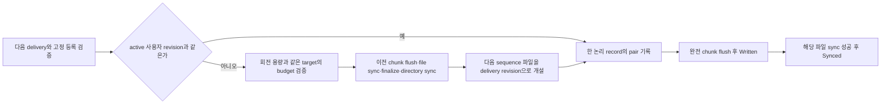

# ADR-013 — native 표준 MCAP·손실 기록·revision별 파일 회전

- **상태:** Proposed — Human 설계 승인 대기. 이 문서는 구현 완료·승인된 기본값 변경의 근거가 아니다.
- **날짜:** 2026-11-16
- **대상 기준:** `ff4fd5d`(제품 소스 `5d7fe6a`), 로컬 WIP `36c1724`는 설계 조사만 참조하고 병합하지 않음.
- **관계:** ADR-008의 RT·소유권·완료 계약, ADR-010의 MCAP 0.26.0, ADR-012의 facade 소유 모델을 유지한다. API §21·§22.8의 다음 저장 결정을 제안한다.

## ADR 필요성 판단

파일에 남는 장기 호환 형식, 메모리·인덱스 비용, 설정 전환과 장애 복구 의미가 함께 바뀐다. native 단일 형식으로의 전환은 H/J 결정이며, 기존 구현·검증 위임으로 승인된 것으로 간주하지 않는다.

## 맥락과 코드 관측

| 현재 사실 | 근거 | 필요한 변화 |
|---|---|---|
| 모든 사용자 메시지를 Envelope로 저장 | [SegmentWriter](../../../crates/dot-logger/src/storage/writer.rs)의 `with_target`·`append`, [codec](../../../crates/dot-logger/src/storage/codec.rs) | 사용자 schema/encoding으로 직접 저장하는 선택지 |
| S1 export는 사용자 payload와 메시지별 RecordMeta를 분리 | [standard.rs](../../../crates/dot-logger/src/storage/standard.rs), [record_meta.proto](../../../crates/dot-logger/src/storage/record_meta.proto), API §21 | 승인된 매핑을 native 쓰기에 재사용 |
| writer/log는 budget revision과 다른 record를 거절 | [SegmentLog::append](../../../crates/dot-logger/src/storage/retention.rs), `Router::writer_budget_for_revision` | 다음 delivery의 revision이 달라지면 별도 파일 |
| 두 revision bank, producer별 적용 경계·이전 guard 소멸 뒤 재사용 | [config_update.rs](../../../crates/dot-logger/src/control/config_update.rs)의 `boundary`·`ready` | 파일 순서의 revision 단조 증가를 가정하지 않음 |
| Snapshot은 모든 source에 같은 revision을 요구 | [Snapshot::new/scan](../../../crates/dot-logger/src/query/mod.rs) | source별 revision 검증과 하나의 논리 snapshot |
| query/recovery의 기존 형식은 알 수 없는 opcode를 거절 | [recovery.rs](../../../crates/dot-logger/src/storage/recovery.rs), query `scan` | 기존 profile에 손실 Metadata를 추가하는 우회는 사용하지 않음 |
| CaptureCounts는 producer별 제출/대여 **시도 수** | [counters.rs](../../../crates/dot-logger/src/telemetry/counters.rs), capture `try_record_small/raw` | 채널별 계수, 재시도·필터·출력별 결과의 단위 구분 |
| facade encode 오류는 core 진입 전에 발생, DispatchEvent에는 channel 없음 | [Writer::try_log_at](../../../crates/dot-logger/src/logger/writer.rs), [routing/types.rs](../../../crates/dot-logger/src/routing/types.rs) | 단순 기존 telemetry/DispatchEvent 합산만으로 구현하지 않음 |
| CLI manifest v1에는 전역 revision 하나, 알 수 없는 필드 거절 | [model.rs](../../../crates/dot-logger-cli/src/model.rs) | v1 유지 + 명시적 v2 source별 revision |

## 결정 요인

- RT 수집/거절/Drop에 할당·해제·IO·lock 대기·무한 재시도를 넣지 않는다.
- 배포 전 개발 단계이므로 과거 개발 파일/API의 호환 보존을 제품 요구로 두지 않는다. 저장·조회·복구를 native 단일 형식으로 통일한다.
- 사용자 payload는 원문이고, 표준 도구용 descriptor가 없으면 임의 변환하지 않는다.
- 설정 게시·producer 적용·파일 기록·Written·Synced를 구분한다.
- 손실의 고유 개수나 정확한 발생 시각을 관측하지 않았으면 만들어내지 않는다.
- 파일·카운터·체크포인트·조회 인덱스에 유한 예산을 둔다.

## 검토한 옵션

| 선택 | 장점 | 비용·판정 |
|---|---|---|
| **배포 전 native 단일 형식으로 전환** | writer/reader/recovery·예약·시험이 한 형식으로 통일, legacy 선택 API 불필요 | 과거 개발 fixture/예제/manifest를 함께 갱신 — 수정 권고안 |
| 구형 판독·명시 legacy 쓰기 병행 | 배포된 소비처/보존 의무 데이터가 있다면 전환 비용 감소 | 현재 미배포라는 Human 지적에 비해 두 codec·API·예산·검증을 유지하는 부담이 큼 — 초안의 보존 전제 철회 |
| 기존 `dot-logger/1`에 보조 채널/Metadata 추가 | Envelope encoder 재사용 | 현재 strict reader와 새 형식의 의미가 충돌. 배포 전이라도 식별되지 않는 혼합 형식은 만들지 않음 — 비채택 |
| 파일 하나에 revision 혼합 | 회전 횟수 감소 | 합의한 파일 단일 revision과 복구/등록 모델까지 바꿈 — 비채택 |
| revision별 동시 writer 2개 | 교차 arrival의 회전 감소 | TargetLease·파일 sync·상주 writer 예산 변경. 단일 active writer를 우선 유지 |
| 모든 producer 전환까지 새 revision IO 정지 | revision 순서 단순 | 쉬는 writer 때문에 배출·큐가 막힘. 기존 부분 적용 계약과 맞지 않음 — 비채택 |

## 권고 결정 — 승인 항목

| ID | 권고안 | 사용자에게 보이는 영향 |
|---|---|---|
| **D1** | facade·core·조회·복구를 **`dot-logger/standard/1` 단일 형식**으로 전환. 구형 판독·legacy 쓰기·형식 선택 API와 호환 wrapper는 제품 범위에서 제외 | 과거 개발 파일/manifest는 명시적으로 미지원. fixture·예제·소비 코드는 새 형식으로 갱신. 필요한 과거 기록이 특정되면 별도 일회성 변환만 판단 |
| **D2** | native 파일에 `_dot_logger/loss` protobuf 누적 체크포인트. 제출 거절은 시도 수, 출력 실패는 assignment 수, Unknown·의도적 skip·원본 대여 실패는 별도 분류. 보고 주기는 기존 `sync_every` 사용 | 채널별 관측값·구간·사유를 파일과 CLI에서 확인. 고유 메시지 손실/정확 시각/확인되지 않은 종료 꼬리를 0으로 표시하지 않음 |
| **D3** | 출력당 active writer 1개, 다음 delivery의 revision이 다를 때마다 회전. source별 revision 조회/복구 및 manifest v2 | r1→r2→r1 순서도 정상. 전역 적용 barrier를 추가하지 않음. 용량·IO 실패는 기존 완료 실패 의미로 보고 |

D1~D3는 함께 검토할 저장 설계다. **2026-11-16 Human의 「아직 배포된것도 아닌데?」 지적을 반영해 D1의 legacy 보존 전제를 철회**했다. 현재 native 단일 형식으로 정리한 수정안이며 ADR 전체는 Proposed다. 과거 계획의 호환 조건을 배포 후 유지 의무로 확대하지 않는다.

## 1. 형식과 사용자 API 제안

- facade와 core는 native 단일 형식을 쓴다. `StorageFormat::{LegacyV1, StandardV1}`·`storage_format(..)`·`new_with_format`은 추가하지 않는다. 기존 `SegmentWriter::new`·`SegmentLog::new`를 새 구현으로 전환한다.
- 필요한 범위에서 저장/조회 API·manifest·등록/예산 구조를 직접 정리하고 저장소 안의 호출자·예제·시험을 함께 수정한다. 과거 Rust signature/struct literal을 보존하기 위한 wrapper는 추가하지 않는다. 기능과 무관한 API 변경을 위한 작업은 하지 않는다.
- facade는 파일 손실 수집을 기본 활성화한다. 고급 경로는 borrow 전 명시적인 `CaptureOwner::enable_loss_tracking` 계열로 필요한 고정 메모리를 예약한다. 미활성 고급 writer는 파일에 `loss_tracking=unavailable`을 명시하며 0건으로 보이지 않는다.
- 사용자 채널 수 C에 대해 `C+2 <= u16::MAX`를 파일 생성 전에 확인한다. user schema와 보조 descriptor·반복 등록 크기도 함께 예약한다.
- 예약 topic은 `_dot_logger/meta`·`_dot_logger/loss`다. 충돌은 `plan/start` 또는 core 파일 생성 전에 거절한다.
- StorageFormat 재수출 계획은 삭제한다. 이 변경 자체로 facade 이름 있는 항목을 늘리지 않는다(현 34/60). 실제 구현의 공개 항목은 snapshot으로 확인하고 새 레시피는 추가하지 않는다.

## 2. native 파일 계약

### 파일 식별과 등록

- Header profile은 `dot-logger/standard/1`. MCAP 버전은 그대로다. library 문자열은 제품 버전/쓰기 경로를 나타낸다.
- 첫 사용자/손실 chunk 전 MCAP Metadata `dot_logger.file`에 형식 버전·session_id·target_id·segment sequence·**사용자 revision**·producer 수·loss 수집 가용 여부를 저장한다. 자체 크기는 metadata 예산에 포함한다.
- 각 사용자 Channel은 payload schema/encoding을 쓴다. channel metadata에 product channel ID·schema ID/version·session·사용자 revision을 보존한다. runtime patch는 채널 등록/schema/출력 등록을 바꾸지 않으므로 등록 표는 세션 동안 고정이다.
- descriptor 이름/FDS가 있으면 API §21의 이름·encoding을 그대로 쓴다. 없으면 schema id 0과 기존 payload encoding을 보존한다. `vendor-blob` 같은 도구 미지원 encoding 한계는 유지한다.

### 사용자 메시지와 보조 메타의 원자 단위

1. 사용자 Message payload는 원문, MCAP sequence는 accepted_seq 하위 32비트, log/publish time은 real이다.
2. 바로 다음 Message는 `_dot_logger/meta`의 기존 `dot_logger.RecordMeta`(태그 1~9 유지)다. 사용자 MCAP channel ID·producer·u64 accepted_seq·mono·real·revision·level·importance·source를 보존한다. session과 schema 등록은 파일/채널에서 복원한다.
3. **두 Message는 같은 chunk에 물리적으로 인접**한다. 기록 전 pair 전체의 크기/레코드/인덱스 예산을 확인하고 필요하면 먼저 flush/rotate한다. payload만 쓴 뒤 metadata 실패 시 해당 chunk를 safe offset으로 노출하거나 Written으로 보고하지 않는다.
4. reader는 timestamp 순서가 아닌 파일 내 pair 순서로 결합한다. 같은 채널·시각·하위 sequence를 가진 두 producer도 구분한다. orphan/중복 meta·불일치 header·file revision 불일치는 손상이다. 임의의 표준 MCAP 파일을 제품 파일로 오인하지 않는다. file Metadata·각 Channel의 session/revision/등록도 서로 일치해야 한다.
5. 한 chunk의 모든 pair·control record·참조·길이·CRC를 먼저 검증한 뒤 query/export/recovery에 반출한다. 손상 chunk의 앞부분 메시지만 정상으로 내보내지 않는다(REV-055 계약 계승).

### 손실 topic과 논리 개수

`_dot_logger/loss`는 `dot_logger.LossReport`(protobuf descriptor 포함) 전용 채널이다. RecordMeta를 추가로 붙이지 않는다. 손실 report는 사용자 CaptureReceipt·accepted sequence·completion window를 소비하지 않는다. `max_records`·회복 records·사용자 summary는 논리 사용자 기록 수이며, 실제 MCAP Statistics는 물리 Message 수(pair 2건 + loss report)를 센다.

## 3. 손실 수집·파일 보존 계약

### 계수 키와 단위

카운터 키는 `(session, counter_epoch, scope, origin_target?, producer?, product_channel?, reason)`이다. product channel은 u32, 없는 채널/producer/target은 presence로 구분해 ID 0을 빈 값으로 쓰지 않는다. schema는 문자열 label 대신 고정 enum을 쓴다.

| 분류 | 단위·계수 지점 | 금지할 해석 |
|---|---|---|
| `submission_rejected` | core 제출 Capacity/CompletionCapacity·계약 오류·수명 오류의 **거절 시도 수**. facade encode 오류는 core 이전의 별도 reason으로 한 번만 계수 | 재시도 3회 후 성공을 고유 입력 3개 손실로 계산하지 않음 |
| `acquire_rejected` | 원본 slot 대여 **시도 수**, 현재 API가 채널을 받지 않으므로 channel 없음 | 뒤의 제출 거절과 합쳐 record 손실로 계산하지 않음 |
| `intentional_skip` | level/sampling에 따른 의도적 제외. 명시적 no-route도 정책 분류 | 포화/IO 실패와 합쳐 우발 손실로 표시하지 않음 |
| `output_dropped/failed` | origin target의 terminal assignment 수. completion 전이의 최초 성공 지점에서만 계수, report Busy 재시도/중복 호출은 추가하지 않음 | fanout 합계를 고유 사용자 기록 수로 해석하지 않음 |
| `output_unknown` | completion 결과를 확인하지 못한 assignment 수, 별도 불확실성 | 확정 손실 또는 성공 0으로 변환하지 않음 |

미등록/다른 session의 토큰은 채널에 귀속하지 않는다. facade가 core로 제출한 뒤에는 facade에서 같은 실패를 다시 세지 않는다. 종료 후 호출이 무한히 증가시킬 수 있는 Closing 거절은 저장 종료 watermark 밖이며, 마지막 파일이 그런 미래 호출까지 셌다고 주장하지 않는다.

### report 필드와 조회 의미

- report: schema version·session·counter epoch·observer target·checkpoint_id(u64)·part/parts·observed_from_ns/observed_to_ns·coverage 상태·반복 count 행.
- count 행: 위 키·cumulative_count(u64)·overflowed. 누적은 세션 동안 reset하지 않으며 기존 선택 telemetry의 reset/epoch와 독립이다.
- **손실은 세션 누적이며 revision별 정확 분할을 약속하지 않는다.** 파일 revision은 사용자 payload에 적용한다. control report의 관측 구간은 설정 전환을 걸칠 수 있고, 이를 해당 파일 revision에서 발생한 손실로 단정하지 않는다. 기존 Sample/Window의 revision 혼합 금지 계약은 그대로다.
- 시간은 management 관측 구간이다. RT에서 추가 clock을 읽지 않는다. 여러 counter의 동시 전역 스냅샷·개별 거절의 정확 발생 시각을 주장하지 않는다. 이전 표본 읽기 시작부터 현재 표본 읽기 종료까지를 delta의 보수적 관측 구간으로 사용한다.
- 각 파일은 수집 가용 상태와 baseline을 남기고, 주기/회전/종료에 누적 checkpoint를 쓴다. 구간 수는 같은 키의 두 유효 표본 차이고, 처음 baseline 이전/끝 checkpoint 이후는 미확인이다.
- 여러 파일/출력이 같은 전역 ingress counter를 복제해도 누적값을 합산하지 않는다. 키별 누적 watermark로 대조하고 origin target이 있는 assignment counter만 별도로 취급한다. overflow·epoch 불일치·같은 observer의 누적값 감소·불완전 part에서는 exact delta를 만들지 않는다.
- loss 조회는 사용자 `QueryRecord`/Replay 데이터와 분리된 bounded API/CLI 행이다. 사용자 메시지에 가짜 level/payload/receipt를 만들지 않는다. 채널/시각 필터는 product channel과 **관측 구간 겹침**에 적용하며, 사용자 record 시간 필터와 같다고 표시하지 않는다.

### RT·예산·포화·장애

- loss 수집은 선택 telemetry가 꺼져 있어도 facade에서 동작한다. producer별 등록 채널+미귀속 bucket, 고정 reason, 등록 target에만 메모리를 사전 예약한다. counter 채널 index는 기존 등록 검증 결과를 재사용하며 RT에 새 동적 map·queue·문자열·시계·lock/retry를 추가하지 않는다.
- 제출 counter는 각 producer가 단독으로 갱신하고, output counter는 terminal 상태 전이 소유 경로에서 갱신한다. relaxed 관측의 비동시성을 문서화하고 quiescent 최종값을 대조한다. atomic saturation은 wrap 대신 u64::MAX와 overflow 표시다.
- output counter에는 여러 report 경로가 동시에 접근할 수 있음을 전제로 한다. producer counter의 단일 writer load/store를 그대로 재사용하지 않고, 일반 출력 경로의 원자적 포화 갱신 또는 사전 예약한 소유자별 shard 합계로 중복·유실을 막는다. RT 수집 경로에는 이 경합/retry를 넣지 않는다.
- control 메모리: 카운터 행 수 `N`을 등록 수와 enum 수로 checked 산출하고 `N × size_of(cell)`·정렬·scratch·대기 report를 모두 예약한다. 두 revision bank/무제한 revision 이력에 loss counter를 곱하지 않는다.
- native output 예약에는 사용자 pair의 추가 Message/인덱스, descriptor 2개, control report의 **수·바이트 상한**, 각 파일 baseline/final report 여유를 포함한다. 제안 상한은 `K=ceil(N / report당 행 상한)`, 파일 control 수 `L=max(max_records, 2K)`로 두어 baseline/final 두 그룹을 담고, 물리 Message 수를 `2×max_records+L` 이하로 예약한다. 계산 overflow·최소 report/단일 pair가 segment에 들어가지 않으면 시작 전 거절한다. 실제 상수/레이아웃은 구현의 예약 함수로 확정하고 1바이트 경계 시험으로 확인한다.
- 주기는 이미 필수 입력인 `sync_every`를 재사용한다. IO 경로가 사용자 batch를 처리한 뒤 해당 sync 전 report를 반영한다. 별도 RT 손실 report queue를 만들지 않으며 management는 한 turn의 스캔/직렬화 작업량을 제한한다. 파일 회전/정상 종료에도 강제 checkpoint를 시도한다.
- 대기 공간이 모자라면 같은 키의 누적 최신값으로 coalesce하며 관측 구간이 넓어졌음을 표시한다. 성공적으로 기록하기 전 watermark를 버리거나 report 실패를 다시 loss report로 재귀 기록하지 않는다. control 한도로 회전할 수 없으면 지연/미완료 상태를 드러내고 사용자 기록·retention의 기존 유한 예산을 넘지 않는다.
- 한 파일 출력이 고장나면 살아 있는 파일 출력에 origin target이 명시된 관측값을 남길 수 있다. 모든 파일 출력 고장·강제 종료 뒤의 RAM 값은 복원할 수 없다. header/마지막 checkpoint/종료 coverage로 **미확인 꼬리**를 나타내며, 파일이 없거나 report가 없다는 사실을 0손실 증거로 쓰지 않는다.
- 기존 shutdown이 writer outstanding을 허용할 수 있으므로 `Closed`만으로 loss 최종 표본을 Quiescent로 표시하지 않는다. producer quiescence·배출·checkpoint 기록/필요 sync를 실제 확인한 범위만 종료 watermark로 남기고, 기한 초과·IO 오류는 partial/unknown 상태다.

## 4. revision 회전·완료·장애 계약

- **파일 sequence만 증가**한다. r1(A producer) → r2(B) → r1(A의 미전환/대기 기록) → r2(A 전환 뒤)도 각각 별도 파일이다. 게시만으로 빈 새 revision 파일을 열거나 old 기록을 잘못된 revision으로 재표기하지 않는다.
- IO batch를 연속 revision 구간으로 나누고 경계마다 회전한다. producer FIFO·기존 전역 tie 순서는 유지하고 revision별로 임의 재정렬하지 않는다.
- IO thread가 Router를 공유 borrow하는 경로를 새로 만들지 않는다. 고급 호출은 `writer_budget_for_revision`에서 얻은 같은 target/session/ledger의 budget으로 명시 전환한다. facade는 **위조 불가능하고 plan guard를 보유한 Delivery**에서만 내부 revision budget을 파생한다. 임의 u64를 public budget에 덮어쓰는 setter는 만들지 않는다. target/ledger/등록 불일치는 IO 전 거절한다.
- catalog는 각 active/closed 파일의 사용자 revision을 유한 메타데이터로 보존해 source별 identity를 만든다. 기존 catalog/API를 필요한 범위에서 직접 수정하며 과거 struct literal 보존만을 위한 별도 identity table은 만들지 않는다. 이 비용도 max_segments 예약에 포함한다.
- active를 바꿔도 per-producer last accepted sequence·file sequence·catalog·event windows·pins·FileLedger를 초기화하지 않는다. event 보존은 revision 경계를 걸친 파일도 같은 창으로 보호한다. 보호된 파일은 전환을 위해 임의 삭제하지 않는다.
- 회전 전 용량 실패는 기존 active를 보존한다. 이전 파일 발행 후 새 파일 create/header/첫 pair가 실패하면 이전 파일은 유지하고 해당 출력의 새 작업은 기존 fault/poison 규칙으로 실패 보고한다. 새 파일 sync가 이전 미동기화 범위를 확인한 것처럼 처리하지 않는다.
- revision을 걸친 batch의 appended/written/reported 진척은 **논리 사용자 record** 단위로 보존한다. 새 파일 실패 때 이미 기록·발행한 prefix를 재작성하거나 전체 batch를 실패로 덮지 않는다.
- `set_channel/ApplyConfig` 응답은 기존 posted/applied 의미이고 모든 파일의 새 revision 기록·Synced를 뜻하지 않는다. 쉬는 사용자 writer의 Busy/refresh·미반출/tracing writer ack는 API §22의 승인 계약을 유지한다.
- live ConfigUpdates는 두 bank만 유지한다. 디스크의 과거 revision 수는 live bank 수와 별개이며, offline 조회에 과거 bank를 다시 생성하지 않는다. revision마다 왕복할 때 추가 파일·sync 비용이 생기며 기존 파일 수/디스크 상한을 넘기지 않는다. 용량 압력은 기존 record failure로 드러낸다.

## 5. 단일 형식 조회·재생·복구와 개발 자료

| 입력/경로 | 계약 |
|---|---|
| 제품 파일 | `dot-logger/standard/1`의 식별/등록·pair/LossReport를 검증한 뒤 논리 CapturedRecord로 해석 |
| 과거 Envelope `dot-logger/1` 및 S1 빈 profile 개발 출력 | 제품 reader/recovery에서는 명시 Unsupported. 자동 fallback·구형 decoder를 유지하지 않음 |
| multi-revision Snapshot | 하나의 session·고정 등록, source별 expected revision·sequence·safe_offset 검증. 기존 단일 revision 생성 API를 직접 정리하며 호환 wrapper를 만들지 않음 |
| blob/Replay | native payload byte 범위만 참조. 원 receipt·revision·mono/source·inline/blob 소유권·pin/deadline 계약 유지. Envelope 전용 locator/분기 제거 |
| CLI manifest | source별 revision을 가진 schema_version 2로 통일. v1 adapter·format 선택 필드 없음. 중복 path/sequence·다른 session·불일치 revision·이전 version은 명시 거절 |
| recovery | native 파일별 expected session/revision을 검증하고 별도 출력으로 복구. 서로 다른 사용자 revision을 한 파일에 합치지 않음. 다중 파일 작업의 개별 prefix/실패 및 총 파일/바이트 한도 유지 |
| 개발 fixture/예제/consumer | 새 writer로 재생성/수정해 사용자 payload·receipt·손실 의미를 검증. 구형 bytes 판독 성공을 DoD로 두지 않고, 구형 profile의 명시 거절을 확인 |
| 기존 S1 export | 완료 이력/EV-077은 보존하되, legacy 변환 API/CLI를 제품 필수 지원으로 유지하지 않음. 보존할 개발 기록이 특정될 때 기존 변환 코드를 일회성 도구로 활용할지 판단. 이번에 새 변환 도구·데이터 삭제/대량 변환은 수행하지 않음 |

- reader·복구는 완전한 chunk의 pair와 report를 전부 검증한 뒤 채택한다. 중간 pair/잘린 report/CRC 불명 chunk는 suffix로 제외한다. 제품 복구의 CRC 0 정지 정책을 유지한다. 과거 S1 export의 CRC 0 구조 검증 허용은 과거 변환 동작이지 새 복구 계약이 아니다.
- 무압축 제품 파일 지원을 유지한다. 임의 외부 schema import·압축 query/recovery·여러 세션 병합·새 native OS 검증은 이번 범위에 추가하지 않는다.
- 회복/재기록 시 사용자 identity·loss 누적 origin 키를 보존한다. 새 쓰기와 과거 프로세스 Written/Synced ack를 혼동하지 않는다. 중복 receipt를 서로 다른 revision의 새 record로 받아들이지 않는다.
- deterministic 정렬은 기존 mono/real/source·producer·accepted sequence·segment sequence·파일 offset tie 정책을 유지한다. 시간 역전이 있는 real time을 revision 정렬로 대체하지 않는다.
- 파일 profile과 manifest version은 과거 개발 자료를 새 형식으로 오인하지 않게 구분한다. 정식 외부 배포 이후의 version/호환 정책은 그때 확정하며, 현재 개발 파일에 영구 호환 의무를 소급하지 않는다.

## 6. 구현 순서와 검증 계획 — 승인 후

| 단계 | 소유 Task | 첫 실패/수락 검증 |
|---|---|---|
| A: native 단일 pair 쓰기/읽기·구형 경로 정리 | TASK-030 S2 | fixture/예제 갱신·구형 profile 거절, native 사용자 payload 원문/전 필드 독립 reader 대조, 동일 시각/하위 seq producer 2개, pair의 두 번째 쓰기 실패·잘림·CRC 손상에서 부분 반출 0 |
| B: revision 전환·source별 조회/복구·manifest v2 | TASK-030 S2 | r1→r2→r1→r2 배출, batch 경계, 보호/pin 있는 회전 용량 실패, 이전 publish 뒤 새 create 실패, barrier의 파일/sequence 대조, v2 판독·v1/불일치 입력 거절 |
| C: 채널별 수집·손실 checkpoint·조회 | TASK-035 S2 | 용량 거절의 재시도/나중 성공·encode·raw 대여·skip·Unknown·다중 출력 중복 계수 방지, telemetry off에서도 보존, counter 포화·part 누락·coalesce·전 출력 고장·미확인 꼬리 |
| D: facade/core 단일 형식·설정 변경 WIP 통합 | TASK-030 S2 + TASK-034 | facade/core native 동일 동작·형식 선택 항목 없음, topic 충돌, `.set_channel`·Writer refresh·원격 ApplyConfig, update 이전/이후 기록·쉬는 writer ack. WIP를 새 저장 계약에 맞춰 적용하며 단순 cherry-pick 성공을 수락으로 대신하지 않음 |
| E: 마감 | TASK-030·034·035 → TASK-033 | 두 Rust 전체/feature 회귀·fmt/clippy/rustdoc·RT 할당 0·표면/레시피·실제 파일 fault/query/replay, 손실 counter 추가 전후 수집 호출 비용 대조. native 파일 Foxglove의 사용자/메타/loss 판독은 실제 확인 후 기록. 그 뒤 커버리지·UC 대응 재측정 |

새 예약 함수는 native 형식의 총량, event/ring 최소 크기, pair/control 최대 count·bytes, metadata 수, reader의 index/scratch/source 예산을 checked 계산한다. `required-1` 거절·정확 required 수락을 시험한다. native 표준 모드의 처리량·메모리·counter 비용은 **미측정**이며 기존 성능 수치를 승계하지 않는다. native OS·장기·실앱은 TASK-024·026의 기존 이월이다.

## 결과와 비용

- 표준 payload와 완전한 제품 identity, 손실 관측과 설정 전환을 같은 파일 집합에서 해석할 수 있다.
- 배포 전 파일 형식·API·fixture·예약 최소량을 함께 전환한다. 두 codec·형식 선택 API·legacy wrapper 검증 비용은 만들지 않는다. 과거 개발 파일의 자동 판독/이관은 제공하지 않는다.
- 사용자 기록당 metadata Message 하나와 주기 loss 보고, 교차 revision의 추가 파일 sync 비용이 있다. 단일 active writer로 메모리는 제한하지만 회전 빈도가 증가할 수 있다.
- 마지막 checkpoint 밖의 손실·정확한 개별 발생 시각·revision별 손실 분할·고유한 외부 입력 손실 개수는 관측되지 않은 것으로 남는다.

## 관련 문서와 외부 근거

| 항목 | 참조 |
|---|---|
| Intent / Milestone | INT-001 / MS-008·MS-009 |
| Requirement / Story | FR-003·005·007·009·011·014·017, NFR-001·004·006·007·008 / US-001·002·003·004·005 |
| Task | [TASK-030](../../04_implementation/tasks/TASK-030.md)·[TASK-034](../../04_implementation/tasks/TASK-034.md)·[TASK-035](../../04_implementation/tasks/TASK-035.md) |
| 현재 계약 | [API §21·22](../interface_contract.md), [data model](../data_model.md), ADR-008·010·012 |
| 기존 검증 | [EV-077](../../05_verification/verification_evidence.md#ev-077)·[EV-081](../../05_verification/verification_evidence.md#ev-081)·[EV-082](../../05_verification/verification_evidence.md#ev-082) — 이 초안의 실행 결과가 아님 |

외부 사실은 2026-11-16에 1차 자료로 확인했다. 아래는 컨테이너 명세의 근거이고, D1~D3·손실 단위·pair 원자성·revision 회전은 이 프로젝트의 제안이다.

- [MCAP 명세](https://mcap.dev/spec): Header profile, 동일 Channel ID의 일치, Message/Chunk·인덱스·Metadata 정의. 사용자 profile과 보조 topic은 형식상 가능하지만 도구 표시 성공은 따로 검증한다.
- [MCAP registry](https://mcap.dev/spec/registry#protobuf-1): protobuf schema 이름은 package를 포함한 전체 타입 이름, data는 FileDescriptorSet이다. 알 수 없는 사용자 encoding을 protobuf인 것처럼 바꾸지 않는다.

## 초안 검토 결과 — 2026-11-16

제품 코드·protobuf·snapshot은 변경하지 않았다. 현재 코드의 revision/shape/strict-reader/카운터 단위를 대조하고 문서 연결·상태·D1~D3의 미승인 표시를 점검했다. 설계안과 실제 구현을 구분했고, Human 지적 뒤 legacy 보존·선택 타입·wrapper·이중 형식 시험 계획을 제거했다. 구현/회귀/표준 GUI 판독은 위 승인 후 계획이며, 이 초안 작성으로 Pass를 선언하지 않는다.
