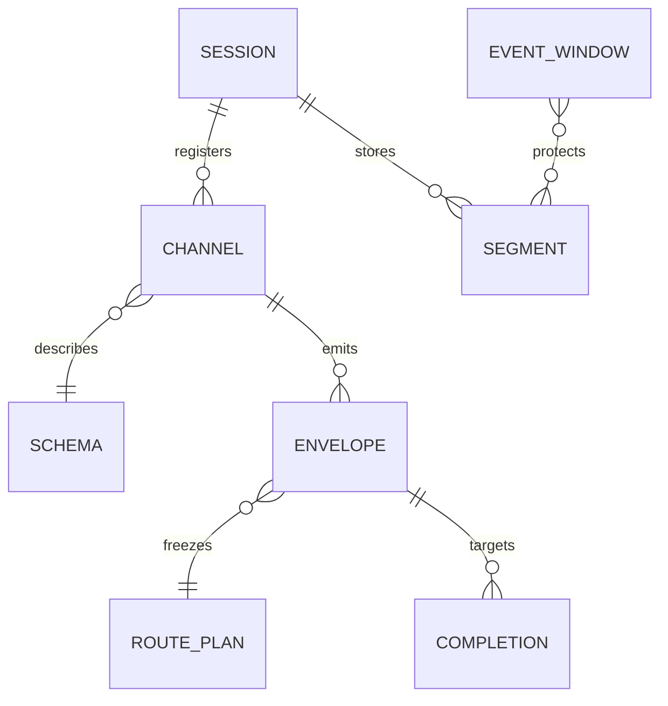

# 데이터 구조·저장 설계

- INT-001 / 2026-10-26 / Approved — ADR-008·009 기준선 채택. 구현·호환성 검증 전.
- 채택: MCAP 0.26.0(ADR-010), InfluxDB v2 어댑터. TASK-002 로컬 의존성/기초 왕복 확인(EV-001), 제품 파일·DB·native 호환은 TASK-007·019·022에서 검증.
- 식별·순서·완료의 기준은 [인터페이스](interface_contract.md), 자원 예산은 [도메인 §5](domain_model.md#5-자원-예산과-설정)다.

## 1. 논리 스키마

| 객체 | 키/주요 필드 | 제약 |
|---|---|---|
| Session | session_id: 128-bit, format_major, config_revision, boot/clock domain, build/config hash | 초기화 때 생성, 재시작 시 새 ID, 비밀값은 hash/보고에서 제거 |
| Channel | session_id + channel_id: u32, name, schema_id, schema_version, encoding, route_plan_id | 시작 전 등록, 이름·schema 길이/개수 상한 |
| Schema | schema_id: 128-bit, version: u32, encoding, descriptor | 같은 ID/version의 내용을 변경하지 않음, 비호환 변경은 새 ID |
| Envelope | producer_id: u32, accepted_seq: u64, channel_id, revision: u64, mono_ns: u64, real_ns: i64, source_time? + clock_domain, importance, level, payload_length | 정수 overflow 거절, 메타데이터 길이 상한, payload 크기 검증 |
| Loan | pool_id, slot_id, generation, length, reservation_class | RT에서 비소유 토큰, 독점 mutable → 수락 뒤 불변 |
| RoutePlan | route_plan_id, target ID 집합, required/optional, 완료 경계 | 시작 전 대상 수 상한. 과거 수락 레코드에 불변 |
| Completion | receipt + target, highest_boundary, terminal_outcome, reason | 실패/폐기/불명/만료 분리, 유한 sliding window |
| Segment | session_id + target_id + segment_seq, file_name, state, clock ranges, bytes, record_count, last_safe_offset | 파일명은 시스템 생성 ID, 사용자 입력을 경로로 직접 사용하지 않음 |
| EventWindow | event_id, time_basis, start/end, pinned segment IDs, expires_at | 서로 겹치면 합집합/참조 수 관리, 보호 bytes 상한 |
| CapacityProfile | profile_id, OS/CPU/SSD/FS/config/workload/build fingerprint, stage, boundary, result, measured_at | 선언 부하·실행 증거가 없으면 검증된 용량으로 취급하지 않음 |

MCAP의 file-local channel/schema ID와 제품 ID를 구분한다. MCAP 필드 폭에 맞춰 매핑하고 소진 전에 회전한다. 제품의 u64 accepted_seq를 MCAP의 u32 sequence에 축소해 유일 키로 사용하지 않는다. 전체 receipt는 메시지 봉투에 보존한다.

## 2. 파일 표현과 시간

파일은 `session/target/segment_seq.mcap`이며 active 파일은 `.active` 상태로 관리한다. 각 세그먼트에 schema·channel·세션/clock metadata를 반복해 다른 파일 없이 읽을 수 있게 한다. 원본·소형 데이터 모두 Message로 저장하고 시간 탐색이 필요한 원본을 단순 Attachment로 숨기지 않는다.

제품 메시지 봉투는 버전 있는 Protobuf로 하고 payload는 등록한 encoding의 bytes다. 인코딩은 writer에서 수행한다. 소형 입력은 사전 직렬화된 bytes 또는 고정 필드 타입, 원본은 loan을 받는다. 파일 인코딩 과정의 복사도 예산/성능에 포함하며 protobuf bytes에 넣는다고 zero-copy라고 주장하지 않는다. 원본 8 MiB 시험에 대해 최대 단일 레코드/인코더 임시 메모리를 제한한다.

MCAP log_time은 real_ns의 유효 Unix 시간, publish_time은 동일 UTC 기준으로 변환 가능한 source_time 또는 real_ns다. mono_ns·원래 source_time·domain·변환 오차는 봉투에 별도 저장한다. 벽시계 점프를 단조시간으로 잘못 변환하지 않는다. 음수/범위 밖 real time은 입력 오류 또는 명시된 변환 정책으로 처리하고 unsigned wrap을 금지한다. 기본 재생은 세션 mono 기준이다. MCAP 기본 log_time 인덱스만으로 mono 탐색이 된다고 가정하지 않고 보조 인덱스를 둔다.

## 3. 인덱스·동시 읽기·회전

세그먼트별 보조 인덱스는 `(channel, mono_min/max, real_min/max, chunk_offset, record_count)`를 포함한다. 재생의 mono와 벽시계 구간 조회를 각각 지원한다. 정렬되지 않은 생산자 시각·벽시계 점프에서도 chunk의 min/max를 사용하며 단조 wall time을 가정하지 않는다. 삭제/손상된 보조 인덱스는 파일을 스캔해 재생성할 수 있고 유일한 원본이 아니다.

active writer는 **완전한 chunk와 필수 schema/channel을 OS 쓰기 경계까지 내보낸 offset**만 공개한다. 조회는 고정된 segment 목록과 각 safe offset의 스냅샷을 사용한다. 공개된 범위가 영속 동기화 완료라는 뜻은 아니다. MCAP reader가 미종료 파일을 직접 지원한다고 가정하지 않으며, 제한 길이의 active reader를 별도로 구현/검증한다. closed 파일은 표준 summary index를 사용한다.

파일 회전은 bytes·시간·메시지 수·인덱스 메모리 중 먼저 온 상한으로 수행한다. 내부 MCAP summary/index 축적까지 자원 추적에 포함한다. 한 메시지가 chunk 목표 크기를 초과할 수 있으므로 target chunk size를 hard memory cap으로 오인하지 않는다. writer 예산은 최소 `max_record + chunk_buffer + index + encoder_scratch`를 수용해야 한다.

회전 순서는 chunk 마감 → footer/summary 작성 → 파일 sync → 이름 확정 → 필요한 directory metadata sync → catalog 공개다. OS별 보장 차이는 capability로 나타내고 지원되지 않는 directory 내구성을 자동 성공 처리하지 않는다. 조회가 파일을 pin하면 유지 기한/읽기 bytes를 제한하고 삭제는 마지막 핀 이후 수행한다. 디스크 한계까지 삭제가 불가하면 쓰기를 멈추고 실패를 보고한다.

### TASK-007 로컬 구현 — 2026-10-29

`storage` 모듈의 버전1 Protobuf 봉투는 session/schema128·sequence64·producer/channel/revision·mono/real/source/domain·level/importance·payload 길이를 보존한다. `envelope.proto`와 protoc 생성 FileDescriptorSet(`envelope.bin`)을 고정했고 payload는 별도 복제 Vec 없이 encoder scratch에 한 번 복사한다. 음수 real time·잘못된 길이/major/식별자·초과 payload는 거절한다. source time은 원본 도메인으로 보존하고 UTC 변환 계약이 없어 publish_time은 real time을 사용한다.

파일-local channel ID는 등록 순서의 u16이며 MCAP sequence는0이다. 제품의 전체 receipt는 봉투에서 읽는다. 각 파일에 envelope descriptor·채널·session/revision·사용자 schema ID/version/encoding 및 선택 descriptor를 반복한다. 알 수 없는 사용자 encoding은 opaque payload다. 사용자 descriptor의 재생성/변환은 수행하지 않는다.

`SegmentWriter`는 direct-seek·무압축·명시 chunk 마감을 사용한다. chunk/data/summary CRC 및 표준 message/chunk index를 활성화했다. `(channel,mono/real min/max,chunk_offset,count)` 보조 인덱스는 성공한 flush 후에만 공개한다. 마지막 safe offset은 OS write 경계이며 디스크 영속 확인이 아니다. Drop은 upstream의 자동 footer 쓰기를 억제하고 명시 finish만 summary/footer를 쓴다.

writer/finished index가 보유하는 공유 예산 lease는 Router의 구체 output 예약을 뺀 잔여분에서 차감한다. 여러 대상/세그먼트의 예약 합계를 제한하고 대상별 활성 writer는 하나다. max_record+encoder·message/chunk index와 Vec 성장·summary clone·명시 쓰기 버퍼를 MCAP0.26의 수량 기반 보수적 예약에 포함한다. 비어 있지 않은 channel/chunk 쌍은 각각 레코드 하나 이상이 필요하므로 상한은 `min(max_records, max_chunks × channels)`이며 보조 인덱스 선할당과 upstream 채널별 chunk 인덱스 예약에 함께 적용한다. `write_batch`는 호출자 보유 guard를 누적해 chunk 목표를 사용하고 완전 flush 뒤 Written을 보고한다. `write_buffer_bytes`(0=direct)는 seek/flush 전에 배출하고 Drop은 IO 없이 폐기한다. requested-byte peak·128채널 sparse/dense index와 File write 호출 비교는 [EV-011](../05_verification/verification_evidence.md#ev-011)에서 대조한다. 어댑터 자체 추가 버퍼·allocator 내부·OS cache는 이 값 밖이다.

명시 `sync_work`는 받은 guard의 session/target과 파일의 producer별 receipt 범위를 대조하고 실제 sink sync 뒤에만 결과를 확인한다. 다른 세그먼트 범위는 bounded completion 이력에서 이미 완료/미라우팅/terminal임을 확인할 수 있을 때만 허용한다. 이력이 만료됐거나 미확인 범위면 IO 전에 원래 SyncWork를 반환해 거절한다. 일시 metadata Busy도 guard를 보존하고, 반환된 guard를 재시도하지 않고 버릴 때에만 Unknown이 된다. 실제 IO 실패는 Failed이며, 새 파일 sync로 이전 미확인 기록을 Synced 처리하지 않는다. 완성 파일도 `FinishedSegment::sync_work`로 footer 포함 sync한다. 자동 회전·directory sync·복구·active reader 및 OS 교환은 후속 Task다.

## 4. 보존과 복구

| 모드 | 동작 | 한계 시 동작 |
|---|---|---|
| 연속 | 회전하며 지정 용량/기간 안에 보관 | 상한 도달 시 대상 실패/입력 경로 상태 보고. 암묵적 순환 삭제 없음 |
| 순환 | 가장 오래된 비보호 closed 세그먼트 삭제 | active/조회 핀/이벤트 보호만 남으면 보존 예산 부족 보고 |
| 이벤트 | 순환 pre-window + 이벤트 뒤 post-window를 보호 | 확보된 과거 창과 요청 창 차이를 표시, 보호 bytes 소진 시 이벤트 보호 실패 |

pre-window는 실제 디스크 순환 파일을 보존한다. 큰 원본 전체를 RAM에 무한 유지하지 않는다. 이벤트가 겹치면 세그먼트 보호 참조를 합치며 quota를 이중 차감하지 않는다. 보호 만료/해제는 명시 정책이다. 모드·디스크 한도·기간·pre/post 창은 필수 구성값으로 두고 알 수 없는 장비에 임의의 제품 기본 용량을 넣지 않는다.

복구는 active/미종료 세그먼트를 읽기 전용으로 조사한다. 길이·opcode·schema 참조·CRC와 bounds를 확인하고 마지막 **완전하고 검증된 chunk**까지만 새 복구 파일로 만든다. 원본은 보존한다. 불완전한 chunk·손상 꼬리는 제외 범위와 원인을 보고한다. 중간 CRC 손상 뒤의 임의 바이트를 무조건 유효 메시지로 재동기화하지 않는다. summary/보조 인덱스는 재생성한다. `Written`만 확인된 데이터와 `Synced`를 구분하고, 재기동 때 과거 프로세스가 성공 응답했는지 추측하지 않는다. 실제 차단 시험의 외부 receipt oracle과 파일 내용을 대조한다.

### TASK-009 로컬 구현 경계 — 2026-10-30

`storage/recovery.rs`는 불변 원본의 마지막 완전 검증 chunk prefix만 독립 출력에 복구하고 표준 summary/보조 인덱스를 재생성한다. chunk CRC/길이/선행 schema·channel·봉투·sequence 검증을 마친 뒤 메시지를 복사하며 손상 뒤 재동기화하지 않는다. 입력 bytes/record/chunk 제한·추가 공유 메모리 예약·오류/취소의 prefix 및 OS 원인 보고를 제공한다. 새 파일 sync 뒤 finalize/directory sync를 할 수 있으나 과거 프로세스의 완료 응답·Synced 상태는 복원하지 않는다. 데이터가 손상된 suffix와 단순 교체한 summary/index를 같은 손실 메시지 수로 해석하지 않는다. 자동 디렉터리 발견·기존 namespace 재개·worker/지표는 후속이다. 상세는 [인터페이스 §13.5](interface_contract.md#135-task-009-중단-복구-api--2026-10-30), 검증은 EV-014다.

### TASK-008 구현 경계 — 2026-10-30

`storage/{retention,catalog}.rs`가 세 보존 모드·회전·closed catalog·event window·읽기 pin을 구현한다. catalog/event/pin/채널 복제·producer 범위·사전 검증 scratch는 유한 공유 output 예약에 포함한다. active file은 disk/protected quota에서 설정한 최대 파일 bytes를 선예약하고 closed 후 실제 길이로 전환한다. 겹친 event는 세그먼트별 한 번만 차감한다. 실제 event extents는 mono min/max 기반이며 gap-free 기록 존재를 보장하지 않는다. 상세 API·오류·capability는 [인터페이스 §13.4](interface_contract.md#134-task-008-회전보존-api--2026-10-30)다.

회전 순서와 multi-segment sync를 일반 경로에서 구동하고, file/directory sync 또는 rename 실패는 catalog 미공개·Poisoned다. 삭제가 성공한 뒤 directory sync만 실패하면 현재 namespace에서 없어진 파일을 catalog에서도 제외하고 미확인 durable 삭제를 성공으로 승격하지 않는다. 호스트가 관리하는 전용 파일 namespace 밖은 삭제하지 않는다. 재기동 조사/복구는 TASK-009, active snapshot/reader는 TASK-010, 실제 장비·OS 교환은 TASK-022 이후다.

## 5. DB projection과 장애 의미

첫 DB 어댑터는 기존 dot-probe와 맞춘 InfluxDB v2 HTTP write API다. S1 로컬 구현/한계는 [API §14.6](interface_contract.md#146-task-019-s1-influxdb-v2-유한-write--2026-11-01)·[EV-037](../05_verification/verification_evidence.md#ev-037)을 따른다. S2 실제 OSS2.9.1 write/query·원 receipt/ns 보존과 한계는 [API§14.7](interface_contract.md#147-task-019-s2-제한-수치-query실제-db-검증--2026-11-01)·[EV-038](../05_verification/verification_evidence.md#ev-038)로 추가했다. S3 원 Delivery·원 schema/real ns·DatabaseAcknowledged/Unknown과 로컬 파일 영향 관측은 [API§14.8](interface_contract.md#148-task-019-s3-원-deliverydb-완료파일-격리--2026-11-01)·[EV-039](../05_verification/verification_evidence.md#ev-039)를 따른다. 초기 정책은 fresh/exclusive namespace와 채널별 high-water 기반 equal/older 시각 거절이며 out-of-order 및 기존 DB 충돌 조사는 미지원이다. 수치/작은 이벤트만 mapping하고 이미지·점군 원본은 파일/선택 원격 경로에 둔다. measurement·bounded tags(장치/채널)·typed fields·real timestamp·receipt field를 사용한다. recipe ID나 sequence를 무제한 tag로 넣지 않는다.

Influx의 동일 series/timestamp 병합을 고려해, 한 series에서 timestamp 유일성이 증명되지 않으면 시작 시 `collision_policy`가 필요하다. 권고 기본은 충돌 감지·projection 실패 보고이며 원본 파일은 그대로 보존한다. 명시된 집계/최신값 모드만 병합 손실을 허용한다. timestamp를 몰래 변경해 전량 보존으로 표시하지 않는다. 실제 다중 생산자·같은 시각 충돌 테스트가 필수다.

HTTP 성공은 DB API 확인 경계이며 SSD 영속 완료나 조회 결과 검증과 같지 않다. 제한된 retry는 동일 직렬화 배치로 수행하고 timeout 뒤 결과는 Unknown을 허용한다. `at-least-once`/중복·부분 실패를 명시한다. file-backed 무제한 spool은 제공하지 않는다. 조회는 자체 파일을 기본 소스로 하며 DB 수치 조회는 어댑터의 명시된 기능으로 분리한다. InfluxDB 3의 v2 write 호환을 v2 query/Flux 호환으로 확대하지 않는다.

## 6. 호환성·보안·변경

- 파일 container 버전, envelope 버전, 사용자 schema 버전, wire API 버전을 분리한다.
- 알 수 없는 선택 필드는 건너뛰고 unknown payload는 opaque bytes로 반환한다. 모든 임의 encoding에 자동 schema migration을 약속하지 않는다.
- 외부 배포 이후 기준 golden file과 OS 간 교환으로 읽기 호환성을 검증한다. 현재 배포 전 개발 파일에는 영구 호환 의무를 두지 않으며 ADR-013 수정안은 native 단일 형식 전환이다. 미지원 profile/major는 명시 오류다.
- 입력 길이/압축 해제 크기/레코드 수/파일 offset 산술을 검증한다. 경로 traversal·과도한 압축 확장·무한 스캔을 막는 읽기 예산을 둔다.
- DB token·TLS key는 설정 참조로만 연결하고 파일 metadata·CLI JSON·리포트에 저장하지 않는다.

근거: [MCAP 명세](https://mcap.dev/spec), [Rust writer 설정](https://docs.rs/mcap/latest/mcap/write/struct.WriteOptions.html), [InfluxDB 3 호환 API 범위](https://docs.influxdata.com/influxdb3/core/write-data/http-api/compatibility-apis/). 기술 조사의 사실·해석은 별도 [조사 기록](../06_evolution/imported_context/research_2026-10-26_detailed_design.md)에 둔다.

### DB 충돌 검출의 제한된 상태

첫 충돌 거절 구현은 adapter가 단독 소유하는 namespace와 사전 등록한 유한 series 집합을 전제로 한다. series별 마지막 제출 timestamp를 유지하고 새 point가 그보다 작거나 같으면 out-of-order/collision으로 거절한다. 네트워크 재시도는 동일 batch 재전송으로 구분한다. 임의 과거 point나 외부 writer와의 충돌을 유한 캐시로 모두 검출한다고 주장하지 않는다. 외부 writer가 같은 namespace를 사용하면 해당 보존 보장은 unsupported다. 모든 원본은 선택된 파일 경로에서 그대로 유지한다. 이 제약은 DB projection 계약이며 파일의 시간 역행 허용을 바꾸지 않는다.

### TASK-010 조회/읽기 수명 구현 — 2026-10-30

query snapshot은 고정 session/revision·segment별 complete safe offset을 검증해 메타데이터/원본 payload 위치의 유한 index를 구성한다. 현재 closed도 제한된 data-section scan을 사용하며, 표준 summary로 scan을 생략하는 최적화는 미구현이다. 이는 위 설계의 손상/누락 index 재구성 경로를 우선 구현한 범위이고 성능 달성/완료 판정은 아니다. mono/real/명시 domain source ticks·채널/최소 level 필터 및 결정적 tie 순서, metadata+inline bytes/count 페이지, snapshot-local blob range/누적 IO 한도를 적용한다.

reader-owned permit은 active→closed 회전을 따라 삭제를 막고, 실제 reader close 뒤에만 회수 가능 상태를 게시한다. 낮은 ReadPin의 명시 release/분실 시 보호 유지 계약은 그대로다. query의 external 예약은 snapshot 합계를 제한하며 catalog 예약은 남은 permit 수명까지 유지한다. 상세 [API §14.1](interface_contract.md#141-task-010-로컬-api--2026-10-30), 최신 검증 EV-016을 따른다. replay/live remote/CLI·실제 OS/장비 IO 간섭은 별도다.

### TASK-011 재생 데이터 수명 — 2026-10-30

Replay는 frozen Snapshot의 원 receipt/mono 정렬 index와 사전 예약 page/blob 버퍼를 공유하며 최대1건의 미전달 descriptor만 유지한다. inline은 frame borrow 동안만 유효하고 blob은 원본 범위·현재 seek generation으로 검사한다. seek는 미전달 prefetch를 폐기하지만 이미 전달된 데이터를 취소한 것으로 보고하지 않는다. End의 마지막 blob read를 위해 snapshot을 보유하며 stop/Drop/terminal 오류에서 실제 reader close 뒤에만 읽기 permit/예약을 반환한다. 시계는 mono ns·양수 유리수 배속이고 OS timer/worker는 후속이다. 상세 [API §14.2](interface_contract.md#142-task-011-로컬-재생-api--2026-10-30), 검증 EV-018.

## TASK-014 계측 데이터 — 2026-10-31

- CaptureCounts: accepted/rejected/skipped/accepted_bytes/acquire_rejected·overflowed와 제출/대여 각각의 rejected_capacity/rejected_contract/rejected_lifecycle 범주. 총계는 범주 checked 합계이며 overflow 표시를 보존한다. producer 수 고정, 임의 record/string label 없음. 원본 대여 실패는 제출 결과와 별도이며 재시도마다 즉시 판정을 집계한다. 리포트 용량 압력은 capacity만 사용하고 부하율은 accepted+rejected_capacity 시도율이다. 고유 입력/손실 records로 해석하지 않는다.
- Sample: session_id/revision/epoch/at_ns와 ingress·전체/필수 CompletionTotals. 301개 고정 ring으로 300초 구간+기준 표본을 보존한다.
- Window: 실제 from_ns/to_ns·session/revision/epoch와 누적 counter 차. 10/60/300초 선택만 제공하며 시간 누락/reset/포화에서 값을 꾸미지 않는다.
- Observation: Observed·Stale·Unavailable(reason). 미계측은 owner telemetry()의 None, 미제공 completion/다른 session·revision/누락 이력은 명시 사유다. 동시 atomics는 전체 시점 일관성을 약속하지 않으며 배출 후 정확 대조한다.
- 대상별 CompletionTotals의 assignment는 선택 target, records/expired_records는 session 전체다. 원본 물리 bytes·durable bytes로 accepted_bytes를 해석하지 않는다. reset은 receipt·completion을 변경하지 않는다.

### TASK-016 revision 전환과 비교 — 2026-11-01

Completion RecordSlot은 accepted record의 revision과 target 선택을 보존한다. posted revision과 producer별 applied revision은 분리하며, 두 bank 외의 무제한 plan 이력을 만들지 않는다. Sample은 안정 revision 또는 RevisionTransition 미가용 상태를 보존하고 서로 다른 session/revision/epoch의 구간을 합치지 않는다. Snapshot은 원래 Report/profile provenance·application_input_id·Window와 선택 Resources(동일 Window/measurement_scope_id)를 보존한다. Comparison의 signed-magnitude RateChange는 after-before의 정확한 u128 유리수이며 intentional skip·거절·출력 실패/폐기/Unknown은 구분한다. MCAP 봉투/파일의 단일 revision은 유지하고 새 revision은 명시 budget/별도 writer로 기록한다.

## TASK-030 S2·TASK-035 저장 모델 제안 — 2026-11-16

**Proposed — [ADR-013](adrs/ADR-013_native_standard_loss_revision_storage.md) D1~D3 Human 승인 대기.** 배포 전 native 단일 형식의 사용자 payload/RecordMeta pair와 손실 누적 checkpoint, 파일별 사용자 revision과 다중 revision source 조회/복구를 제안했다. 손실 counter는 session 누적이며 정확 revision별 손실 분할·고유 입력 손실·개별 발생 시각을 추정해 넣지 않는다. 구형 파일 판독/legacy 쓰기·호환 wrapper를 유지하는 요구는 초안에서 제거했다. 기존 Envelope/단일 revision 설명은 현재 구현 사실/이력으로 유지하고, 승인 전 새 형식·기본값·메모리 예약이 구현된 것으로 해석하지 않는다.
