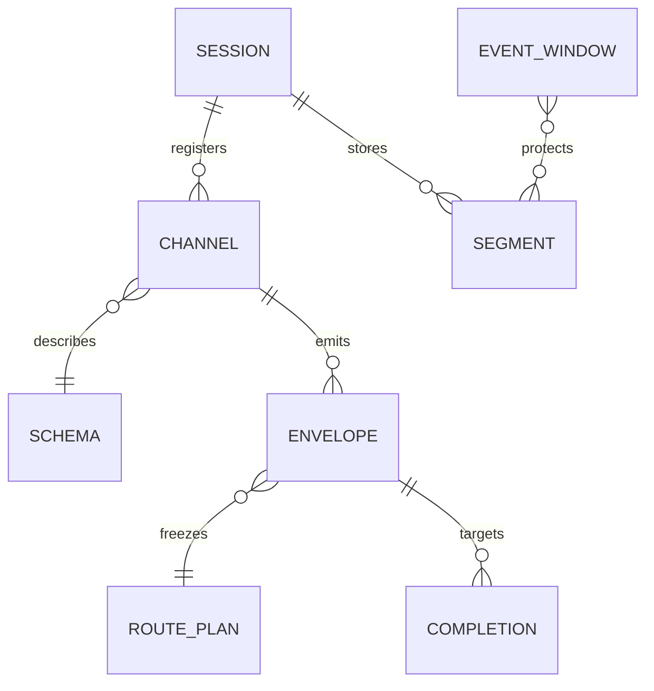

# 데이터 구조·저장 설계

- INT-001 / 2026-10-26 / Approved — ADR-008·009 기준선 채택. 구현·호환성 검증 전.
- 채택: MCAP 파일, InfluxDB v2 어댑터. 실제 버전/patch·호환 확인은 TASK-002·019.
- 식별·순서·완료의 기준은 [인터페이스](interface_contract.md), 자원 예산은 [도메인 §5](domain_model.md#5-자원-예산과-설정)다.

## 1. 논리 스키마

| 객체 | 키/주요 필드 | 제약 |
|---|---|---|
| Session | session_id: 128-bit, format_major, config_revision, boot/clock domain, build/config hash | 초기화 때 생성, 재시작 시 새 ID, 비밀값은 hash/보고에서 제거 |
| Channel | session_id + channel_id: u32, name, schema_id, schema_version, encoding, route_plan_id | 시작 전 등록, 이름·schema 길이/개수 상한 |
| Schema | schema_id: 128-bit, version: u32, encoding, descriptor | 같은 ID/version의 내용을 변경하지 않음, 비호환 변경은 새 ID |
| Envelope | producer_id: u32, accepted_seq: u64, channel_id, revision: u64, mono_ns: u64, real_ns: i64, source_time? + clock_domain, importance, level, payload_length | 정수 overflow 거절, 메타데이터 길이 상한, payload 크기 검증 |
| Loan | pool_id, slot_id, generation, length, reservation_class | RT에서 비소유 토큰, 독점 mutable → 수락 뒤 불변 |
| RoutePlan | route_plan_id, target ID 집합, required/optional, 완료 경계 | 시작 전 대상 수 상한. 과거 수락 레코드에 불변 |
| Completion | receipt + target, highest_boundary, terminal_outcome, reason | 실패/폐기/불명/만료 분리, 유한 sliding window |
| Segment | session_id + target_id + segment_seq, file_name, state, clock ranges, bytes, record_count, last_safe_offset | 파일명은 시스템 생성 ID, 사용자 입력을 경로로 직접 사용하지 않음 |
| EventWindow | event_id, time_basis, start/end, pinned segment IDs, expires_at | 서로 겹치면 합집합/참조 수 관리, 보호 bytes 상한 |
| CapacityProfile | profile_id, OS/CPU/SSD/FS/config/workload/build fingerprint, stage, boundary, result, measured_at | 선언 부하·실행 증거가 없으면 검증된 용량으로 취급하지 않음 |

MCAP의 file-local channel/schema ID와 제품 ID를 구분한다. MCAP 필드 폭에 맞춰 매핑하고 소진 전에 회전한다. 제품의 u64 accepted_seq를 MCAP의 u32 sequence에 축소해 유일 키로 사용하지 않는다. 전체 receipt는 메시지 봉투에 보존한다.

## 2. 파일 표현과 시간

파일은 `session/target/segment_seq.mcap`이며 active 파일은 `.active` 상태로 관리한다. 각 세그먼트에 schema·channel·세션/clock metadata를 반복해 다른 파일 없이 읽을 수 있게 한다. 원본·소형 데이터 모두 Message로 저장하고 시간 탐색이 필요한 원본을 단순 Attachment로 숨기지 않는다.

제품 메시지 봉투는 버전 있는 Protobuf로 하고 payload는 등록한 encoding의 bytes다. 인코딩은 writer에서 수행한다. 소형 입력은 사전 직렬화된 bytes 또는 고정 필드 타입, 원본은 loan을 받는다. 파일 인코딩 과정의 복사도 예산/성능에 포함하며 protobuf bytes에 넣는다고 zero-copy라고 주장하지 않는다. 원본 8 MiB 시험에 대해 최대 단일 레코드/인코더 임시 메모리를 제한한다.

MCAP log_time은 real_ns의 유효 Unix 시간, publish_time은 동일 UTC 기준으로 변환 가능한 source_time 또는 real_ns다. mono_ns·원래 source_time·domain·변환 오차는 봉투에 별도 저장한다. 벽시계 점프를 단조시간으로 잘못 변환하지 않는다. 음수/범위 밖 real time은 입력 오류 또는 명시된 변환 정책으로 처리하고 unsigned wrap을 금지한다. 기본 재생은 세션 mono 기준이다. MCAP 기본 log_time 인덱스만으로 mono 탐색이 된다고 가정하지 않고 보조 인덱스를 둔다.

## 3. 인덱스·동시 읽기·회전

세그먼트별 보조 인덱스는 `(channel, mono_min/max, real_min/max, chunk_offset, record_count)`를 포함한다. 재생의 mono와 벽시계 구간 조회를 각각 지원한다. 정렬되지 않은 생산자 시각·벽시계 점프에서도 chunk의 min/max를 사용하며 단조 wall time을 가정하지 않는다. 삭제/손상된 보조 인덱스는 파일을 스캔해 재생성할 수 있고 유일한 원본이 아니다.

active writer는 **완전한 chunk와 필수 schema/channel을 OS 쓰기 경계까지 내보낸 offset**만 공개한다. 조회는 고정된 segment 목록과 각 safe offset의 스냅샷을 사용한다. 공개된 범위가 영속 동기화 완료라는 뜻은 아니다. MCAP reader가 미종료 파일을 직접 지원한다고 가정하지 않으며, 제한 길이의 active reader를 별도로 구현/검증한다. closed 파일은 표준 summary index를 사용한다.

파일 회전은 bytes·시간·메시지 수·인덱스 메모리 중 먼저 온 상한으로 수행한다. 내부 MCAP summary/index 축적까지 자원 추적에 포함한다. 한 메시지가 chunk 목표 크기를 초과할 수 있으므로 target chunk size를 hard memory cap으로 오인하지 않는다. writer 예산은 최소 `max_record + chunk_buffer + index + encoder_scratch`를 수용해야 한다.

회전 순서는 chunk 마감 → footer/summary 작성 → 파일 sync → 이름 확정 → 필요한 directory metadata sync → catalog 공개다. OS별 보장 차이는 capability로 나타내고 지원되지 않는 directory 내구성을 자동 성공 처리하지 않는다. 조회가 파일을 pin하면 유지 기한/읽기 bytes를 제한하고 삭제는 마지막 핀 이후 수행한다. 디스크 한계까지 삭제가 불가하면 쓰기를 멈추고 실패를 보고한다.

## 4. 보존과 복구

| 모드 | 동작 | 한계 시 동작 |
|---|---|---|
| 연속 | 회전하며 지정 용량/기간 안에 보관 | 상한 도달 시 대상 실패/입력 경로 상태 보고. 암묵적 순환 삭제 없음 |
| 순환 | 가장 오래된 비보호 closed 세그먼트 삭제 | active/조회 핀/이벤트 보호만 남으면 보존 예산 부족 보고 |
| 이벤트 | 순환 pre-window + 이벤트 뒤 post-window를 보호 | 확보된 과거 창과 요청 창 차이를 표시, 보호 bytes 소진 시 이벤트 보호 실패 |

pre-window는 실제 디스크 순환 파일을 보존한다. 큰 원본 전체를 RAM에 무한 유지하지 않는다. 이벤트가 겹치면 세그먼트 보호 참조를 합치며 quota를 이중 차감하지 않는다. 보호 만료/해제는 명시 정책이다. 모드·디스크 한도·기간·pre/post 창은 필수 구성값으로 두고 알 수 없는 장비에 임의의 제품 기본 용량을 넣지 않는다.

복구는 active/미종료 세그먼트를 읽기 전용으로 조사한다. 길이·opcode·schema 참조·CRC와 bounds를 확인하고 마지막 **완전하고 검증된 chunk**까지만 새 복구 파일로 만든다. 원본은 보존한다. 불완전한 chunk·손상 꼬리는 제외 범위와 원인을 보고한다. 중간 CRC 손상 뒤의 임의 바이트를 무조건 유효 메시지로 재동기화하지 않는다. summary/보조 인덱스는 재생성한다. `Written`만 확인된 데이터와 `Synced`를 구분하고, 재기동 때 과거 프로세스가 성공 응답했는지 추측하지 않는다. 실제 차단 시험의 외부 receipt oracle과 파일 내용을 대조한다.

## 5. DB projection과 장애 의미

첫 DB 어댑터는 기존 dot-probe와 맞춘 InfluxDB v2 HTTP write API다. 수치/작은 이벤트만 mapping하고 이미지·점군 원본은 파일/선택 원격 경로에 둔다. measurement·bounded tags(장치/채널)·typed fields·real timestamp·receipt field를 사용한다. recipe ID나 sequence를 무제한 tag로 넣지 않는다.

Influx의 동일 series/timestamp 병합을 고려해, 한 series에서 timestamp 유일성이 증명되지 않으면 시작 시 `collision_policy`가 필요하다. 권고 기본은 충돌 감지·projection 실패 보고이며 원본 파일은 그대로 보존한다. 명시된 집계/최신값 모드만 병합 손실을 허용한다. timestamp를 몰래 변경해 전량 보존으로 표시하지 않는다. 실제 다중 생산자·같은 시각 충돌 테스트가 필수다.

HTTP 성공은 DB API 확인 경계이며 SSD 영속 완료나 조회 결과 검증과 같지 않다. 제한된 retry는 동일 직렬화 배치로 수행하고 timeout 뒤 결과는 Unknown을 허용한다. `at-least-once`/중복·부분 실패를 명시한다. file-backed 무제한 spool은 제공하지 않는다. 조회는 자체 파일을 기본 소스로 하며 DB 수치 조회는 어댑터의 명시된 기능으로 분리한다. InfluxDB 3의 v2 write 호환을 v2 query/Flux 호환으로 확대하지 않는다.

## 6. 호환성·보안·변경

- 파일 container 버전, envelope 버전, 사용자 schema 버전, wire API 버전을 분리한다.
- 알 수 없는 선택 필드는 건너뛰고 unknown payload는 opaque bytes로 반환한다. 모든 임의 encoding에 자동 schema migration을 약속하지 않는다.
- 이전 버전 golden file과 OS 간 교환으로 읽기 호환성을 검증한다. 읽을 수 없는 major는 명시 오류다.
- 입력 길이/압축 해제 크기/레코드 수/파일 offset 산술을 검증한다. 경로 traversal·과도한 압축 확장·무한 스캔을 막는 읽기 예산을 둔다.
- DB token·TLS key는 설정 참조로만 연결하고 파일 metadata·CLI JSON·리포트에 저장하지 않는다.

근거: [MCAP 명세](https://mcap.dev/spec), [Rust writer 설정](https://docs.rs/mcap/latest/mcap/write/struct.WriteOptions.html), [InfluxDB 3 호환 API 범위](https://docs.influxdata.com/influxdb3/core/write-data/http-api/compatibility-apis/). 기술 조사의 사실·해석은 별도 [조사 기록](../06_evolution/imported_context/research_2026-10-26_detailed_design.md)에 둔다.

### DB 충돌 검출의 제한된 상태

첫 충돌 거절 구현은 adapter가 단독 소유하는 namespace와 사전 등록한 유한 series 집합을 전제로 한다. series별 마지막 제출 timestamp를 유지하고 새 point가 그보다 작거나 같으면 out-of-order/collision으로 거절한다. 네트워크 재시도는 동일 batch 재전송으로 구분한다. 임의 과거 point나 외부 writer와의 충돌을 유한 캐시로 모두 검출한다고 주장하지 않는다. 외부 writer가 같은 namespace를 사용하면 해당 보존 보장은 unsupported다. 모든 원본은 선택된 파일 경로에서 그대로 유지한다. 이 제약은 DB projection 계약이며 파일의 시간 역행 허용을 바꾸지 않는다.
