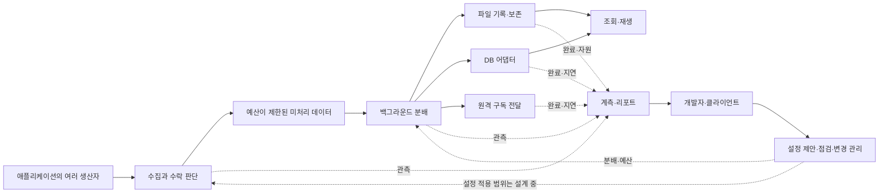

# 도메인·모듈 설계

- 관련 Intent: INT-001
- 상태: Draft — Design 진입 후 첫 책임/경계 초안. 모듈 분리·실행 구조는 검토 대상이며 채택된 crate/프로세스 구성이 아니다.
- 기준: ADR-003·004·005·006, 요구사항 §12~16
- 갱신: 2026-10-25 / AI

## 1. 설계 목적

다중 생산자의 로그·수치·원본을 수집해 선택한 파일/DB/원격 소비자에게 전달하고, 개발자가 운영 중 부하·검증 범위·병목을 확인해 기록량을 조절한 효과를 확인할 수 있게 한다. 수집 성능·실제 활용 완료·보존 예산·관측 비용을 함께 다룬다.

## 2. 책임 경계 초안

화살표는 책임/데이터 관계이며 네트워크 프로토콜이나 스레드 수를 뜻하지 않는다. RT 경로는 수집·제한된 수락 판단까지로 한정하는 안이다. 분배·저장·DB·네트워크·조회·리포트 계산·설정 관리는 RT 호출 밖에서 수행한다.

**실행 격리 및 코어 배치 모델**:
- **수집 경로 (`try_record`)**: 별도의 스레드를 띄우지 않고, 제어 루프가 실행 중인 RT 격리 코어(`isolcpus`) 위에서 인라인(Inline) 무대기 실행되어 컨텍스트 스위칭 오버헤드를 0으로 유지한다.
- **백그라운드 I/O 워커 (분배/파일/DB/네트워크/회수)**: 제어 루프의 지연 스파이크(Jitter, 캐시 오염, I/O 인터럽트)를 방지하기 위해, 설정에 따라 지정된 **비-RT 하우스키핑 코어(CPU Affinity/Pinning)**에 고정되어 동작한다.

| 모듈 책임 후보 | 담당할 일 | 경계 |
|----------------|-----------|------|
| 수집 | 생산자/채널 핸들, 소형 데이터/원본 소유권 제시, 수락/거절, 최소 계측 | RT에서 I/O·공간 대기·동적 설정 생성 금지 계약 유지 |
| 버퍼·분배 | bytes/슬롯/중요도별 예산, 공정성, 출력별 전달/완료 추적 | 느린 대상의 영향과 미처리량 제한. 하나의 전역 무제한 큐 가정 금지 |
| 파일 운영 | 인코딩·체크섬·인덱스·쓰기·동기화·회전·보존·복구, 전원 예고 시 중요 파일 우선 기록 옵션(FR-018, 기본 비활성) | 형식/압축은 후보 비교 중. 수락/쓰기/영속 완료 구분. 활성 구성의 전체 약 3초 예고 긴급 계약은 인터페이스 §12 검토안 |
| 외부 전달 | DB·원격 구독의 배치·재시도·실패·소비 확인 | 별도 제한 예산. 외부 지연을 RT 공간 대기로 전파하지 않음 |
| 조회·재생 | 시간/채널 조회, 제한된 페이지/스트림, 재생 제어 | 읽기 가능한 범위·결측·동시 쓰기/조회 자원 영향 명시 |
| 계측·리포트 | 단계별 카운터/분포·자원·부하 프로필·기준 유효성·예측·전후 비교 | 제한된 비용/이력. 관측·검증·추정과 의도적 생략/손실 구분 |
| 관리·점검 | 설정 초안/변경, 버전/이력, 시작/정지, 점검/추천 | 적용 가능한 변경 범위·종료/점검 시간·공간 예산을 명시 |

이는 논리 모듈이며 실제 패키지 수·worker 수·한 프로세스/별도 서비스·비동기 런타임은 선정하지 않았다. 데이터 처리 큐와 관리 요청의 전달 구조도 별도 비교한다.

## 3. 주요 개념과 관계

공통 정의는 [용어집](../02_project_definition/domain_glossary.md)을 따른다. 아래 이름은 설명용이며 공개 Rust 타입/스키마의 확정 이름이 아니다.

| 개념 | 책임/관계 | 필요한 식별·상태 |
|------|-----------|------------------|
| 로깅 세션 | 설정·생산자·채널·출력·자원 예산·종료 상태를 묶음 | 세션 ID·설정 revision·실행 상태 |
| 생산자 등록 | 하나의 기록 주체와 호출 계약을 연결 | 생산자 ID·소형/원본 계약·순서 식별 |
| 논리 채널 | 데이터 목적/스키마·필터·출력 매핑을 표현 | 채널/장치 ID·스키마 식별자/버전·설정 revision |
| 타임스탬프 삼원화 | 센서 퓨전 및 재생을 위한 다중 시간축 보존 | MonoTime(단조 증가)·RealTime(벽시계)·SourceTime(하드웨어 취득, 선택) |
| 스키마 식별·진화 | 데이터 구조의 진화 및 과거 로그 판독 호환성 관리 | Schema ID·Schema Version·역호환 디코딩 규칙 |
| 기록 봉투 | 시각/순서·채널·레벨·별도 보존 중요도와 payload를 연결 | 세션/생산자/채널 식별·sequence·삼원 시각·내용 또는 소유권 핸들 |
| 양방향 버퍼 풀 | RT 무할당 수집과 RT 밖 무대기 회수를 보장하는 메모리 라이프사이클 | 대여 핸들·역방향 회수 대기열(Recycle Queue)·참조 수·재사용 가능 상태 |
| 버퍼 소유권 | 수락 전/후의 원본 수명과 bytes/슬롯 사용을 관리 | 현재 소유 주체·크기·회수 경로·미처리 참조 |
| 출력 경로 | 파일/DB/원격 대상과 완료·실패를 연결 | 대상 ID·필수/선택 완료 범위·경로별 상태 |
| 완료 상태 | 한 기록/범위가 대상별 어디까지 끝났는지 표현 | 수락·쓰기·동기화·수신 활용·실패·폐기·미처리 |
| 관측 구간 | 실행 부하·계측 결과를 설정/장비와 연결 | 시간 구간·설정/장비/부하 프로필·집계 단위 |
| 기준 능력 프로필 | 같은 조건에서 검증한 지속 처리 범위 | 도구/버전·조건·완료 경계·측정 시각·유효성 |
| 보고서/조절 비교 | 현재 병목·여유·잔여/보존 시간과 변경 효과를 설명 | 관측/검증/추정 구분·조건/오차·전후 revision |

수락된 기록은 여러 출력으로 분기할 수 있고 각 출력의 완료가 다를 수 있다. 따라서 파일 한 곳의 동기화나 TCP 송신 완료를 전체 기록의 모든 활용 완료로 승격하지 않는다. 메타데이터/원본 공유는 참조와 작업 버퍼의 실제 자원 소비를 예산에 반영해야 한다.

## 4. 반드시 유지할 불변식

1. RT 호출은 공간 확보·파일/DB/네트워크 완료·관리 요청 완료를 기다리지 않는다. 예열/등록과 payload 생성/최종 해제의 경계를 엄격히 분리하며, RT 스레드 내 객체 Drop 시 메모리 할당자(Allocator) 잠금이나 시스템 콜 해제가 절대 유발되지 않도록 역방향 무대기 회수 큐를 유지한다.
2. 중요 기록 우선·별도 보존 중요도 기본값을 유지한다. 중요 기록도 포화될 수 있으므로 예약/거절/관측 세부 계약을 설계에서 정한다.
3. 수락 성공은 출력 성공이나 영속 저장 성공이 아니다. 종료·실패·부분 완료를 대상별로 설명할 수 있어야 한다.
4. 관리 버퍼의 bytes와 슬롯을 모두 제한한다. 소유권 핸들이 원본의 수명을 연장하면 해당 원본을 예산에 포함하고 무제한 재시도/조회/전송 대기를 두지 않는다.
5. 미처리량이 가득 찬 뒤 폐기되어 정체한 상태를 정상 처리 여유로 표시하지 않는다. 설정의 의도적 생략·수락 거절·정책 폐기·I/O 실패는 구분한다.
6. 계측/리포트·점검/추천은 수집 성능과 자원 예산에 포함해 검증한다. R1 목표 수치를 실제 PC 능력의 자동 분모로 사용하지 않는다.
7. 변경 비교에는 설정 revision·관측 구간·부하 조건을 연결한다. 운영 중 변경의 정확한 적용 시점/범위는 명시된 계약만 허용한다.
8. 같은 하드웨어 자원을 공유하는 출력 간 영향이 완전히 없다고 보장하지 않는다. 실행/자원 격리 수준은 시험 가능한 조건으로 정의한다.
9. 디스크 공간 부족(ENOSPC)이나 파일 시스템 I/O 실패가 발생하더라도 RT 생산자 스레드에 패닉/크래시/블로킹을 전파하지 않는다. 로거 백그라운드는 I/O 장애 상태로 안전하게 전이(Fail-Safe)되고 계측 카운터를 갱신하되, 상위 로봇 제어 루프의 실행 무결성을 항상 최우선으로 보호한다.

## 5. 설계에서 비교할 선택

| 선택 | 우선 검토 방향 | 아직 확정하지 않은 것 |
|------|----------------|----------------------|
| 큐/분배 | 생산자별 제한 큐와 병합·출력별 예산 안 비교 | rtrb/SPSC 채택·MPSC 대안·병합 공정성·worker 수/깨우기 |
| 원본 | 제한된 풀의 대여 핸들, 수락 시 이관·거절/생략 시 반환, 안전한 회수 경로 검토 | 인터페이스 §3 상세 계약안은 Human 검토 전. 실제 반납 구조·최종 해제·타입/수명 증명 미정 |
| 포화·완료 | 중요 기록 예약 보호·신규 입력 거절, 생산자별 식별·대상별 부분 완료 검토 | 인터페이스 §4·9~11의 미승인 권고안. 예약 수치·추적 상한·알고리즘 미정 |
| 파일 | MCAP 등 기존 컨테이너의 색인·복구·처리 비용 검증 후보 | 실제 형식·압축·동기화 기본값·인덱스 구조 |
| 관리 변경 | revision이 있는 설정 초안·검증·명시적 적용 | 실행 중 변경 가능 항목·적용 일관성·이전 설정 회수 |
| 외부 활용 | 어댑터로 경계 정의 | DB 제품·전송 프로토콜·서비스/클라이언트/CLI 범위 |
| 운영 계측 | 단계/채널별 제한된 관측과 독립적인 백그라운드 집계 | 샤딩/동기화·분포 수집·계측 비용·오차 한도 |

선택은 승인된 방향의 검토이며 구체 라이브러리/형식/설계 패턴 채택은 주요 결정 검토 후 ADR에 남긴다.

## 6. 다음 확정 순서와 근거

수집 API의 원본 수명/반납·중요도 예약/포화·생산자별 완료/실패와 설정 revision 경계를 [인터페이스 계약 초안 §3~4·9~11](interface_contract.md#11-리뷰-시나리오승인-범위잔여-사항)에 구체화했다. 현재 Human 검토 전이며 기존 불변식 이상의 새 상세 동작을 확정한 것은 아니다. 계약안 검토 후 버퍼/worker 대안·실제 dot-probe 환경과 연결하고 요구사항 §15.4의 승인된 보완 계획을 따른다.

- [요구사항](../02_project_definition/requirement_spec.md)
- [승인된 Story/AC](../02_project_definition/user_story_registry.md)
- [ADR 목록](adr_registry.md), [ADR-005](adrs/ADR-005_design_baseline_and_deferred_decisions.md)

## 7. 크로스 플랫폼 경계 (Tier 1 vs Tier 2)

ADR-006/NFR-007에 따라 Linux·macOS·Windows의 라이브러리와 클라이언트 공통 경로를 설계하되, 플랫폼 역할을 **Tier 1 (Target / Full SLA)**과 **Tier 2 (Compatibility / Best-Effort)**로 분리한다.

- **Tier 1: Linux (PREEMPT_RT / 일반 Linux)**: 실제 로봇 탑재(IPC) 환경. 전체 기능 및 엄격한 실시간 SLA(p99 ≤5 µs, 1.0 GB/s, UPS 3초 긴급 동기화)를 100% 보장하며, 백그라운드 워커의 CPU 코어 격리(`sched_setaffinity`)와 실시간 스케줄링 설정을 완벽히 지원한다.
- **Tier 2: Windows, macOS**: 로컬 개발자 PC, 시뮬레이터, 로그 분석/재생, 모니터링 클라이언트 환경. API 동작 및 데이터 교환(로그 파일 포맷 호환)은 100% 보장하되, 정량적 성능 측정 및 실시간 SLA 보장 대상에서는 제외(Best-effort)하여 불필요한 OS 스케줄러 튜닝 오버엔지니어링을 배제한다.

| 플랫폼 서비스 책임 후보 | 공통 계약에서 필요한 의미 | OS별 비교/검증 사항 (Tier별 차등) |
|------------------------|---------------------------|----------------------------------|
| 시각 | 지연용 단조 시각·기록 시각/외부 시각 관계, 타임스탬프 삼원화 | Tier 1: Linux RT 고정밀 시계 / Tier 2: 일반 OS 타이머 해상도(1~15ms) 인정, NTP 슬루 대응 |
| 스레드/실행/격리 | 일반 처리와 RT/최적화 옵션의 지원 여부 | Tier 1: CPU 코어 격리(Affinity/Pinning) 및 RT 우선순위 보장 / Tier 2: 기본 스케줄러 위임 |
| 파일/공간/영속성 | 생성·쓰기·동기화·회전/재열기·가용 공간·복구 경계 | 경로/파일명, 열린 파일 락/동시 읽기 허용(Windows FileShare 정책), I/O Sync 프리미티브(Linux fdatasync, macOS F_FULLFSYNC, Windows FlushFileBuffers) 비용과 내구성 차이, ENOSPC 격리 |
| 시스템 관측 | CPU/메모리/IO/연결 상태와 측정 범위 | 플랫폼/권한별 지표 유무·집계 의미·비용 |
| 점검/배포 | 실제 실행 가능한 부하/기능 프로필 | Tier 1: 네이티브 고부하 벤치마크(P0~P6) / Tier 2: 기능 테스트 및 Linux 생성 파일 판독 검증 |

실제 추상 타입·trait·사용할 이식성 crate는 미선정이다. 공통 API에 OS 전용 핸들·계측 지표를 필수로 노출하지 않는 방향으로 검토한다. 기능 지원 정보와 미측정/미지원 이유를 보고하고 지표가 없다고0으로 채우지 않는다. R1 목표와 각 OS의 실제 능력을 분리해 검증한다.

대표 부하는 UHD급2D LiDAR1개·카메라 센서4개·모터10개 이상·기타/3D 센서 가능성으로 일반화됐다. 이전 RealSense 예시는 과거 참고 계산이며 실제 카메라 구성의 bytes/s로 단정하지 않는다.
