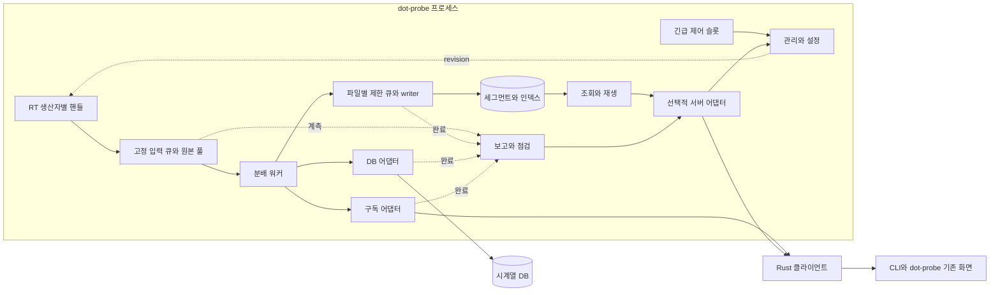

# 도메인·모듈 상세설계

- 관련 Intent: INT-001 / 갱신: 2026-10-26
- 실행 구조: **Accepted — ADR-007**, 내장형 Ports and Adapters + 제한된 생산자/소비자 파이프라인.
- 상세 계약·기술·시험 기준: **Approved**, ADR-008·009 및 MS 계획을 2026-10-26 Human이 채택했다. 구현/실물 검증은 미완료다.
- 기존 기준: ADR-003~006. 첫 클라이언트는 Rust API + CLI, dot-probe 기존 화면 연동(Human 선택).

## 1. 규모에 맞춘 아키텍처

Ports and Adapters로 외부 시스템과 응용 로직의 의존 방향을 분리한다. 프로세스 내부는 단순한 생산자/소비자 파이프라인으로 구성한다. RT 수집·일반 관리·백그라운드 출력을 구분하되 논리 모듈마다 별도 서비스나 crate를 만들지 않는다. 첫 릴리즈는 내장 라이브러리와 클라이언트/CLI다.

포트는 역할별 좁은 계약이다. 예: `StorageWriter`, `RecordReader`, `DatabaseSink`, `SubscriberSink`, `PlatformServices`. 파일/DB/시각 대역으로 핵심 정책을 테스트할 수 있어야 한다. RT 호출은 구체 타입의 짧은 연산만 수행하며 사용자 정의 trait 콜백·직렬화·동적 dispatch를 호출하지 않는다.

## 2. 패키지와 의존 방향

| 패키지 후보 | 모듈/책임 | 금지하는 결합 |
|---|---|---|
| `dot-logger` | `capture`, `pool`, `routing`, `completion`, `storage`, `query`, `replay`, `control`, `telemetry`, `platform` | RT 모듈에서 파일·DB·네트워크·async executor 호출 |
| `dot-logger-client` | 공개 조회/구독/관리 DTO, Rust 클라이언트, 오프라인 파일 읽기 facade | dot-probe 도메인 타입 필수 의존 |
| `dot-logger-cli` | 설정 검증, 상태·조회·재생·점검·비교 명령 | CLI 안에 보존/완료 정책 중복 구현 |

Cargo workspace의 3개 패키지를 권고한다. 최초에는 `dot-logger`부터 만들고 MS별로 필요한 패키지를 추가한다. 파일 수집 기본 기능과 선택 기능 `remote`, `influxdb`, `tracing-adapter`, `compression-zstd`를 분리한다. 네트워크 없이도 수집·파일·오프라인 조회가 동작한다. 공통 DTO는 라이브러리의 공개 모듈을 클라이언트가 참조하되 wire DTO를 공개 핵심 타입으로 노출하지 않는다. 별도 protocol crate는 실제 순환 의존이 생길 때 검토한다.

## 3. 실행 구조와 병목 경계

| 실행 주체 | 책임 | 정지·과부하의 영향 |
|---|---|---|
| RT 생산자 | 등록 핸들로 수락 판정·고정 크기 복사/원본 핸들 전달·고정 계측 | 공간 없음 즉시 거절. 깨우기 syscall/전역 lock/CAS 무한 반복 없음 |
| 분배 워커 1개부터 | 생산자별 큐 순회, 대상별 enqueue, 완료·원본 참조 관리 | 모든 enqueue는 비차단. 파일 write를 여기서 실행하지 않음 |
| 파일 writer | 한 논리 파일의 유일한 writer, chunk·쓰기·동기화·회전 | writer 큐 상한. 느린 파일 때문에 dispatcher 정지 금지 |
| 외부 I/O executor | 선택 기능의 DB·gRPC, 제한된 연결·작업·bytes | I/O 대기 동안 RT/파일 worker 소유 금지 |
| 관리·관측 워커 | 설정 준비·보고·보존·복구·점검 조정 | 관리 요청도 유한 큐. 긴급 알림은 별도 슬롯 |
| 조회 워커 | 고정 수의 읽기 작업, 페이지/재생·임시 복사 | 읽기 bytes/동시성/핀 유지 기한 상한 |

R1의 첫 비교안은 dispatcher 1, 파일 writer 최대 16(파일별 1), 관리 1, 조회 1~2, 외부 executor 1~2다. 스레드는 CPU 코어와 일대일이 아니다. 작은 장비에서는 여러 파일을 worker에 묶을 수 있지만 같은 worker의 head-of-line blocking을 리포트한다. 정확한 수는 제품 기본값이 아니라 P0/P3 비교 변수다.

분배는 생산자별 record 수와 bytes를 함께 제한한 deficit round-robin을 후보로 한다. 수집 시의 `Important` 예약과 출력 스케줄링은 구분한다. 하나의 생산자 큐는 FIFO로 소비해 수락 순서를 유지하며 이미 수락된 큰 원본을 RT에서 축출하지 않는다. 우선 수락은 즉시 출력 우선권·무손실 보장이 아니다. 긴급 파일 순위는 별도 프로토콜로 처리한다.

RT 생산자가 syscall로 worker를 깨우지 않는다. Tier 1은 설정한 비-RT 코어에서 dispatcher polling/짧은 backoff를 비교하고 CPU 비용을 공개한다. Tier 2는 sleep 기반 polling을 허용하되 같은 기능 계약을 유지한다. 깨우기 간격은 파일 최신성·CPU 예산 시험으로 정한다.

## 4. 수집·소유권·회수의 상세안

`SessionOwner`가 풀과 모든 큐 메모리를 소유한다. `Producer<'session>`은 복제 불가·동시 공유 불가이며 한 직렬 호출 주체만 사용한다. 여러 스레드가 같은 채널에 쓰려면 각각 등록한다. 핸들과 loan이 owner보다 오래 살 수 없도록 수명으로 제한하고, RT 핸들 Drop에 마지막 `Arc` 해제나 큐 소유자 해제가 발생하지 않게 한다. scoped thread 또는 그와 동등한 owner 수명 통합이 첫 API의 제약이다.

원본 슬롯 상태는 `Free → Loaned → Queued → InUse → ReturnPending → Free`다. 거절·생략은 동일 loan을 반환한다. 수락 시 payload는 불변이며 output별 참조는 백그라운드에서만 관리한다. 모든 접근이 끝나야 반환 가능하다. 외부 센서 SDK 콜백은 일반 경로의 어댑터 책임이다.

반납은 **슬롯당 원자적 ReturnPending 표시**를 반드시 보유한다. 회수 큐는 빠른 알림의 선택 최적화일 뿐이다. 알림 큐가 가득 차도 슬롯 표시를 통해 백그라운드가 고정 범위씩 스캔해 회수하므로 RT 동기 해제·반납 유실·누수 폴백이 필요 없다. payload 쓰기/게시/반납은 Release, 다음 소유자의 관측은 Acquire를 기준으로 메모리 순서를 증명한다. 재사용 generation과 단독 대여 권한으로 ABA·이중 반납을 방지한다. 이 증명은 TASK-004의 코드/모델 검증 대상이며 문서만으로 안전성이 입증된 것은 아니다.

예약은 생산자별 사전 할당 quota로 시작해 전역 경쟁을 피한다. Normal의 slots·풀 bytes 상한을 전체 quota보다 작게 두고 Important 예약분을 보호한다. 사용하지 않는 다른 생산자의 quota를 RT에서 빌리지 않는다. 사용률 손해는 구성/재시작으로 재분배하고, 동적 공유 예산은 측정 필요가 생기면 검토한다. 대여 단계부터 중요도·크기 등급을 고정해 일반 원본이 중요 bytes를 먼저 점유하는 우회를 막는다.

TASK-004 로컬 구현·검증(2026-10-27): `CaptureOwner`가 원본 allocation을 보유하고 `Loan`/`RawRecord`는 borrowed guard다. 세부 상태·generation을 하나의 64-bit atomic에 넣어 stale generation과 상태를 함께 비교한다. 마지막 generation은 재사용하지 않는다. 반환 알림은 capacity 1의 atomic coalescing mailbox로 구현했고, 포화/알림 소모 뒤에도 슬롯별 ReturnPending 순환 스캔으로 전량 회수했다. mutable/immutable bytes borrow는 guard에 묶여 해제 뒤 접근을 금지한다. UnsafeCell과 Sync의 Safety 경계는 private `pool/storage.rs`이며 Miri 8개 seed·할당 감시·동시 수집/반환 시험을 [EV-003](../05_verification/verification_evidence.md#ev-003--task-004-원본-풀수명반환)에 기록했다. 실행한 경로 밖의 모든 interleaving 또는 실제 RT 지연을 증명한 것은 아니다. Human 리뷰 승인·변경분 native CI 대기다.

## 5. 자원 예산과 설정

전역 승인 예산은 `입력 봉투 + 전체 원본 풀 + 출력 참조/복사 + 인코딩/인덱스 + 완료 추적 + 조회/원격/DB + 설정/계측 + 스레드 스택/기타 예약`의 합이다. 원본은 물리 bytes로 한 번, 출력 보유 원인은 별도로 집계한다. 미대여 풀·회수 대기·열린 파일 인덱스도 빠뜨리지 않는다. OS page cache·앱 메모리·커널 소켓 메모리는 별도 보고하며 전체 시스템 메모리 상한이라고 주장하지 않는다.

| R1 시험용 예산 | MiB | 주요 제한 |
|---|---:|---|
| 원본 풀 | 1,408 | 4개 원본 생산자 중심 분배, Important 별도 quota |
| 입력 봉투/소형 payload | 64 | 생산자별 슬롯과 bytes 모두 제한 |
| 출력 큐·writer·chunk·인덱스 | 256 | 파일별 quota, 레코드 수 회전 상한으로 인덱스 증가 제한 |
| DB·원격·조회/재생 | 128 | 연결/페이지/재시도 포함, 합계 예약 검사 |
| 완료·설정·계측 | 64 | 이력·revision·채널 수·histogram 상한 |
| worker 스택·allocator 여유 | 128 | 생성 수·스택 크기 포함, 숨은 할당 측정 |
| 합계 | 2,048 | 제품 기본값이 아닌 2 GiB 비교 프로필 |

512 MiB/4 GiB는 단순 비례 축소가 아니라 최대 단일 원본·worker·기능별 최소 예산을 검증해 생성한다. 예산이 부족한 구성은 시작 전에 거절한다. 제조사 SSD 속도나 CPU 사양으로 버퍼를 자동 확정하지 않는다.

실행 중 변경은 필터·샘플링·이미 열린 대상 간 라우팅으로 제한한다. producer별 두 고정 설정 슬롯과 변경 mailbox를 두고, producer가 호출 경계에서 설정을 복사·ack한다. old revision 기록의 처리가 끝날 때까지 route plan을 유지한다. 느리거나 idle인 producer로 이전 revision이 남으면 다음 변경은 `RevisionBusy`로 거절한다. `apply` 결과는 게시와 생산자별 적용 완료를 구분한다. 생산자 수·풀 크기·파일 수·worker 배치·긴급 계획은 정지/재시작이 필요하다. 자동 적용·자동 중요 기록 감축은 하지 않는다.

## 6. 영속 저장·활용·관측

- [데이터 설계](data_model.md): 세션·봉투·파일·인덱스·DB projection·복구.
- [인터페이스 §13~17](interface_contract.md#13-상세-api-설계안): API·대기·조회/재생·설정·긴급 계약.
- [CLI 사용 흐름](ui_spec.md): 사용 중 관측 → 조절 → 비교, 점검은 명시 실행.

파일은 자체 기록의 기준 원본이다. DB와 원격은 선택 경로이며 각 완료/실패를 독립 보고한다. 이 표현은 모든 입력이 반드시 파일에 기록된다는 뜻이 아니다. 파일 없이 DB만 선택한 채널도 route에 명시한다. DB 성공을 파일 영속 성공으로, 수락을 어느 출력의 성공으로도 승격하지 않는다.

## 7. 플랫폼과 보장의 범위

Tier 1은 Linux RT의 조건부 정량 목표 검증, Tier 2는 Windows/macOS 기능·교환 검증에 집중한다. 일반 Linux의 결과를 PREEMPT_RT 결과로 바꾸지 않는다. affinity는 스케줄링 배치를 제어할 뿐 IRQ·커널 작업·공유 캐시/메모리·장치 경합을 제거하지 않는다. 배포 앱이 RT 스케줄링·CPU 격리를 소유하고 로거는 자기 worker 설정만 수행한다.

| 플랫폼 경계 | 계약 |
|---|---|
| 시각 | mono/real/source와 clock domain·오차 보존. Tier 2 타이머를 일괄 1~15 ms로 가정하지 않음 |
| 실행 | CPU 목록/권한 검증, 적용 성공·미지원·실패 표시. required 옵션 실패 시 시작 거절 |
| 파일 | write/flush/sync/rename/directory durability를 별도 동작으로 표현 |
| Windows 공유 | read/delete 공유 정책과 열린 핀·삭제 지연 검사. Unix open 플래그와 의미가 동일하다고 가정하지 않음 |
| 관측 | 지표 없음은 unavailable. 0 또는 정상 여유로 채우지 않음 |

I/O 오류는 `Result`와 대상별 실패 상태로 처리한다. 같은 프로세스의 panic=abort·OOM·메모리 손상까지 완벽히 격리한다는 약속은 하지 않는다. 스레드 panic은 관리 경로에서 실패로 수집하되 panic 복구를 정상 오류 처리 수단으로 쓰지 않는다.

## 8. 불변식과 검증 연결

1. RT 경로는 무할당·무해제·무 I/O·무대기, 실패 경로도 동일하다(TC-002).
2. bytes·slots·참조·완료 이력을 모두 제한하고 슬롯 재사용은 마지막 접근 이후다(TC-002·003).
3. 수락·쓰기·동기화·DB 확인·원격 수신 확인을 구분한다(TC-003·007·008).
4. 순환/이벤트 보존이 가득 차면 관측 가능한 실패로 끝내며 보호 구간을 몰래 삭제하지 않는다(TC-005).
5. 손실/의도적 생략과 조건 불일치를 숨겨 여유를 과장하지 않는다(TC-009·010).
6. UPS는 기본 비활성, 활성 장비는 신호 발생부터 전체 예산을 검증한다(TC-011).
7. 정량 목표는 전체 경로와 실제 장비에서 검증한다(TC-012).

전체 요구사항의 체크 상태는 [추적표](../05_verification/test_case.md#3-요구사항설계구현테스트-추적-체크리스트)에만 유지한다.

## 9. 설계에서 남은 결정

ADR-007~009와 상세설계·MS 계획은 승인됐다. 세부 수집/소유권/완료·실패·기본값, 파일/DB/통신과 US-002 추가 AC를 기준선으로 채택했다. TASK-002에서 MSRV 1.85·의존성 patch의 로컬 호환을 확인했다(EV-001). MCAP 계열은 보안 수정과 Human 승인 ADR-010에 따라 0.26.0으로 대체했다. OS/CPU별 실제 호환성은 native CI와 TASK-022에서 확인한다. 실제 검증 장비는 Human이 2026-10-26 **미확정**으로 정정했다. R1은 실장비가 아닌 참조 조건이다. FR-015는 제안 상태로 별도 Task에 격리한다.

## 10. 정책 조합의 경계값

`TreatEqually`를 선택하면 Important 전용 수집 예약을 0으로 두고 동일 FIFO/신규 거절 계약을 적용한다. 중요도 metadata는 보존할 수 있지만 우선 수락 효과는 없다. `PrioritizeImportant`에서는 quota의 Normal 한도와 Important 예약을 모두 검사한다. 일반 대기 옵션은 두 정책 모두에 적용 가능하나 RT 핸들에는 적용하지 않는다. 설정 조합은 TC-002에서 교차 검증한다.

소형 중요 이벤트와 대용량 Important 원본은 풀/슬롯 quota를 분리한다. 단일 record가 허용 최대값/잔여 bytes보다 크면 슬롯 여유와 관계없이 거절한다. 한 생산자의 모든 대여 loan도 그 quota에 포함한다.
