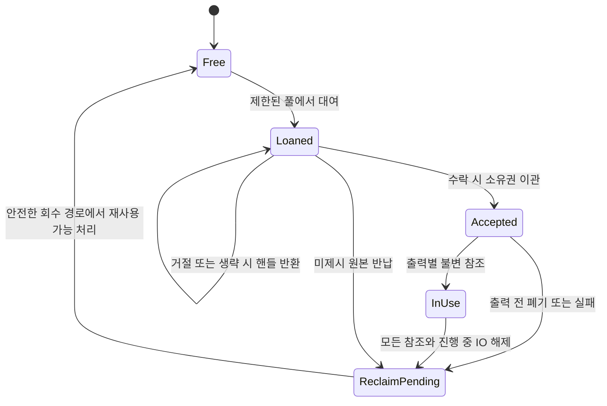

# 핵심 인터페이스 계약

- 관련 Intent: INT-001
- 상태: Approved — 2026-10-26 상세설계·ADR-008/009 기준선 채택. 공개 함수 표기는 설계 계약이며 컴파일/수명·실제 호환 검증은 구현 Task에서 수행한다.
- 해석 우선순위: §13~17과 ADR-008·009가 현재 상세 동작 계약이며, 검증 방법/시점은 2026-10-31 ADR-011을 우선한다. §1~12의 초기 제안/미정 표현은 여기서 구체화한 범위에서 대체된다. 장비별 수치·알고리즘 증명은 미검증이다.
- 승인 기준선: ADR-003~009, US-001~005(US-002 AC6~10 포함)
- 후속 요구: FR-018 — 선택 옵션·기본 비활성·전체 약3초/중요 파일 우선 기록 계약 유지. 2026-10-31 ADR-011로 UPS는 시뮬레이션 판정, 실제 장치 시험은 현재 PC 실측으로 대체 수락한다.
- 갱신: 2026-10-27 / AI

## 1. 제공자·소비자와 실행 경계

| 경로 | 제공자/호출 주체 | 처리 책임 | 완료 의미 |
|------|-----------------|-----------|-----------|
| 등록·설정 | 애플리케이션/관리 클라이언트 | 로거 관리 경로 | 검증·등록/설정 적용 결과 |
| 기록 제시 | 등록된 생산자 | 제한된 수집 경로 | 수락 또는 거절. 저장 완료가 아님 |
| 완료 확인 | 애플리케이션/관리 클라이언트 | 백그라운드 출력/완료 관리 | 요청한 대상/완료 경계까지의 상태 |
| 조회·재생·구독 | 분석/모니터링 클라이언트 | 조회/전달 경로 | 소비 가능한 응답/전달. GUI 표시 완료와 구분 |
| 관측·조절 비교 | 개발자/클라이언트 | 계측·보고 경로 | 조건과 근거가 포함된 관측/검증/추정 보고 |
| 점검·종료 | 관리 클라이언트 | 관리·백그라운드 경로 | 완료/실패/시간 제한·미완료 범위를 포함한 결과 |

RT 호출은 기록 제시까지로 제한하는 안이다. 대기가 필요한 완료 확인·종료·점검·조회는 일반/관리 경로에 둔다. Rust 라이브러리 경계를 먼저 검토하고 원격 프로토콜·실행 배치는 ADR-007·009를 따른다.

## 2. 작업별 계약 검토안

| 작업 | 입력 의미 | 반환/관측 의미 | 검토할 제약 |
|------|-----------|---------------|-------------|
| 생산자/채널 등록 | 목적·스키마·출력 매핑·정책·크기/자원 예산 | 검증된 핸들·설정 revision 또는 구성 오류 | RT 실행 전 등록, 종료 중 등록·등록 수 상한 |
| 기록 가능 여부 확인 | 핸들·레벨/필터·선택 정보 | 현재 정책에서 기록 대상인지 | 공간을 예약한 의미는 아님. 실제 제시는 거절될 수 있음 |
| 소형 기록 제시 | 핸들·시각/순서·작은 구조화 payload·보존 중요도 | 수락 식별 또는 거절 이유 | RT 무대기. payload 생성·포맷·할당과 호출 비용 경계 정의 |
| 원본 기록 제시 | 유효 크기/메타데이터·제한된 원본 소유권 핸들 | 수락 시 소유권 이관, 거절 시 원본 반환을 우선 검토 | 최종 참조 해제/회수·거절 경로의 추가 작업과 수명 보장 |
| 완료 확인 | 기록/범위·대상 집합·원하는 완료 경계·제한 시간 | 대상별 완료/실패/폐기/미처리와 시간 제한 | 일반 경로. 일부 대상만 완료된 결과를 표현 |
| 조회·구독·재생 | 시간/채널/범위·필터·페이지/스트림 상한·재생 제어 | 읽을 수 있는 기록·결측/완료 범위·소비 흐름 | 동시 쓰기 가시성·취소·느린 소비자·메모리/IO 상한 |
| 보고서 조회 | 설정/장비/관측 구간·경로/채널 선택 | 부하·완료·지연·손실·예산·기준 유효성·추정 | 수집 근거와 불확실성을 표시. 계산은 RT 밖에서 수행 |
| 설정 제안/적용 | 현재 revision·개발자 조절 의도·대상 범위 | 검증된 변경안·효과 가정·명시적 적용 결과/새 revision | 고정값 유지·실행 중 변경 범위·되돌리기·기준 만료 |
| 간편 점검 | 재사용할 부하 프로필·완료 경로·시간/CPU/메모리/쓰기/공간 예산 | 실제 시험 범위·통과/실패/중단·추정과 추천 | 명시적 실행·임시 자원 관리·운영 기록 보호·상대 수신자 부재 |
| 종료 | 배출·동기화 범위·종료 제한 시간 | 최종 완료/미완료·실패 범위 | RT 밖에서 수행. 강제 종료/프로세스 중단의 보장 범위 별도 |
| 전원 이상 긴급 기록 | 예고 신호·차단 기한/남은 예산·사전 등록 중요 파일 계획 | 요청 인수와 파일별 영속 완료/실패/미완료 | FR-018. 전체 약 3초에 전달 지연·종료 여유 포함. 상세는 §12 검토안 |

위 작업명은 역할 설명이며 코드 API가 아니다. 어댑터가 요구하는 런타임/네트워크 기능을 수집 API의 필수 의존성으로 정하지 않았다.

## 3. 입력과 소유권·실패

### 3.1 등록·입력·동기 반환

이 절부터의 상세 동작은 권고안이다. 등록은 일반/관리 경로에서 수행하고 생산자·채널·스키마·최대 입력 크기·출력 계획·중요도 정책·자원 상한을 검증한다. RT 핸들은 하나의 직렬 호출 주체가 소유하는 안이다. 여러 스레드가 같은 논리 채널을 쓰려면 생산자 핸들을 각각 등록한다. 핸들의 임의 복제나 동시에 호출하는 공유 핸들은 아직 지원 계약으로 확정하지 않는다.

| 반환 분류 | 의미 | 원본 소유권 / 식별 |
|-----------|------|--------------------|
| Accepted | 처리 책임과 제한된 수집 공간을 로거에 이관 | 원본 핸들 소비, 수락 식별자 반환. 출력 완료 보장 아님 |
| Skipped | 활성 필터·샘플링 등 설정에 따른 의도적 생략 | 원본 핸들 반환, 수락 식별자 없음 |
| Rejected | 잘못된 입력·자원 한계·종료 등으로 수락하지 못함 | 원본 핸들 반환, 수락 식별자 없음 |

거절 이유는 최소한 `InvalidHandle`, `SchemaMismatch`, `TooLarge`, `Capacity(scope)`, `Contended`, `Closing`을 구분하는 안이다. `scope`는 수집 슬롯·원본 bytes·완료 추적 등 제한된 코드로 표현한다. RT 반환에 오류 문자열 포맷·동적 할당·사용자 콜백을 요구하지 않는다. 경합 재시도도 정해진 연산 한도 안에서 끝나야 하며 그 한도와 알고리즘은 후속 검증 사항이다. 등록된 계약 밖의 입력을 필터 생략으로 숨기지 않는다.

RT 수집 호출 내부는 사전 준비된 메모리만 사용하고 동적 할당·블로킹 잠금·OS I/O를 실행하지 않는 방향으로 검증한다. 제한된 복사·자원 판정·계측·동기화 연산까지 전체 경로 비용에 포함한다. 무대기 반환 계약과 특정 OS/장비에서의 호출 지연 목표 달성은 별개다.

소형 입력은 등록된 크기 상한 안의 바이트를 수집 공간으로 복사하는 안이다. 호출 뒤에는 애플리케이션 입력을 빌려 두지 않는다. 문자열 포맷·직렬화·사용자 payload 생성 비용은 호출 전 준비 비용으로 별도 계측한다. 원본 입력은 전체 바이트 복사 대신 §3.2의 제한된 소유권 핸들을 소비한다. 사전 기록 가능 여부 확인은 힌트이며 공간 예약·수락 보장이 아니다.

목표의 256 B는 소형 기록 시험 조건이며 API의 고정 최대 payload가 아니다. 32생산자·16파일·128채널 역시 검증 규모이며 제품의 고정 최대 개수로 변환하지 않는다. 실제 슬롯/bytes/객체 크기 상한은 등록/구성 계약에서 정한다.

### 3.2 원본 수명과 회수

RT 입력의 우선 검토안은 **사전 등록한 제한된 풀의 대여 핸들**이다. 생산자는 대여 중에만 내용을 쓰고, 수락 후에는 읽기·쓰기·재사용하지 않는다. 분배 이후에는 출력들이 불변 원본을 공유한다. 일반 `Vec`·`Arc`·외부 SDK 버퍼를 무조건 RT 입력으로 받는 계약은 두지 않는다. 외부 버퍼는 일반 경로에서 복사/등록하거나 해당 수명·회수 방식을 검증한 어댑터로 연결하는 안이다. 센서 SDK에서 풀로 입력하는 과정과 파일/네트워크 출력까지 완전한 zero-copy를 보장하지 않는다.



| 상황 | 처리 책임과 수명 |
|------|------------------|
| 거절·필터 생략 | 같은 핸들을 호출자에게 돌려준다. 내부 예약은 되돌리며 숨은 원본 참조를 남기지 않는다. 재제시/반납은 호출자가 선택한다. |
| 정상 수락·출력 분기 | 로거가 원본 수명을 책임진다. 각 출력의 참조와 복사/작업 버퍼를 예산에 포함한다. |
| 한 출력의 실패·폐기 | 그 출력이 더 이상 접근하지 않을 때만 참조를 해제한다. 다른 출력의 원본을 무효화하지 않는다. |
| 조회 취소·완료 대기 시간 초과 | 대기/조회만 끝낸다. 수락 기록 처리나 진행 중 IO를 암묵적으로 취소하지 않는다. |
| 종료·강제 중단 요청 | 신규 수락을 닫고 남은 참조/IO를 추적한다. 종료 시간이 지났다고 사용 중 메모리를 재사용하지 않는다. |
| 호출자 핸들·관리 객체 해제 | 풀에 접근 가능한 핸들이 남아 있으면 기반 메모리도 살아 있어야 한다. 최종 풀 소멸은 관리 경로에서 수행하도록 수명 계약을 검증한다. |

대여 핸들의 반납/Drop은 RT에서 큰 payload 해제·외부 SDK 반납 콜백·무한 재시도를 실행하지 않는 계약을 검토한다. 생산자 측에서 핸들이 소멸(Drop)되더라도 즉각적인 메모리 해제(OS deallocation)를 절대 수행하지 않고, 비소유/비차단 역방향 회수 큐(Recycle Queue)로 인계되어 백그라운드 워커에 의해 풀로 환원되는 RAII 안전 래퍼 구조를 검증한다. 회수 대기열이 찼을 때 동기 해제나 누수를 택하는 폴백을 두지 않는다. 슬롯별 반납 상태 또는 모든 대여 슬롯을 감당하는 회수 용량 등 **반납 경로가 포화돼도 반환 책임을 잃지 않는 구조**를 구현 전에 증명한다. 미제시 대여분·실패 후 반환분·회수 대기분도 계속 점유로 센다. 실제 자료구조·메모리 순서·관리 객체의 최종 해제 방식은 미정이며, 검증 전 RT 안전성 달성으로 표시하지 않는다.

근거: Rust의 [Arc 공식 문서](https://doc.rust-lang.org/std/sync/struct.Arc.html)는 마지막 참조 소멸 시 내부 값도 Drop됨을 설명한다. 따라서 공유 포인터를 사용했다는 이유만으로 최종 해제 비용이 RT 밖으로 이동했다고 판단할 수 없다. 제한된 풀/반납 구조는 이 프로젝트의 설계 제안이며 Arc 채택 결정이 아니다.

### 3.3 수락 시점과 설정·출력 계획

수락 판단과 공개는 하나의 논리적 경계를 갖는 안이다. 수락 식별자를 반환할 때는 기록 내용/원본 핸들·고정된 설정 revision·출력 계획·수집 및 추적 예산의 인수가 완료돼 있어야 한다. 중간 예약 실패는 모두 되돌린 뒤 거절하며 부분 수락을 동기 성공으로 반환하지 않는다. 구체 동시성 알고리즘은 미선정이다.

출력 계획에는 대상별 필수/선택 여부와 지원 완료 경계를 넣는다. **수락은 해당 계획의 처리 시도 인수이며 모든 출력 큐 공간이나 향후 성공의 원자적 예약이 아니다.** 후속 분배에서 필수 대상이 포화/실패하면 해당 대상의 실패/폐기를 명시하고 전체 요청을 성공으로 만들지 않는다. 선택 대상의 포화도 숨기지 않는다. 필수 대상 전체의 공간을 미리 예약하는 대안은 더 강한 초기 인수 조건을 주지만 RT 판단 비용과 출력 간 결합이 늘어 권고안에서는 보류한다.

한 기록에는 하나의 불변 revision/출력 계획을 연결하고 재시도·조회에도 유지한다. 설정 변경으로 과거 수락 기록의 대상을 바꾸지 않는다. 이전 설정/출력 계획의 수명도 제한 예산에 포함하고 회수 전 revision을 무제한 쌓지 않는다. 전역 동시 적용·실행 중 변경 가능 항목은 OQ-005로 남는다.

### 3.4 타임스탬프 삼원화 및 시계 동기화 계약

센서 퓨전 및 다중 생산자 분석을 위해 기록 봉투 메타데이터는 3가지 시간축을 선택적으로 다룬다.

| 시간축 | 정의 및 출처 | 용도 및 보장 |
|--------|--------------|--------------|
| `MonoTime` | 시스템 단조 시계 (`CLOCK_MONOTONIC` 또는 OS 동등물) | 필수. 제어 루프 주기 분석, 정렬, 로거 내부 지연 측정. 역행 없음 보장 |
| `RealTime` | 벽시계 (`CLOCK_REALTIME` 또는 OS 동등물) | 필수. 외부 시스템 이벤트 연관 및 절대 시간 조회. NTP/PTP 슬루/점프로 역행/도약 가능 |
| `SourceTime` | 센서 하드웨어/드라이버 생성 타임스탬프 | 선택. 카메라 셔터 시점, LiDAR 패킷 시각 등 정밀 센서 퓨전용 |

- NTP/PTP 시계 동기화로 인한 `RealTime`의 불연속 변화(점프)가 발생하더라도 `MonoTime`은 영향을 받지 않으며, 세션 메타데이터에 시계 기준점(Base Clock Offset)과 보정 이벤트를 기록해 재생/조회 시 시간축 왜곡을 보정할 수 있게 한다.
- 시간 기반 재생(Playback)의 기본 정렬 기준은 `MonoTime`을 권장하며, 벽시계 기반 질의 시에는 `RealTime` 인덱스를 사용한다.

### 3.5 스키마 식별 및 진화(Schema Evolution) 계약

데이터 구조의 변경과 장기 보존 로그의 판독 호환성을 위해 스키마 메타데이터 계약을 검토한다.

- **스키마 등록**: 모든 채널은 등록 시 `(schema_id, schema_version)` 및 필드 기술자(Descriptor/Schema Text)를 로깅 세션 메타데이터에 기록한다.
- **하위 호환 디코딩**: 신규 필드 추가는 선택적/기본값 허용 방식으로 설계하여 구버전 판독기가 신규 로그의 미인식 필드를 건너뛰고(Skip), 신규 판독기가 구버전 로그의 누락 필드를 기본값으로 채울 수 있도록 한다.
- **불가역 변경 격리**: 필드 타입 변경 등 호환 불가능한 변경은 새로운 `schema_id`를 발급하거나 주 버전을 올려 이전 로그 판독과의 혼선을 방지한다.

## 4. 완료 상태와 무결성

| 상태 | 의미 | 보장하지 않는 것 |
|------|------|------------------|
| 수락 | 로거가 해당 기록 처리를 받아들임 | 모든 대상 완료·영속 저장 |
| 파일 쓰기 완료 | 지정한 파일 쓰기 경계에 도달 | 전원 장애 영속성·다른 출력 완료 |
| 영속 동기화 완료 | 지정 범위와 필요한 메타데이터 동기화 결과 확인 | 장치 계약 밖의 고장 보장·미동기화 꼬리의 무손실 |
| 원격 활용 전달 완료 | 지정 수신 프로그램의 검증/소비 전달 경계 확인 | GUI 렌더링·다른 DB/파일 완료 |
| 실패/정책 폐기/미처리 | 경로별 원인·대상·기록/범위가 끝나지 않은 상태 | 임의로 성공 또는 측정된 처리량에 포함 |

### 4.1 식별·순서·완료 확인

수락 식별자는 `(session_id, producer_id, accepted_seq)`의 의미를 갖는 작은 비소유 토큰으로 제안한다. `accepted_seq`는 해당 생산자에서 수락될 때만 증가한다. 센서 프레임 번호/애플리케이션 발생 순서는 별도 입력 메타데이터이며 생략·거절은 반환/카운터로 센다. 세션 재시작이나 생산자 재등록 때 식별자를 재사용하지 않고 sequence 소진 시에는 관리 경로에서 갱신하거나 명시적으로 거절한다.

생산자별 수락 순서는 추적하되 전체 생산자·채널·출력의 전역 순서를 보장하지 않는 안이다. 출력이 순서대로 보이도록 요구하면 실패/폐기된 구간도 함께 표시해야 한다. 최고 완료 sequence만으로 모든 이전 기록의 완료를 추정하지 않는다. 큰 원본과 작은 기록의 처리 완료 순서도 다를 수 있다.

완료 조회는 기록 토큰 또는 **등록된 생산자 집합과 생산자별 수락 상한을 고정한 범위**를 받는다. 범위를 만든 뒤의 수락/신규 생산자는 자동 포함하지 않는다. 전 생산자를 같은 순간에 잘라 내는 전역 원자적 스냅샷은 보장하지 않는다. 조회에는 대상 선택·대상별 완료 경계·대기 기한을 명시하고 폴링/대기는 일반 경로에서만 수행한다. 조회 자체가 추가 전송/동기화를 시작하지 않는다. 요청한 경계가 기록의 처리 계획에 없으면 미지원/계획 오류를 반환하며, 명시적 동기화 실행 요청은 별도 관리 계약에서 정한다.

### 4.2 대상별 진행·결과와 대기 결과

| 구분 | 표현할 의미 |
|------|-------------|
| 진행 상태 | 대상별 최고 확인 경계와 아직 진행 중인 범위 |
| 완료 | 요청한 경계에 도달한 기록/범위 |
| 실패 | 더 진행할 수 없는 원인·대상·범위와 이미 확인한 경계 |
| 정책 폐기 | 구성된 정책에 따라 종료한 대상/범위. 수락 거절과 별도 집계 |
| 원격 결과 불명 | 전송 뒤 연결 단절 등으로 수신 활용 여부를 확인하지 못함. 미전달/성공으로 단정하지 않음 |
| 이력 만료 | 상세 조회 보존 범위를 벗어나 확인 불가. 성공/실패/아직 미처리로 변환하지 않음 |
| 대기 시간 초과/조회 취소 | 조회 작업의 결과이며 기록의 최종 처리 상태가 아님. 마지막 상태를 함께 반환 |
| 미지원/잘못된 범위 | 대상이 제공하지 않는 경계·알 수 없는 대상/세션·유효하지 않은 토큰. 대기 전에 오류 반환 |

쓰기 완료 후 동기화에 실패하면 쓰기 완료 사실을 유지하고 영속 동기화 실패를 별도로 표시한다. `Pending → Written → Synced` 하나로 모든 대상을 모델링하지 않는다. DB/원격의 경계는 어댑터가 선언하고, 수신 애플리케이션의 확인이 없으면 원격 활용 완료를 반환하지 않는다. 재시도로 생길 수 있는 중복/불명 상태를 성공으로 숨기지 않으며 exactly-once 전달은 아직 보장하지 않는다.

범위 결과는 요청한 대상·경계와 완료/실패/폐기/미처리/불명/만료 범위를 돌려주는 안이다. 필수 대상의 모든 요청 범위가 해당 경계에 도달해야 필수 범위 성공이다. 선택 대상도 요청에 포함하면 그 상태를 함께 보고한다. 예를 들어 파일은 쓰기 완료, DB는 실패, 원격은 대기 중이면 전체 출력 완료로 응답하지 않는다.

파일 쓰기 완료는 해당 기록의 인코딩 바이트를 사용자 공간 버퍼에서 OS 쓰기 경계까지 넘긴 의미로 검토한다. 파일 영속 동기화는 그 기록/범위를 포함하는 동기화 작업의 성공과 연결한다. Rust [File::sync_all 공식 문서](https://doc.rust-lang.org/std/fs/struct.File.html#method.sync_all)는 내용/메타데이터 동기화를 별도 연산으로 설명하며 File Drop의 오류는 무시됨을 명시한다. 파일 Drop을 정상 종료/동기화 성공으로 취급하지 않는다. 파일명·디렉터리·회전/인덱스 복구까지 포함한 영속 계약, OS별 구현과 장치 보장은 별도 검토 대상이다.

### 4.3 제한된 완료 이력과 수량 대조

상세 토큰/범위 조회에는 보존 시간·항목/bytes·동시 대기자 상한을 두고 유효 조회 범위를 노출한다. 완료 구간은 연속 범위로 압축하고 결측/실패 구간도 제한된 예산으로 관리하는 안이다. 구간 분열로 추적 예산이 부족하면 신규 수락을 거절하거나 계약된 이력 만료를 명시한다. 미처리 기록 상태를 몰래 버려 성공으로 만들지 않는다. 토큰을 보관한다고 원본 메모리나 상세 이력이 영구 보존되는 것은 아니다. 정확한 상한·집계/만료 방식은 구현 전 확정한다.

고정된 생산자/대상 집합·revision·대조 구간에서 다음 수량을 연결한다.

- 제시 수 = 수락 수 + 의도적 생략 수 + 수락 거절 수.
- 대상별 배정 수 = 해당 대상의 최종 성공 수 + 최종 실패 수 + 정책 폐기 수 + 진행 중 수 + 결과 불명 수. 최종 성공은 선언한 대상 완료 경계 기준이며, 쓰기/동기화 누적 카운터를 더해 기록 수로 쓰지 않는다.
- 대상에 배정되지 않은 기록은 그 대상의 분모에서 제외한다. fan-out 합계는 수락 수보다 클 수 있다.

상세 이력 만료 뒤에도 누적 집계의 범위/손실 여부를 명시한다. 원격 결과 불명을 나중에 해소하면 같은 기록의 상태를 전이하며 중복으로 최종 결과를 더하지 않는다. 실행 중 비동기 스냅샷의 일시적 불일치와 정지/배출 뒤 확정 대조를 구분하고, 애플리케이션이 API에 제시하지 않은 생성 데이터는 로거 자체 집계로 검증했다고 주장하지 않는다.

### 4.4 디스크 공간 부족(ENOSPC) 및 I/O 장애의 Fail-Safe 격리

저장 매체 가득 참(`ENOSPC`, Disk Full)이나 파일 시스템 쓰기 실패는 로깅 시스템의 치명적 상황이지만, 메인 로봇 제어 시스템의 생존을 위협해서는 안 된다.

| 장애 상황 | 로거 백그라운드 동작 | RT 생산자/상위 제어 영향 |
|-----------|----------------------|--------------------------|
| 디스크 풀 (`ENOSPC`) | 영향받는 파일 대상에 `IoFailure(ENOSPC)` 상태 마킹. 백그라운드 재시도 중단 및 손상 방지 파일 닫기 | RT 호출에 패닉·블로킹 전파 금지. 수집 큐 포화 시 정책에 따라 새 입력 거절 또는 카운터 집계 |
| 파일 권한/잠금 충돌 | 대상별 실패 기록, 리포트에 장애 알림 발행 | 정상 출력은 계속 처리하되 공유 CPU/장치 경합의 영향은 별도 계측 |
| 순환 로깅 회전 실패 | 오래된 파일 삭제 실패 시 신규 파일 강제 생성 중단 (디스크 고갈 방지) | 자원 한계에 도달하면 신규 수락을 `Capacity(DiskFull)`로 명시적 거절 |

- 복구 가능한 I/O 오류는 `Result`와 대상별 상태로 처리하며 RT에 panic/대기를 전파하지 않는다. 내장형 구조는 panic=abort·OOM·메모리 손상의 프로세스 장애까지 격리하지 못한다(ADR-007).
- 장애가 감지되면 관측 리포트에 즉각 `StorageDegraded` 지표를 노출하고, 복구(디스크 공간 확보 등) 전까지는 지정된 안전 정책(신규 입력 거절 또는 메모리 내 손실 카운팅)을 따른다.

## 5. 운영 관측·기준 능력·개발자 조절

보고서에는 최소한 설정 revision·측정 구간·생산자/채널/대상 범위·입력/완료량·단위·미처리량·지연·손실/의도적 생략·측정 기준의 출처/유효성을 연결한다. 기준선 목표, 일상 관측, 지정 시험으로 검증된 능력, 모델 추정, 미측정/기준 만료를 구분한다.

버퍼 bytes/슬롯·작업/회수 예산과 실제 원본의 수명 연장을 함께 집계한다. 회전/삭제·압축·중복 출력 후 실제 파일 증가와 파일 시스템 여유를 관측하고 버퍼 포화·출력 정지 가정·디스크 여유·순환 보존 창의 시간을 각각 표시한다.

개발자의 주기/필터·샘플링·원본/필드·출력 변경을 지원하는 API와 설정 단위를 검토한다. 변경안의 이유·절감과 기록 정보 손실·적용 가능한 범위·필요한 재점검을 제공하고 명시적으로 적용한다. 변경 전후의 비교는 조건 차이와 설정 revision을 남기며, 출력만 줄인 효과와 앱에서 기록 생성 작업을 줄인 효과를 구분한다. 자동 설정 변경/자동 제한은 현재 기본 범위에 없다.

## 6. 열려 있는 설계 결정

| 관련 미결 | 정할 내용 | 확정 시점 |
|-----------|-----------|-----------|
| OQ-002 | 실제 dot-probe 장비·제어 주기/부하·소형/원본 타입·크기·단계별 수치 | 실제 장비 대응/검증 설계 및 해당 계약 리뷰 |
| OQ-003 | ADR-008/§13~17 계약 승인. 잔여: 장비별 quota·보호량/허용 손실 수치와 수명/동시성 증명 | TASK-003~009·021·022 및 실제 검증 |
| OQ-004 | ADR-007·009 배치/기술 채택. patch·MSRV 로컬 확인(EV-001). 잔여: native OS/CPU/DB 호환 | TASK-002·019·022 |
| OQ-005 | 설정·리포트·점검 및 계측 목표 승인. FR-015는 별도 제안 | 관련 구현/검증 Task, TASK-018은 범위 승인 후 |

[요구사항 §15.4](../02_project_definition/requirement_spec.md#154-미결을-설계에서-확정할-보완-계획)의 승인된 수집 계획을 따른다. 채택한 계약/기술은 ADR-008·009를 따른다. 미확정 실장비 수치를 임의로 채우지 않는다.

## 7. 관련 기준

- [도메인·모듈 초안](domain_model.md)
- [요구사항](../02_project_definition/requirement_spec.md)
- [승인 Story/AC](../02_project_definition/user_story_registry.md)
- [ADR-005](adrs/ADR-005_design_baseline_and_deferred_decisions.md)


## 8. OS 지원·기능 탐색 계약 (Tier 1 vs Tier 2)

Linux·macOS·Windows에서 공통 수집·기록·조회/재생·리포트/점검·개발자 조절 계약을 제공하되, 플랫폼 역할을 **Tier 1 (Target / Full SLA)**과 **Tier 2 (Compatibility / Best-Effort)**로 분리한다.

- **Tier 1: Linux (PREEMPT_RT / 일반 Linux)**: 실제 로봇 탑재 타겟. 승인된 조건부 실시간 호출 지연(p99 ≤5 µs), 대용량 처리(1.0 GB/s), 활성 구성의 전원 차단 긴급 동기화(FR-018)를 목표로 장비별 검증하며, 백그라운드 워커의 CPU 코어 격리(Pinning) 및 RT 우선순위 설정을 지원한다.
- **Tier 2: Windows, macOS**: 개발자 워크스테이션 및 분석기. 기능적 호환성(API 동작, 데이터 수집/파일 생성, 크로스 파일 판독, 모니터링 클라이언트)을 제공·네이티브 검증하며, 엄격한 실시간 SLA 및 성능 측정 대상에서 제외(Best-effort)한다.

플랫폼/권한에 따라 지원하지 않는 고급 스레드 설정(예: CPU 코어 격리)·계측 지표는 지원 여부와 사유로 표현하는 안이다. 미지원 요청을 조용히 성공 처리하거나 해당 지표를0·정상 여유로 변환하지 않는다. 가능한 공통 경로와 성능/보장 범위를 설명하고, 플랫폼 전용 API/핸들을 일반 호출자의 필수 입력으로 정하지 않는다.

완료 경계와 단위·시각 의미는 공통으로 문서화하고 OS별 파일/영속 동기화·열린 파일 회전/삭제·오류·공간 조회의 실행 동작을 확인한다. R1은 Linux PREEMPT_RT 참조 프로필이며 다른 OS의 측정값·성능 보장으로 재사용하지 않는다. 보고서의 장비/설정/기준 프로필 식별에는 OS와 실행 환경도 포함한다.

- **OS별 영속 동기화 프리미티브**: Linux는 `fdatasync`/`fsync`, macOS는 `fcntl(fd, F_FULLFSYNC)`, Windows는 `FlushFileBuffers`를 기본 매핑 후보로 하며, 각 플랫폼 시스템 콜의 지연 특성과 전원 장애 내구성 보장 차이를 문서화하고 벤치마크 프로필에 반영한다.
- **파일 락 및 공유 플래그 (특히 Windows)**: Windows 환경에서 로거가 기록 중인 파일에 모니터링 클라이언트나 점검 도구가 접근할 때, 또는 순환 로깅 중 이전 세그먼트를 회전/삭제할 때 배타적 락으로 인한 `Access Denied` 실패가 발생하지 않도록 파일 생성 시 `FILE_SHARE_READ | FILE_SHARE_DELETE` (Unix open 플래그와 동등한 의미는 아니며 OS별 검증 필요) 플래그를 기본 적용한다.
- **백그라운드 워커 CPU 코어 격리 (Affinity/Pinning)**: 로거 설정(`WorkerThreadingConfig`)을 통해 백그라운드 I/O 워커들이 동작할 CPU 코어 목록(예: Core 0, 1)을 지정할 수 있다. Tier 1 Linux에서는 `sched_setaffinity`를 통해 RT 제어 코어(Core 2, 3 등)에서 worker 실행을 분리하며 IRQ·공유 자원 간섭은 별도 검증하고, Tier 2 OS에서는 플랫폼 지원 수준에 따라 적용하거나 기본 스케줄러에 위임한다.

[ADR-006](adrs/ADR-006_cross_platform_linux_macos_windows.md), [US-005](../02_project_definition/user_stories/US-005_cross_platform_support.md).

## 9. 중요도·예산과 포화 동작 권고안

### 9.1 기본 동작과 대안

ADR-003의 중요 기록 우선 기본값을 구체화하는 **2026-10-26 승인된 상세 계약**이다. 옵션 지원 방향은 유지하며 RT 호출의 공간/저장 무대기는 기존 확정 계약이다.

| 쟁점 | 권고안 | 대안과 비용 |
|------|--------|-------------|
| 초기 중요도 | `Normal`·`Important` 두 등급, 로그 레벨과 별도 지정 | 다단계는 표현력이 높지만 예약·공정성 조합이 늘어 후속 필요 확인 |
| 중요도 생략 | 명시값 → 채널에 설정한 분류/기본값 → Normal. 레벨 기반 채널은 등록된 매핑으로 분류 | 생략 자체를 오류로 만들면 명시성은 높지만 일반 기록의 사용 비용 증가 |
| 수집 포화 | 중요 기록용 slots와 bytes를 보호하고, 허용 공간이 없으면 새 입력 거절 | 수락된 저중요도 기록 축출은 중요 입력을 더 받을 수 있지만 분배/참조 회수와 완료 이력 처리가 복잡 |
| 같은 중요도 포화 | 먼저 수락한 기록을 유지하고 새 입력 거절 | 오래된 기록 폐기는 최신 관측에 유리할 수 있으나 수락 후 폐기와 순서 공백 처리가 추가됨 |
| 중요 기록까지 포화 | 무대기 거절과 원인 집계. 무손실 보장 없음 | 일반 호출의 제한 시간 대기는 별도 옵션. RT용으로 자동 전환하지 않음 |
| 느린 선택 출력 | 그 출력의 제한 예산 안에서만 유지하고 한계 도달 시 대상별 정책 폐기 보고 | 모든 출력 완료까지 무제한 원본 유지하면 공유 메모리가 고갈됨 |

레벨 기반 매핑을 선택했는데 매핑/채널 기본값이 불완전하면 등록 오류로 처리하는 안이다. Important 지정은 우선 수락 기회를 뜻하며 모든 출력 성공·영구 보존·일정 지연 보장은 아니다. 같은 등급의 원본 대용량 기록이 소형 중요 이벤트용 예약분을 소진하지 않도록 생산자/채널 또는 payload 종류별 예산 분할도 검토한다. 실제 예약 비율·최대 크기·스케줄링 공정성 수치는 장비/부하 확인 전 채우지 않는다.

### 9.2 예산 차감과 출력 장애

관리 예산은 수집 봉투 slots/bytes, 풀 할당·대여/로거 보유 원본 bytes, 출력별 참조/복사·작업 버퍼, 완료 추적/대기자, 회수 대기를 포함한다. 같은 원본 할당은 전역 물리 점유로 한 번 세고 출력별 보유 원인/참조를 별도로 보고한다. 출력이 별도 복사하면 그 바이트를 추가한다. 풀 사전 할당량과 사용 중/재사용 가능량을 구분하고 애플리케이션 외부 할당까지 전체 프로세스 상한에 포함됐다고 주장하지 않는다.

예약 보호는 수집 봉투뿐 아니라 실제 병목 자원에도 적용돼야 한다. 풀의 대여 단계부터 채널/중요도에 맞는 예약분을 보호하고, 대여할 때의 자원 분류와 제시할 때의 분류가 일치하는지 확인하는 안이다. 일반 입력이 중요 풀을 먼저 빌려 보호를 우회할 수 없어야 한다. 자원별 허용 검사를 모두 통과해야 수락하며 슬롯만 남거나 bytes만 남으면 거절한다. 모든 자원에서 Important 예약분을 일반 입력이 잠식하지 않도록 구성 검증한다. 숫자/예약 구현·부족 자원별 판정 순서는 후속 사항이다.

출력 정지 시 필수 대상도 무제한 재시도하지 않는다. 대상별 시도/시간/미처리 bytes 상한과 종료 결과를 사전 구성하고, 소진하면 실패/정책 폐기로 정리하는 안이다. 선택 출력은 해당 출력의 참조를 포기할 수 있지만 이미 진행 중인 IO 접근은 안전하게 끝나거나 취소 확인을 받아야 한다. 다른 출력도 공유 CPU/메모리/SSD 영향을 받을 수 있으며 완전한 성능 격리를 보장하지 않는다.

필수 파일에 실패한 수락 기록을 일반 메모리에서 끝없이 보관하거나 별도 비상 디스크로 자동 우회하지 않는다. 재전송·영속 스풀 같은 추가 수단은 필요성과 예산을 별도 결정한다. 수락 후 실패는 입력의 동기 거절로 소급하지 않는다.

## 10. API 사용 흐름과 종료 검토안

다음은 의미를 검토하기 위한 표기이며 컴파일 가능한 Rust 선언이나 최종 함수명이 아니다. 실제 타입/수명·오류 열거형·고정 크기는 계약 합의와 알고리즘 검증 뒤 정한다.

```text
설정: init_logger(session_config, worker_threading_config) -> Session 또는 오류
      - worker_threading_config: { cpu_affinity: Option<Vec<usize>>, priority: Option<Priority> }
관리: register_producer(channel_plan, limits) -> Producer 또는 구성 오류
준비: try_acquire(pool, channel_class) -> Loan 또는 대여 불가
RT:   try_record_small(producer, metadata, bounded_bytes)
        -> Accepted(receipt) | Skipped(reason) | Rejected(reason)
RT:   try_record_raw(producer, metadata, loan)
        -> Accepted(receipt) | Skipped(reason, loan) | Rejected(reason, loan)
관리: capture_scope(producer_set) -> 생산자별 수락 상한이 고정된 범위
일반: poll_completion(receipt_or_scope, targets_and_boundaries) -> 대상별 상태
일반: wait_completion(receipt_or_scope, targets_and_boundaries, deadline)
        -> Complete | Incomplete | TimedOut(snapshot) | QueryError
관리: shutdown(drain_plan, deadline) -> 완료·실패·미처리·회수 잔여 보고
```

수락 receipt는 원본을 소유하지 않는다. 거절된 loan은 재제시하거나 반납할 수 있다. 재제시는 같은 시도 안의 무한 재시도가 아니며 제어 경로 밖의 명시적 정책으로 다룬다. 소형 입력은 호출 뒤 계속 빌리지 않으므로 반환할 loan이 없다. 일반 호출의 제한 시간 수락 대기는 별도 API/명시 옵션으로 설계하고 RT 핸들에 대기 동작을 숨기지 않는다.

운영 예: 카메라 원본을 제시해 Accepted를 받으면 해당 메모리를 다음 프레임에 재사용할 수 없다. 로거가 사용하는 동안은 풀에서 다른 핸들을 얻는다. 풀 고갈로 대여에 실패하거나 제시가 Rejected면 입력 누락/거절을 구분해 집계한다. 파일 쓰기 완료와 원본 풀 복귀는 서로 다른 상태다. 원본 참조는 동기화보다 먼저 해제될 수도, 다른 출력 때문에 더 오래 유지될 수도 있다.

종료는 `Running → Closing → Closed`의 관리 상태로 검토한다. Closing 전환과 경합한 제시는 수락 경계에 따라 완전 수락하거나 원본을 반환하며 거절한다. Closed 성공은 선언된 배출/동기화 계획과 안전한 정리가 끝났을 때만 반환한다. 제한 시간에 도달하면 미처리 기록·대상·회수/IO 잔여와 계속 살아 있는 관리 책임을 보고한다. 진행 중 IO가 있는 메모리를 무효화하거나 백그라운드 객체를 조용히 버리지 않는다. 프로세스 중단 후 복구 가능 범위와 허용 손실은 형식/동기화 설계에서 별도 확정한다.

## 11. 리뷰 시나리오·승인 범위·잔여 사항

### 11.1 계약 대조 시나리오

아래는 **설계 리뷰 항목**이며 실행된 테스트 기록은 아니다. 세부 AC의 현재 승인 근거는 ADR-008이다. 코드가 없는 현재는 모두 실행 미검증이다.

| 소비자/조건 | 확인할 동작 | 후속 실행 검증 |
|-------------|-------------|----------------|
| 소형/원본 생산자 정상·생략·입력 오류 | 소형 입력을 호출 뒤 빌리지 않음, 원본은 수락만 소비하고 그 외 동일 핸들 반환 | 내용/수명·카운터 대조 |
| slots 여유·bytes 부족 및 반대 | 자원별 명시 거절, 부분 예약/참조가 남지 않음 | 경계값·경합·메모리 상한 |
| 일반 입력 포화 뒤 Important 입력 | 보호한 예약 자원을 사용할 수 있음. 예약분 소진 후 Important도 거절 | 혼합/편중 부하·제어 주기 영향 |
| 풀 반납·회수 경로 포화 | 거절된 핸들의 Drop/반납도 RT에서 동기 해제/콜백·누수로 우회하지 않음 | 최종 참조·관리 객체 해제·회수 중단 |
| 파일 정상·DB 실패·원격 정지 | 대상별 부분 완료와 참조 수명 유지, 무제한 재시도 없음 | 장애 주입·팬아웃·실제 소비 확인 |
| sequence 1 진행 중·2 완료 | 최고 완료 2를 연속 완료로 보고하지 않음 | 범위/결측·실패/폐기 대조 |
| 쓰기 완료 뒤 동기화 실패·회전 | 쓰기 성과를 보존하고 동기화/복구 범위는 별도 보고 | OS별 파일/이름/인덱스 복구 |
| 대기 취소·시간 초과·이력 만료 | 수락 데이터는 계속 추적, 조회 한계/만료를 성공으로 바꾸지 않음 | 제한된 이력·대기자·메모리 |
| 설정 교체·종료와 동시 제시 | 한 revision/계획에 속한 완전 수락 또는 원본 반환 거절 | 경쟁 조건·기존 설정 회수·잔여 IO |
| 보고서·조회/재생 | 제시/수락/거절·대상별 결과와 결측 구분, 읽을 수 있는 범위만 노출 | 집계 정합성·실제 기록 조회·부하 영향 |
| UPS 예고·중요 파일 긴급 기록 | 신호 발생부터 전체 약 3초 안에서 우선순위/최대 보호량·전달 지연·진행 중 IO를 함께 판정 | 실제 전원 차단·재기동 복구, §12 검토안 |

Linux 일반/PREEMPT_RT·macOS·Windows에서 해당 경로를 네이티브 실행하고 OS/장비·설정 revision·부하와 함께 검증한다. 현재 공통 의미만 설계했으며 어느 OS의 지연/영속성 달성도 확인하지 않았다.

### 11.2 이번에 검토할 계약 묶음

Human 검토 대상은 (1) 제한된 원본 풀/소유권 반환·RT 밖 회수, (2) 두 중요도와 예약 보호·신규 거절 기본 동작, (3) 생산자별 수락 식별·revision/출력 계획 고정과 대상별 부분 완료·제한된 조회 이력이다. §9.1의 대안 비용과 함께 검토한다. 기존 ADR-003의 옵션·기본값과 ADR-004의 저장 예산 분리는 유지한다.

2026-10-26 ADR-008·009와 §13~17을 기준선으로 승인받았다. 장비별 quota·보호량·허용 손실 수치와 동시성/회수 알고리즘의 실제 안전성·성능은 구현/검증 Task에서 확인한다. 설계 승인과 제품 실행 증거를 구분한다.

## 12. 전원 이상 시 중요 파일 우선 기록

### 12.1 요구와 예산

**FR-018 기능 방향은 Human 요청이며, 약 3초는 UPS 신호 발생부터 실제 전원 차단까지 전체 시간이다.** 로거 수신 후 3초를 추가로 확보한 것으로 계산하지 않는다. 시간·요구의 기준 본문은 [요구사항 §17](../02_project_definition/requirement_spec.md#17-전원-이상-시-중요-파일-우선-긴급-기록)이다. 아래 API와 동작은 상세 검토안으로서 이전 §11.2 계약 묶음과 함께 검토할 대상이다.

**Human 확정: 기능은 선택 옵션이며 기본값은 비활성이다.** 활성 상태에만 아래 긴급 계획/예산을 적용한다. 비활성 시 긴급 전환·전용 자원 예약을 하지 않으며 일반 기록/종료 계약을 유지한다. 통지 API에는 비활성/미설정 결과를 표현해 인수 성공으로 오인하지 않도록 검토한다. 활성화 구성의 유효성 검증·설정 revision은 관리 경로에서 처리하는 안이며 실행 중 변경과 빌드 기능 분리는 미정이다.

전달/감지 지연과 종료/전원 차단 안전 여유를 뺀 남은 시간 안에 중요 범위의 쓰기·필수 메타데이터·영속 동기화를 완료하도록 설계한다. 보호 범위는 파일/우선순위와 최대 미동기화량으로 제한하며 로거 전체 메모리 배출과 구분한다. 중요 파일의 기본 목록·순위·같은 순위 안의 순서와 정확한 시간 여유는 미정이다.

### 12.2 입력·실행·완료 계약 검토안

| 경계 | 검토안 |
|------|--------|
| 사전 등록 | 중요 파일 ID/순위·보호 범위·최대 미동기화 bytes·필수 복구 메타데이터/완료 경계·신호 전달 지연 상한·안전 여유를 관리 경로에서 검증 |
| 신호 입력 | 장치/OS 어댑터가 원인·신호 발생/수신 시각·검증한 차단 기한 또는 남은 예산을 전달. 하드웨어 시각과 로거 단조 시각의 대응/오차도 명시 |
| 빠른 통지 | 사전 준비한 제어 요청을 게시하고 인수 여부 반환. 인수 성공은 긴급 파일 저장 완료가 아님. 대기/할당/파일 IO를 비동기 OS 신호 핸들러나 RT 호출 안에서 하지 않음 |
| 제어 자원 | 데이터 큐 포화 때도 긴급 통지/계획을 표현할 수 있게 별도 제한된 제어 자원 검토. 기존 관리 대기열 뒤에 무기한 지연되지 않도록 설계 |
| 긴급 진입 | 관리 경로가 기존 Closing/종료 처리와 조정해 고정된 긴급 기록 범위/계획을 만듦. 일반 신규 입력 제한과 마지막 중요 상태 수락 범위는 사전 설정한 별도 예산으로 검토 |
| 우선 실행 | 파일 긴급 순위에 따라 중요 범위를 먼저 처리. 파일 내 앞선 바이트/인덱스 등 복구 의존성도 포함. 기록의 Normal/Important 분류와 별도의 파일 순위를 사용 |
| 비필수 작업 | 조회·압축·원격/DB 등 비필수 작업은 긴급 정책에 따라 유예/축소하되 진행 중 IO와 참조를 안전하게 유지. 중요 로컬 파일 성공이 외부 수신자 응답을 기다리지 않도록 검토 |
| 신호 중복/종료 경합 | 동일 사건을 중복 종료로 실행하지 않고 더 이른 유효 기한을 반영. 중복 수신마다 예산을 3초로 다시 시작하지 않음. 전원 복구 신호만으로 정상 재개할지는 별도 결정 |
| 결과 | 파일/범위별 쓰기·영속 동기화 완료와 실패/미완료, 기한·소요시간·사용한 계획 revision 보고. 전원 차단으로 결과 보고가 없으면 완료 불명으로 다루고 재기동 때 확인 |

#### 긴급 3초 단계별 부하 차단(Load Shedding/Fast Reject) 프로토콜

UPS 신호 감지부터 실제 전원 차단까지의 전체 예산(약 3초) 내에서 핵심 파일의 온전한 보존을 보장하기 위해, 긴급 통지 접수 즉시 3단계 부하 차단을 적용한다.

```text
[UPS 신호 수신]
  │
  ├─ 1단계 (Fast Reject): 신규 일반/대용량 로그 입력 즉시 차단 (Rejected: EmergencyPowerOff)
  │                      (사전 지정된 필수 상태/오류 스냅샷 슬롯만 엄격한 상한 내 수락)
  │
  ├─ 2단계 (Shedding):    원격 네트워크 전송, 시계열 DB 연동, 비중요/선택 파일 Flush 즉시 포기
  │                      진행 중인 저우선 I/O 취소 요청 및 리소스 반환
  │
  └─ 3단계 (Sync Focus):  사전 등록된 순위에 따라 1순위 중요 파일의 쓰기 버퍼 즉시 플러시
                         OS 영속 동기화(fsync/FlushFileBuffers) 집중 실행 후 안전 종료 마진 확보
```

개념 API는 `notify_power_fail(pre_registered_plan, deadline_evidence) -> request_status`와 관리 경로의 상태 조회로 검토한다. RT 생산자가 종료/동기화 완료를 기다리지 않는 기존 계약은 유지한다. 정확한 타입·스레드·큐/장치 어댑터는 미선정이다.

일반 파일의 큰 쓰기/동기화가 이미 진행 중일 수 있으므로 우선순위 변경만으로 시간을 보장하지 않는다. 긴급 경로의 최악 지연을 고려해 평소 처리 단위·중요 파일의 미동기화량을 제한하고, 필요하면 주기적 영속 동기화·별도 자원 배치를 비교한다. 이는 아직 주기/배치 채택 결정이 아니다. 유효한 시간 예산이 없거나 보호 범위가 예산을 넘으면 지원/완료를 성공으로 표시하지 않는다. 기한 초과만으로 진행 중 IO가 안전하게 취소된 것으로 간주하지 않는다.

실제 UPS 어댑터 선택을 위한 참고로 [NUT 구성 문서](https://networkupstools.org/docs/user-manual.chunked/ar01s06.html)는 UPS 통신/안전 종료 구성을 설명한다. 현재 NUT를 채택하거나 이 문서만으로 3초 신호 전달/저장 성능을 입증한 것은 아니다. 파일 쓰기와 영속 동기화의 구분은 §4.2의 Rust 공식 문서 근거를 따른다.

### 12.3 검증·잔여 결정

US-002 AC-6~10의 승인된 추가 수락 기준을 따른다. 기본 비활성의 일반 경로를 확인하고, 활성 구성은 여러 순위 파일·최대 보호량·큰 일반 IO 진행 중·신호 지연/중복·종료 경합·디스크 장애·CPU/IO 편중에서 신호 발생→전원 차단까지 계측해 재기동 후 파일/내용/복구 범위를 확인한다. OS/UPS/SSD·파일 시스템별 실행과 실제 차단 검증은 아직 없다. 우선순위/새 입력 제한·복구 경계는 OQ-003, 장비/보호량은 OQ-002, 어댑터와 계측/수락 조건은 OQ-004·005로 보완한다. 기능 추가는 이전 세 가지 핵심 API 권고안의 자동 승인이 아니다.

## 13. 상세 API 설계안

2026-10-26 추가 및 Human 기준선 채택 완료. §1~12의 초기 논의를 아래 계약으로 구체화했다. ADR-008·009에 따라 새 기본값·오류·소유권·통신을 채택한다. 컴파일/실제 수명 검증은 TASK-003·004에서 한다.

| API 후보 | 입력/결과 | 실행 경계 |
|---|---|---|
| `SessionBuilder::validate/build` | limits·target·schema·worker·durability 계획 → owner 또는 구조화된 설정 오류 | 일반 경로, 모든 quota 합계·최대 단일 원본 검증·예열 |
| `owner.scope(callback)` | scope 안에서 producer/loan을 빌려 사용, owner보다 오래 유지 불가 | RT 스레드 생성 전에 등록. 최종 해제는 scope 종료 후 관리 스레드 |
| `Producer::try_record_small` | 고정 metadata + `&[u8]` → receipt/생략/거절 | `&mut self`, 하나의 생산자·고정 상한 복사 |
| `Producer::try_acquire` | 크기 등급·importance → `Loan<'session>` 또는 Capacity | 유한 풀에서 하나 대여, 외부 SDK 버퍼 아님 |
| `Producer::try_record_raw` | metadata + loan → receipt 또는 이유와 같은 loan | 성공 때만 이동. pool/producer/class 불일치 거절 |
| `Loan::drop` | 슬롯 상태를 ReturnPending으로 게시 | payload free·callback·blocking 없이 반환 의무 보존 |
| `GeneralProducer::record_until` | 입력 + 단조 deadline → receipt 또는 Timeout/Closing | 일반 핸들만 사용, 매 시도 기한 확인. RT API에 대기 옵션 없음 |
| `completion.poll/wait` | receipt 또는 생산자별 고정 상한 + target/boundary | 일반 경로. `Expired`, `UnsupportedBoundary`, `TimedOut(snapshot)` 분리 |
| `control.sync` | 대상/생산자별 scope + deadline | 각 writer의 barrier까지 들어온 기록을 마감·sync. 단순 poll은 sync를 시작하지 않음 |
| `control.shutdown` | drain·sync 계획 + deadline → Closed 또는 Incomplete(report, owner) | timeout이면 owner/IO 메모리 유지. 후속 poll/join으로 정리 |

`SessionOwner`의 무거운 Drop을 RT에서 안전하다고 선언하지 않는다. borrowed producer/loan만 RT-safe Drop 대상이다. scoped API 제약 때문에 dot-probe의 장기 thread 통합이 곤란하면 TASK-004에서 owner 기반 대안을 재검토하고, 미검증 `Arc`로 수명을 우회하지 않는다.

고정 오류 코드는 `InvalidInput`, `SchemaMismatch`, `TooLarge`, `Capacity(resource)`, `RevisionBusy`, `Closing`, `EmergencyPowerOff`, `Unsupported`, `IoFailure`, `DeadlineExceeded`를 포함한다. 동적 진단은 일반 경로의 별도 리포트다. no-op tracing 어댑터도 RT 안전하다고 자동 선언하지 않는다.

TASK-002 구현 범위: `crates/dot-logger/src/config.rs`의 `SessionBuilder::new(config).validate(&PlatformCapabilities)`가 총 메모리·생산자별 소형/원본 고정 slot·중요 예약·worker stack·CPU 목록·required capability를 검증하고 읽기 전용 `ValidatedConfig`를 반환한다. quota/slot 크기는 명시 설정이며 R1 수치를 기본값으로 쓰지 않는다. 지원 미확인·실패·미지원은 구분하고 optional 상태도 결과에 보존한다. 이 API는 worker/IO를 시작하지 않는다. `build`·예열·실제 플랫폼 탐색/적용·target/schema/durability와 실제 metadata 할당 예산 검사는 해당 자원을 구현하는 후속 Task에서 확장한다. 위 표의 owner/수집/완료/종료 API는 설계 계약이며 아직 구현하지 않았다. 로컬 검증은 EV-001, native CI는 GAP-004다.

TASK-003 구현 범위(2026-10-27): `capture::CaptureOwner::new(&ValidatedConfig, session_id, revision, channels)`와 `scope`는 소형 ingress만 구성한다. owner가 owning endpoint를 보유하고 `Producer::try_record_small`/`GeneralProducer::record_until`은 빌린 핸들이다. `CaptureConsumer::try_read`는 일반 경로의 대역 소비 API다. payload·봉투·endpoint/rtrb descriptor를 input, owner·고정 채널 metadata를 control 예산에 검사한 뒤 사전 할당·예열한다. 중요 예약은 생산자별 미소비 Normal 슬롯 수를 제한하고, 각 record의 최대 크기로 Important bytes도 보호한다. `ChannelConfig`의 전체 6레벨 mapping은 불완전한 매핑을 타입으로 배제한다. channel/schema/크기 오류는 필터보다 먼저 반환한다. 수락 sequence는 owner의 scope 재진입에도 유지하고 소진 시 거절한다.

`CaptureReceipt`는 소형 ingress 식별자이며 전체 출력 계획/완료 추적 예산을 인수하는 최종 세션 API의 완료를 뜻하지 않는다. 현재 `Capacity`는 소형/원본 ingress에 한정된 오류이며 최종 완료 추적 예산 오류는 후속 Task다. 초기 revision은 고정이며 설정 변경은 후속 Task다. ingress `control.close`는 신규 입력을 닫고 수락 기록을 읽을 수 있게 남긴다. 이는 drain/sync/worker join을 수행하는 최종 shutdown이 아니다. 제품 코드 unsafe 금지·무할당/무해제 로컬 검증은 [EV-002](../05_verification/verification_evidence.md#ev-002--task-003-소형-수집예약일반-대기)에 기록했다. Human 리뷰와 변경분 3 OS × 2 Rust native CI는 2026-10-27 완료됐다. 실제 RT/장비 판정은 남아 있다.

TASK-004 구현 범위(2026-10-27, Human 구현 리뷰 승인): `CaptureOwner`가 선택 원본 풀까지 할당한다. `Producer::try_acquire(length, importance)`는 producer별 고정 크기 등급에서 유효 길이를 고정한 `pool::Loan`을 반환한다. 대여 단계부터 중요 예약 bytes/slots를 보호한다. `try_record_raw`는 pool/producer/중요도 불일치도 필터보다 먼저 검사하며, 거절은 `RawRecordError { reason, loan }`, 생략은 `RawRecordOutcome::Skipped(loan)`, 수락은 `Accepted(CaptureReceipt)`다. 수락은 payload 복사 없이 같은 producer FIFO에 들어간다. 소형/원본 수락 sequence는 하나이며 ingress 인수만 뜻한다.

`CaptureConsumer::try_take_raw`는 불변 `RawRecord`를 반환한다. 선두가 소형이면 `PayloadKindMismatch`로 남겨 FIFO를 유지한다. 일반 복사가 필요한 소비자는 `try_read`로 두 payload 종류를 읽을 수 있다. 짧은 버퍼는 원본 상태/큐를 바꾸지 않는다. `RawRecord`의 마지막 borrow/guard 종료 뒤 ReturnPending으로 게시하며, `reclaim_raw(limit)`가 유한 스캔으로 Free로 바꾼다. 알림은 1슬롯 coalescing mailbox이며 권위 있는 반환 상태는 슬롯에 있다. 원본 generation은 61 bits·소진 시 Retired/GenerationExhausted이며 식별자를 재사용하지 않는다. 풀 미설정은 Unsupported다. 예산/수명/Miri/allocator 검증은 [EV-003](../05_verification/verification_evidence.md#ev-003--task-004-원본-풀수명반환)이며 제품 unsafe 예외는 private pool/storage 한 모듈로 제한한다. 완료 window·출력 성공·fanout·실제 shutdown·장비 성능 판정은 후속 범위다.

TASK-005 구현 범위(2026-10-28, Human 리뷰 승인): `routing::Router::new(plan, ordered_consumers, RoutingConfig)`는 같은 capture 세션의 모든 producer·실제 small/raw slots/slot bytes·초기 revision·채널 route·대상 ID와 concrete output 예약을 검증한다. `Router::scope`에서 유일 `Dispatcher`와 대상별 `TargetConsumer`를 빌린다. `Dispatcher::turn(now, events)`은 비감소 단조시간·유한 retry/회수/공정 순회를 사용하고, `TurnReport.events` 길이의 event prefix와 `fault`를 보고한다. 실패 head는 ingress에 남고, 이전에 처리한 기록의 event도 report에서 보존한다. `Enqueued`는 출력 FIFO 진입이며 쓰기/완료/영속 보장이 아니다. 필수 대상 drop을 전체 성공으로 바꾸지 않는다. 빈 route는 명시 `Unrouted`다.

`TargetConsumer::try_next(now)`는 불변 `Delivery` 또는 해당 queued 항목의 `Cancelled`/`Expired` event를 한 건 반환한다. 출력이 끝날 때까지 guard를 유지해야 하며 사용자 복제 API는 없다. raw fanout은 같은 원본 pointer를 공유하고, 소형 fanout은 별도의 일반 경로 복사 한 건을 공유한다. pending/queued/진행 IO의 대상별 보유 slots/bytes와 distinct 공유 header/copy bytes를 분리 집계한다. 이벤트 버퍼/공유 예산 포화는 신규 분배를 유예하고, 대상 포화·시도/기한 소진은 `DispatchEvent`로 명시한다. 취소 후 reader를 구동하지 않으면 유한 큐 보유가 남는다. `cancel_target`은 실제 진행 IO를 무효화하지 않고, `close`/owner Drop은 성공한 shutdown을 뜻하지 않는다. 초기 route만 구현하며 설정 변경·완료 추적/수락 예산 통합은 후속 Task다. [EV-004](../05_verification/verification_evidence.md#ev-004--task-005-분배출력-격리예산)에서 실행 범위를 확인한다.

### 13.1 완료 추적의 실제 상한

생산자별 `accepted_seq mod window_size` 슬롯에 sequence generation과 대상별 bitset/상태를 저장한다. 모든 필수 추적 예산을 먼저 확보한 뒤 수락한다. 미완료 슬롯을 재사용하지 않는다. window가 가득 차면 `Capacity(Completion)`으로 거절한다. 완료 뒤 상세 이력의 보존 한도에 따라 축출하고 그 이전 receipt는 `Expired`다. 최고 sequence만으로 완료 공백을 지우지 않는다.

2026-10-28 RV-002 수정: producer별 완료 보호량 R은 소형/원본 `important_slots` 중 큰 값이다. window W가 R보다 작으면 시작 전에 거절하고, W=R이면 Normal을 수락하지 않는다. Normal은 자기 slot 외에 다음 R개 cyclic slot이 Empty/Terminal일 때만 수락해 Important의 다음 수락 기회를 남긴다. 단순 빈 슬롯 수만 세면 중간의 pending slot이 다음 sequence를 막으므로 연속 재사용 가능성을 검사한다. 이미 Important가 점유했거나 일반 보고가 Updating 중이면 거절될 수 있다. RT는 최대 R개 상태 조회와 기존 단발 예약 CAS를 수행하며 추가 할당·시각 확인·재시도 loop는 없다. 예약이 0인 TreatEqually는 기존 동작이다.

범위 결과는 bounded page로 반환한다. 각 페이지의 complete/failed/dropped/pending/unknown/expired 구간을 구분하며 상세 구간 개수가 응답 상한을 넘으면 cursor를 제공한다. 전체 성공 판정에는 모든 요청 범위의 결과가 필요하다. 수락 토큰은 원본 메모리를 소유하지 않는다.

### 13.2 TASK-006 실제 API와 완료/종료 경계 — 2026-10-28

Human 리뷰 승인. `CaptureOwner::new_tracked(plan, session_id, revision, channels, routing, CompletionConfig)`는 초기 route와 producer별 완료 window·control bytes를 검증한다. 같은 source memory 분할을 Router/ControlOwner 생성 때 대조하고 pool layout mismatch도 거절한다. `CaptureScope::completion`/`control`로 borrowed 관리 핸들을 얻는다. `try_record_small/raw`는 수락 전에 completion slot을 단발 예약하고 부족/게시 중이면 `CompletionCapacity`로 거절한다. raw 거절은 같은 loan이며 일반 `record_until`은 이 포화도 deadline 안에서 재시도한다. 실제 RT 지연은 미검증이다.

`Completion::poll(receipt,target,boundary)`는 `RecordStatus { confirmed, outcome }`를 반환한다. 지원되지 않는 경계·잘못된 receipt/session/target은 오류다. Outcome은 Complete/Pending/Failed/Dropped/Unknown/Expired/NotRouted/Busy다. Synced 확인은 Written/Enqueued를 포함하고, 후속 실패는 이미 확인한 경계를 지우지 않는다. `Delivery::report(update)`는 guard를 유지한 채 구체 결과를 보고하며 Busy면 같은 guard로 재시도한다. 보고 없는 guard Drop은 Unknown으로 관측한다. 원본/소형 payload 접근 종료와 최종 완료 경계는 동일하지 않다.

RV-001 수정: FIFO 공개 직후 writer가 실패를 보고하고 Enqueued feedback이 나중에 도착할 수 있다. 이 선행 enqueue 사실만 terminal 결과와 병합하며 실패/폐기/불명을 성공으로 바꾸지 않는다. 뒤늦은 Written/Synced가 terminal 실패를 덮는 전이는 계속 거절한다.

`Completion::capture_scope(caller_ranges)`는 producer별 상한을 고정하고 `scope(first/last ranges)`는 명시 부분 범위를 검증한다. `query(scope,requests)`는 동시 query permit을 얻고 `page(caller_items)`가 설정한 page_items 이내 prefix와 누적 summary를 반환한다. 전 page를 읽기 전 is_complete는 false다. `wait(deadline,cancel,buffer)`는 페이지 사이마다 기한/취소를 확인하고 마지막 유한 page·summary를 반환하며 기록 처리나 sync를 바꾸지 않는다. clock 기반 최대 history_retention 또는 window 재사용으로 상세 결과가 Expired가 되며 terminal 집계는 남는다. `poll_at`의 caller 시간은 같은 단조 도메인의 시간 순서로 제공한다.

`ControlOwner::new(plan,capture_control,ControlConfig,origin)`은 별도 controller metadata를 남은 control 예산에서 예약한다. 명시 `request_sync(frozen_scope,targets,now,deadline)`는 명령 인수일 뿐이다. `next_sync(token,target,now,dispatcher,caller_cutoffs)`는 구체 입력/대상 IO/feedback의 배출을 확인한 뒤 유일 `SyncWork`를 준다. writer가 실제 동기화한 후 complete(Synced/Failed/Unknown)하고 `poll(now)`가 유한 receipt metadata에 결과를 적용한다. 이후 수락 기록을 과거 barrier로 Synced 처리하지 않으며 이미 만료된 detail을 성공으로 복원하지 않는다. barrier 결과와 범위 내 과거 실패/이력 만료는 별도로 조회한다. 진행 IO는 deadline 후에도 유지하며 live/queued/applying 상태에서 request slot 재사용을 거절한다.

`begin_shutdown(ShutdownPlan{sync_files},now,deadline,dispatcher)`는 신규 입력을 close하고, pre-close admission/loan publication이 끝난 뒤 cutoffs를 동결한다. Synced가 설정된 계약에서 sync_files=false는 close 전에 거절한다. `shutdown_ranges`와 전용 `shutdown_sync`로 동결 범위와 실제 sync 작업을 구동한다. `poll_shutdown`은 Closing/Incomplete(report)/Closed(report)이며 owner를 소비하지 않는다. 실제 IO guard/loan·queued/retry·feedback·회수 잔여 또는 pre-close call이 있으면 Closed 성공을 반환하지 않는다. deadline 이후에도 같은 owner로 cleanup하고 결과의 deadline 준수 여부를 보존한다. Closed의 is_success는 필수 대상 실패/불명과 sync 실패를 검사하며 optional 실패는 전체 totals에 남는다. 앱 worker/thread join은 애플리케이션 scoped host가 수행한다. `poll_shutdown`은 매 호출 완료 장부 전체(생산자 × window × target)를 집계해 보고서를 만든다 — drain 중 매 turn 호출하면 dispatch를 굶기므로 호출 빈도를 제한한다. facade host는 crate 내부 `poll_shutdown_when_due`로 종료 가능(drain·생산자 호출 0)이거나 미보고 Incomplete가 남은 기한 경과 때만 집계하고, 닫힘은 집계한 poll에서만 판정한다(2026-11-11, T5 ⑫, [EV-067](../05_verification/verification_evidence.md#ev-067)). 실제 파일/OS primitive·장비 durability·처리량 보장은 [EV-005](../05_verification/verification_evidence.md#ev-005--task-006-완료-추적명시-sync종료)의 대역 결과로 승격하지 않는다.

RV-003 수정: shutdown sync가 시작 전에 만료되면 실제 입력/출력/IO/loan/feedback 및 선행 일반 sync application을 먼저 배출한다. 그 뒤 전용 shutdown slot의 유한 application cursor로 Written 이후 미확인 Synced를 Unknown으로 종결한다. 명령 snapshot의 Expired·deadline 미준수·Written 확인은 보존하고 Closed도 실패 보고다. 일반 sync 요청만의 만료는 이 처리를 실행하지 않으며 이후 새 요청으로 동기화할 수 있다. 진행 중 guard를 무효화하거나 뒤늦은 실제 성공을 Unknown으로 선점하지 않는다. 수정 근거는 [EV-007](../05_verification/verification_evidence.md#ev-007)이다.

RV-005 수정 — 2026-10-29: 일반 `request_sync`의 진입부터 슬롯 게시/오류 반환까지 단발 원자적 진입 표시로 추적한다. 동시에 게시 중인 일반 요청이 있으면 기존 `Busy`로 무대기 반환하며, close 이후 요청은 `Closing`으로 거절한다. 진입 표시·열림 확인·shutdown close·정지 확인을 SeqCst로 순서화해, close 전 열림을 확인한 요청이 게시/반환되기 전에는 shutdown 범위 동결과 최종 정리를 확정하지 않는다. 이미 진입한 요청의 게시 이후에는 기존 명령/IO/metadata 수명과 deadline 계약을 따른다. 요청이 검증 오류/포화로 끝나도 RAII가 표시를 해제한다. `Closing`/`Incomplete`에서 dispatcher/readers/writers와 같은 owner를 계속 구동하고 `Closed`가 반환되면 보고의 `is_success`를 별도로 확인한다. 새 오류 enum·RT 수집 연산은 추가하지 않는다.

### 13.3 TASK-007 실제 파일 API — 2026-10-29

`Router::writer_budget(target)`은 source session/revision·target 및 같은 Router의 실제 잔여 output 예산을 묶은 opaque `WriterBudget`을 반환한다. 같은 target의 활성 `SegmentWriter`는 하나이고 여러 대상/finished index의 예약을 공유 합계로 검사한다. startup 경합은 Busy, 잔여 부족은 Budget이다. `WriterConfig`의 max payload·record·chunk·metadata 상한과 명시 `write_buffer_bytes` 및 보수적 reservation을 IO 전에 검증한다. 쓰기 버퍼는 logger 공유 예산에 포함하며 0이면 직접 쓴다. seek/flush 전에 버퍼를 배출하고 position 조회는 논리 위치를 반환한다. Drop은 버퍼를 재시도하거나 배출하지 않는다. 호출자가 제공하는 empty seekable `SyncSink`만 사용하며 path 생성이나 worker 시작은 하지 않는다. 표준 File 구현은 명시 sync_all을 호출한다.

`append(record,payload)`는 frozen session/revision/channel/schema·producer별 sequence·길이/시각을 검증하고 봉투를 기록한다. 인코딩과 file IO는 일반 경로다. 레코드/chunk 한계는 NeedRotation으로 거절하고 자동 삭제/회전은 수행하지 않는다. `flush_chunk` 성공 뒤에만 safe offset과 보조 인덱스를 공개한다. IO 실패 뒤에는 Poisoned이며 이전 safe offset은 유지한다. `finish`는 footer/summary까지 쓰고 `FinishedSegment`에 index/예산 소유권을 옮기며, finish/Drop을 Synced로 간주하지 않는다.

`write_batch(&[&Delivery])`는 호출자가 보유한 유한 guard 묶음을 chunk target에 따라 누적하고 마지막 chunk를 한 번 flush한 후 Written을 순서대로 보고한다. 배치 크기/최대 보유 지연은 호스트가 정하며 제품 기본값은 가정하지 않는다. 빈 묶음은 IO를 하지 않는다. `BatchWriteError`는 append 수락 prefix(`appended`), 마지막 batch flush 성공으로 보장하는 prefix(`written`), 성공한 보고 prefix(`reported`)를 보존한다. append/flush 실패에서는 Written을 보고하지 않는다(`written=reported=0`, 앞서 자동 마감된 chunk도 보수적으로 별도 확인). append 거절 뒤의 수락 prefix는 명시 flush 후 report할 수 있고, IO 실패는 Poisoned다. 성공한 batch flush 뒤 보고 Busy이면 `[reported..written]`의 같은 guard로 `Delivery::report(Update::Confirmed(Boundary::Written))`만 재시도한다. append된 prefix를 다시 쓰지 않는다.

`write_delivery(&Delivery)`는 단일 guard의 append/완전 chunk flush 뒤 Written을 보고하는 저지연 경로다. Busy 뒤에는 위와 같이 report만 재시도한다. Expired 등 그 외 완료 오류는 StorageError::Completion으로 보존한다.

`SegmentWriter::sync_work`와 `FinishedSegment::sync_work`는 같은 private 검증/오류 매핑으로 session/target·파일 coverage를 확인한 뒤 실제 sync를 수행하고 Synced/Failed를 보고한다. IO 전 검증 거절·metadata Busy·기존 Poisoned는 `SyncWorkError { error, work: Some(work) }`로 guard를 반환하므로 올바른 파일/시점에 재시도할 수 있다. 실제 flush/sync 실패는 Failed를 보고하고 `work: None`이다. 반환한 work를 버리면 기존 Drop 계약대로 Unknown이다. query permit은 coverage의 직접 poll 경로를 제한하지 않는다. 다른 세그먼트의 pending/만료 범위를 단일 새 파일 sync로 확인하지 않는다. 다중 세그먼트 조정은 TASK-008 후속이다.

제품 타입은 외부 MCAP/prost wire 타입을 공개 API에 노출하지 않는다. `encode_record`/`decode_record`는 버전 봉투·입력/해독 길이 상한을 검사하고 사용자 payload는 opaque bytes로 유지한다. 현재 압축은 off, CRC/index는 on이다. 초기 파일/독립 판독·golden 근거는 [EV-010](../05_verification/verification_evidence.md#ev-010), 리뷰 수정·배치/재시도·버퍼/할당 회귀는 [EV-011](../05_verification/verification_evidence.md#ev-011), 실제 OS/장비 내구성과 성능은 미검증이다.

### 13.4 TASK-008 회전·보존 API — 2026-10-30

`SegmentLog<SegmentStore>`는 일반 경로의 단일 소유자다. 같은 대상의 delivery를 producer FIFO로 전달하며, 단일 writer와 공유하는 target lease를 회전 사이에도 유지한다. `RetentionConfig`는 세 보존 모드·disk/reserve·file bytes/age·index bytes·event/pre/post/quota·pin count/bytes/deadline을 명시한다. 파일 bytes와 index bytes는 pinned MCAP의 보수적 수량 상한으로 판정해 실제보다 일찍 회전할 수 있다. 설정이 최대 단일 record와 최소 인덱스를 수용하지 못하면 IO 전에 거절한다.

`append(record,payload,now_ns)`는 session/revision/schema/producer sequence·길이/시각을 사전 검증하고 bytes/time/records/index 한도 전에 회전한다. `rotate`는 chunk/footer 마감→실제 file sync→시스템 생성 이름 확정→directory sync→closed catalog 공개→다음 active 파일 순서다. 연속 모드는 용량/기간 한계에서 멈추고, 순환/이벤트 모드는 오래된 비보호 closed 파일만 삭제한다. active/이벤트/실제 읽기 핀 때문에 확보가 불가능하면 Capacity다. 삭제 후 directory sync만 실패해도 unlink된 파일은 현재 catalog에서 제외하고 writer를 Poisoned로 멈춘다. 재기동의 durable namespace 판정은 TASK-009다.

`protect_event(at,expires,now)`는 active chunk를 flush하고 retained 파일의 session mono min/max와 요청 pre/post 창을 대조한다. `EventReport.actual`은 파일별 레코드 min/max 범위와 요청 창의 교집합이며 개별 레코드의 연속 존재나 gap-free coverage를 뜻하지 않는다. 부족한 과거 창과 post 대기 상태를 별도 표시한다. 겹친 창은 unique segment bytes로 한 번만 차감하며, 겹친 active는 파일 상한 전량을 예약한다. 향후 post 범위의 append도 quota를 먼저 검사한다. `release_event`/`expire_events`만 보호를 해제하고 자동 만료로 삭제하지 않는다.

`pin`은 published closed 파일 한 개의 읽기 bytes/deadline을 제한한다. `consume_pin`은 남은 bytes와 기한을 검사하며, 만료 후에도 실제 IO 종료와 `release_pin` 전까지 삭제 보호를 유지한다. Drop한 pin을 자동 해제로 추정하지 않는다. `ReadPin`은 `must_use`이며 오류/취소 경로에서도 보관 후 실제 읽기가 모두 끝나면 명시 반환한다. 토큰 유실 시 해당 catalog가 살아 있는 동안 보호와 pin slot이 남아 `PinLimit`/`Capacity`가 발생할 수 있다. 기한만으로 IO 종료를 증명할 수 없으므로 자동 강제 회수는 하지 않는다. 리더 수명 관리·중단/종료 확인 후 반환 및 고립 회수 조건 검토는 TASK-010 후속이다([REV-010 RV-012](../05_verification/reviews/REV-010_TASK-008_CODE_REVIEW.md)).

`write_batch`는 회전된 이전 파일과 마지막 완전 chunk를 대상으로 Written을 보고한다. `RetentionBatchError`는 원래 Capacity/EventQuota/IO/Completion 원인과 appended/written/reported prefix를 보존한다. 부분 append 거절 시 accepted prefix를 다시 쓰지 않고 명시 flush/report한다. 최종 flush 후 보고만 실패하면 report만 재시도한다. `sync_work`는 모든 과거 rotation 파일이 이미 동기화됐다는 사실과 같은 owner의 producer별 수락 범위·active 실제 sync·directory sync를 함께 확인한다. IO 전 거절/Busy는 원 work를 반환하고 실제 IO 실패만 Failed다. 보존 삭제는 과거 Synced 관측을 취소하거나 파일 영구 보존을 약속하지 않는다.

`SegmentStore`는 fresh filesystem 여유 관측·create/finalize/remove·directory sync capability를 제공하는 host port다. logger catalog/event/pin/인코더 상태는 공유 output 예산에 포함하며, OS cache·host adapter 자체 상태와 외부 프로세스의 공간 경쟁은 별도다. 표준 `FileStore`는 신선한 session/target namespace와 Unix directory sync를 제공하고 다른 OS는 Unsupported로 거절한다. OS별 어댑터/native·실장비 durability는 미검증이다. `finish`/Drop은 control의 Synced 성공을 만들지 않는다.

### 13.5 TASK-009 중단 복구 API — 2026-10-30

`recover_segment(source, budget, channels, options, sink, cancel)`는 일반 경로에서 변경이 멈춘 `Read + Seek` 원본과 독립된 빈 `SyncSink`를 사용한다. 호출자는 원래 session/revision·생산자 수·동일 순서의 채널/사용자 schema 등록을 제공한다. 호스트가 원본을 읽기 전용으로 열고 복구 중 불변성을 보장한다. 자동 startup namespace 발견/기존 target 재개나 worker 기동은 하지 않는다.

`RecoveryOptions`는 출력 `WriterConfig`와 `RecoveryConfig { max_source_bytes, max_record_bytes, max_chunks }`를 명시한다. source 크기 초과는 출력 쓰기 전 거절한다. 고정 body buffer·metadata/decoder 임시 메모리·참조/sequence registry를 `RecoveryOptions::reservation`으로 공유 output 예산에서 추가 예약하며, 별도 writer 예약과 함께 검사한다. 파일 길이/u64 overflow를 검사한 뒤 고정 buffer 안에서만 읽는다. host source/sink buffer·allocator 내부·OS cache는 별도다.

현재 제품 writer의 `dot-logger/1` 무압축 형식을 대상으로 header/magic·record 길이/opcode·nonzero chunk CRC·schema/channel 선행 참조·등록 metadata·봉투 식별자/시각·생산자별 증가 sequence·chunk 시각 범위를 검증한다. 완전한 chunk 전체를 검증한 뒤에만 해당 chunk의 메시지를 출력한다. 중간 오류가 있는 chunk의 앞선 메시지도 제외하며 이후 바이트를 재동기화하지 않는다. 지원하지 않는 압축·CRC 부재·record/chunk 한계도 명시 stop 원인이다. 손상/누락된 옛 summary/인덱스를 신뢰하지 않고 새 표준 summary/보조 인덱스를 만든다. 복구 봉투는 현재 버전의 알려진 필드를 재인코딩하며 사용자 payload는 opaque bytes로 보존한다. 원본 파일은 수정하지 않는다. 형식 판단 근거는 [MCAP 규격](https://mcap.dev/spec)과 고정된 mcap0.26.0 writer/독립 판독 시험이다.

`RecoveryReport`는 원본 길이·마지막 완전 검증/복사 chunk 끝(`verified_end`, 없으면0)·반개구간 제외 suffix·chunk/record 수·stop 원인을 보고한다. 제외 suffix에는 새로 만드는 옛 message index/summary도 포함하며 전부 손실된 메시지라는 의미가 아니다. 보고된 count/offset은 실패 시에도 앞서 완전히 복사한 prefix만 나타낸다. 원본 CRC 손상/절단/입력 한계에서 얻은 prefix는 성공한 복구 파일로 반환할 수 있지만, IO·writer 예산/용량 오류·취소는 `RecoveryError { error, report }`이고 출력을 성공으로 게시하지 않는다. 원 OS 오류는 보존한다. 취소는 유한 record/chunk 경계와 최종 file sync 이후에 확인한다. 진행 중 OS IO를 강제로 취소하거나 deadline을 보장하지 않는다.

`RecoveredSegment`는 새 파일의 finish+실제 file sync를 마친 `FinishedSegment`와 보고서다. 과거 프로세스의 Written/Synced 응답을 추정하거나 completion registry에 복원하지 않는다. `recover_to_store`는 create→복구/file sync→close→finalize→directory sync를 구동한다. capability 미지원은 생성 전 거절하며 모든 단계 실패를 원인/앞선 prefix와 반환한다. 실패한 active/rename 파일은 조사용으로 보존하고 자동 삭제·재시도·catalog 공개를 하지 않는다. FileStore의 Unix 지원/배타적 namespace/기존 경로 거절 계약을 유지한다. 대상 IO 실패→기존 completion 보고 및 StorageDegraded 계측 연결은 호스트/후속 worker·TASK-014 범위다. 실제 전원 차단·OS별 장애·재기동 durable namespace 수락은 TASK-022 이후 검증이며 복구 primitive 통과로 완료하지 않는다.

## 14. 조회·재생·원격 계약안

| 작업 | 계약 |
|---|---|
| `Query` | session + time_basis(mono/real/source) + [from,to) + 채널/레벨 + snapshot + cursor. source 축은 clock domain·변환 정보 없으면 명시 거절 |
| 소형 페이지 | 기본 시험 상한 1,000건 또는 256 KiB 중 먼저 도달. 커다란 원본은 descriptor와 blob handle을 반환해 페이지 초과 방지 |
| 원본 읽기 | blob ID + offset + bounded length, 만료·보존 삭제는 Gone. 무제한 전체 파일 응답 없음 |
| 정렬 | 오프라인은 `(mono, producer_id, accepted_seq)`로 결정적 정렬. 벽시계 조회는 real + tie-break. live는 수락 순서/부분 순서와 late 여부를 노출 |
| Snapshot | segment/offset·설정 revision 고정. 후속 기록은 다음 snapshot. 핀 만료 시 cursor 만료 오류 |
| Replay | start/pause/resume/seek/stop, 유한 양수 배속. mono 기준 상대 스케줄, seek 때 generation 증가·기존 전송 취소/폐기 구분 |
| 늦은 replay 소비자 | offline은 제한 prefetch 안에서 재생 시계를 늦추고 지연 보고, live는 해당 구독만 drop/disconnect. RT 생산자까지 대기 전파 없음 |
| Subscribe | 필터·최대 records/bytes/age·원본 opt-in. overflow는 Gap(범위/이유) 후 계속 또는 disconnect 정책을 시작 때 선택 |
| 원격 완료 | receiver가 전체 record 조립·검증·소비 큐 인계한 뒤 receipt ACK. 네트워크 send 완료와 구별 |

gRPC/Protobuf를 통신 후보로 한다. `GetStatus`, `Query`, `ReadBlob`, `Replay`, `Subscribe`, `ApplyConfig`, `RunCheck`, `Compare`, `GetCompletion`을 서비스 메서드 후보로 둔다. bulk payload는 최대 256 KiB 조각, 레코드 ID/offset/총 길이/checksum과 완료 ACK를 갖는다. 연결별 동시에 조립할 원본 수·bytes·TTL을 협상해 메모리를 제한한다. 재연결 후 미확인 전송은 Unknown이며 자동 exactly-once를 제공하지 않는다. HTTP/2 흐름제어가 애플리케이션 큐 전체의 예산을 대신하지 않는다.

네트워크 서버는 기본 비활성, 활성화 시 기본 loopback이다. 비-loopback은 인증/TLS 구성을 명시하고 dot-probe의 기존 보안 정책과 연결한다. 파일 읽기·관측 권한과 설정·점검 권한을 구분한다. 원격 요청에서 임의 파일 경로·무제한 데이터/실행 예산을 받지 않는다. 서비스 token/인증 설정은 운영 로그에서 제외한다.

### 14.1 TASK-010 로컬 API — 2026-10-30

RV-021~023 조치: 동일 질의(시간축·범위·채널·최소 level)가 연속되면 사전 예약된 정렬 index를 재사용하며 질의가 달라지면 같은 버퍼에서 재구성한다. 이전 cursor의 위치/필터·취소/만료·결정적 순서는 유지한다. `Payload::Inline` 좌표는 해당 Page 안에서만 유효하며 원본 파일 위치가 아니다. 바이트는 같은 Page의 record를 `Page::inline`에 전달해 얻는다(범위 검사는 있으나 Page identity 검증은 없음).

`query::{QueryBudget, QueryConfig, QuerySource, Snapshot, Query, Cursor, Page, QueryRecord, Payload, BlobHandle, TimeBasis, QueryError}`는 일반 경로의 동기식 primitive다. 현재 고정 session/revision·동일 순서의 등록·한 target의 유한 segment 목록을 사용한다. 호스트가 각 파일의 독립 read-only descriptor를 열고 snapshot 생존 중 공개된 원본 prefix의 불변성을 보장한다. query가 파일 경로 문자열을 입력받거나 worker를 시작하지 않는다.

`QueryBudget::new(plan)`는 session당 한 번 생성해 external 예약을 공유한다. 현재 query가 이 partition을 사용하며 다른 DB/remote/replay adapter 도입 시 합계 예약을 연결해야 한다. `QueryConfig::reservation(channels)`는 frame/decode scratch·유한 record/order index·페이지 metadata/inline bytes·blob read buffer·등록 검증 임시 메모리의 보수적 requested-byte 상한이다. source adapter 자체 메모리·OS cache/allocator 내부는 별도다. 동시 snapshot 합계·source bytes/segment/record/metadata/producer·누적 read bytes와 개별 blob read 길이를 제한한다. QueryConfig::read_bytes는 모든 source의 safe_offset 합계(초기 scan의 보수적 차감)와 이후 page inline/blob 재읽기 전체를 포함해야 한다. prefix 합계만 예약하면 scan 직후 payload 재읽기 여유가 없고 반복 page/blob 호출도 다시 차감된다.

`Snapshot::new`는 `Read+Seek` source별 frozen safe offset 안에서만 `dot-logger/1`의 무압축·nonzero chunk CRC·schema/channel/봉투/sequence/시각을 검증한다. source size/overflow·잘못된 framing/참조는 실패하며 부분 snapshot을 반환하지 않는다. offset0은 아직 공개 chunk가 없는 빈 active 범위다. 완전 검증 chunk만 index하며 뒤의 미완성/후속 기록을 노출하지 않는다. 현재 closed 파일도 data section을 bounded scan하여 조회 index를 재구성한다. 옛 summary/보조 index를 정답으로 신뢰하지 않으며 표준 summary를 이용한 scan 생략 최적화는 구현하지 않았다. 이 동작의 IO/지연은 장비 성능 달성 근거가 아니다.

`Query`는 mono/real/명시 source clock domain의 native ticks에서 `[from,to)`와 선택 채널·최소 level을 고정한다. source domain 누락/불일치는 ClockDomain이며 unrelated clock/UTC 변환을 추정하지 않는다. order는 `(선택 축 시각,producer_id,accepted_seq,segment_seq,payload_offset)`다. 벽시계 역행을 허용한다. offline query이며 live late 표시/subscribe는 TASK-012다.

`start`의 opaque Cursor는 snapshot 식별자·불변 filter·위치를 보유한다. `page`는 immutable cursor를 입력받아 최대 `page_records` 및 `page_bytes` 안의 borrowed Page와 next Cursor를 반환한다. bytes에는 `size_of::<QueryRecord>()`의 metadata/descriptor 및 실제 inline payload를 포함한다. wire encoding 상한은 TASK-012에서 별도 검사한다. inline 한도를 넘거나 단독 페이지에 들어가지 않는 payload는 원본 길이/receipt와 snapshot-local BlobHandle로 반환한다. `read_blob`는 이 snapshot의 핸들·payload 상대 범위·개별/누적 한도만 허용한다. 다른 snapshot 핸들·만료된 blob은 Gone, 다른 cursor는 Cursor 오류, 만료된 cursor는 Expired다. source lifetime/핀 deadline 중 가장 이른 시각에 만료한다. 관측된 시각의 최대값을 기억하여 이미 만료된 cursor/blob을 과거 인수로 되살리지 않는다. 취소는 요청을 끝내며 이미 진행 중인 OS IO를 강제 종료하지 않는다.

`SegmentLog::{active_boundary,active_query_source,query_source}`는 complete-chunk offset 또는 published closed 길이를 동결하고 reader가 소유하는 읽기 permit을 제공한다. active permit은 같은 sequence가 회전해 closed가 돼도 삭제를 막는다. QuerySource는 reader를 먼저 Drop하고 permit을 나중에 반환하며 오류/취소/만료만으로 보호를 일찍 해제하지 않는다. catalog는 실제 종료가 게시된 슬롯만 다음 관리 작업에서 회수한다. 저수준 ReadPin의 명시 release 계약은 유지하고, 토큰 유실/`mem::forget`/종료를 확인할 수 없는 reader에 대한 강제 회수는 도입하지 않았다. reservation authority도 permit이 보유하여 catalog가 먼저 사라져도 잔여 reader metadata의 예산이 유지된다. `QuerySource::active` 직접 생성은 호스트가 truncation/replacement/삭제 방지를 별도로 보장하는 standalone writer/오프라인용이다.

초기 구현 근거는 [EV-016](../05_verification/verification_evidence.md#ev-016), REV-014 조치의 최신 로컬 검증/hash는 [EV-017](../05_verification/verification_evidence.md#ev-017)이다. 실제 장비 p95/IO 간섭·native/OS 교환·replay/remote/CLI는 별도 후속이다.


### 14.2 TASK-011 로컬 재생 API — 2026-10-30

`replay::{Replay, Speed, ReplayState, ReplayPoll, ReplayFrame, ReplayPayload, Transition, ReplayError}`는 `Snapshot<Read+Seek>`을 소유하는 일반 동기식 offline API다. 자동 timer/worker/전송을 시작하지 않으며 RT 수집에 대기를 전파하지 않는다. host는 snapshot/pin과 같은 단조 ns clock domain의 now를 제공하고 Replay는 최대 관측값으로 역행을 막는다. `new`는 mono Query만 허용하고 시작 시각에 query.from을 anchor로 사용한다. leading gap을 포함한 원래 mono 간격과 `(mono,producer,seq,segment,offset)` 순서를 보존한다. 실시간/SourceTime 재생 변환은 추정하지 않는다.

`Speed::new(numerator:u32, denominator:u32)`는 양수 유리수 배속(0.5/1/2 포함)을 표현하며 0 성분은 거절한다. `Speed`의 `Eq/PartialEq`는 입력 성분을 비교하고 `is_equivalent(&other)`는 u64 교차곱으로 비율을 비교한다(1/1과 2/2는 성분 불일치·비율 일치). `Speed::REALTIME`은 1/1이며 `numerator()`/`denominator()`는 약분 없이 입력 성분을 돌려주고 Display는 `분자/분모`(예: `6/4`)로 표시한다. `ReplayPoll`·`ReplayFrame`·`ReplayPayload`는 일반 경로 진단을 위한 Debug를 제공한다. 정수 u128 산술과 deadline ceil을 사용하고 u64 deadline 표현을 넘으면 Limit으로 중단한다. `pause`/`resume`는 시계 진행을 멈추고 이어가며 반복 호출은 idempotent다. `set_speed`는 현재 정수 ns media 위치를 유지하고 전환 때 1ns 미만 소수부는 내림한다.

`poll(now_ns, consumer_ready, cancel)`는 최대1건만 prefetch한다. 기존 Snapshot의 사전 예약 page/order/blob 버퍼와 추가 heap 없는 controller metadata를 사용하며 shared external 예약은 그대로다. 아직 due가 아니거나 소비자가 준비되지 않았으면 `Waiting { due_ns, late_ns }`, paused면 읽기 없이 Paused다. Ready는 원 receipt/metadata·borrowed inline 또는 blob descriptor·generation·late_ns를 반환한다. 늦은 실제 전달만큼 offline 시계를 늦춰 후속 간격을 보존한다. blocked 상태에서 pause/배속 전환으로 media 위치가 미전달 레코드를 넘었어도, 전달 시 그 레코드 위치로 재기준화해 나머지를 몰아서 보내지 않는다. repeated blocked poll은 원본을 재읽거나 read 예산을 다시 소비하지 않는다. 데이터/범위가 없거나 끝나면 End이며 빈 범위에서 손실 건수를 추정하지 않는다.

`seek(from_ns, now_ns, cancel)`는 upper bound/채널/level을 보존하고 lower bound를 바꾼다. 검증 성공 뒤 generation을 checked 증가시키며 기존 미전달 prefetch를 폐기한다. 이미 반환된 동기식 전달은 취소한 것으로 보고하지 않는다. borrowed frame이 살아 있으면 Rust borrow가 seek/stop을 막는다. 외부 adapter가 복사한 전송은 generation을 확인해 직접 폐기해야 하며 네트워크 in-flight 취소는 TASK-012다. 잘못된 range/generation 한도 거절은 이전 상태를 보존한다. seek는 pause를 유지하고 End에서 새 재생을 시작할 수 있다.

큰 payload는 원본 descriptor를 유지하고 `read_blob(generation, handle, offset, length, now_ns, cancel)`로 같은 Snapshot의 개별/누적 예산 안에서 읽는다. 이전 seek generation은 StaleGeneration으로 거절한다. inline/page 재사용과 blob의 Gone/원 IO/한도 판정은 query 경로를 사용한다. lifecycle 검사에서 이미 관측한 만료/취소는 `ReplayError::Query(Expired/Cancelled)`로 terminal stop한다. 실제 IO 중 발생한 원인도 반환 후 terminal stop하며 실제 reader close 뒤에만 pin과 reservation을 반환한다. `stop`/Drop은 미전달 descriptor를 버리고 실제 reader를 닫는다. stop은 idempotent·terminal이며 End는 마지막 blob read를 위해 stop/Drop까지 snapshot을 보유한다.

`ReplayError`의 Display는 variant별 설명을 출력하며 Query는 기존 QueryError 표시와 원 IO 정보를 유지한다. 오류 분류/terminal 정리 및 배속 전환 동작은 유지한다. 검증은 [TASK-011](../04_implementation/tasks/TASK-011.md)과 EV-018·[EV-019](../05_verification/verification_evidence.md#ev-019)·[EV-020](../05_verification/verification_evidence.md#ev-020)에 기록한다. 실제 timer 지터·p95/수집 IO 간섭·native/OS/장비·remote/live/CLI는 별도 후속이다.

### 14.3 TASK-012 원격 어댑터·host 관리 경계 — 2026-10-31

`adapters::remote`는 선택 `remote` feature의 일반 경로다. `ServerConfig`는 기본 disabled/loopback/익명 read-only, `RemoteServer::bind`와 host 소유 Tokio runtime의 `serve(shutdown)`으로 명시 시작한다. 외부 bind는 인증 credential과 실제 TLS identity가 모두 있어야 한다. read/manage token을 분리하고 ApplyConfig/RunCheck는 Manage만 허용한다. 잘못된 인증 헤더는 익명으로 낮추지 않는다. 원격 입력에는 파일 경로를 받지 않고 native capability ID/고정 필터·기한/예산만 사용한다. secret 타입은 Debug를 제공하지 않으며 전송 오류는 credential을 출력하지 않는다. 테스트 PEM은 fixture 전용이며 운영 인증 정보가 아니다.

[logger.proto](../../proto/logger.proto)의 `dot_logger.remote.v1.Logger`는 GetStatus/Query/ReadBlob/Replay/GetCompletion/ApplyConfig/RunCheck/Compare·Subscribe·Ack를 제공한다. major1, 16-byte LE session/schema ID, 16-byte LE signed query bounds, enum validation·encoded message cap을 적용한다. `scripts/check-remote-protocol.py`로 checked-in prost 필드/태그/반복·optional 종류를 schema와 대조하며 protoc는 설치 시 compiler 검증도 한다. schema를 빌드 때 자동 생성하거나 core에 네트워크 의존을 강제하지 않는다.

`RemoteHub::new(&QueryBudget, RemoteLimits)`는 query와 같은 세션 external authority에서 유한 예약을 먼저 얻는다. TCP 연결/handshake·동시 stream·command·subscription·queued+awaiting-ACK records/bytes·encoded message·record·age를 제한한다. 조각 payload는 최대256KiB이며 message cap에서 envelope 여유1024B를 뺀 크기도 적용한다. HTTP2 header/window/reset/frame·동시 연결/요청 한도를 명시한다. adapter buffer 예약은 Requested bytes의 보수적 상한이며 host callback/source/sink buffer 및 Tokio/TLS/HTTP2/runtime/allocator 내부·OS socket/cache headroom은 별도 worker/host 예산으로 기록한다. HTTP2 흐름제어를 전체 관리 메모리 한도로 주장하지 않는다.

`RemoteHub::subscriptions`로 유한 ID 목록을 관측하고 `offer`/`offer_delivery`가 **일반 경로에서** payload를 복사한다. 채널/레벨/원본 opt-in을 검사하며 큐와 ACK 대기 항목의 bytes/records를 함께 차감한다. Gap 정책은 신규 기록을 버리고 구독 내 연속 transfer position의 first/last·reason=overflow를 보낸다. Gap 전까지 들어온 기록이 먼저 전달되며 미통지 gap이 있으면 신규 기록도 같은 연속 gap에 합친다. Disconnect 정책/record age/idle lease는 해당 stream만 종료하고 pending을 Unknown으로 한다. live mono 역행은 late로 표시하며 원본 receipt/revision/clock/schema를 유지한다. 미등록 생산자별 순서를 시간만으로 전역 순서라고 꾸미지 않는다.

한 전송은 모든 조각을 stream에 제공한 뒤에도 Pending이며, **같은 실제 TCP 연결**에서 receipt/transfer/generation이 일치하는 Ack만 받는다. `Reassembler`는 공유 external 예약·동시 원본 수/bytes·TTL 안에서 total/record identity·generation·정확한 offset·전체 CRC를 검증한다. `ReceivedRecord`는 소비자가 handoff를 수락할 때만 Ack를 만든다. 거절/Drop/TTL/이전 generation은 ACK가 아니며 permit을 실제 소유자 수명까지 보유한다. `discard_generations`는 제한된 generation gate를 올려 incomplete·늦은 조각·ready지만 미인계인 이전 세대를 거절한다. 이미 소비자에게 인계되었거나 네트워크 in-flight인 bytes를 취소했다고 주장하지 않는다. seek를 처리하는 host는 해당 구독의 `RemoteHub::discard_generations`와 수신 generation gate를 함께 갱신한다.

`RemoteDelivery::poll`은 원래 Delivery guard를 보관하면서 ReceiverAcknowledged/Unknown/명시 Dropped를 실제 completion에 게시한다. 보고 Busy는 guard를 유지하고 다음 host turn으로 넘긴다. 바이트 send 또는 Query 조회가 receiver 완료를 만들지 않으며 unreported Drop의 기존 Unknown 계약을 유지한다. 파일의 Written/Synced와 별도 경계다.

REV-019 보강: 연결 한도 초과 TCP는 기존처럼 닫되 이후 accept 재폴링은 10ms timer를 기다려 연속 backlog에 의한 자기 wake 반복을 억제한다. 한도/기존 연결 permit과 shutdown 의미는 유지하며 실제 CPU 점유율 상한을 보장하지 않는다. Bearer credential은 bind 시 길이와 고정256B 배열로 정규화하고 기존 lock의 subtle2.6.1로 고정 크기 bytes/길이를 비교한다. 이는 비교 primitive의 보강이며 전체 RPC·토큰 목록 탐색의 constant-time이나 공격 불가능을 보장하지 않는다.

GAP-008 수정 — 2026-11-03: `serve(shutdown)`은 tonic의 연결 종료 대기 뒤, 서버가 만든 모든 요청 future·구독 응답 stream이 hub handle을 놓을 때까지 기다린 다음 반환한다. hyper는 HTTP/2 stream마다 별도 task를 실행하므로 연결 future가 끝난 뒤에도 그 task가 hub 예약을 잠시 보유할 수 있었다. 따라서 `serve`가 Ok로 반환되고 host가 자기 hub/inbox/Command를 모두 놓으면 adapter 예약은 즉시 반환된다. host 소유 Command·실제 IO는 기존대로 host가 놓을 때까지 보유한다. 대기 중 미응답 관리 요청은 기존 `request_timeout`으로 유한하다. serve 오류 반환·future 취소에서는 대기하지 않는다. [EV-045](../05_verification/verification_evidence.md#ev-045).

수신자는 실제 transport 연결별 Reassembler를 소유한다. 서로 다른 구독의 generation gate는 `records`개까지 누적되고 동일 구독 갱신은 추가 슬롯을 쓰지 않는다. 미완성 원본 만료가 gate를 지우지 않는다. gate `Limit`이면 연결을 종료하고 새 연결에 새 receiver를 만든다. 재연결 시 이전 조각 라우팅/미인계 owner를 정리하고 이전 ACK를 새 연결로 보내지 않는다. 이전 owner/IO의 예산은 실제 종료까지 유지한다. 늦은 조각·ready handoff 방어를 위해 gate를 자동 삭제하지 않는다. TASK-013 transport가 이 수명을 연결한다.

관리 unary RPC는 유한 `CommandInbox`로 native `ManagementRequest`를 전달한다. host가 `Command::request`에 따라 실제 Snapshot/page/blob·Replay·Completion 또는 등록된 관리 기능을 실행하고 `respond`로 native reply를 돌려준다. 미구현 기능은 Unsupported로 명시한다. Query/ReadBlob/Replay의 handle/TTL·page/item/blob 권한/reader 종료는 host가 기존 primitive와 제한된 capability 목록으로 관리한다. timeout/취소는 대기만 끝내며 host Command가 살아 있으면 permit/예약을 회수하지 않는다. `cancelled`를 actual IO 종료로 해석하지 않는다. CLI/실제 설정 적용·RunCheck/Compare backend 자체는 TASK-013/016/017 및 관련 Task다. 관리 응답의 type/record 수·encoded bytes·소유한 Vec capacity 및 요청 blob length도 제한하며 과대 응답은 Limit이다.

초기 로컬 근거와 자가 리뷰는 [TASK-012](../04_implementation/tasks/TASK-012.md)·[REV-018](../05_verification/reviews/REV-018_TASK-012.md)·[EV-022](../05_verification/verification_evidence.md#ev-022)에 기록한다. 실제 LAN 지연/처리량·network/runtime 전체 RSS·dot-probe 통합/운영 보안 정책·다른 OS/native는 별도 검증이며 core 소유권/RT·실제 저장 경로를 바꾸지 않는다.

### 14.4 TASK-013 native client·CLI API — 2026-10-31

`dot-logger-client` 기본 feature는 `Cancellation`·`OfflineConfig`·`OfflineSource`·`open_snapshot`이며 remote는 opt-in이다. remote는 기존 저수준 `ClientReceiver`·opaque `ConnectionId`·`PendingRecord`·`Acknowledgement`·`ReceiverConfig`에 `RemoteConfig`·`RemoteClient`·`RemoteSubscription`·`RemoteEvent`를 제공한다. 모든 작업은 일반 경로이며 host 소유 Tokio에서 원격 호출을 실행한다. 자체 runtime/애플리케이션 worker/daemon을 시작하지 않는다.

RemoteConfig는 finite endpoint/operation deadline/encoded cap과 명시 bearer/CA/TLS 이름이다. 평문은 literal loopback IP만, HTTPS는 명시 CA, 외부 주소는 token도 필요하다. userinfo/임의 RPC 경로/불량 token을 거절하고 config/secret에 Debug를 제공하지 않는다. gRPC 원문·credential·임의 payload는 오류에 노출하지 않는다. `request(ManagementRequest, &Cancellation)`는 기존 native ManagementReply만 반환하며 wire/runtime 타입을 공개 계약에 강제하지 않는다. reply version/kind/metadata/개수/요청 blob 길이·완료 boundary/재생 generation도 대조한다.

RemoteClient는 one-shot TCP connector와 실제 IO close/waker guard를 사용한다. 자동 재연결/재전송하지 않으며 새 연결은 새 client다. parent disconnect/Drop은 해당 실제 연결을 닫는다. `subscribe`는 유한 records/record bytes/TTL과 공유 QueryBudget을 예약하고 같은 실제 연결에 stream·receiver·ACK owner를 묶는다. `next`는 완전 검증 record/Gap만 반환하고 ACK하지 않는다. `handoff` consumer가 유한 소비 큐/출력을 수락한 뒤 그 연결로 ACK하며 서버 확인 전 완료를 주장하지 않는다. consumer 거절은 ACK가 없고 인계 뒤 확인 실패는 AcknowledgementUnknown이다. stream Drop은 해당 구독을 종료하고 외부 owner의 예약은 실제 Drop까지 유지한다. 이미 인계/추출/전송된 데이터나 ACK를 소급 취소하지 않는다.

저수준 ClientReceiver는 실제 연결별 begin/push/세대/end/ACK 추출에 같은 opaque identity를 검사한다. Arc identity가 남은 동안 새 연결과 동일해질 수 없다. 실패/중복 begin은 기존 상태를 바꾸지 않고 stale/foreign end가 현재 연결을 닫지 않는다. host seek와 수신 generation gate는 함께 갱신하며 gate 한도를 이유로 살아 있는 연결의 gate만 초기화하지 않는다. §14.3의 ACK/Unknown·generation·실제 owner 종료 계약을 유지한다.

`open_snapshot`은 원래 session/revision/등록 순서·독립 read-only 일반 파일·명시 source/index/page/blob/read 예산과 caller mono clock/deadline으로 Snapshot<File>을 만든다. active는 완전 chunk safe_offset이 필요하고 불변 prefix/경로 교체 방지는 host 책임이다. Snapshot/Replay native API의 cursor/blob identity·expiry·실제 reader 종료 뒤 반환을 사용한다. Cancellation은 같은 AtomicBool을 동기 core에 연결하며 진행 중 OS/host IO 강제 종료를 뜻하지 않는다.

CLI `dot-logger`는 explicit remote 또는 offline manifest를 받는다. schema_version1 NDJSON/human 출력·고정 exit0(유한 요청/관측 완료)/2(입력·권한·미지원)/3(부분·취소·기한·한도·Gone/만료·ACK 불명)/4(IO/통신/불량 응답)를 사용한다. 원래 ID는 hex, lossless 큰 정수/시각·sequence/capability는 문자열이다. bounded output은 summary 공간을 보존하고 tail의 stdout write/flush 성공 후에만 ACK한다. config validate는 offline 선언/예약 검증이다. runtime 지표·config apply·compare는 host가 §15.8 backend를 연결하면 제공되고, 연결하지 않은 host는 Unavailable/Unsupported다. offline 복구는 단일 전체 source·create_new/file sync/namespace_synced:false·오류 파일 보존이다. CLI/SDK가 OS IO 종료나 성능을 추정하지 않는다.

[SDK/화면 계약](../../crates/dot-logger-client/README.md)·[CLI/선언 예제](../../crates/dot-logger-cli/README.md)·[native Query→Replay 예제](../../crates/dot-logger-client/examples/remote_query_replay.rs)·[TASK-013](../04_implementation/tasks/TASK-013.md)·EV-025/REV-021을 따른다. CLI/화면은 같은 native logical 결과를 사용하며 실제 dot-probe 화면 적용은 TASK-020/026이다. CLI10·transport7·실제 파일/프로세스/취소와 영향 Miri32는 로컬 범위이고 다른 OS/native·LAN/RSS/PC/RT/UPS는 잔여다.

### 14.5 REV-022 오류·구독 대기 보강 — 2026-10-31

- TASK-020 S3(2026-11-02): [유한 화면 예제](../../crates/dot-logger-client/examples/dot_probe_tail.rs)·[표시 계약](../../crates/dot-logger-client/README.md#구독-경계-화면-예제--task-020-s3)은 `TimedOut`의 로컬/서버 출처를 추정하지 않고 같은 구독 재대기로 확인한다. timeout 행은 Unconfirmed, None/취소/기타 오류는 종료 구분선, 새 subscribe는 새 segment·연결 금지/누락 개수 Unknown이다. 구독 내 Gap만 inclusive transfer 범위와 새 span으로 표시하고 capture 손실로 환산하지 않는다. 화면 큐 포화는 미인계/미ACK·종료 전용행 보존 후 owner 종료, ACK 불명은 이미 인계된 행과 별도 종료 표시다. 실제 SDK/wire를 바꾸지 않으며 지속 앱/화면·장기 tail/복원은 TASK-026 후속이다.
- `next`의 로컬 wait timeout만으로 구독/미완성 decoder를 버리지 않는다. 같은 owner에서 명시 재대기할 수 있다. 서버 TimedOut(lease 만료) 등 원격 오류·명시 cancel·연결 오류는 종료이며 그 뒤 next는 None이다. tonic0.13.1의 message/poll_next가 decoder 상태를 Streaming에 보관하는 것을 소스 대조하고 실제 TCP 분할 시험으로 확인한다. grpc-timeout은 이 버전의 server response future(handshake)를 제한하며 서버 idle lease를 대체하지 않는다.
- ReceiverConfig ttl은 조립/미수락 기록 수명과 요청 idle lease를 겸한다. 서버 max_age로 제한된다. heartbeat/lease 분리 wire는 추가하지 않는다. 별도 구독 사이의 기록은 연속 transfer/Gap으로 추정하거나 복원하지 않는다. 화면 호스트는 종료/재구독 경계를 불연속으로 표시한다. 장기 유휴 tail/재구독 복원은 후속이며 이번 조치의 수락 범위 밖이다.
- handoff는 소비자 미호출의 TTL/세대 사전 거절을 Remote(Gone)으로, 실제 소비자 거절을 ConsumerRejected로 구분한다. 모두 ACK 없음이다. 소비자 수락 뒤 ACK 불명은 기존 AcknowledgementUnknown이다.
- CLI replay의 정확한 limit=전체 선택 완료는 성공, 추가 기록이 있으면 Limit이다. tail의 명시 건수 수락/ACK 뒤 성공 및 전체 기한은 유지한다. recover는 열린 descriptor의 정규 파일 여부/길이를 출력 생성 전에 재검사하며 불변 path는 host 책임이다.

| 서버/native 오류 또는 gRPC status | gRPC / client 결과 | CLI |
|---|---|---|
| Corrupt | DataLoss / Corrupt | invalid_data / exit4 |
| InvalidInput / 기존 InvalidArgument | InvalidArgument / InvalidInput | invalid_input / exit2 |
| Limit / 메시지 OutOfRange | ResourceExhausted 또는 OutOfRange / Limit | limit / exit3 |
| PermissionDenied | PermissionDenied·Unauthenticated / PermissionDenied | permission_denied / exit2 |
| Version | FailedPrecondition / Version | incompatible_protocol / exit4 |
| TimedOut | DeadlineExceeded / TimedOut | deadline / exit3 |
| Gone | NotFound / Gone | gone_or_expired / exit3 |
| Unsupported | Unimplemented / Unsupported | unsupported / exit2 |
| 기타 status | Transport | io_or_transport / exit4 |

게시를 시도한 변경 명령 ApplyConfig/RunCheck/Replay의 Gone에도 CLI는 completion_unconfirmed를 붙인다. host Command가 respond 없이 Drop한 것과 capability 부재를 기존 wire에서 구분할 수 없기 때문에 보수적으로 표시한다. 이 표시는 자동 재시도나 실제 IO 종료/미적용의 증거가 아니다. 새 client는 이전 InvalidArgument를 계속 InvalidInput으로 수용하지만, 이전 client는 새 DataLoss를 Transport로 볼 수 있다(성공으로 오인하지 않음). 크기 협상은 추가하지 않는다.

## 15. 설정·운영 계측·점검 계약안

`validate_config(base_revision, patch)`는 차이·예산·정보 손실·재시작 필요 여부를 반환한다. `apply_config`는 명시 요청만 수행하고 revision 불일치면 Conflict다. 라우팅/필터는 producer 경계에서 적용하며 모든 생산자가 같은 순간에 바뀐다는 보장을 하지 않는다. 응답은 posted revision과 per-producer applied revision을 분리한다. old plan을 처리 중이면 추가 업데이트는 RevisionBusy다.

RT는 producer-local 고정 카운터만 갱신하고, 관리 경로는 고정 atomic snapshot을 읽어 1초마다 집계하는 안이다. 상세 지연 histogram은 샘플링 또는 시험 모드로 분리한다. 채널 ID는 등록된 유한 집합이고 문자열 label·record ID를 지표 label로 늘리지 않는다. 기본 이력은 10/60/300초 추세에 필요한 고정 ring이며 raw 관측 무제한 보관은 없다.

TASK-014 로컬 API(2026-10-31): CaptureOwner::enable_telemetry는 scope 전에 producer 수만큼의 128B 정렬 고정 counter와 301개 sample(300초+기준 표본)을 control 잔여 예산에 예약한다. 기본은 비활성이며 telemetry()의 None은 미계측이다. enable은 중복 호출해 재예약하지 않는다. RT는 유일 Producer의 small/raw 제출 결과 accepted/skipped·accepted_bytes와 용량/계약/수명별 거절을 relaxed atomic load/store로 갱신한다. CaptureCounts의 rejected/acquire_rejected 총계는 관리 읽기에서 범주 합계로 checked 산출하고, 각 *_capacity/*_contract/*_lifecycle 필드도 보존한다. Capacity/CompletionCapacity/DeadlineExceeded는 용량, InvalidInput/SchemaMismatch/TooLarge/Unsupported는 계약, Closing/SequenceExhausted/GenerationExhausted는 수명 범주다. 동시 조회는 서로 가까운 시점의 카운터가 섞일 수 있고 생산자 종료/배출 뒤에는 정확 일치한다. 카운터에는 payload publication 순서를 맡기지 않으며 CAS/대기/할당/클록 호출을 추가하지 않는다. try_acquire 실패는 제출 거절과 별도이고 GeneralProducer/raw 재시도는 각 즉시 제출 판정마다 집계한다. GeneralProducer가 실제 제출 전에 종료/기한을 검사해 반환한 오류는 제출 시도가 아니므로 이 counter에 추가하지 않는다.

scope.telemetry()의 빌린 관리 핸들은 producer별 조회 및 sample(at_ns,completion)를 제공한다. host가 최소1초 간격으로 구동하고 session/revision·counter epoch·관측 시각·전체/필수 completion 결과를 함께 보존한다. completion 미제공/다른 session·revision, 불충분/누락 구간, 포화는 Unavailable이며 2초 초과 최신 표본은 Stale다. 10/60/300초 window는 보존된 실제 시간 구간의 카운터 차이며 검증된 처리 능력·추정치는 만들지 않는다. sample/이력 Mutex는 관리 경로에만 있고 RT는 접근하지 않는다. count는 포화 표시 후 절대 wrap하지 않는다.

history_len()은 Observation<usize>이며 poison을 0으로 치환하지 않는다. reset_telemetry는 모든 핸들이 끝난 독점 owner에서만 epoch를 checked 증가시키고 counter/이력을 비운 뒤 history Mutex poison을 해제한다. receipt sequence·completion의 session 누적 결과는 바꾸지 않는다. Completion::target_totals(id)는 기존 live/retired 권위에서 지정 target assignment만 집계하며 records/expired_records는 여전히 session 전체 값이다. fixed target 목록 밖 ID는 None이다. telemetry metadata는 control 예약에 포함되며 overhead fixture는 examples/telemetry_overhead.rs다. CLI/status runtime backend·자동1초 worker·검증 능력/추정/설정 변경은 후속 Task이며 ≤5% 비용·실제 RT/PC/OS 달성은 이 로컬 API 수락과 별도다.

보고서 값은 `Observed`, `Validated(profile_id)`, `Estimated(assumptions)`, `Unavailable(reason)`, `Stale`로 구분한다. 부하율의 분모는 동일 장비/기능/부하 조합의 검증된 완료 능력이다. 포화 예상은 가용 bytes와 slots 각각의 양의 순증가율로 계산해 먼저 오는 한계를 표시한다. 거절/폐기로 큐가 정체한 경우 Overloaded를 유지한다. 순환 보존 창과 디스크 소진 시간을 다른 필드로 둔다.

### 15.1 TASK-015 로컬 리포트 API — 2026-10-31

`telemetry::report::ReportInput::from_window(window, conditions)`는 TASK-014의 전체 생산자/채널 `Window`를 사용한다. session/revision/epoch·실제 from/to 시각을 보존하고, 출력은 `Conditions::target_id/boundary`로 범위를 명시한다. 호스트는 같은 window/조건의 `OutputDelta`(완료 assignment 수·최종 pending·실패/폐기/Unknown), `BufferTrend`(물리 resource ID·처음/끝 bytes/slots·gross 유입·상한), `DiskTrend`(처음/끝 filesystem free·reserve·출력 quota 잔여·실제 쓰기/삭제·순환 재사용 예산/보존 span)를 제공한다. 다른 session/revision/epoch·구간/대상 관측을 합치기 전에 거절하고 원본 참조 유지·작업/회수 예약을 해당 물리 자원 점유에 포함하는 것은 호스트 책임이다. 독립 큐/풀은 각각 보고하며 ingress payload bytes를 물리 점유·파일 bytes로 치환하지 않는다. 미제공 관측은 `Unavailable(MissingMeasurement)`다. 현재 API는 지연 계측/물리 gauge 수집·자동 worker·CLI runtime backend를 시작하지 않는다.

대상별 OutputDelta 호스트 절차(RV-061): 성공한 sample마다 Sample의 session/revision/epoch/at_ns와 선택 target의 target_totals를 호스트 예산의 유한 이력(예:301개)에 보관하고 reset 때 비운다. conditions.target_id와 해당 target에 설정된 completion boundary도 함께 고정한다. window 요청 후 실제 from_ns/to_ns의 두 끝점을 정확히 찾으며 to_ns-요청초로 시작을 추정하지 않는다(실제 시작은 요청보다 최대2초 이전). 끝점 누락/다른 세션·revision·epoch·target·boundary/overflowed/busy>0/terminal 누적값 감소는 Unavailable다. complete/failed/dropped/unknown은 checked_sub 차분, pending은 끝점 값이고 records/expired_records 및 전체 Sample.outputs는 대상 차분으로 쓰지 않는다. concurrent 관측의 근접 시점 혼합 계약은 유지한다. 실제 completion 연결은 tc_009_telemetry::host_aligns_target_completion_history_to_actual_window_endpoints에서 검증한다. 현재 공개 API는 호스트가 주입한 OutputDelta의 identity를 자체 검증하지 않으므로 위 절차가 호스트 책임이다.

`Report::build(input, profile, now_ns)`는 할당/대기/IO/클록/상시 worker 없는 유한 관리 경로 계산이다. 분모 `capacity::Profile`은 실제 검증을 수행한 호스트의 evidence ID이며 이 라이브러리가 성능 시험을 했다는 증명이 아니다. profile의 session clock identity·장비/OS/feature·부하/payload/fanout/codec·revision·출력·완료 경계와 전체 관측 구간/현재 시각 유효성을 검사한다. host가 이전 세션의 측정 능력을 재사용하려면 현재 조건을 검증하고 현재 세션 clock으로 명시 재발급한다. 분모는 전역 ingress에 환산한 완료 records rate이며 fanout assignment 합계를 그대로 사용하지 않는다. 부하율 분자는 accepted+rejected_capacity 제출 시도다. 계약/수명 거절·의도적 skipped·모든 raw acquire 실패는 제외한다. raw loan/GeneralProducer의 용량 재시도도 매번 포함하므로 고유 offered records/유실 records 추정치가 아니며 시도 수요 대 검증 완료 능력 비율이다. 원래 rejected/acquire_rejected 총계와 6개 범주 필드는 Report에도 Observed/Stale/Unavailable로 보존한다. output completion rate는 assignment 단위로 별도다. rate/ratio는 정수 유리수여서 0 분모·부동소수 NaN/반올림 성공이 없다.

`Value<T>`는 Observed/Validated(profile_id)/Estimated(assumptions)/Unavailable(reason)/Stale(value,basis)다. 최신 시각이 2초를 초과해 낡거나 역방향이면 값/원래 provenance를 Stale로 보존한다. stale resource 입력은 현재 예측에 사용하지 않고 명시 사유를 반환한다. profile 만료·미측정·조건 불일치·0 능력/0 구간·counter 포화를 수치0으로 바꾸지 않는다. 용량 범주 reject/acquire 실패·출력 실패/폐기/Unknown·현재 자원 한계는 Observed Overloaded이며, 오직 용량 대비 계산으로 초과했으면 Estimated(MatchingCapacity) Overloaded다. loss로 점유가 평탄해져도 정상으로 바뀌지 않는다. NoPressureObserved는 해당 구간에서 압력 증거를 보지 못했다는 뜻이며 검증된 여유 보장이 아니다.

버퍼 예측은 `remaining_bytes/양의 물리 bytes 순증가율`, `remaining_slots/양의 slots 순증가율`의 빠른 한계다. 출력/회수 정지 가정은 순증가율 대신 gross 물리 유입률을 쓴다. filesystem은 free-reserve와 net free 감소율, 출력 quota는 quota 잔여와 written-deleted 순증가율을 독립 계산해 빠른 것을 고른다. 순환 보존은 보호/pin을 뺀 재사용 byte 예산/gross 물리 쓰기율 모델이며 실제 retained timestamp span과 분리하고 구간 내 완전한 연속 보존을 보장하지 않는다. Forecast는 AtLimit(잔여0), AfterNs(양수·ns 올림), NoGrowth(증가율0/음수·무한 여유 아님), BeyondRange(양수지만 u64 ns 초과)다. BeyondRange보다 먼저 도달하는 알려진 유한/AtLimit 한계를 유지한다. 안정 합성 step simulation은 계산 시나리오 검증이며 PC/RT 예측 오차≤20%·계측 비용≤5% 실측은 별도다.

### 15.2 TASK-016 로컬 설정 변경·전후 비교 — 2026-11-01

`CaptureOwner::enable_config_updates(&routing)`는 추적 owner와 일치하는 초기 route에 한해 scope 전에 두 고정 policy/route bank·생산자 ack/cutoff/소비 watermark·수명 계수를 control 잔여 예산에 예약한다. 채널별 샘플링 위상은 owner가 보유한 생산자별 고정 배열이다. `scope.config_updates()`의 `ConfigUpdates`는 `channel_policy(base, channel)`·`route_targets(base, channel, buffer)`로 현재 값을 읽고, `validate_config(base, &ConfigPatch)`로 실제 변경 개수·정보 손실·재시작 필요·고정 예약 bytes를 확인한다. validate는 게시/IO/자동 적용을 하지 않는다. 최소 level·양수 sample_every와 기존 target 집합 route만 live 변경하며 schema/importance mapping·생산자/target 수·풀/worker/긴급 계획은 고정이다. memory 변경은 dry-run에서 restart_required, apply에서 RestartRequired다. 중복/미등록/0 간격·빈 실효 변경·feedback 한도 초과는 InvalidPatch, 짧은 route buffer는 무변경 BufferTooSmall이다.

`apply_config`는 관리 Mutex로 직렬화하고 base 불일치는 Conflict, 이전 세대가 남으면 RevisionBusy, 최대 revision은 RevisionExhausted로 무변경 반환한다. 게시된 u64와 `producer_revision(id)`의 per-producer ack는 별개다. 각 small/raw 제출 또는 `Producer::apply_pending_config()`가 acquire한 posted 정책으로 전환하며, idle 생산자는 직접 poll하기 전 이전 revision을 유지한다. 호스트는 생산자를 소유한 worker의 유휴 주기에도 `Producer::apply_pending_config()`를 호출하도록 연결한다(별도 `poll_config` API는 없음). 관리 스레드가 Producer를 동시에 만지거나 worker를 이 API가 자동 기동하는 방식이 아니다. poll이 없으면 다음 apply의 RevisionBusy가 계속될 수 있다. ack가 모두 갱신돼도 old ingress/완료/실제 guard가 남으면 Busy이므로 해당 배출·해제를 별도로 구동하고 확인한다. 모든 생산자의 ack와 최종 old accepted_seq까지의 ingress 소비, old completion terminal, old RawRecord/공유 Delivery의 실제 Drop를 모두 확인한 뒤에만 이전 bank를 재사용한다. forget한 guard/idle producer의 강제 회수나 timeout 성공 추정은 없다. RT에서는 고정 배열·원자 load/store와 기존 완료 예약만 사용하고 새 lock/할당/해제/IO/clock/콜백/대기 루프는 없다. 관리 guard의 증감은 일반 경로다.

샘플링은 유효하고 level 필터를 통과한 Normal **제출 시도**의 첫 건과 매 N번째를 유지한다. 채널·생산자별 위상은 revision 전환 때 0으로 초기화하고 scope 재대여로 초기화하지 않는다. 잘못된 schema/길이/loan ownership은 생략으로 숨기지 않으며, raw 실패/생략은 같은 loan을 반환한다. Important는 샘플링을 우회하지만 명시 level 필터는 적용한다. sampling은 앱의 생성 주기/계산을 변경하지 않으며 skipped는 용량/계약/수명 거절과 별도다. 수락한 record는 그 revision과 route를 영구 보존하고 Completion slot의 revision/대상 선택을 해당 수락 시점에 고정한다.

계측 `sample`은 관리 게시 직렬화 안에서 revision을 붙인다. 생산자/old record/완료/실제 guard가 전환 중이면 capture/output 모두 Unavailable(RevisionTransition)다. History는 session/revision/epoch가 다른 표본이나 전환 표본을 가로질러 Window를 만들지 않으며, 새 안정 baseline 뒤 10/60/300초가 필요하다. Completion::revision()은 초기 등록 식별자이고 Sample::revision은 현재 안정 revision이다. 누적 카운터/완료 합계는 session 전체를 보존하며 reset을 암묵 수행하지 않는다.

`Router::writer_budget_for_revision(target, revision)`은 현재/직전으로 유지된 revision을 명시한 단일 revision writer budget이다. 기존 writer에 새 revision을 섞지 않으며 호스트가 이전 writer를 끝내고 해당 revision 파일을 별도로 열어야 한다. session/revision 고정 snapshot/recovery/replay 계약은 유지한다. 파일 생성/회전 자동 worker·원격 ApplyConfig/Compare 운영 backend·CLI runtime 연결은 후속이며 현재 proxy의 Unsupported를 성공으로 바꾸지 않는다.

`telemetry::compare::Comparison::build(Snapshot, Snapshot)`은 두 Report의 profile provenance/revision/실제 Window·완료/실패/폐기/Unknown·모든 거절 범주를 보존한다. application_input_id는 로거 이전의 앱 생성 조건이며 앱에서 주기/생성 작업을 바꾸면 새 ID를 부여한다. session/epoch·장비/OS/feature·workload·앱 생성·target/완료 boundary·자원 측정 scope 차이, 겹치거나 잘못된 구간은 Differences에 모두 남기고 수치 차이는 Unavailable(IncomparableConditions)다. 서로 다른 revision 자체는 의도한 비교이므로 거절하지 않는다. Observed accepted/bytes/완료/의도적 skip/capacity 거절 시도율과 실제 주입 CPU ns/구간, latency/memory 차이는 정수 부호+u128 유리수로 계산한다. stale/미제공/예측 수치를 관측 절감으로 바꾸지 않고 Resources는 정확한 Window·측정 scope가 필요하다. 실제 CPU/메모리/지연 수집은 호스트 책임이고 처리량 감소만으로 앱 작업 절감을 주장하지 않는다.

비교 호스트 지침(RV-064): 변경 전 안정 Window의 Report를 보존하고 변경 뒤 `Telemetry::window`가 `Observed(Window)`를 반환한 구간만 새 Report로 만든다. 전환 Sample의 `Unavailable(RevisionTransition)`를 0으로 바꾸거나 임의 Window로 재포장하지 않는다. 모든 ack·old record/완료·guard가 정리된 뒤 새 baseline부터 10/60/300초를 수집해야 하며, 과도기를 포함하는 window 요청은 `Unavailable(IncompleteWindow)`다. Comparison은 전달받은 Report의 원본 시간/측정 상태를 비교할 뿐 호출자가 만든 Window의 전환 이력을 재검증하지 않는다. 안정 구간끼리 시간 경계가 접하는 것은 허용되며 임의의 추가 안정화 대기시간은 도입하지 않는다.

`RunCheck`는 dry-run 계획에서 시간·CPU worker 수·RAM·총 쓰기 bytes·디스크 reserve·상대 수신자·완료 경계를 먼저 보여준다. 실행은 명시 요청이다. 어느 예산이 먼저 소진되거나 운영 오류/공간 reserve 침범·취소가 오면 신규 부하를 중단하고 진행 중 IO를 정리한다. 결과는 Pass/Fail/Aborted/Inconclusive이며 짧은 점검을 24시간/UPS 검증으로 바꾸지 않는다. 사용자가 지정한 전용 시험 디렉터리만 만들고 지운다.

`Compare`는 before/after의 profile/revision/window·완료/지연/손실·의도적 생략·CPU/메모리를 대조한다. 다른 장비·부하/측정 경계는 비비교 가능으로 표시한다. 입력 자체를 조절하는 코드는 사용자 앱의 책임이며 로거의 샘플링은 기록량만 바꾼다. FR-015 추천은 제안 기능으로 명시하고 자동 적용을 하지 않는다.

### 15.3 TASK-017 S1 로컬 계획·예산 판정 — 2026-11-01

`diagnostics::CheckPlan::build(CheckSpec)`는 시간 ns·물리 총 쓰기 bytes·RAM·disk reserve·CPU worker 수와 session/revision·장비/부하 ID·전용 절대 경로·완료 경계·수신자 범위를 보존하는 무부하 선언 검증이다. 0 시간/쓰기/RAM/worker/필요 메모리와 RAM 초과·상대/루트/상위 탐색 경로는 거절한다. `required_memory_bytes`는 plan/path·buffer/stack/metadata를 포함한 호스트의 계산 선언이며 실제 예약/측정 증명이 아니다. plan은 IO/clock/worker/network를 구동하거나 filesystem 존재·symlink/소유권·실제 예약·출력 capability를 확인하지 않는다. 경로를 삭제할 권한도 부여하지 않는다. 기본 예산값은 없으며 TC fixture를 제품 기본값으로 승격하지 않는다.

`CheckPlan::write_allowance(Progress)`는 host의 실제 elapsed·물리 written+outstanding 예약 bytes·outstanding 미쓰기 예약을 차감한 최신 filesystem free·취소를 받아 신규 예약 가능한 최대 bytes를 반환한다. cancelled → reserve → time → bytes 우선순위는 같은 관측 시점의 사유 선택일 뿐 사건 선후 추정이 아니다. 물리 쓰기는 payload만이 아니라 봉투/index/footer와 최종 배출 비용을 포함하고 삭제 bytes를 누적 총 쓰기에서 빼지 않는다. 호스트는 예약을 직렬화하고 indivisible write가 allowance를 넘지 않도록 하며, finalization 예산을 먼저 남긴다. 계산은 stateless이며 실제 공간/메모리 예약이나 IO 취소가 아니다. 공유 filesystem의 다른 프로세스 경쟁과 진행 중 OS IO의 강제 시간 상한은 보장하지 않는다.

`NetworkPlan`은 UnavailableNoReceiver / LoopbackOnly / RemoteUnmeasured(peer_id) 선언을 구분하고 실제 성능·수신 확인·Validated 능력을 만들지 않는다. 수신자가 없으면 네트워크 결과는 미측정으로 남기며 loopback을 원격 인증으로 바꾸지 않는다. S1은 plan·admission primitive이며 로컬 파일 실행은 §15.4의 S2로 연결했다. 생산 capture/routing/네트워크 부하와 CLI/runtime/원격 RunCheck 연결은 S3 후속이다. S3 로컬 host/CLI 연결은 §15.5를 따르며 backend 부재는 Unsupported다.

### 15.4 TASK-017 S2 로컬 합성 파일 점검 — 2026-11-01

`CheckPlan::run_file(WriterBudget, FileCheck, &mut CheckRuntime)`는 별도 명시 실행 API다. 전용 check session/target의 writer 권위와 plan의 session/revision이 같아야 하며, 단일 호출 worker·Unix directory sync만 지원한다. `FileWorkload`는 유한 records·payload bytes·간격 ns(0은 명시 최대 부하)·반복 byte seed, `FileCheck`는 단일 채널 등록을 보존한다. 입력은 합성이며 producer0/sequence1..N·실제 mono·real0/source 없음·Normal/Info다. 생산 capture/라우팅/필터/수신 ACK를 우회하는 파일 scope이고 실제 앱의 수락/완료 receipt나 검증 능력 Profile을 만들지 않는다.

실행 전 writer의 checked requested-byte 예약+payload+run bookkeeping/path 상한을 계산하고 `required_memory_bytes`를 넘으면 파일 생성 전 `MemoryBudget`로 거절한다. host runtime·OS cache/allocator 내부/RSS·OS 메모리 가용성 인증은 별도다. 실제 SegmentWriter의 공유 output 예약도 적용하고 모든 반환 경로에서 회수한다. records/spacing overflow·0 입력·다른 identity/지원하지 않는 worker는 pre-IO 오류다. Written/Synced 외 완료 경계나 loopback/remote 요청은 파일 부하를 시작하지 않고 `Inconclusive`/UnsupportedBoundary 또는 UnsupportedNetwork로 남긴다. 수신자 없는 파일 점검 Pass는 네트워크 성능 Pass가 아니다.

호스트는 기존 trusted parent와 생성 namespace를 호출 동안 독점 통제한다(FileStore와 같은 전제). parent가 실제 디렉터리인지 확인하고 `create_dir`/`create_new`로 새 경로만 만든다. 기존 디렉터리/파일/symlink는 거절한다. 출력은 고정 `check.mcap`이며 cleanup은 생성한 inode/dev가 유지된 파일과 디렉터리에 한정한다. 재귀 삭제하지 않으므로 외부/예상 밖 파일이나 경로 교체가 있으면 보존하고 cleanup 오류로 보고한다. 이 검사는 악의적인 ancestor 동시 교체에 대한 완전한 sandbox가 아니다. 진행 중 file/clone을 실제 Drop한 뒤 삭제하며 parent directory sync까지 확인한다.

무압축 product MCAP writer를 사용하고 각 record의 chunk를 flush한다. header/footer/summary·chunk/index·seek 재쓰기를 포함한 보수적 물리 예약을 먼저 남겨 예산에 일찍 도달할 수 있다. `BoundedSink`는 실제 Write 수락 bytes(파일 길이·payload 양·SSD write amplification/파일시스템 journal과 다름)를 누적하며 총 한도/예약 상한과 최신 free-reserve를 각 쓰기 전에 재검사한다. 공간/시간/쓰기 한계와 취소는 신규 부하를 멈춘다. 일반 관측/시계 오류도 이미 쓴 prefix의 footer 마감→실제 file+directory sync→close→정리 시도를 생략하지 않는다. writer가 IO로 poison됐으면 footer 성공을 만들지 않고 실제 남은 파일 sync/close/정리만 시도한다. footer/배출·sync는 admission 기한을 넘길 수 있으며 진행 중 OS IO를 강제 취소하지 않는다.

`CheckRuntime`은 session clock·최신 free probe·취소·기한 대기를 제공한다. `FileCheckRuntime`은 실제 Instant/10ms 이하 취소 확인 간격의 대기와 host free probe를 연결하며 worker를 만들지 않는다. 시계 역전/일찍 끝난 대기는 재시도 루프로 숨기지 않고 오류다. 기존/반환 시각·workload/target/channel·written/synced records·actual Write bytes·file length·footer/cleanup 상태를 `CheckReport`에 남긴다. primary 오류·첫 footer/sync 오류·cleanup 오류는 별개로 보존하고 원 OS 원인을 유지한다.

결과는 전체 요청 record의 파일 완료·sync/정리 성공이면 Pass, 깨끗한 취소면 Aborted, 범위/예산 부족이면 Inconclusive, 실제 IO/시계/footer/sync/정리 오류면 Fail이다. 공간이 쓰기 중 급감해 footer도 거절되면 완료를 추정하지 않고 Fail/부분 범위를 남긴다. 기록 성공 뒤 정리만 실패해도 Fail이며 stop 원인은 원래 Completed/Limit로 보존한다. 실제 운영 free probe·Report/profile·CLI/원격 backend의 로컬 연결은 §15.5다. 실앱/생산 부하·PC/RT 비용/오차/native/UPS/장기는 후속이며 짧은 합성 파일 Pass로 대체하지 않는다.

### 15.5 TASK-017 S3 로컬 운영 host·CLI 연결 — 2026-11-01

`CheckHost::new(1..=1024)`는 일반 host worker가 소유하는 고정 등록 슬롯이다. `register(CheckPlan, WriterBudget, FileCheck, Option<CheckSource>)`는 IO/시계/worker 없이 전용 check session/revision의 writer 권위와 명시 계획을 등록한다. 경로·입력·예산은 host만 공급하고 remote 입력은 capability ID뿐이다. ID는 이 host 인스턴스 안에서 checked 증가하며 슬롯 재사용 때도 재발급하고 wrap/자동 재시도를 하지 않는다. host 교체/재시작을 가로지르는 exactly-once·capability 유효성·결과 보존을 보장하지 않으며 살아 있는 inbox에서 host를 초기화해 ID를 재사용하지 않는다. host 등록 metadata/이미 소유한 문자열·Report 저장 비용은 실행 RAM 예산과 별도로 host가 계산·확보한다.

`preview(id)`/새 read RPC `PlanCheck`/`check plan --endpoint ... --plan ID`는 기존 선언의 무부하 조회다. 전용 경로를 생성하거나 filesystem/실제 capability를 조회하지 않으며 경로 문자열도 전송하지 않는다. 예산/required-memory·session/revision/environment/workload/target/boundary·network 선언·합성 records/payload/간격/seed와 capability Unprobed를 보여준다. 계획 조회가 실행 동의나 실제 자원 예약/검증을 의미하지 않는다. PlanCheck는 기존 Request/Reply 메시지를 사용하는 additive 메서드다. 구 server는 Unsupported로 거절하며 RunCheck로 fallback하지 않는다. protobuf 필드/major1·기존 RunCheck Manage 권한은 유지한다.

`run(id, runtime)`은 preflight/IO 전에 capability를 소비하고 S2 실제 file runner를 호출한다. 오류·취소·예산 부족에도 해당 ID는 Gone이며 재실행에는 host의 새 명시 등록이 필요하다. `handle_command(Command, runtime)`은 PlanCheck/RunCheck만 처리하며 다른 요청은 Unsupported로 응답한다. host가 동기 호출하는 일반 worker이므로 Tokio executor의 IO worker를 직접 막지 않도록 별도 host 일반 경로에서 명시 구동한다. Command는 실제 footer/sync/close/cleanup 반환까지 살아 있고 remote timeout/closure는 새 부하의 취소로만 합성한다. pacing은 10ms 이하 구간으로 나누어 remote 취소를 확인하되 진행 중 OS IO를 강제 취소했다고 주장하지 않는다. late 응답이 폐기돼도 native `CheckEvidence`는 host에 반환하므로 host가 유한 결과 저장소에 기록할 수 있다. 자동 결과 저장소/worker/daemon은 만들지 않는다.

`Command::response_capacity()`는 기존 message 한도에서 1024B envelope 여유를 제외한다. host 요약 schema의 보수 상한4096B가 들어가지 않으면 실행/ID 소비 전에 Limit이다(따라서 최소 message_bytes5120). preview/result JSON은 `dot_logger.check.v1`이며 고정 enum·정수만 포맷한다. 파일 경로/임의 오류 문자열 대신 원래 stage·io kind·OS code와 partial written/synced/actual Write bytes/file size·완료/정리 상태·실제 구간을 분리한다. CLI는 schema/kind/outcome을 검사하고 Pass=0, Fail=4, Aborted/Inconclusive=3으로 종료한다. 실제 결과가 도착한 실패에는 completion_unconfirmed를 붙이지 않으며 timeout/transport/Gone 뒤에는 기존 보수 표시를 유지한다. 알 수 없는 host report schema는 Corrupt이며 RunCheck가 이미 수행됐을 가능성을 지우지 않는다.

`CheckSource`는 기존 `telemetry::report::Report`와 선택 외부 `capacity::Profile`을 원문 보존한다. Report의 Window/conditions와 measurements·profile로 재계산한 결과가 일치하고 계획 revision/environment/workload/target/boundary가 맞아야 등록한다. 원래 운영 source session/clock은 전용 synthetic check session/clock과 다를 수 있고 양쪽 identity/구간을 별도로 보존하며 서로 다른 clock의 시각을 차분하지 않는다. profile 자체의 만료/조건 차이는 원래 Report의 Stale/Unavailable 판정을 유지한다. 요약에는 source session/revision/epoch/원래 구간·조건과 profile ID/조건/유효구간/완료 rate를 보존하고 `reused_as_check_capacity=false`다. 합성 결과에서 운영 Window/capture/output counter·새 Profile을 만들거나 오래된 profile 유효기간을 갱신하지 않는다. source가 없으면 null, 점검 capacity/network_measurement는 항상 Unavailable이다.

`linux_available_bytes`는 Linux 일반 경로에서 고정 rustix1.1.4의 안전한 `statvfs`를 호출하고 `f_bavail * f_frsize`를 checked 계산한다. available>total·0 fragment·overflow를 거절하며 원 OS 오류를 보존한다. 제품 unsafe/외부 명령·새 worker를 추가하지 않는다. [rustix 공식 API](https://docs.rs/rustix/1.1.4/rustix/fs/fn.statvfs.html)를 사용하며 다른 OS는 Unsupported다. snapshot은 quota/예약·다른 프로세스의 공간 경쟁/OS IO 시간 상한을 보장하지 않는다. 실제 probe 뒤 시각/취소를 재확인하므로 관측 도중 만료된 예산으로 신규 파일/record를 시작하지 않는다. 이미 수락한 IO·footer/sync/정리는 기한 뒤에도 완료를 시도한다.

S3의 이번 수락 범위는 현재 Linux PC의 실제 공간 관측과 명시 host/CLI의 합성 파일 종단이다([EV-033](../05_verification/verification_evidence.md#ev-033)). 생산 capture/routing/수신 ACK·dot-probe 실앱·실제 PC/RT 성능/비용/오차·UPS/장기/native(T3)/다른 OS는 후속이다. TASK-017/MS-005·TC-010 전체·Gate4/5는 미완료다.

## 16. 동기화·긴급 동작의 구체안

정상 파일 동기화는 explicit 또는 interval 옵션이다. 시험 프로필은 1초 요청 주기를 쓰되 실제 sync 완료 지연/미동기화 bytes를 계측한다. 제품 데이터 손실 상한으로 해석하지 않는다. 기본 모드·disk quota는 명시 설정이 필요하다. compression은 첫 성능 기준선에서 off, chunk CRC와 인덱스는 on이다.

FR-018 활성화는 재시작 때만 허용하는 안이다. 시작 전에 중요 파일 rank, 최대 미동기화 bytes, 신호 지연 상한, 안전 여유, 현재 장비의 검증 프로필을 받는다. 검증 프로필이 없으면 시험용 활성화임을 표시하고 Supported/3초 보장을 반환하지 않는다. 같은 rank는 target ID 순으로 결정적으로 처리한다.

긴급 통지는 사전 할당 atomic mailbox에 사건 ID와 **가장 이른 deadline**을 게시한다. 중요 snapshot용 사전 예약 슬롯 외의 신규 입력을 닫고, 선택 출력의 신규 작업을 중지한다. 실행 중 OS IO는 즉시 취소됐다고 가정하지 않으며 원본 참조를 유지한다. 이미 진행 중인 파일 sync의 최악 지연도 전체 예산에 포함한다. 정상 종료와 긴급 종료는 동일 coordinator가 상태 전이한다. 긴급 종료 뒤 자동 Running 복귀는 하지 않는다.

`available = poweroff_deadline - signal_received - safety_margin`이며 signal_received가 늦어졌으면 예산도 줄어든다. 전체 판정에는 신호 생성→수신의 지연을 포함한다. 예상 drain/sync가 available보다 크면 Unachievable과 파일별 partial 결과를 보고한다. 비활성에서는 긴급 전용 예약/전이가 없고 Disabled를 반환한다.

### 16.1 TASK-021 로컬 긴급 제어·UPS 시뮬레이션 — 2026-11-02

`platform::power::PowerAlarm`은 nonzero event ID·원 신호 생성 Instant·절대 차단 기한을 전달하는 host DTO다. `new(id, generated, hold_up)`은3초나180초 등 유한 시간을 표현한다. OS signal handler 안에서 IO하지 않으며 hardware/OS 어댑터·worker를 자동 설치하지 않는다. 신호 시각을 직접 모르면 host가 검증한 전달 지연 상한을 보수적으로 차감하고, 그 근거가 없으면 시간 지원을 인증하지 않는다.

`ControlOwner` 기본 emergency=None은 전용 heap 예약/전이 없음·`notify_power` Disabled다. producer/ordinary sync 사용 전 `enable_emergency(plan, EmergencyConfig)`에서 startup 고정 파일 목록/동일 session target·Synced 지원·중복/필수 Synced 누락·payload 합계·checked control metadata 예산을 검사한다. 파일은 rank/동일 rank target ID로 정렬한다. 보호 payload는 기존 raw/input quota에 포함하고 framing/index/footer는 기존 writer/output 예약을 유지한다. 이 첫 정책의 **알람 후 추가 snapshot 수락량은0**이며 사전 수락한 protected 범위만 frozen cutoff로 처리한다.

`notify_power(alarm, received)`는 할당/해제·IO·락·사용자 콜백·retry 루프 없이 신호를 게시하고 capture를 닫는다. event ID·최소 생성/수신 시각은 독립 관측이며 atomic mailbox의 cutoff는 fetch_min으로만 줄어든다. `poll_emergency`는 optional 비보호 출력의 신규 작업을 취소하고 같은 정상 종료 coordinator를 시작/단축한다. 일반 sync 신규 수락은 닫고 queued ordinary 작업은 Expired, 이미 시작한 SyncWork/Delivery/raw guard는 실제 IO 종료까지 유지한다. 중요 파일보다 낮은 순위/동일 순위 큰 ID는 이전 파일의 barrier가 terminal이 될 때까지 시작하지 않는다. 실패한 상위 파일 때문에 하위 파일을 무한 대기시키지 않는다.

실제 work deadline은 원 차단 기한−안전 여유다. 늦게 받은 알람에 새 예산을 주지 않으며 정상 종료의 더 이른 기한도 늘리지 않는다. `poll_emergency`는 마지막 기한을 다시 관측해 report 도중의 단축을 반영한다. 보고의 `unachievable`(host 예상 drain/sync 또는 payload 초과)과 `protected_complete`(실제 파일/receipt·명시 양·기한 확인)는 별개다. `observe_protected_bytes(target, frozen_payload_bytes)`는 cutoff 이후 host가 실제 writer 원본 범위의 양을 한 번 관측해 공급한다. 미관측은0이 아니고, 초과/기존 실패·누락/만료는 보호 성공이 아니다. `emergency_files`는 caller buffer에 순위별 Armed/Pending/InFlight/Synced/Failed/Unknown/Expired와 양/한도·보수적 확인 시각을 복사한다. file barrier와 개별 receipt 결과를 혼동하지 않는다.

`ups_simulation --plan`은 무부하 선언, `--run <trusted-parent>`는 고정 합성8/64MiB·48/16MiB rank·전달0/50/250/1000ms·원점→차단3초·여유200ms의 실제 MCAP/sync/복구를 실행한다. 기본 회귀의 작은 파일 시험과 현재 PC ext4 실측을 구분한다. child exit17은 writer destructor 없이 active 파일을 남기며 parent의 사전 외부 oracle·read-only 원본/새 독립 출력으로 잘린 꼬리를 제외하고 receipt/metadata/bytes를 대조한다. 과거 completion은 복원하지 않는다. ENOSPC/sync 오류·기한 초과는 partial, 실제 owner 종료 후 예약/소유 경로 정리를 확인한다. OS IO 강제 취소/모든 환경3초 보장·물리 전원 소실 내구성을 주장하지 않는다. 실물 UPS 제공은 수락 선행조건이 아니다(ADR-011).

## 17. 첫 검증 구성과 상세 리뷰 경계

- 수집: 2 importance, Normal 기본, explicit → channel policy → Normal, Important 예약 slots/bytes, 신규 거절, producer별 FIFO.
- 원본/완료: owner가 메모리 소유, 슬롯별 반납 표시, bounded 완료 window, partial/expired/unknown 구분.
- 파일: MCAP·chunk CRC/index, 제한 회전, active safe offset, 복구 파일 별도 생성, 명시 quota/보존 설정.
- 활용: Rust API + CLI 범위는 승인. query/subscribe/replay·DB/gRPC 상세도 기준선 채택 완료.
- 관측/계측의 승인된 합격선: 안정 합성 입력에서 카운터 정합성은 배출 후 정확 일치, 안정 추세의 포화/소진 시간 추정 오차 ≤20%(5초 이상 예측 구간), 기본 계측 활성/비활성 완료 처리량 차이 ≤5%. RT 호출 목표는 계측 포함해서 기존 §12 목표로 판정한다. 이 추가 목표는 2026-10-26 Human 승인, 실제 달성은 미검증이다.
- 검증 장비 확정(ADR-011): 현재 PC 실측으로 실제 장치 시험을 대체 수락하며 UPS는 시뮬레이션으로 판정한다. TASK-022의 실행 커널/제어 주기·deadline·부하 프로필과 실행 증거로 판정한다. native는 공개 완료 후 진행하며 미실행을 Pass로 표시하지 않는다.

TASK-004 게시 후 native CI는 GitHub 계정 결제/지출 한도로 8개 job 모두 실행 전 차단됐다. 해당 revision의 제품/native 시험은 Not Run이며 재실행 조건은 EV-003·GAP-004에서 추적한다.

## 검증 방법·시점 갱신 — 2026-10-31

[ADR-011](adrs/ADR-011_local_pc_simulated_ups_verification.md)에 따라 §12/16 및 UPS·복구의 실물/실제 차단 필수 시험은 모의 신호·기한/지연·실제 파일 IO와 중단/재개/복구 시뮬레이션으로 대체 수락한다. 실제 장치 시험은 현재 Ubuntu PC 실측을 사용하고 GitHub native는 공개 완료 후 진행한다. 이전 실물 필수/장비 미확정 표기는 이 범위에서 대체하며 API·예산·순위·partial/오류 의미는 유지한다. 실행 중 generic/설치된 PREEMPT_RT는 TASK-022에 구분하며 커널별 시험 결과를 혼합하지 않는다.

### 15.6 TASK-017 S3 생산 모듈·dot-probe export snapshot 연결 — 2026-11-01

명시 실행 예제 `dot-logger-client/examples/dot_probe_bridge.rs`는 dot-probe `PROBE_TICK_REPORT` JSON 한 건을 일반 host에서 import한다. `--plan <path>`는 파일 접근/clock·listener·worker/부하 없이 한도를 표시하고 `--run <path>`만 source read와 실제 연결을 수행한다. source는 exporter가 관리하는 신뢰된 일반 파일이며 handle 하나에서 최대64KiB+1을 읽어 상한을 재검사한다. thread1..128·이름≤128B·양수 interval_us·u64 ticks를 확인하고 원문을 변경하지 않는다. 누적 tick 수치를 logger session clock·fresh runtime Window/Report·capacity Profile로 재해석하지 않는다. 원 export에 freshness/boot ID가 없어 Unavailable이다.

전용 logger session/revision1·raw64KiB 슬롯1·target10 필수 REMOTE/ReceiverAcknowledged·route/shared1·수신 큐1을 선언하고 production `try_record_raw → Router → offer_delivery → TCP/gRPC → next/handoff`를 실행한다. logger budget16MiB(외부8MiB·worker headroom4MiB)·current-thread runtime1을 사용하되 실제 전체 RSS 측정/상한 증명으로 보지 않는다. 신규 capture와 수신 큐 인계는 시작 후2초/취소를 재검사한다. 이미 진행 중인 IO·ACK settlement/close는 실제 종료까지 소유하며 settlement 관측 상한3초를 별도로 둔다. 파일 read/OS IO의 hard deadline을 주장하지 않는다.

receiver `next`/완전 조립 뒤에도 원 receipt는 Pending이고 routing guard는 원본 슬롯을 보존한다. 소비 큐 `try_send` 성공 뒤 같은 연결의 ACK를 서버가 확인하고 `RemoteDelivery::poll`이 실제 완료를 게시해야 Pass다. 큐 거절/연결 종료는 Unknown·Inconclusive, 큐 인계 후 ACK 불명은 AcknowledgementUnknown과 실제 데이터 소유권을 보존한다. 취소는 Aborted, 운영/형태/transport 오류는 별도 Err/CLI4이며 성공으로 치환하지 않는다. CLI preview/Pass0·불충분3이다. 부모 client/stream·hub/server 실제 close를 기다린 뒤 외부 예약 반환과 원본 회수를 관측한다.

[EV-034](../05_verification/verification_evidence.md#ev-034)는 실제 app export·생산 모듈·실제 loopback socket/큐 ACK의 **단일 snapshot** 근거다. `CheckHost`/RunCheck의 routed backend 등록·remote 관리 권한 연결은 후속이며 §15.5의 file backend 의미는 바꾸지 않는다. dot-probe 내장 수집/화면·off/on·장비 capacity/LAN/PC/RT/UPS/장기/native·TASK-020/026 전체를 수락하지 않고 T1 첫 적용 완료도 선언하지 않는다. core/RT/unsafe·공개 wire/오류/완료 계약·아키텍처 변경이 없어 새 ADR 승격 대상이 아니다.


### 15.7 TASK-017 고정 routed RunCheck — 2026-11-01

- `CheckHost::register_routed(plan, target, Box<dyn RoutedCheckBackend>, source)`는 기존 고정 슬롯/checked 단일 사용 ID를 공유한다. file/routed source 검증은 같은 기준이며 revision·environment·workload·target·boundary·원 Report 재구성이 일치해야 한다. 원 source session/clock/profile는 전용 check session과 구분한다.
- 새 trait은 신뢰된 일반 경로 host 확장점이다. `target_id`·실제 retained input을 포함한 `required_memory_bytes`를 등록 시 대조하고 단일 worker·LoopbackOnly·ReceiverAcknowledged를 요구한다. 원격 요청이 backend나 입력/경로를 생성하지 않는다. file `run`과 routed `run_routed`의 잘못된 타입 호출은 실행 없이 capability를 보존한다. 명시적인 실행의 preflight 실패/취소는 기존처럼 단일 사용이다.
- client `SnapshotCheck`(2026-11-15부터 라이브러리 밖 `dot-logger-client/examples/support/dot_probe` — TASK-033 S3 Human 결정, 동작 계약은 그대로)는 host-owned dot-probe export≤64KiB 한 건·target10·2초 admission/24MiB 요구량으로 실제 production capture/routing→TCP/gRPC→유한 소비 큐→ACK→원 receipt 완료·raw 회수·실제 종료/외부 예약 반환을 수행한다. 예제 허용32MiB는 제품 기본값이 아니다. 파일 IO0, network/RSS/capacity/freshness/boot ID는 미측정이다. 메모리 선언은 process RSS hard limit이 아니다.
- 동일 session/revision과 host 원 monotonic clock으로 capture metadata를 만든다. 실제 시계/취소를 capture와 handoff 직전에 다시 관측한다. 정리까지 흐른 시간을 새 부하가 기한을 넘었다는 근거로 쓰지 않는다. 최초 시계 오류는 원 OS error·빈 구간/수집0의 Fail이며, 실행 중 오류도 이미 수락한 receipt/카운터를 지우지 않는다.
- `handle_command`는 기존 Read/Manage·응답4096B headroom preflight·command permit·취소 관측을 양쪽 backend에 적용한다. native 반환은 `HostCheckEvidence::File(CheckEvidence)` / `Routed(RoutedCheckEvidence)`이며 summary의 scope를 구분한다. transport wire 변경은 없다. remote waiter 종료 후에도 native evidence는 실제 정리 뒤 반환한다.
- 동기 host는 Tokio 밖 일반 worker에서 실행한다. 기존 async host는 별도 일반 worker를 사용해야 하며 중첩 runtime 호출은 panic 대신 오류다. 이 API는 상시 worker/데몬을 생성하지 않는다. 기존 file backend·별도 explicit bridge 예제도 유지한다.
- 계약 검증: [EV-035](../05_verification/verification_evidence.md#ev-035). 지속 실앱/기존 화면/off-on(TASK-020/026), PC/RT 비용/오차·UPS/장기(TASK-021~024), 공개 후 native(T3)는 이 기능 시험의 수락 범위 밖이며 전체 완료 조건에서는 유지한다.


### 14.6 TASK-019 S1 InfluxDB v2 유한 write — 2026-11-01

`adapters::influxdb`는 `influxdb` 선택 feature의 일반 경로다. `Writer::new(&QueryBudget, Config)`는 고정 session/measurement/device/채널≤128·typed schema와 max_points≤128·body≤64KiB·event≤4KiB·attempts≤8·request timeout≤60초·retry delay≤60초·TTL≤1시간을 명시 검증한다. `write(&[Point], cancel)`은 호스트 Tokio runtime에서 호출하며 큐/worker/spool·원본 자동 projection을 만들지 않는다.

- **충돌/시계:** 호스트가 session별 새 독점 series namespace를 제공한다. `CollisionPolicy::RejectNonIncreasing`만 구현하며 같은 measurement/device/channel의 equal/older real Unix ns를 생산자와 배치에 걸쳐 거절한다. 과거 timestamp도 거절하는 보수 계약이다. 기존 DB 조사·재시작 연속성·별도 writer 충돌 방지는 아직 없다. 원 timestamp/receipt 보존, mono/source clock 추정 변환 없음. 전체 preflight는 트랜잭션이며 실패 시 high-water 변경/네트워크 없음. 첫 시도 직전 high-water를 소비하여 Unknown/취소/호출 future Drop 후 새 배치 재제출을 막는다.
- **형식:** measurement는 유한 ASCII 식별자, device는 유한 고정 tag, channel은 설정된 유한 tag. int/float/bool/event는 서로 다른 field key이며 채널별 field type 고정. session/producer/accepted_seq는 field다. 작은 UTF-8 이벤트의 quote/backslash만 escape하고 control/newline은 거절한다. 유효 real timestamp를 명시하여 서버 시각 대체를 방지한다.
- **결과/재시도:** 204만 API `Acknowledged`, 최초401/403/404/413은 `Rejected`, 400/422·응답 불명·이전 Unknown 뒤 거절은 `Unknown`이다. 미시도 취소/TTL은 `NotSent`; 시도 뒤 취소/기한은 Unknown이며 원격 rollback을 추정하지 않는다. 실제 종료 원인은 `Stop`과 attempts/status로 분리한다. 429/503·transport 오류만 유한 retry, 같은 bytes 사용, Retry-After 초 단위를 냉각/전체 TTL에 반영한다. 날짜 형식은 조기 재시도하지 않고 중단한다. 재시도는 at-least-once 위험이 있으며 exactly-once/DB disk 내구성·query 검증과 다르다.
- **예산/소유권:** 요청 body 상한×2+32KiB의 보수 application 예약을 공유 external partition에서 확보한다. HTTP body는 `bytes::Bytes::from_owner`를 통해 예약을 함께 소유한다. 마지막 transport body가 해제되기 전 다음 배치는 Busy이며 Writer Drop 뒤에도 body 예약은 남는다. 라이브러리 HTTP/TLS/runtime/allocator/OS 메모리는 별도 host headroom으로 전체 RSS cap이 아니다. 호출자 Point/입력 메모리는 host 소유다.
- **보안/격리:** HTTPS 또는 literal loopback HTTP base URL만 허용, URL credential/path/query/fragment 거절·자동 redirect/proxy/라이브러리 retry 비활성. token은 sensitive header, Config/Writer Debug 없음, Error/WriteReport에 URL/token/server body 없음. 파일/RT/기존 Router/Completion 구현은 변경하지 않는다.

공식 근거: [v2 write API](https://docs.influxdata.com/influxdb/v2/api/write/), [line protocol 타입·중복점 규칙](https://docs.influxdata.com/influxdb/v2/reference/syntax/line-protocol/). `bytes`는 기존 lockfile의1.12.1을 influxdb 선택 직접 의존으로 고정했다. 승인된 ADR-009 방향 안의 내부 구현이며 새 DB 계열/배포 버전 채택이 아니다.

S1 대역 검증은 [EV-037](../05_verification/verification_evidence.md#ev-037)이다. S2 DB pin/수치 query·실제 대조는 아래 §14.7·EV-038로 추가했다. S3 실제 Delivery 및 `DatabaseAcknowledged`·Unknown/원본 수명/파일 격리 계측은 미구현·미수락이다. Task/TC-008 전체와 Gate4/5는 미완료다.


### 14.7 TASK-019 S2 제한 수치 query·실제 DB 검증 — 2026-11-01

`Writer::query_numeric(NumericQuery, cancel)`은 일반 host Tokio runtime에서 같은 writer의 고정 measurement/device/channel/session에 대한 int/float/bool을 조회한다. 이벤트/원본/임의 Flux·DB 변경·자동 retry는 제공하지 않는다. 기존 파일 조회와 별도 기능이다.

- **범위/반환:** 원 Unix ns의 `[from_ns,to_ns)`·단일 고정 수치 채널·max_rows1..1024·response256B..1MiB를 명시한다. `NumericPage`는 원 `NumericScope`(session/measurement/device/channel)·원 Query·순서대로 검증한 `NumericPoint`(원 receipt/real_ns/typed value)를 보존하며 빈 결과나 Writer Drop 후에도 출처가 남는다. int/uint identity를 float로 변환하지 않는다.
- **요청/응답:** `/api/v2/query`에 JSON Flux와 `dialect.annotations=[datatype,group,default]`를 명시한다. quoted bucket/device는 Flux quote/backslash escape, `${` interpolation은 API 입력 거절이다. 필터→typed receipt pivot→session 필터→global group/sort→`max_rows+1`→고정 numeric/receipt map을 사용한다. 추가 행은 Limit이며 일부 행만 성공으로 반환하지 않는다. HTTP200 뒤에도 CSV 전체 EOF·고정8열 schema/type·원 session·유효 receipt·범위·strictly increasing ns를 검사한다. late error/foreign/malformed/NaN·truncation은 실패다. 범용 CSV/임의 schema 지원이 아니며 고정 숫자/hex cell에서 quote는 거절한다.
- **예산/수명:** 같은 session reservation authority에서 `max_rows*sizeof(NumericPoint)+max_response_bytes+64KiB`를 따로 예약한다. 응답 buffer/row/request·유한 metadata/headroom을 포함하며 CSV 열은 고정 배열8개다. query request body도 실제 마지막 HTTP body owner까지 예약을 유지하고 반환 Page는 실제 Drop까지 자기 예약을 유지한다. Writer/원 QueryBudget handle Drop은 살아 있는 Page/body의 예산을 회수하지 않는다. HTTP/TLS/runtime/OS 내부는 별도 host headroom이다.
- **기한/오류:** 단일 요청이며 응답 읽기까지 기존 request timeout/전체 TTL·협력 cancel을 적용한다. parse 전/후도 기한/취소를 검사한다. QueryError는 InvalidInput/Limit/Cancelled/TimedOut/Http(status)/Transport/Corrupt이고 URL/token/server body를 넣지 않는다. 조회 실패가 앞선 write API ACK를 지우거나 원격 query rollback/완료를 증명하지 않는다. 서버의 query CPU/RAM/IO hard cap을 약속하지 않는다.
- **실제 DB 프로필:** 승인된 v2 계열의 로컬 기능 시험은 **InfluxDB OSS2.9.1 Linux amd64**, `influxdb@sha256:a66a9e8b2c93f58bec088c17ff5876540caa095436df5a66e908bdbdb6a36205`로 고정했다. `/health` version도 확인한다. `scripts/check-influxdb.py`가 loopback 임시 port·독립 tmpfs namespace·2CPU/512MiB/128pids container를 생성하고 무작위 일회 token을 HTTP setup·child 환경으로만 전달한다. 기존 DB/volume/설정 업그레이드 없이 성공/실패 모두 자신이 만든 container/volume만 정리한다. token은 evidence에 저장하지 않는다. 다른 OS/DB 버전·v3 호환이나 성능 수락이 아니다.

근거: [v2 query API/dialect](https://docs.influxdata.com/influxdb/v2/api/query/), [annotated CSV](https://docs.influxdata.com/influxdb/v2/reference/syntax/annotated-csv/), [Flux limit의 table별 의미](https://docs.influxdata.com/flux/v0/stdlib/universe/limit/), [2.9.1 릴리즈](https://docs.influxdata.com/influxdb/v2/reference/release-notes/influxdb/). serde_json1.0.154는 기존 고정 버전의 influxdb 선택 직접 의존으로 연결했다.

[EV-038](../05_verification/verification_evidence.md#ev-038)·[REV-036](../05_verification/reviews/REV-036_TASK-019_NUMERIC_QUERY.md)에서 실제 write/query·동일 시각 병합/adapter 거절·실제 partial type failure/남은 유효 행을 대조했다. S3 Delivery/완료·원본 수명·DB 장애의 파일 영향은 §14.8/EV-039에서 로컬 검증을 추가했다. 통합/환경 수락은 별도다.


### 14.8 TASK-019 S3 원 Delivery·DB 완료·파일 격리 — 2026-11-01

`RoutedWriter::new(Writer, Completion, target, Vec<ProjectionSchema>)`는 원 session·초기 revision·DB API 완료 target 및 채널별 원 schema ID/version/field type을 고정한다. `ProjectionEncoding::{I64Le,F64Le,BoolByte,Utf8Event}`를 명시하여 숫자/작은 이벤트만 변환한다. 원 receipt/channel/real ns를 사용하고 원 metadata·payload를 바꾸지 않는다. 이미지 등 불명 bytes를 자동 변환/전송하지 않으며 live revision 전환·schema migration은 지원하지 않는다.

- **원본/실제 IO:** `write_delivery(Delivery,cancel)`은 host 소유 **일반 worker의 동기식 한 건 처리**다. 기존 Tokio 안에서의 호출은 Runtime 오류/미시도로 원 guard를 반환한다. 명시 실행마다 전용 current-thread runtime에서 기존 유한 write를 구동하고, runtime/로컬 IO의 실제 정리가 끝나기까지 원 Delivery를 소유한다. `shutdown_background/timeout`으로 진행 IO를 남기고 원본을 회수하지 않는다. DNS 같은 blocking 작업의 OS 종료가 늦으면 정리가 TTL을 넘을 수 있으며 원격 write rollback/완료를 추정하지 않는다. 등록 시 runtime/worker를 만들지 않고 daemon/자동 소비 loop를 추가하지 않는다. runtime/DNS/OS 자원은 host worker headroom이다.
- **결과/게시 분리:** 반환 `DeliveryAttempt`는 원 guard·native write 결과·정해진 Update를 보유한다. 204→Confirmed(DatabaseAcknowledged), 최초 definitive rejection→Failed(IoFailure), attempted timeout/부분 실패/단절/취소→Unknown, 미시도 취소→Dropped(Cancelled), 미시도 TTL→Dropped(Expired), schema/payload/write preflight 실패→Failed(AdapterFailure)다. identity/runtime/기존 Busy는 update=None·게시 없음이다. 초기 취소는 schema decode/runtime 생성/HTTP보다 먼저 처리한다.
- **Busy/재제출:** `publish()`만 completion을 bounded nonblocking 갱신한다. Busy이면 같은 owner를 유지하고 이 메서드만 재시도한다. HTTP 재시도/원 시각 변경 없음. 미게시 Drop은 기존 Delivery Unknown fallback이며 게시 성공도 원본 해제를 뜻하지 않는다. 실제 Attempt Drop 후 target permit/원본 회수 가능하다. `into_delivery()`는 update=None인 identity/runtime/Busy의 미시도 guard만 복구하고 terminal/실제 시도 owner는 Err(Self)로 유지하여 DB 재제출을 막는다.
- **예산/격리:** schema metadata는 같은 external authority에서 `len*sizeof(ProjectionSchema)+sizeof(RoutedWriter)`를 추가 예약하며 len≤128·writer 채널과 정확히 일치시킨다. per-call 한 건·기존 target retained bytes/queue/pending·공유 원본 슬롯·외부 예산을 그대로 사용한다. 파일 target과 DB worker는 독립 경로로 처리한다. 느린 DB가 보유하는 공유 원본은 finite target 한도에 제한되며 전체 원본 풀이 고갈될 수 있는 점까지 완전 격리로 표현하지 않는다.
- **로컬 파일 영향 관측:** 같은 원본6건을 DB 비활성/정지·포화로 각각 실제 MCAP에 기록했다. 각6건/3508B·원 payload/receipt/schema/mono·real ns/순서 동일, file Written 완료. DB 정지 중 원본8B/1건만 in-flight, 이후5건 DB Capacity drop을 표시하면서 파일6건/마감/독립 read를 완료했다. DB 취소 뒤 socket EOF/전용 runtime 종료→Unknown 게시→원 guard Drop/회수1을 확인했다. file phase ns를 원문 로그에 기록하되 단일 쌍의 기능 관측으로 지연/처리량 우월·≤5% 비용·RT/장기 성능을 판정하지 않는다.

근거: [Tokio runtime shutdown](https://docs.rs/tokio/latest/tokio/runtime/struct.Runtime.html#shutdown)과 고정1.51.6의 로컬 runtime source를 확인했다. 공개 API는 외부 runtime/wire 타입을 강제 노출하지 않으며 별도 mutable owner와 scoped runtime은 승인된 비RT adapter 구현 세부다. [EV-039](../05_verification/verification_evidence.md#ev-039)·[REV-037](../05_verification/reviews/REV-037_TASK-019_ROUTED_COMPLETION.md). 실제 OSS2.9.1에서도 원 capture→DB ACK/원 completion→query receipt/ns와 실제 DB type failure→Unknown/원본 회수를 대조했다.

S1/S2/S3 로컬 기능은 수락했으나 실제 dot-probe/지속 앱·화면/설정 통합(TASK-020/026), PC/RT/RSS/정량 성능·장기/UPS 및 공개 후 native(T3)는 미완료다. Task/MS/TC 전체·Gate4/5 완료로 승격하지 않는다.


## 14.9 TASK-020 S1 일반 경로 tracing/log 입력 — 2026-11-01

`tracing-adapter` 선택 feature의 `adapters::tracing::{tracing_event, log_record}`는 기존 애플리케이션 subscriber/sink에서 명시 호출하는 일반 경로 인코더다. 전역 subscriber/logger·worker·큐·시계 자동 등록은 없다. 호출자의 scratch를 빌려 완전한 UTF-8 JSON `{"target":"...","fields":{"name":"value"}}`을 생성한다. 필드 값은 모두 텍스트이며 tracing 원시 문자열은 그대로 JSON escape, 그 외 필드는 Debug, log 메시지는 Display로 표현한다. span context·log key-values·file/module/line은 수집하지 않으며 typed 수치는 별도 수치 경로를 쓴다.

`EncodedLog`는 scratch의 불변 borrow와 변환한 Level을 보유한다. scratch 전체 길이가 출력 bytes 상한이며 초과 시 `EncodeError::TooLarge`, 사용자 formatter 실패는 `Formatting`으로 전체 거절한다. 실패 scratch의 partial prefix는 이벤트가 아니고 전송/제출하면 안 된다. overflow는 sticky라 formatter가 write 오류를 무시해도 성공으로 바뀌지 않는다. 텍스트 scratch의 할당/수명·worker 메모리 예산은 호스트 책임이다. 새 adapter-owned heap 예약은 없다.

`EncodedLog::capture`는 `Producer::try_record_small`에 한 번만 제출한다. 외부 source 수준으로 `metadata.level`만 대체하며 host channel/schema/version·mono/real/source time·importance를 유지한다. Fatal은 외부 두 API에 없고 Error를 Important로 자동 승격하지 않는다. schema/slot 크기는 호스트가 명시 등록한다. Skipped/기존 오류·수락 receipt는 원래 의미이며 출력/DB 완료를 추정하지 않는다. 재시도·자동 출력은 없다.

사용자 Debug/Display는 할당/대기/재귀할 수 있으므로 scratch bytes 상한은 CPU/시간·RT 안전 보장이 아니다. 호스트의 기존 일반 경로 subscriber/sink에서만 사용하고 재귀 로그를 피한다. core RT API/원자성/소유권/오류/완료 계약과 ADR-009의 기술 선택은 변경하지 않는다. S2 통합 비교·S3 화면 불연속 예제·TASK-026 지속 실앱/PC·RT/native는 별도 잔여다. [TASK-020](../04_implementation/tasks/TASK-020.md).

## 14.10 TASK-020 S2 유한 통합·설정 비교 예제 — 2026-11-01

client의 `integration-example` 선택 feature는 기존 remote/influxdb/tracing-adapter를 enable하고 `dot_probe_pipeline` 예제/공유 시험을 제공한다. 제품 공개 API/wire·core/RT/unsafe는 변경하지 않는다. plan은 환경·파일·DB·bind를 건드리지 않는다. run은 환경으로 받은 DB·새 독점 measurement와 자기 소유 임시 MCAP·실제 loopback 서버만 사용한다. logger 명시 예산32MiB, raw64B·payload≤512B·수신 큐1·phase별 생성30건·파일 읽기≤2MiB·신규 입력 실시간 기한≤30초다. 런타임/OS RSS나 성능 수락이 아니다.

한 session/epoch의 **가상 mono 시계**에서 0~10초/11~21초의 1초 간격 sample을 만들고 실제 capture/target_totals를 quiescent 상태에서 대조한다. 실제 HTTP/ACK/admission/정리는 Instant 시계다. 첫 phase는 로그·I64 수치·합성 raw 각10건을 수락하여 file/receiver30건·DB(log/numeric)20건을 처리한다. `validate_config→apply_config→producer ack` 뒤 Info 로그10건·Normal 수치5건을 의도적으로 생략하고 raw10건·수치5건을 file/receiver로 전달한다. DB RoutedWriter는 initial revision 계약이므로 phase2 DB route를 명시 off하여 할당0건을 유지한다. live DB revision 지원을 우회/추가하지 않는다.

파일은 revision별 별도 writer budget/lease이며 close 후 독립 MCAP 읽기에서 원 capture receipt/metadata/revision/payload를 대조한다. 완료는 Written이고 file sync가 과거 Synced 응답을 대신하지 않는다. DB는 원 receipt/time/schema projection을 사용하고 선택 query에서 이전 수치10건의 receipt/Unix ns/값을 대조한다. raw를 DB로 자동 해석하지 않는다. 구독은 완전 조립 후 1슬롯 소비 큐 인계만 ACK하며 Full은 미ACK·연결 종료/Unknown이다. phase별 target 차분은 checked terminal counters·final pending·busy/overflow 검사를 사용한다.

Report/Comparison은 원 window와 selected FILE/Written을 보존한다. JSON의 두 phase에도 원 session/epoch/revision/from/to·environment/workload/target/boundary/application_input ID를 내보낸다. fanout 변경은 workload 조건 차이로 남기고 인과적 rate/CPU 절감은 Unavailable이다. 가상 시계의 rate는 실제 처리량/RT 측정이 아니다. 순차 일반 경로 예제라 DB 지연과 독립된 지속 파일 처리율을 약속하지 않는다. `Ok(report)`는 결과 수집이며 `is_complete`가 모든 입력/선택 경계/query/정리를 검사한다. CLI0은 고정 기능 프로필 수락, 3은 결과 미달, 4는 입력/IO/검증 오류다. server/실제 IO·원 guard·파일을 정리한 뒤 external0을 검사한다. S3 화면 불연속·TASK-026 지속 실앱/PC·RT/UPS/장기/native는 별도 잔여다. [TASK-020](../04_implementation/tasks/TASK-020.md)·[REV-040](../05_verification/reviews/REV-040_TASK-020_PIPELINE.md).

### 15.8 운영 backend(status·apply·compare) — 2026-11-03

Human 결정(2026-11-03): 원격 ApplyConfig/Compare 운영 backend와 status runtime 지표를 구현하고, 게시 없는 세 거절을 새 오류 코드로 구분하며, 지표는 Status 응답에 싣는다. proto 파일·major는 바꾸지 않는다.

- `telemetry::operations::OperationsHost::new(1..=64)`는 host가 소유하고 일반 worker에서 구동하는 고정 snapshot 슬롯이다. `register_snapshot(Snapshot)`은 host가 안정 window로 만든 Report를 새 opaque ID로 보관하며, 가득 차면 Limit이고 암묵 eviction은 없다. `forget_snapshot(id)`는 슬롯만 비우고 ID를 재사용하지 않는다. 1초 `Telemetry::sample`·snapshot 생성·CPU/메모리/지연 측정·producer의 `apply_pending_config()` 호출은 host 책임이며 worker/timer를 시작하지 않는다.
- `handle_command(command, telemetry, config_updates, now_ns)`는 GetStatus/ApplyConfig/Compare만 처리하고 나머지는 Unsupported로 응답한다(다른 host가 처리하도록). report가 `Command::response_capacity()`를 넘으면 자르지 않고 Limit이다. host는 message 한도에 맞게 슬롯 수를 정한다(RV-088).
- **Status:** `ManagementReply::Status{session, revision, report}`. 기존 `Reply.data`(kind1)를 사용한다. 빈 report는 지표 backend 없음이며 CLI는 기존처럼 `Unavailable/no_runtime_metrics_backend`를 표시한다. `dot_logger.status.v1`은 `session`, `posted_revision`(config updates 없으면 null), `latest`(최근 표본: Observed/Stale/Unavailable+reason, capture/outputs/required_outputs 각각의 관측 상태), `windows`(10/60/300초 window의 상태·실제 from/to·counts), `snapshots`(ID·revision·epoch·from/to, ID 오름차순 = 등록 순서; 빈 슬롯 재사용과 무관, RV-093)다. 응답 revision과 `posted_revision`은 한 번의 읽기에서 만든다. u64 값은 문자열이고 미관측 필드는 생략하며 0으로 채우지 않는다.
- **ApplyConfig:** patch는 `dot_logger.config_patch.v1` JSON이다. 최상위 `schema`/`channels`/`routes`/`memory`, channel 항목 `channel`/`minimum_level`(trace|debug|info|warn|error)/`sample_every`, route 항목 `channel`/`targets`만 허용한다. 알 수 없는 필드는 InvalidInput, 중복 키는 serde_json 규칙대로 마지막 값이다(RV-090). null이 아닌 `memory`는 RestartRequired이며 live로 해석하지 않는다. 이후 기존 `ConfigUpdates::apply_config`의 검증·게시 규칙을 그대로 쓴다. config updates가 없는 host는 Unsupported다.
- **오류 매핑:** Conflict→`RemoteError::Conflict`/gRPC Aborted, RevisionBusy→`Busy`/Unavailable+`dot-logger-reason: busy`, RestartRequired→`RestartRequired`/FailedPrecondition+`dot-logger-reason: restart_required`, InvalidPatch·BufferTooSmall→InvalidInput, Untracked→Unsupported, RevisionExhausted·Config→Limit, Closing→Gone, Unavailable(poison)→Transport. metadata 없는 Unavailable/FailedPrecondition은 기존대로 Transport/Version이다. CLI는 `revision_conflict`·`revision_busy`(exit3), `restart_required`(exit2)이며 세 거절은 게시가 없으므로 `posted_host_io`를 붙이지 않는다. Closing의 Gone은 기존 보수 규칙대로 `completion_unconfirmed`가 붙는다(RV-089).
- **Compare:** 두 등록 ID로 `Comparison::build`를 실행해 `dot_logger.compare.v1`을 반환한다. 각 쪽의 원 session/revision/epoch/window·조건·application_input ID, `comparable`, differences 8항목 전체, 8개 변화값(state·direction·정수 분자/분모 문자열 또는 Unavailable reason, Validated/Estimated/Stale의 출처)을 보존한다. 없는 ID는 Gone이다. 비교 불가 조건은 수치를 계산하지 않는다.

[EV-044](../05_verification/verification_evidence.md#ev-044)·[REV-044](../05_verification/reviews/REV-044_TASK-016_OPERATIONS_BACKEND.md). 실제 dot-probe 화면(TASK-026)·PC/RT 비용/오차·native(T3)는 후속이다.

## 18. 기본 실행 계층(facade) 계약안 — 2026-11-05

상태: **Accepted(2026-11-05 Human, TASK-027 S1)**. 결정 내용은 §18.7. 소유 모델은 [ADR-012](adrs/ADR-012_facade_owned_writer_handles.md)를 따른다. 아래 선언은 계약 검토용 스케치이며 이름·필드는 S2 TDD에서 확정한다. 기존 §13~17의 세부 API는 고급 경로로 그대로 유지하고 외부 시그니처를 바꾸지 않는다.

### 18.1 범위와 위치

- 모듈 `dot_logger::logger`와 `dot_logger::prelude`(facade 타입만 재수출). 기존 모듈은 고급 경로다.
- S2: builder·기본 worker·file 출력·`Writer`/`Channel<T>`·shutdown. S3: slot 직접 encode·tracing·remote·telemetry 표본 선택 연결·`health()`. 예산 계산·preset은 TASK-028에서 `Budget`을 만들어 주입한다.

```rust
let logger = Logger::builder()
    .budget(budget)                                   // TASK-028: .preset(Preset::control(1000))
    .file_output("/data/logs", Retention::ring(64 * GIB))
    .channel::<Pose>("robot/pose")
    .writer("control")
    .start()?;
let pose = logger.channel::<Pose>("robot/pose")?;    // Copy 토큰, 타입·schema 대조
let mut w = logger.take_writer("control")?;          // 'static + Send + !Sync, 한 번만
std::thread::spawn(move || loop { let _ = w.try_log(pose, &read_pose()); });
let report = logger.shutdown(Duration::from_secs(3))?.wait_closed()?;
```

### 18.2 구성(일반 경로)

| API | 계약 |
|---|---|
| `Logger::builder()` | 할당·IO 없음. 아래 선언을 모아 `start()`에서 한 번에 검증한다. |
| `.budget(Budget)` / `.preset(..)`(TASK-028) | 둘 중 하나는 필수다. 없으면 `start()`가 `ConfigError::MissingBudget`으로 거절한다. **손실 값**(sync 주기, `shutdown`·`drop_deadline` 기한, 메모리·slot 크기, 보존 용량)은 필수이며, 빠지면 빠진 항목 목록과 함께 거절한다. **성능 값**(IO thread 1, CPU 고정 없음, idle 대기 상한)은 facade 기본값이 있다(ADR-012 §6). |
| `Budget` | writer별 small slots·slot bytes·raw slots/bytes·중요 예약, 완료 window, IO thread 수·CPU 목록, sync 주기, 종료/Drop 기한. facade가 `MemoryBudget` 7분할·`RoutingConfig`·`CompletionConfig`·`WriterConfig` 세부를 **결정적 규칙**으로 계산한다. 부족하면 항목·부족량을 담은 오류를 반환한다. `Budget::advanced(core configs)`는 core 설정을 그대로 받는 탈출구다. |
| `.file_output(dir, Retention)` | file target 하나를 추가한다(여러 번 호출 가능, TASK-023 S2의 16파일 대응). `Retention::{ring, continuous, event}` 상위 입력에서 `RetentionConfig`를 계산한다. 경로는 기존 `FileStore`의 신선한 session namespace 규칙을 따른다. |
| `.channel::<T: Record>(topic)` / `.channel_with(topic, ChannelOptions)` | 시작 전에 고정 등록한다. 등록 순서가 channel ID 순서다. 기본 발신 level=Info(`Channel::at`으로 변경)·채널 수용 하한=Trace(낮춘 발신도 등록에서 걸러지지 않음, REV-051 RV-126)·importance=Normal·route=모든 file target. 런타임 채널 추가는 없다(core 고정 등록 계약). |
| `.writer(name)` / `.writer_with(name, WriterQuota)` | producer slot 하나를 선언한다. 기본 quota는 `Budget`에서 온다. |
| `start()` | 검증 → 사전 할당·예열 → host thread와 IO thread 시작 → `Logger`. 실패 시 생성한 thread·파일을 모두 정리하고 오류를 반환한다. 부분적으로 시작된 상태는 남기지 않는다. host 내부 실패(출력 namespace·`Required` CPU 고정 등)도 아직 내보내지 않은 writer를 반납하고 host를 join한 뒤 반환하므로, 반환 시점에 remote listener가 닫혀 있다(REV-051 RV-122). |

### 18.3 기록 핸들(RT 경로)

| API | 계약 |
|---|---|
| `Logger::channel::<T>(topic) -> Result<Channel<T>, LookupError>` | 등록 topic과 `T::SCHEMA` 대조(일반 경로). `Channel<T>`는 `Copy`이며 메모리를 소유하지 않는다. |
| `Logger::take_writer(name) -> Result<Writer, LookupError>` | 각 writer를 한 번만 꺼낸다. 두 번째 호출은 `AlreadyTaken`. |
| `Writer::try_log(&mut self, Channel<T>, &T) -> Result<Logged, LogError>` | 무대기·무할당·Arc clone 0. 단조·실시간 시계를 읽는다. 사전 할당 scratch에 encode한 뒤 기존 `try_record_small`을 호출한다. slot 직접 encode는 2026-11-07 Human 결정으로 S3에서 제외했고, TASK-023 S2 P1 측정 결과에 따라 별도 설계한다(이월 T4). `Logged::{Accepted(receipt), Skipped}`. |
| `Writer::try_log_at(.., Stamp)` / `try_log_with(.., Meta)` | 시각·level·importance·source time을 호출자가 지정한다. 시계를 읽지 않는다. |
| `Writer::producer(&mut self) -> Producer<'_>` | 고급 경로. 기존 `try_acquire`/`Loan`/`try_record_raw`/`apply_pending_config`를 그대로 쓰는 빌림 뷰(ADR-012 §2). |
| `Channel<T>::metadata(&self, mono_ns, real_ns) -> RecordMetadata` | 고급 경로용 메타데이터: 채널 id·level·`T::SCHEMA` id/version, source time·importance 없음. 시계를 읽지 않고 할당하지 않는다. `try_record_raw`에 그대로 쓴다(2026-11-08 Human 「메타데이터 헬퍼」, TASK-023 S2c). |
| `trait Record` | `const SCHEMA: Schema`(id·version·encoding·이름), `fn encode(&self, out: &mut [u8]) -> Result<usize, EncodeError>`. RT 구현은 할당하지 않아야 한다. 이는 사용자 책임이며 문서와 allocator guard 예제로 보인다. `[u8]`·`&[u8]` 고정 구현을 제공한다. |
| `Writer::drop` | 상태(`Arc<CaptureCore>` 포함)를 반환 mailbox로 이동한다. 할당·해제 0(ADR-012 §3). reaper는 mailbox `Producer`가 폐기된 뒤(rtrb `is_abandoned`)에만 해제하므로 마지막 해제는 항상 관리 측이다(REV-051 RV-120). |

`LogError`는 `Copy`이며 동적 진단을 포함하지 않는다: `Closing`, `Capacity(Resource)`, `TooLarge`, `SchemaMismatch`, `Encode`, `EmergencyPowerOff`. 기존 core 거절 이유를 손실 없이 대응시킨다. revision 적용(`apply_pending_config`)은 `try_log` 진입 시 고정 비용으로 수행한다. idle writer의 미적용은 core 계약대로 `RevisionBusy`로 보인다.

### 18.4 기본 worker

- host thread(이름 `dot-logger-host`, management): dispatcher turn, raw reclaim, `Budget.sync_every` 주기의 `request_sync`/`next_sync`, completion feedback 적용, telemetry 표본(S3).
- IO thread `Budget.io_threads`개(기본 1): file target을 round-robin으로 배정한다. `write_batch` 크기와 최대 보유 지연은 `Budget`에서 온다. 회전·보존·`SyncWork`는 기존 `SegmentLog` 계약을 따른다.
- CPU affinity는 `Budget.cpu_ids`에 지정한 경우에만 적용한다. 적용 실패는 기존 `Requirement` 규칙(Optional은 결과에 보존, Required는 `start()` 거절)을 따른다.
- 대기: idle backoff로 재운다(상한 `Budget.idle_wait`). RT writer는 worker를 깨우지 않는다(무대기).

### 18.5 종료·Drop·상태 조회(일반 경로)

| API | 계약 |
|---|---|
| `Logger::shutdown(self, deadline) -> Result<Shutdown, ShutdownError>` | close → drain → (Synced 계약이면) 최종 file·directory sync → worker join. `Shutdown::Closed(FacadeReport)` 또는 `Incomplete { report, pending }`. |
| `PendingShutdown::wait(self, deadline)` / Drop | 같은 정리를 계속 기다린다. Drop하면 detach한다. host가 정리를 끝낸 뒤 management thread에서 해제한다. IO·guard를 강제 해제하지 않는다. |
| `FacadeReport` | core `ShutdownReport` + 미확인 producer 범위(유한 배열, 상한 = writer 수) + `writers_outstanding` + `worker_failed` + 파일 목록 요약(유한). `is_success()`는 core 판정에 `!worker_failed`를 더한다. `writers_outstanding`은 성공 판정을 바꾸지 않고 자원 잔여로만 보고한다. |
| `Logger::drop` | `Budget.drop_deadline` 동안 `shutdown`과 같은 기한 있는 종료를 수행하고 보고서는 버린다. 기한을 넘기면 detach한다(ADR-012 §5). |
| `Logger::health()`(S3) | `Running`/`Degraded{reason}`/`Closing`/`Failed{WorkerFailed\|IoPoisoned\|..}`와 target별 요약. 측정하지 않은 값은 `Unavailable`로 표시하고 0으로 쓰지 않는다. |

### 18.6 NFR-008 수락 수치 제안

측정 방법: `examples/recipes/` 레시피(TASK-029)를 rustfmt로 정리한 뒤 센다. "연동 코드 줄"에서 `use`·주석·빈 줄·사용자 메시지 타입과 그 `Record` 구현은 뺀다. "도입 개념"은 사용자 코드가 이름을 쓰는 `dot_logger` 경로의 타입·trait·자유 함수 수다(메서드 이름은 세지 않는다).

| 지표 | 제안 수치 | 현재 기준(2026-11-04 평가) |
|---|---|---|
| L1 최소 file 기록(시작→RT thread 기록→shutdown 판정) 연동 코드 | ≤ 20줄 | pipeline 본문 39줄 + support 약 1,000줄 |
| L1 도입 개념 | ≤ 6개(예: `Logger`·`Budget`/`Preset`·`Retention`·`Record`·`Schema`·`Shutdown`) | capture/config/routing/completion/control/storage 등 15+ |
| L2 RT 다중 writer + raw loan + 종료 보고 확인 | ≤ 40줄, 개념 ≤ 10개 | 해당 경로 없음 |
| L3 선택 연결 1개 추가(tracing·remote 각각) | 연결당 +6줄 이하 | 어댑터별 수십~수백 줄 |
| 공통 금지 | L1~L3에 support 모듈·`unsafe`·사용자 수명 매개변수·`thread::scope` 강제·메모리 7분할 직접 기입 0 | — |
| facade 공개 표면 | `dot_logger::logger` 공개 항목 ≤ 60(rustdoc JSON 계수, TASK-029 회귀 가드) | core 534 |

기존 NFR-001(RT 무대기·무할당)과 NFR-005(유한 예산)는 약화하지 않는다. 수치를 넘으면 TASK-029 검사가 실패한다.

### 18.7 Human 결정 — 2026-11-05

리뷰 포인트 5개를 하나씩 검토해 모두 권고안으로 정했다.

| # | 항목 | 결정 |
|---|---|---|
| 1 | 소유 모델 | ADR-012 옵션 F(공유 core + 소유 endpoint + 빌림 뷰). Drop 반납함 불변식과 allocator guard 3가지 Drop 순서 시험을 S2 DoD에 포함 |
| 2 | 기본값 위치 | 혼합. 성능 값은 facade 기본값, 손실 값은 `Budget`/preset 필수(§18.2) |
| 3 | `Logger::drop` | `drop_deadline` 동안 기한 있는 종료, 보고서 폐기(§18.5) |
| 4 | NFR-008 수치 | §18.6 표 그대로 |
| 5 | 핸들 형태 | `writer.try_log(channel, &msg)`. writer는 thread당 하나(`!Sync` FIFO), channel은 `Copy` 이름표. 편의 핸들(`bind`)은 필요해지면 별도로 검토 |

### 18.8 S2 구현 반영 — 2026-11-05

[EV-047](../05_verification/verification_evidence.md#ev-047)·[REV-046](../05_verification/reviews/REV-046_TASK-027_S2_FACADE.md). 승인된 계약과 다른 결정은 없다. 초안을 구체화하거나 다르게 드러난 점은 다음과 같다.

- **완료 경계:** file target의 completion 경계는 Written이다. 내구성은 `Budget.sync_every` 주기 barrier와 shutdown 전용 sync로 확인하며, `FacadeReport::is_success()`가 sync 실패·기한 초과·IO 실패를 거절한다. 그래서 completion window는 수락부터 파일 쓰기까지만 덮으면 된다(writer별 slot 수 × 2).
- **메모리 분할 규칙:** raw = Σ raw slot bytes, input = core의 `input_entry_bytes`와 같은 공식, worker = (IO thread + 1) × 2 MiB stack. 나머지를 control 1/4, output 3/4로 나누고 external은 0이다. 부족하면 `StartError::Budget { resource, required, available }`(RV-097, TASK-028에서 정밀화).
- **routing 규칙:** 공유 record 상한 = 모든 writer slot 합계 = 각 target queue 크기. 과부하는 target drop이 아니라 ingress 역압으로 나타나고, RT에서는 Capacity 거절로 보인다. queued 최대 나이 24시간, pending 0, 시도 1회.
- **파일 규칙:** segment = clamp(retention/8, max(8 MiB, 2 × 최대 payload + 1 MiB), 256 MiB), 60초 또는 16384 record 또는 4096 chunk에서 회전, index 4 MiB. `Retention::ring`은 2 × segment 이상이어야 한다(미만이면 회전할 수 없어 시작 전에 `StartError::Retention{required: 2 × segment}`, 2026-11-15 TASK-033 S3 결함 수정 — 이전에는 시작 뒤 기록 대부분이 실패했다). `continuous`는 segment 하한만 적용한다. 기본 일괄 쓰기는 256 record / 10 ms(`Budget::batching`).
- **`LogError` 실제 variant:** `Closing`·`Capacity`·`TooLarge`·`Encode`·`InvalidInput`·`SchemaMismatch`·`Exhausted`. core에 긴급 전원 전용 거절이 없어 `EmergencyPowerOff`는 넣지 않았다(긴급 종료는 `Closing`으로 보인다, RV-099).
- **`FacadeReport`:** `core`·`writers_outstanding`·`worker_failed`·`io_failed`·`unconfirmed`. 파일 목록 요약 대신 `Logger::directories()`가 출력별 session/target 디렉터리를 준다.
- **API 표면:** `Budget::new()`의 손실 값 setter(`memory_bytes`·`sync_every`·`drop_deadline`·`writer_quota`)와 성능 값 setter(`io_threads`·`batching`·`idle_wait`), `WriterQuota::small(..).with_raw(..)`, `Retention::{ring, continuous}.reserve(..)`, `Channel::at(level)`, `Writer::{try_log, try_log_at, producer, now_ns}`, `Logger::{channel, take_writer, directories, worker_failed, shutdown}`, `PendingShutdown::wait`.
- **S3 이후:** CPU 고정(RV-096), `health()`(주기 sync 실패 노출 포함, RV-095), slot 직접 encode, tracing·remote·telemetry 선택 연결, worker panic 자동 시험(GAP-009). 비 Linux Unix에서는 여유 공간 관측이 없어 `start()`가 거절된다(RV-098, Tier 2).


### 18.9 S3a 구현 반영 — 2026-11-07

[EV-048](../05_verification/verification_evidence.md#ev-048)·[REV-047](../05_verification/reviews/REV-047_TASK-027_S3A_HEALTH.md), 소스 `2a805ef`. §18.4·§18.5 범위 안의 구체화이며 승인된 계약과 다른 결정은 없다. 단, §18.5의 `Closing` 상태는 넣지 않았다(아래).

- **`Logger::health() -> Health`(일반 경로, 목록 할당):** `state: HealthState`, `outputs: Vec<OutputHealth>`(file_output 선언 순서), `affinity: Option<bool>`, `telemetry: Option<Observation<Sample>>`.
  - `HealthState`는 심각한 것부터 `Failed(Failure::WorkerFailed)`(worker panic·정지, 수락 Closing) → `Failed(Failure::IoPoisoned)`(어느 출력이든 쓰기·sync·게시 IO 실패로 정지. 모든 출력이 required라 이후 기록이 모두 실패한다) → `Degraded(Degradation::RecordsFailed)`(IO 고장 없이 출력이 기록을 거절, 예: continuous 보존 가득) → `Degraded(Degradation::SyncOverdue)`(마지막 성공 sync, 없으면 시작 시점부터 `4 × sync_every + 1 s` 초과) → `Running`.
  - `OutputHealth { since_sync: Option<Duration>, failed_records: u64, failed: bool }`. 첫 sync 성공 전 `since_sync`는 `None`이며 0으로 쓰지 않는다. 기록이 없는 유휴 상태에서도 주기 barrier는 계속 성공한다(F9).
  - `Closing`은 넣지 않았다. `shutdown(self)`이 handle을 소비하므로 정상 종료 중에는 `health()`를 부를 수 없고, worker 실패로 닫힌 경우는 `Failed(WorkerFailed)`로 보인다.
  - RV-095: 주기 sync 실패·지연이 shutdown 전에 `IoPoisoned`/`SyncOverdue`로 보인다.
- **선택 계측 `LoggerBuilder::telemetry()`:** 기존 `CaptureOwner::enable_telemetry`(control partition 예약)를 켜고 host가 1초마다 `Telemetry::sample`을 기록한다. `Health.telemetry`는 꺼져 있으면 `None`, 첫 표본 전 `Unavailable(IncompleteWindow)`, 2초보다 오래되면 `Stale`이다. 10/60/300초 window 노출은 하지 않았다(TASK-028/032에서 필요 시).
- **CPU 고정 `Budget::worker_cpus(&[usize], Requirement)`(RV-096):** host와 모든 IO thread를 목록 전체로 제한한다(스레드별 1:1 배정 아님, 간섭 감소이지 격리 아님). 목록이 있을 때만 Linux `sched_getaffinity`로 허용 CPU를 관측해 기존 `SessionBuilder::validate`(미허용·중복 CPU는 Requirement와 무관하게 `InvalidCpu`/`DuplicateCpu`)를 거친다. 적용은 각 worker thread가 시작 시 수행하고, IO thread 결과까지 받은 뒤에 `start()`가 반환한다. `Required` 적용 실패는 `start()` 거절(namespace 제거), `Optional` 실패는 `Health.affinity = Some(false)`. Linux 외에서는 Unsupported로 관측해 `Optional`은 미적용 보고, `Required`는 `CapabilityRequired` 거절이다(미실행, 코드 검토만).
- **worker panic(GAP-009):** crate 내부 `#[cfg(test)]` 주입 flag로만 시험한다. 공개·feature hook은 없다. host가 죽으면 command 수신단을 즉시 놓아 `shutdown`이 기한까지 기다리지 않고 `ShutdownError::WorkerFailed`를 반환한다(이전에는 deadline + 5초 뒤 `Unresponsive`).
- **의존성:** Linux 대상 `rustix`에 `thread` feature를 켰다. Cargo.lock 변경 없음.
- **남은 S3:** tracing·remote 선택 연결, api-consumer 갱신. slot 직접 encode는 2026-11-07 Human 승인으로 S3에서 제외했다(사유는 TASK-027 S3 계획, 재설계 조건은 이월 T4).

### 18.10 S3b tracing 선택 연결 — 2026-11-07

[EV-049](../05_verification/verification_evidence.md#ev-049)·[REV-048](../05_verification/reviews/REV-048_TASK-027_S3B_TRACING.md), 소스 `91387ba`. feature `tracing-adapter`에서만 존재한다. §18.1 S3 범위 안의 구체화다.

```rust
let logger = Logger::builder()
    /* L1 선언 … */
    .tracing("app/log", tracing::Level::INFO, WriterQuota::small(256, 1024))   // +1줄
    .start()?;
tracing::subscriber::set_global_default(logger.tracing()?)?;                  // +1줄 (또는 log::set_boxed_logger)
```

- **`LoggerBuilder::tracing(topic, min: tracing::Level, quota: WriterQuota)`:** JSON text channel(schema 99/v1, encoding `"json"`, 기존 `adapters::tracing` 형식)과 내부 writer를 마지막 순서로 선언한다. quota는 유실을 정하는 손실 값이라 필수다. tracing만 선언해도 `Missing::Channel`/`Writer`가 되지 않는다. 내부 writer는 `take_writer`로 꺼낼 수 없다.
- **`Logger::tracing() -> Result<TracingSink, LookupError>`:** `TracingSink`(Clone)는 `tracing::Subscriber`와 `log::Log`를 함께 구현한다. 선언하지 않았으면 `Unknown`. clone은 내부 writer 하나를 `Mutex`로 공유한다(일반 경로 전용, RT thread에서 이벤트를 내지 않는다).
- **필터:** `min`보다 덜 심각한 이벤트는 `enabled`에서 거른다(formatting 없음). span은 추적하지 않는다(`enabled`가 span을 끈다). 이벤트 자체 필드만 기록한다.
- **유실:** 채널 포화·slot 초과·formatter 오류·formatting 중 같은 thread에서 다시 sink로 들어온 이벤트(lock 재진입 교착 방지)·shutdown 뒤 이벤트는 버리고 `Health::tracing_dropped`에 센다. worker를 기다리지 않는다. 같은 thread의 중첩 `tracing` 이벤트는 tracing 자체가 sink에 전달하지 않는다(우리 카운트 밖). core level/sampling `Skipped`는 유실로 세지 않는다.
- **종료:** `shutdown`/Drop은 시작 시 sink의 writer를 회수해 반납함으로 보낸다. 그래서 global subscriber로 설치된 sink가 살아 있어도 보고의 `writers_outstanding`이 0이고 host reaper가 끝난다.
- **NFR-008 L3:** 연결 코드 +2줄(제한 +6줄), 사용자가 이름을 쓰는 새 개념 0개(`WriterQuota`는 L1에 이미 있음). 정식 계수는 TASK-029.

### 18.11 S3c remote 선택 연결 — 2026-11-07

[EV-050](../05_verification/verification_evidence.md#ev-050)·[REV-049](../05_verification/reviews/REV-049_TASK-027_S3C_REMOTE.md), 소스 `c284354`. feature `remote`에서만 존재한다. 2026-11-07 Human 결정(아래 3항목 모두 권고안)에 따른다.

```rust
let logger = Logger::builder()
    /* L1 선언 … */
    .remote(ServerConfig { enabled: true, ..Default::default() })   // +1줄 (loopback·read-only 기본)
    .start()?;
let address = logger.remote_addr();                                   // 선택(포트 0일 때)
```

- **Human 결정 — 2026-11-07:** ① 구독 기록은 **관측용 사본**이다. 첫 file output이 쓴 기록의 사본을 활성 구독마다 offer하고 completion target에 넣지 않는다. 구독 포화는 그 구독의 기존 정책(Gap/Disconnect)으로만 보이고 파일 기록·종료 판정에 영향이 없다. ② 관리 요청은 **상태 조회만** 처리한다. telemetry가 켜져 있으면 기존 `OperationsHost`가 GetStatus(`dot_logger.status.v1`)를 응답하고, ApplyConfig는 facade에 live 설정 경로가 없어 Unsupported, Compare는 등록 snapshot이 없어 Gone이다. telemetry가 꺼져 있으면 GetStatus는 빈 report(지표 backend 없음, 0 아님)다. Query/ReadBlob/Replay/PlanCheck/RunCheck/GetCompletion은 Unsupported이며 이력 조회·재생은 MS-009 TASK-031에서 다룬다. ③ 한도는 **기본값 + 명시 옵션**이다.
- **`LoggerBuilder::remote(ServerConfig)`:** writer quota에서 결정적으로 `RemoteLimits`를 계산한다. 연결·구독·command 각 4, `record_bytes` = 가장 큰 slot, `subscription_records` = 모든 slot 수 합, `subscription_bytes` = min(모든 slot bytes 합, 4 MiB)이며 `record_bytes` 이상, `message_bytes` 32 KiB, `max_age` 10초, `request_timeout` 5초다. `remote_with(ServerConfig, RemoteLimits)`는 직접 지정한다. 구독 유실은 Gap으로 보이는 관측 손실이므로 성능 값처럼 기본값을 둔다(ADR-012 §6의 손실 값 필수 원칙은 파일 기록에 적용).
- **메모리:** `RemoteLimits::reservation()`을 `Budget::memory_bytes`에서 먼저 빼서 core external partition으로 둔다. remote thread stack 1개는 worker partition에 더한다. 부족하면 `StartError::Budget { resource: Resource::Total, .. }`다(core `Resource`에 external 항목이 없어 공개 enum을 바꾸지 않았다). 한도 자체가 잘못되면 `StartError::Remote(InvalidInput)`이다.
- **시작:** listener는 namespace를 만들기 전에 `dot-logger-remote` thread(current-thread tokio runtime)에서 bind한다. bind 실패는 `StartError::Remote`, 남는 디렉터리 없음. `worker_cpus`가 있으면 이 thread도 같은 규칙으로 고정한다. `Logger::remote_addr()`가 bind된 주소를 준다.
- **처리 위치:** 사본 offer는 첫 output의 IO thread가 batch 쓰기 성공분(오류 시 기록된 prefix)에 대해 수행한다. command는 host turn마다 비대기로 처리한다.
- **종료:** host는 Closed를 보고하기 전에 inbox를 놓고(대기 command는 Gone) hub를 닫고(구독 종료) listener를 멈춘 뒤 thread를 join한다. 클라이언트가 연결을 닫지 않으면 graceful 종료가 끝나지 않으므로 정지 신호 뒤 **2초 유예**가 지나면 runtime을 내려 남은 연결을 끊는다. 그래서 정지된 클라이언트가 있어도 shutdown은 최대 2초 더 걸릴 뿐 막히지 않는다(F13).
- **NFR-008 L3:** 연결 코드 +1줄(주소 조회 포함 +2줄), 새 개념 `ServerConfig` 1개. 정식 계수는 TASK-029.

### 18.12 채널별 출력 선택 — 2026-11-07 (TASK-023 S2a)

- **Human 결정 — 2026-11-07:** §18.2의 `.channel_with(topic, ChannelOptions)`를 **출력 선언 순서 지정** 방식으로 구현한다(대안: 출력 이름 지정, 제품 변경 없이 측정). 계기는 TASK-023 S2: 모든 채널이 모든 출력으로 복제되면 16파일 측정이 P0(기록 s → 파일 s % 16)와 같은 workload가 되지 않는다.
- **계약:** `ChannelOptions::new()`(기본 = 모든 file output, `.channel(topic)`과 동일)·`.outputs(&[usize])`(`file_output` 선언 순서 0부터). 빈 목록·중복·선언되지 않은 index는 `start()`/`plan()`을 `StartError::InvalidOutputs`로 거절한다. core `Route.targets`에 그대로 반영되며 완료 추적도 선택된 출력만 대상으로 한다. 모든 출력의 MCAP channel 표에는 등록된 채널이 모두 기록된다(기록이 없는 채널 포함).
- **remote 영향:** 구독 사본은 첫 번째 출력이 쓴 기록에서 만들어지므로(§18.11), 출력 0으로 가지 않는 채널은 구독에 보이지 않는다(rustdoc 명시).
- **공개 표면:** 새 공개 타입 `ChannelOptions` 1개, 메서드 `channel_with`·`ChannelOptions::{new, outputs}`, `StartError::InvalidOutputs` 변형 1개. level·importance 옵션은 필요할 때 같은 타입에 추가한다. NFR-008 계수는 TASK-029.
- **검증:** 소스 `1602d5e`. TC-013 F16(`tc_013_routing.rs`) — 선택 출력만 기록·기본 전체 출력·잘못된 선택 거절. 출력 선택을 무시하는 돌연변이에서 F16 실패 확인.

## 19. 예산 preset·사이징 계약 — 2026-11-07

상태: **Accepted(2026-11-07 Human, TASK-028 S1 결정 3건 모두 권고안)**. TASK-028 S1에서 구현하며, 구현 중 구체화는 §19.x로 덧붙인다. §18의 `Budget` 계약(손실 값 필수, 성능 값 기본값)을 유지하고 그 위에서 값을 계산한다.

### 19.1 Human 결정 — 2026-11-07

| # | 항목 | 결정 |
|---|---|---|
| 1 | preset 구성 | 3종 + `Sizing`. `Preset::control(hz)`(256B 소형 기록 제어 루프), `Preset::sensor(hz, bytes)`(raw 원본 + 소형 메타), `Preset::black_box(hz)`(소형, sync 100ms·흡수 2초로 내구성 우선). 혼합·writer별 다른 부하는 `Sizing`으로 직접 지정 |
| 2 | 안전 여유 기본값 | 흡수 시간 1초(파일 IO가 멈춰도 RT 기록이 거절되지 않는 시간, local-pc-v1 sync 1초와 일치), slot 여유 ×1.25, 메모리는 계산된 정확 요구량 +10%. `black_box`만 흡수 2초 |
| 3 | 계산 시점 | builder `.preset(..)`을 start 때 선언된 writer·출력·채널 수로 계산. `LoggerBuilder::plan()`이 시작·할당 없이 계산된 `Budget`과 항목별 근거·부족 항목을 반환 |

### 19.2 계약 초안

```rust
let logger = Logger::builder()
    .preset(Preset::control(1000))                       // 1 kHz × 256 B per writer
    .file_output("/data/logs", Retention::ring(64 * GIB))
    .channel::<Pose>("robot/pose")
    .writer("control")
    .start()?;
let plan = builder.plan()?;   // 시작 없이 Budget·근거 확인(재현 기록용)
```

- **사용자 값 우선:** `.budget(..)`과 `.preset(..)`을 함께 쓰면 preset은 `Budget`에서 비어 있는 손실 값(메모리·sync 주기·종료 기한·writer quota)만 채운다. 사용자가 정한 값은 덮어쓰지 않으며 근거에 출처(사용자/preset)를 남긴다.
- **slot:** small slots = ⌈기록률 × 흡수 × 1.25⌉, slot bytes = payload 크기. raw도 같은 규칙.
- **메모리:** core 각 구성요소(capture·routing·completion·control·storage catalog/writer·telemetry·remote)의 실제 예약 공식을 생성자와 같은 순수 함수로 계산한 정확 요구량 합 × 1.1. 이 계산은 facade의 기존 control 1/4·output 3/4 고정 분할(RV-097)도 대체한다. 명시 `memory_bytes`에서는 요구량을 먼저 배정하고 나머지를 output에 준다.
- **부족:** 명시 값으로는 부족하면 `StartError::Budget { resource, required, available }`로 항목·부족량을 보고한다.

### 19.3 S1 구현 반영 — 2026-11-07

[EV-052](../05_verification/verification_evidence.md#ev-052)·[REV-050](../05_verification/reviews/REV-050_TASK-028_S1_PRESET.md), 소스 `21cc198`(S1a)·`4465be3`(S1b). §19.1 결정과 다른 점은 없다.

- **S1a 정확 배정(RV-097 해소):** capture 등록·completion registry·control owner·routing·storage(catalog + 활성 writer 1개)의 예약 공식을 각 생성자와 공유하는 crate 내부 순수 함수로 꺼냈다(생성자 동작 불변). facade `derive`는 control = 정확 요구량, output = 나머지 전부(writer buffering에 쓰임)로 배정한다. 명시 `memory_bytes`가 모자라면 `StartError::Budget { resource: Total, required, available }`이며, 보고된 `required`는 정확하고 충분하다(F14: 그 값으로 성공, 1바이트 적으면 같은 값으로 거절).
- **S1b 공개 API:** `Sizing::new(sync_every, drop_deadline)`·`.small(hz, bytes)`·`.raw(hz, bytes)`·`.absorb(d)`·`.sync_every(d)`·`.drop_deadline(d)`, `Preset::{control(hz), sensor(hz, bytes), black_box(hz)}`(Sizing 반환, 이어서 조정 가능), `LoggerBuilder::preset(Sizing)`, `LoggerBuilder::plan() -> Result<Plan, StartError>`, `Plan { memory: MemoryBudget, required_bytes, sync_every, drop_deadline, writer_quota, preset_filled: Vec<Missing> }`.
- **채우기 규칙:** preset은 `Budget`에서 비어 있는 손실 값만 정해진 순서(메모리→sync 주기→종료 기한→writer quota)로 채우고 `preset_filled`에 남긴다. `.budget(..)` 없이 쓰면 빈 `Budget::new()`(성능 값 기본값)에서 시작한다. writer별 `writer_with` quota는 그대로다.
- **수치:** slot = ⌈기록률 × 흡수 × 1.25⌉(최소 1). raw만 있는 Sizing은 소형 metadata pool을 raw와 같은 기록률·256B로 둔다. `control` = 256B·sync 1초·종료 3초·흡수 1초, `sensor` = control + raw, `black_box` = 256B·sync 100ms·종료 3초·흡수 2초. 메모리 = 정확 요구량 + ⌈10%⌉.
- **plan():** start와 같은 해석(`resolve`)을 쓰며 할당·bind·파일 생성을 하지 않는다. 디렉터리 존재 확인과 remote bind는 start에서만 한다. 같은 builder의 plan은 결정적이다(F15).
- **공개 표면:** 이번 세션 facade 추가 공개 타입은 `Health`·`HealthState`·`Degradation`·`Failure`·`OutputHealth`·`TracingSink`·`Preset`·`Sizing`·`Plan`이다. NFR-008 ≤60 계수는 TASK-029 회귀 가드에서 확인한다.

### 19.4 REV-051 조치 반영 — 2026-11-07

[EV-053](../05_verification/verification_evidence.md#ev-053)·[REV-051](../05_verification/reviews/REV-051_FACADE_PRESET_PERF_INDEPENDENT_REVIEW.md). §19.1 결정은 바뀌지 않았다.

- **facade 고유 할당(RV-124, ADR-012 단점 항목 이행):** worker partition = 스레드 스택(기존) + `facade_bytes`. `facade_bytes` = Σwriter(small slot bytes(encode scratch) + 1-slot 반환 mailbox `size_of::<RingBuffer<Owned>>() + size_of::<Owned>()`) + 출력 수 × `batch_records` × `size_of::<Delivery>()` + host 이벤트 버퍼 256 × `size_of::<Option<DispatchEvent>>()` + writer 수 × 3 × `size_of::<ProducerRange>()`. `required_bytes`에 포함되므로 preset +10%와 F14 정확성 계약이 그대로 적용된다. 채널 큐(mpsc)·유한 sync 작업 목록·IO batch 참조 벡터는 포함하지 않는다.
- **극단 입력(RV-123):** `Duration::MAX` 같은 무한 의도의 sync 주기·종료/Drop 기한은 허용하고 내부 `Instant` 기한을 100년 상한으로 클램프한다. 합이 `usize`를 넘는 writer quota·preset 크기는 `StartError::InvalidBudget`(remote 기본 한도가 먼저 걸리면 `StartError::Remote`)로 거절한다. 패닉하지 않는다.
- **오류 분류(RV-125):** `FacadeReport::io_failed`와 `OutputHealth::failed`는 파일 자체 오류(`Io`/`Poisoned`)에만 켜진다. 보존 한도 도달은 `records_failed`(Degraded)와 core 실패 집계로만 보이며, 그 범위를 덮는 sync barrier 실패는 core `sync_failed`로 보고된다. `is_success()`는 core 실패 집계로 계속 false다.
- **공개 표면(RV-126):** `prelude`에 `Preset`·`Sizing` 추가(새 타입 아님), `EncodeError: Display + Error`.

### 19.5 TASK-023 S2b 조치 반영 — 2026-11-07

[EV-054](../05_verification/verification_evidence.md#ev-054). Human 결정(2026-11-07, 권고안 3건)을 따른다.

- **IO batch 상한(③):** 실제 batch = min(`Budget::batching` 값, target별 기록 예산/2). 기록 예산은 모든 writer slot 합이다. `Plan::batch_records`로 보이고, facade batch 버퍼 예산(§19.4)도 이 값으로 계산한다.
- **주기 sync 발급(④):** Written 경계가 있는 target은 "cutoff까지의 기록이 각 생산자 ingress를 떠났고, 그중 이 target으로 라우팅된 기록이 모두 Written 이상(또는 종료)"일 때 barrier를 발급한다. 연속 부하에서도 1초 주기 sync가 일어난다. 확인은 최신 완료 window만 조회하고 (target, 생산자)별 단조 watermark로 비용을 나눈다. 다른 target은 기존 조건(진행 중 호출 0·feedback 비어 있음·target 장부 0)을 유지한다. **§19.6에서 한정:** watermark는 연속 구간만 전진하고, 이 경로는 완료 기준이 Written/Synced인 target에만 쓴다.
- **부분 라우팅 sync coverage(①):** 파일이 받은 범위 밖 구간은 최신 window만 조회하고 Expired는 종료로 본다. **§19.6에서 한정:** 이 생략은 어떤 파일도 append하지 않은 구간에만 적용한다.
- **폐기 없음(②):** 필수 target 입구 `Capacity` 폐기가 drop 순서 경쟁으로 일어나지 않는다. 과부하는 RT `Capacity` 거절로만 보인다.
- **회전(⑤·⑥):** facade segment는 바이트 상한(§19.3), 기록당 상한 추정(payload + 2,560B)의 누적, 16,384건 중 먼저 닿는 것으로 회전한다. 보존 segment 개수 상한은 이 회전이 만들 수 있는 가장 작은 segment(min(segment × 31/2,560, 16,384 × 31B), storage 공용 공식) 기준으로 계산해 설정 보존 바이트가 실제 한도가 되게 한다(Human 2026-11-07 「권고대로」). 시간 회전(60초)·종료로 닫히는 더 작은 segment는 이 계산 밖이다.
- **IO 스레드 견고성(⑦·⑧):** Busy 완료 보고는 최대 1초 재시도한다. IO 루프는 `stop`을 `finish`보다 먼저 읽어, Closed 뒤 `.active` segment가 남지 않는다. [EV-055](../05_verification/verification_evidence.md#ev-055).

### 19.6 REV-052 조치 반영 — 2026-11-08

[REV-052](../05_verification/reviews/REV-052_SYNC_BOUNDARY_PERF_REVIEW.md), [EV-056](../05_verification/verification_evidence.md#ev-056). 기존 승인 범위의 결함 조치이며 새 공개 API는 없다.

- **파일 sync coverage(RV-128):** 완료 기준이 Written인 target에서 종료·Expired는 "어느 파일에 쓰였다"는 과거 사실일 뿐 Synced가 아니다. target마다 writer 교체 뒤에도 남는 파일 장부가 producer별로 ① 이 target의 파일이 append한 최고 seq, ② sync 없이 놓인 파일들의 범위를 기록한다. 한 파일의 `sync_work`에서 그 파일 범위 밖이면서 **다른 파일이 가질 수 있는 기록**(파일 시작 전 sync 없이 놓인 범위, 파일의 마지막 기록 뒤 다른 파일이 append한 범위 — 파일이 유일한 writer였던 구간의 빠진 기록은 이 target으로 라우팅되지 않은 것이라 제외, `b2899a3`)은 Synced·NotRouted·실패 종료로 증명되어야 한다. 증명 구간이 완료 window보다 길거나 Expired면 `InvalidRecord`로 거절하고 work를 돌려준다. 어떤 파일도 append하지 않은 구간만 최신 window의 Pending 여부로 판정한다(§19.5 ①). 완료 기준이 Synced인 target은 종료가 Synced 또는 실패라 증명을 생략한다.
- **부채 기록·해소:** 단독 `SegmentWriter`가 sync 안 된 기록을 가진 채 `finish`하거나 Drop되면, 또는 `SegmentLog`가 그런 상태로 Drop되면 부채가 남는다. `FinishedSegment::sync_work`(복구의 sync 포함) 성공이 그 파일의 부채를 해소한다. 해소 수단이 없는 파일(sync 없이 Drop)의 범위는 세션 끝까지 다른 파일로 대신 덮을 수 없다. 여러 파일에 걸친 barrier는 파일별 범위로 나눠 각 파일에서 처리한다(`FinishedSegment::sync_work` 문서의 "다른 segment는 별도 조정" 계약). facade `SegmentLog`는 회전 시 이전 파일을 sync하고 전체 범위를 가지므로 동작이 바뀌지 않는다.
- **sync 발급 watermark(RV-129):** (target, 생산자) Written watermark는 그 바로 다음부터 연속으로 확인한 구간만 전진한다. 더 뒤에서 시작하는 부분 범위는 그 요청에서만 확인한다. 완료 window 생략·Expired 통과는 완료 기준이 Written/Synced인 target에만 쓰고, Enqueued 기준 target은 drained 조건을 쓴다.
- **측정 구간(RV-130, harness):** P0·logger·control·safety는 각자 setup(스레드 시작·pin·파일 생성·logger 시작·조회)을 마친 뒤 공통 절대 시작 시각부터 계시한다. 처리량 분모·수락 시각·control 첫 release가 모두 이 시각 기준이다. 부하 수락 구간과 최종 내구화 tail을 나눠 보고하고, skew 0·control 구간의 99% 이상 중첩이 아니면 `NotConcurrent`로 판정해 off/on 비교에 쓰지 않는다.

### 19.7 TASK-023 S2d 조치 반영 — 2026-11-08

[EV-058](../05_verification/verification_evidence.md#ev-058). facade 내부 기본값 변경이며 공개 API는 같다.

- **완료 장부 reconcile(발견 ⑨):** dispatcher turn과 종료 poll의 reconcile 상한은 writer 1개의 완료 window다(이전: window × writers). 버려진 delivery의 Unknown 확정은 writers turn 안에 이루어진다. 32생산자·16파일에서 소형 10만/s와 P3 혼합이 backlog 없이 처리된다(smoke).
- **완료 장부 reconcile·sync 적용(발견 ⑪, 2026-11-09):** 갱신은 자기 slot을 종결하므로 reconcile이 필요한 것은 버려진 delivery뿐이다. `AbandonMarker`가 발동할 때마다 세대를 올리고, reconcile은 세대가 바뀌었을 때만 window 전체를 한 바퀴(turn당 상한은 그대로) 훑는다. 갱신 중이라 건너뛴 slot에 버려진 기록이 있으면 한 바퀴 더 훑는다. Unknown 확정 상한은 버려진 뒤 writers turn(재훑기 시 그 두 배)으로 유지된다. sync 확인 적용(`control.poll`)은 cell word로 이 target에 라우팅·Written·미Synced·비종결인 칸만 receipt 조회·poll을 거친다(의미 동일). P3 무제한에서 host 시간의 약 65%를 차지하던 두 훑기를 없앴다([EV-062](../05_verification/verification_evidence.md#ev-062)). 세대는 marker가 drop될 때 그 칸이 같은 기록이고 아무 경계도 확인되지 않았을 때만 올린다 — IO guard는 보고 뒤에도 marker를 해제하지 않고 drop하므로, 이 조건 없이는 모든 기록이 훑기를 다시 시작한다([EV-063](../05_verification/verification_evidence.md#ev-063)). marker가 target을 16비트로 담으므로 완료 장부의 target 수 상한은 65,535다. **훑기 소유권(REV-053 RV-131, 2026-11-12):** 공개 `Completion::reconcile`은 router turn과 control poll이 동시에 부를 수 있다. 진입 claim 하나로 정리 상태(세대·잔여량·재훑기 표시·cursor)를 한 호출만 갱신하며, 다른 호출이 정리 중이면 대기 없이 0을 반환한다. 그 사이 생긴 새 abandonment 세대는 다음 호출이 감지해 훑기를 시작한다([EV-072](../05_verification/verification_evidence.md#ev-072)).

### 19.8 TASK-028 S2 auto preset 계약 — 2026-11-11

상태: **Human 결정(2026-11-11, 착수 시 질문 3건 모두 권고안)**, 구현 중 구체화는 §19.9로 덧붙인다. §19.1~19.7은 바뀌지 않는다.

| # | 항목 | 결정 |
|---|---|---|
| 1 | 지속 처리량·수락 오차 | 기본 calibrate는 짧다(쓰기 ≤ 4 GiB 또는 ≤ 15초 중 먼저). 순간 쓰기+fdatasync 처리량과 sync·쓰기 호출 지연은 Observed, 지속 처리량은 Estimated(순간 × 0.5, 가정 문자열 명시 — SSD 캐시·page cache 때문에 짧은 측정은 지속값을 과대평가한다). 수락: 같은 PC의 TASK-023 S3 정식 S(1.544 GB/s, EV-064)를 20% 넘게 과대평가하지 않는다(추정 ≤ 1.2 × S). 장기 모드는 두지 않는다 |
| 2 | 프로필 형식 | JSON(`serde_json`, 새 의존성 없음), 형식 이름·버전 필드. core는 선택 feature `calibrate`로만 포함 |
| 3 | preset 반영 범위 | 흡수 시간 = max(Sizing 흡수, ⌈관측 최대 IO 정체 × 2⌉) — 사용자가 `.absorb(..)`로 정한 값은 바꾸지 않는다. 메모리 예산이 관측 가용 메모리(MemAvailable·cgroup 한도 중 작은 값)를 넘으면 경고, 선언 부하(writer 수 × Σ기록률×크기)가 추정 지속 × 0.6을 넘으면 경고. CPU(online·isolated)·governor·커널·PREEMPT_RT·파일시스템은 기록만 |

**계약 초안:**

```rust
// feature "calibrate" — 설치·커미셔닝 때 명시 실행. 자동 적용 없음.
let profile = dot_logger::calibrate::Calibration::new("/data/logs")  // 측정 대상 파일시스템의 기존 디렉터리
    .run(&cancel)?;              // 전용 하위 디렉터리에 쓰고 fdatasync, 끝나면 지운다
profile.save("machine.json")?;   // 새 파일만 만든다(덮어쓰기 거절)
let profile = Profile::load("machine.json")?;

let builder = Logger::builder()
    .preset(Preset::control(1000).profile(&profile))   // 사용자 opt-in
    /* outputs, channels, writers */;
let plan = builder.plan()?;      // plan.warnings: 메모리·부하 경고(시작은 막지 않는다)
```

- **한도:** `write_limit`(기본 4 GiB)·`time_limit`(기본 15초)·`disk_reserve`(기본 1 GiB, 남은 공간이 reserve + 쓰기 한도보다 작으면 한도를 줄이고, 블록 하나도 못 쓰면 거절)·취소 flag(블록마다 확인). 측정 파일은 성공·실패·취소 모두 지운다.
- **측정:** 8 MiB 블록 순차 쓰기, 1초마다와 끝에 fdatasync. 처리량 = 쓴 바이트 / (마지막 fdatasync까지 경과). IO 정체 = 쓰기 호출·fdatasync 한 번의 최대 시간. 정지 사유를 기록한다.
- **host 사실:** Linux에서 커널 release, `/sys/kernel/realtime`, online·isolated CPU, CPU0 governor, `/proc/meminfo` MemTotal·MemAvailable, 자기 cgroup `memory.max`, 파일시스템 종류·여유. 읽지 못한 값은 Unavailable(사유)이며 0이나 성공으로 바꾸지 않는다. 다른 OS는 모두 Unavailable.
- **한계 표시:** 프로필은 측정 시점 snapshot이며 보장이 아니다(page cache·온도·governor·장치 상태 변동). 프로필의 측정 디렉터리와 다른 장치에 쓰는 출력에는 맞지 않는다.

### 19.9 S2 구현 반영 — 2026-11-11

[EV-071](../05_verification/verification_evidence.md#ev-071). §19.8 결정과 다른 점은 없다.

- **이름:** `Preset::from_profile` 대신 `Sizing::profile(&Profile)` — 부하(hz·bytes)는 사용자 입력이라 어느 preset·Sizing에도 이어 붙인다. 사용자의 `.absorb(..)`는 호출 순서와 관계없이 유지되고, preset 고유 흡수(`black_box` 2초)는 프로필이 늘릴 수만 있다.
- **공개 표면:** facade 추가는 `PlanWarning`(+1)과 `Plan::warnings` 필드. `calibrate` 모듈(feature 조건, 고급 경로) 타입 9개: `Calibration`·`Profile`·`Host`·`Fact`·`WriteMeasurement`·`Stop`·`Estimate`·`CalibrateError`·`ProfileError`.
- **형식 v1:** `format`·`version`·`measured_unix_s`·`directory`·`host`(각 값 `{"observed": v}` 또는 `{"unavailable": 사유}`, cgroup 무제한은 `{"observed": null}`)·`write`(바이트·`elapsed_ns`·sync 수·`sync_max_ns`·`write_call_max_ns`·`stopped_by`)·`derived`(읽는 사람용, 읽을 때 무시하고 재계산). 저장은 새 파일만.
- **측정:** 블록 하나는 항상 쓴 뒤 시간 한도를 본다. reserve는 시작 시 여유 snapshot으로 한도를 줄이며(실행 중 재확인 없음) 그때 정지 사유는 `DiskReserve`. 다른 OS는 여유 확인이 `Unsupported` I/O 오류다 — 파일을 쓰지 않으며 CLI는 IO 실패(exit 4)로 보고한다(REV-053 RV-132, [EV-072](../05_verification/verification_evidence.md#ev-072)).
- **CLI:** `dot-logger calibrate --directory D --output P` — `P`가 있으면 측정 전 Conflict(exit 3), 사용자가 `--timeout-ms`를 주지 않으면 제한 시간 = `--time-limit-ms` + 120초.

## 20. TASK-029 레시피·접점 회귀 가드 — 2026-11-12

### 20.1 Human 결정 — 2026-11-12

착수 질문 2건 모두 권고안(「이름 있는 항목」·「rustdoc JSON + 스크립트」).

| # | 항목 | 결정 |
|---|---|---|
| 1 | §18.6 「facade 공개 항목 ≤ 60」의 계수 단위 | `dot_logger::logger` 공개 모듈 트리(재수출 포함, 모든 feature)에서 **이름 있는 항목** — struct·enum·trait·union·type alias·const·static·자유 함수·macro. enum variant·필드·메서드·trait 연관 항목은 세지 않는다(「도입 개념」 규칙과 같은 단위). 결정 시점 실측 30개(struct 17·enum 12·trait 1). variant 포함 77·메서드 포함 138 |
| 2 | 공개 API 변경 감지 도구 | 이미 쓰는 Miri 검증용 `nightly-2026-10-26`의 rustdoc JSON(format 61) + Python 스크립트. 개수 상한을 검사하고, 전체 표면(항목·variant·공개 메서드·trait 구현)을 snapshot 파일과 비교해 차이가 있으면 실패시킨다. snapshot 갱신은 같은 커밋에서 리뷰 대상이 된다. 새 도구 설치 없음 |

참고: 534(2026-11-04 core)는 산출 방법이 기록되지 않았다. 현재 crate 전체는 이름 있는 항목 248·variant 포함 633이므로 variant 포함 단위였던 것으로 추정한다. 결정 1의 단위와 직접 비교하지 않는다.

### 20.2 레시피 단계(§18.6 기준)

TASK-029 문서 초안의 L1~L3 서술(L1 = tracing만, L3 = RT 원본)은 2026-11-05 승인된 §18.6 표와 달랐다. 승인 수치를 기준으로 정렬한다: **L1** 최소 file 기록(시작→RT thread 기록→shutdown 판정) ≤ 20줄·개념 ≤ 6, **L2** RT 다중 writer + raw loan + 종료 보고 ≤ 40줄·≤ 10, **L3** 선택 연결 1개(tracing·remote 각각)를 L1에 더할 때 +6줄 이하. 공통 금지: support 모듈·`unsafe`·사용자 수명 매개변수·`thread::scope` 강제·메모리 7분할 직접 기입.

### 20.3 S1·S2 구현 반영 — 2026-11-12

[EV-073](../05_verification/verification_evidence.md#ev-073).

- **Human 결정(2026-11-12 「`Shutdown::is_success()` 추가」):** L1이 개념 7개(`Shutdown` match 때문)로 상한을 넘어 facade에 `Shutdown::is_success(&self) -> bool`을 추가했다. `Closed(report)`이고 `report.is_success()`일 때만 true이며, `Incomplete`는 항상 false다(버리면 기존 문서대로 대기 handle이 분리된다). 메서드라 이름 있는 항목 수(30)는 그대로다.
- **가드:** `scripts/check-integration-surface.py`. 표면 snapshot `tests/api-surface/logger.txt`(항목·variant·공개 필드·공개 메서드 시그니처·trait 구현 이름). 차이는 unified diff로 보여 주고 실패한다. 의도한 변경은 `--bless`로 같은 커밋에 갱신해 리뷰한다. CI `integration-surface` job(1.96.0 + nightly-2026-10-26).
- **계수 구현(§18.6 규칙):** rustfmt 결과에서 `use`·주석·빈 줄·사용자 메시지 타입(`struct`/`enum`/`#[derive]`)과 그 `Record` 구현 블록을 빼고 센다. 개념은 `use dot_logger::...`와 본문의 `dot_logger::` 경로를 crate 공개 트리(재수출 포함)에서 찾아 모듈이 아닌 것만 센다. 풀리지 않는 경로는 실패다.
- **레시피:** `examples/recipes/`(`dot-logger` 예제 `recipe_l1_file`·`recipe_l2_rt_writers`·`recipe_l3_tracing`·`recipe_l3_remote`). 출력 디렉터리는 `std::env::temp_dir()`(이미 있는 디렉터리)이고, 가드는 레시피마다 새 `TMPDIR`을 주고 실행 뒤 지운다. L2는 `Preset::sensor(30, 256 KiB).small(1000, 256)`으로 선언 부하를 실제 주기(1 kHz pose·30 Hz 프레임)에 맞춘다 — 선언보다 빠른 루프는 RT 수락에서 거절된다(초안에서 1000건 중 68건만 수락됨을 확인).

### 20.4 REV-054 조치 — 가드 감지 범위 — 2026-11-12

[EV-076](../05_verification/verification_evidence.md#ev-076). 승인된 §20.1 결정(도구·계수 단위)은 그대로이고, 가드가 그 결정을 지키도록 감지 범위를 넓혔다.

- **snapshot 내용:** 기존(항목·variant·공개 필드·공개 메서드 시그니처·trait 구현 이름)에 더해 trait 상위 제약·where, 연관 상수 타입·연관 타입 제약/기본값·trait 메서드 기본 구현 여부, trait impl의 대상 타입·제네릭 제약·where(`impl<T: ?Sized> Copy for Channel<T>`), 제네릭 고유 impl 머리줄, 비공개 필드·숨은 variant 표시, `#[non_exhaustive]`, type alias·const·static 대상 타입. 렌더러가 모르는 항목 종류는 실패한다.
- **개념 계수:** `use` binding(모듈·별칭·중첩·`self`·crate 별칭)을 풀어 본문 모듈 상대 경로까지 해석하고, 같은 항목은 한 번만 센다. glob import와 풀리지 않는 `dot_logger` 경로는 실패다(§20.3의 「풀리지 않는 경로는 실패」를 실제 종료 코드로 보장).
- **가드 자가 시험:** `scripts/test_check_integration_surface.py`(CI `integration-surface` job).

## 21. TASK-030 MCAP 표준 호환 — 2026-11-12

### 21.1 Human 결정 — 2026-11-12

착수 확인 4건 모두 권고안. S1(export)과 S2(native 표준 모드) 공통 매핑이며, S2 저장 모드 자체는 ADR 채번·승인 후 착수한다.

| # | 항목 | 결정 |
|---|---|---|
| 1 | MCAP `sequence`(u32, 채널 단위) ↔ Envelope `sequence`(u64, producer 단위) | MCAP `sequence` = Envelope sequence 하위 32비트(wrap, 표준 도구의 간격 확인용). 원래 u64는 보조 메타 채널에 보존 |
| 2 | `log_time`·`publish_time` 시계 | 둘 다 real(ns, 현재 writer와 같음). mono는 보조 메타 채널에 보존하고 단조 순서는 mono와 파일 내 기록 순서로 판단. real 시각 점프 시 표준 도구 정렬이 흔들릴 수 있음을 손실/한계로 명시 |
| 3 | 메시지별 level·importance·producer(+revision·source) | 보조 메타 채널 1개. 같은 `log_time`으로 protobuf `RecordMeta`(channel·producer·u64 sequence·mono·revision·level·importance·source 등)를 기록. 사용자 채널은 사용자 schema·encoding 그대로 |
| 4 | ROS 2 encoding(cdr/ros2msg) | 이번 범위 밖, 기존 T1 이월 유지 |
| 5 | facade 사용자의 schema descriptor(구현 중 발견: facade는 항상 `schema: None`) | facade `Schema`에 선택 descriptor 추가 — `Schema::new(..).descriptor(name, encoding, &'static [u8])`(const fn). 기록 시점에 파일에 저장해 S1·S2 모두 사용 |
| 6 | 표준 도구용 schema 타입 이름 저장 위치 | 채널 metadata 키 `payload_schema_name` 추가(가산, `dot-logger/1` 형식·기존 파일 판독 영향 없음). schema record 이름 `payload.<id>.v<n>`은 유지 |

### 21.2 S1 구현 반영 — 2026-11-12

[EV-077](../05_verification/verification_evidence.md#ev-077).

- **라이브러리:** `dot_logger::storage::standard::{export, ExportLimits, ExportReport, ExportedChannel, ExportError, META_TOPIC}`. `export(input: Read, output: Write + Seek, ExportLimits::new(max_record_bytes), cancel: &AtomicBool)`. 입력은 `sans_io::LinearReader`로 앞에서부터 한 번 읽는다(파일 전체를 메모리에 올리지 않음). chunk는 전체 길이·내부 레코드 파싱과 비영 CRC를 먼저 검증한 뒤 메시지를 내보낸다(`prevalidate_chunk_crcs`, REV-055 RV-136). CRC가 0이어도 전체 chunk를 선검증하며 checksum 무결성은 주장하지 않는다. 입력 header profile이 `dot-logger/1`이 아니거나 채널이 `dot_logger.Envelope`가 아니면 `NotDotLogger`.
- **출력:** profile `""`, library `dot-logger/0.1.0 export --standard`, 무압축 chunk. 사용자 채널 = 같은 topic, message encoding = `payload_encoding`, schema = 저장된 descriptor(이름은 `payload_schema_name`, 없으면 저장 이름 `payload.<id>.v<n>`). descriptor가 없으면 schema 없는 채널(schema id 0). 채널 metadata는 `payload_schema_file_id`(입력 파일 내부 id)만 빼고 유지. 메시지 = payload 원문, `sequence` = 하위 32비트, `log_time` = `publish_time` = real.
- **메타 채널:** topic `_dot_logger/meta`(`META_TOPIC`), schema `dot_logger.RecordMeta`(protobuf, `storage/record_meta.proto`·protoc FileDescriptorSet `record_meta.bin`). 사용자 메시지마다 바로 뒤에 같은 `log_time`·`sequence`로 1건: `channel`(출력 파일의 사용자 MCAP 채널 id)·`producer`·`sequence`(u64)·`mono`·`real`·`revision`·`level`(Trace 0~Error 4)·`importance`(0 Normal·1 Important)·`source{ticks, clock_domain}`. session·schema id/version은 채널 metadata에 있으므로 메시지마다 반복하지 않는다.
- **오류·손실:** 잘린 파일·CRC 불일치 chunk·해석 불가 레코드를 만나면 그 앞의 검증된 chunk까지 내보내고 `ExportReport::truncated`에 이유를 남긴다(성공 반환). 한도 초과 레코드/chunk → `RecordTooLarge`, 사용자 topic이 `_dot_logger/meta` → `TopicConflict`, `cancel` → `Cancelled`. **모든 `Err` 반환에서 출력에 일부 바이트가 있을 수 있으므로 폐기한다.** descriptor의 Envelope 자기참조·빈 이름·descriptor 없는 이름, 재등장 채널의 schema/topic/encoding/metadata 불일치는 `InvalidRecord`다. `ExportLimits`는 개별 record/chunk 상한이며 누적 schema/channel map의 합계 상한은 아니다. 입력의 MCAP metadata/attachment 레코드는 내보내지 않고 `skipped_records`로 센다(현재 writer는 쓰지 않음).
- **CLI:** `dot-logger export --standard --input <dot-logger file> --output <new file> [--max-record-bytes 268435456]`. 출력은 새 파일만(있으면 exit 3 Conflict), 실패·취소·panic unwind 시 생성 출력의 Drop 가드가 파일을 지운다(정리 자체의 OS 오류는 강제로 복구하지 못함). `--standard` 없으면 exit 2. 입력 오류(`NotDotLogger`·`TopicConflict`) exit 2, 한도·취소 exit 3, 손상·IO exit 4. JSON 행 `export`(messages·channels·meta_topic·truncated·skipped_records). 공통 summary의 `records`는 출력한 `record` 줄 수라 export에서는 항상 0이다(2026-11-15 확인, 변환 메시지 수는 `export` 행 `messages`). 명시하지 않으면 timeout 1시간(일반 5초 기본값 대신, Ctrl-C 취소 유지).
- **descriptor 없는 채널(2026-11-15 Human 「권고대로」):** export는 payload 원문과 사용자 `payload_encoding`을 그대로 둔다(변환·`application/octet-stream` 대체 없음). 표준 도구가 모르는 encoding이면 그 토픽만 판독 불가다 — Foxglove는 `Unsupported encoding <encoding>` 오류로 표시하고 다른 토픽은 영향 없다. 표준 도구 판독이 필요한 채널은 `Schema::descriptor`로 descriptor를 붙이거나 표준 encoding(protobuf·json 등)을 쓴다.
- **저장 계층:** `PayloadSchema.name: Option<String>`(1~256 bytes) — writer가 `payload_schema_name` metadata로 쓰고 metadata 예산에 포함, 복구는 설정과 일치할 때만 수락(bit 128). CLI manifest descriptor에 선택 `name`.

## 22. TASK-034 facade에 core 기능 노출 — 계약안 2026-11-15

상태: **Accepted(2026-11-15 Human 「승인」, TASK-034 S1)** — 결정 D1~D4 모두 권고안. 배경은 [TASK-034](../04_implementation/tasks/TASK-034.md)에 있다. §18.2가 원래 약속한 `Retention::event`와 §18.3의 레코드별 importance 지정 중 구현되지 않았던 부분도 여기서 마무리한다. 기존 RT 계약(무대기·무할당·Arc clone 0)과 손실 값 필수 원칙(§18.7 ②)은 유지한다.

### 22.1 core 사실(2026-11-15 코드 조사)

- **설정 변경:**
  - core는 revision 두 벌(bank) 방식이다(`ConfigUpdates::apply_config(base, ChannelPatch{level, sample_every})`).
  - 다음 apply를 받으려면 모든 producer가 직전 revision을 확인(ack)해야 한다. ack는 그 producer가 다음에 기록할 때 일어난다. 그 전까지는 `RevisionBusy`다.
  - 첫 apply는 항상 받아들여진다.
  - 적용된 revision은 각 기록에 저장되므로, 변경 전후 비교(FR-017, TASK-016)가 이 값으로 기록을 구분한다.
  - facade가 이 기능을 쓰려면 `start()`에서 `enable_config_updates`를 호출하고, control 예산에 그 상태 크기를 더해야 한다(지금은 계산식에 항목이 없다).
- **이벤트 보존:**
  - core 모드 `RetentionMode::Event`(순환 삭제 + 보호)에서만 `protect_event(at, expires, now)`가 동작한다. 창은 `[at − pre, at + post]`이고 시각은 세션 단조 ns다.
  - 동시 이벤트 수(`max_events`)와 보호 바이트(`protected_bytes`)를 넘으면 `EventQuota`로 거절한다.
  - 보호는 `expires`나 `release_event`로만 풀린다.
  - `SegmentLog`는 IO thread에 있고, 지금은 `Logger`에서 그곳까지 가는 경로가 없다.
- **중요도:**
  - 우선순위는 레코드 지정(`metadata.importance`) > 채널 매핑(`ImportanceMapping::{Default, ByLevel}`)이다.
  - 예약은 `PoolQuota.important_slots`가 담당하는데, facade `WriterQuota`가 이를 **0으로 고정**한다. 그래서 중요 표시를 해도 포화 때 보호받지 못한다.

### 22.2 ① 실행 중 채널 level·샘플링 변경

```rust
logger.set_channel(pose, Level::Warn, 1)?;          // 일반 경로(&self), Revision 반환
// 원격: ApplyConfig(dot_logger.config_patch.v1)도 같은 경로로 처리
```

- `Logger::set_channel<T>(&self, Channel<T>, minimum: Level, sample_every: u32) -> Result<u64, ConfigError>`
  - host thread에 요청을 보내고 결과를 기다린다(일반 경로, 기한 내부 고정).
  - 성공하면 새 revision을 돌려준다.
  - 각 writer는 다음 `try_log`에서 새 revision을 적용한다(기존 고정 비용, §18.3).
- **쉬고 있는 writer 처리(결정 D1):**
  - 아직 꺼내지 않은 writer와 tracing 내부 writer는 facade가 `Mutex` 안에서 직접 ack시킨다.
  - 사용자가 꺼낸 writer가 쉬고 있으면 다음 변경은 `ConfigError::Busy`가 된다.
  - 이 경우를 위해 `Writer::refresh(&mut self)`를 둔다. 기존 `producer().apply_pending_config()`와 같고, 무대기·무할당이다. 쉬는 thread가 주기적으로 부르면 된다.
- 시작 시 초기값: `ChannelOptions::minimum(Level)`. 지금은 Trace로 고정이다.
- 원격 `ApplyConfig`: facade host가 `handle_command`에 `config_updates()`를 넘긴다(지금은 `None` → Unsupported). route·memory 변경은 facade에서도 계속 거절한다(`InvalidPatch`·`RestartRequired`).
- 이렇게 되면 `Logged::Skipped`에 도달할 수 있다. S2에서 시험한다.

### 22.3 ② 이벤트 전후 구간 보존

```rust
.file_output("/data/logs", Retention::ring(4 * GIB)
    .events(EventWindow::new(Duration::from_secs(30), Duration::from_secs(10))
        .hold(Duration::from_secs(3600))
        .limits(8, 512 * MIB)))
let mark = logger.mark_event()?;                      // 일반 경로
logger.release_event(mark)?;                          // 선택: 기한 전에 해제
```

- `Retention::events(self, EventWindow)`: 해당 출력을 core Event 모드로 바꾼다. `ring`에만 붙일 수 있고, `continuous`에 붙이면 `start()`가 거절한다.
- `EventWindow::new(pre, post)`, `.hold(d)`, `.limits(max_events, protected_bytes)`:
  - 보호 기한은 `expires = at + post + hold`다.
  - hold·max_events·protected_bytes는 무엇이 남는지를 정하는 **손실 값**이라 필수다. 빠지면 `start()`가 `Missing`으로 거절한다.
  - `protected_bytes`는 ring 크기보다 작아야 하고, 2 × segment 이상 여유가 남아야 한다. 아니면 `StartError::Retention`.
- `Logger::mark_event(&self) -> Result<EventMark, EventError>`:
  - host → IO thread로 보내, 이벤트 출력마다 `protect_event(now, expires, now)`를 실행한다.
  - `EventMark`는 id와 보호된 출력 수를 담는다.
  - `EventError` 종류: `NotConfigured`·`Quota`·`Closing`·`Failed`.
- `Logger::release_event(&self, EventMark)`: 기한 전에 보호를 푼다.
- 기한이 지난 보호는 host가 sync 주기마다 `expire_events`로 정리한다.
- **RT thread에서 trigger(결정 D2):** S2 범위 밖이다. RT 코드는 `mark_event`를 부르는 일반 thread에 알리면 된다. 직접 RT trigger가 필요해지면 B1에 추가한다.

### 22.4 ③ 중요도 지정

```rust
writer.try_log(alarm.important(), &msg)?;            // 레코드 단위(Channel::at과 같은 형태)
.channel_with::<Status>("robot/status", ChannelOptions::new().important_from(Level::Warn))
.writer_with("control", WriterQuota::small(64, 256).important(8))
```

- `Channel<T>::important(self) -> Self`: 레코드 지정 override다. 채널 토큰에 붙여 쓰며 무비용이다. `metadata()`에도 반영된다.
- `ChannelOptions::important_from(Level)`: 그 level 이상을 Important로 분류한다(core `ByLevel`). 레벨로 분류하는 FR-009 옵션이다.
- `WriterQuota::important(slots)`: Important 전용 예약이다(core `important_slots`). 기본은 0으로 지금과 같다.
  - 중요도를 쓰는 채널이 있는데 예약이 0이면 `Plan`에 `PlanWarning::NoImportantReserve`가 뜬다.
  - 예약을 손실 값으로 보아 필수로 만들지는 결정 D3이다.

### 22.5 공개 표면(NFR-008)

| 항목 | 추가 |
|---|---|
| 이름 있는 항목 | `Level`(재수출, 지금은 `Channel::at`에 쓰면서도 `dot_logger::capture`에서 가져와야 한다), `EventWindow`, `EventMark`, `EventError`, `ConfigError` → **+5, 30 → 35 / 60** |
| 메서드 | `Logger::{set_channel, mark_event, release_event}`, `Writer::refresh`, `Channel::important`, `ChannelOptions::{minimum, important_from}`, `WriterQuota::important`, `Retention::events`, `EventWindow::{new, hold, limits}` |
| variant | `PlanWarning::NoImportantReserve`, `StartError`(이벤트 설정 거절은 기존 `Retention`·`Missing` 재사용) |
| 레시피 | L1~L3 변경 없음(선택 기능). 새 레시피를 추가할지는 결정 D4 |

### 22.6 결정 — 2026-11-15 Human 「승인」(모두 권고안)

| # | 항목 | 권고 | 대안 |
|---|---|---|---|
| D1 | 쉬고 있는 writer와 연속 변경 | 22.2대로: 꺼내지 않은 writer·tracing writer는 facade가 ack시키고, 쉬는 사용자 writer는 `Busy` + `Writer::refresh`. core 계약은 그대로 두며 revision 기반 비교(FR-017)도 유지된다 | (b) host가 쉬는 producer 대신 ack — core 경쟁 조건 설계가 필요해 ADR 대상. (c) facade 전용 atomic 필터 — 기록의 revision이 변경을 반영하지 않아 전후 비교를 잃는다 |
| D2 | 이벤트 trigger 위치 | 일반 경로 `Logger::mark_event`만. RT trigger는 B1 | RT `Writer::mark_event` — 무대기 mailbox가 하나 더 필요하다 |
| D3 | 중요 예약 기본값 | 0 유지 + `PlanWarning`. 기존 사용자 영향 없음 | 중요도를 쓰면 예약을 필수로(손실 값 원칙에 더 엄격) |
| D4 | 레시피 | 추가하지 않고 README 절과 rustdoc 예제로 | L3 「event」 레시피 추가(+6줄 이하 규칙 적용) |

### 22.7 S2 구현 반영

TASK-034 S2a(③ 중요도)를 구현했다. 시험은 `tc_013_facade` f25~f30이다. ①·②는 아직 구현하지 않았다. §22.4 초안과 달라지거나 초안이 정하지 않았던 점은 다음과 같다.

- **`WriterQuota.important_slots` 필드:** 메서드 `important(slots)`와 함께 공개 필드도 추가했다. `WriterQuota`의 다른 값이 모두 공개 필드이고, `Plan::writer_quota`에서 예약값을 읽을 수 있어야 하기 때문이다.
- **거절 조건:** `important(slots)`가 small slots 이상이면 `start()`와 `plan()`이 `StartError::InvalidBudget`으로 거절한다. Normal 기록을 하나도 받을 수 없는 quota이므로 "값이 0이거나 서로 맞지 않음"이라는 기존 variant의 뜻에 맞는다. 새 variant는 만들지 않았다.
- **예약 범위:** 예약은 small pool(`try_log`)에만 적용한다. raw pool(`with_raw`)에는 예약이 없어서, Important loan도 raw slot을 Normal과 똑같이 경쟁해서 얻는다. rustdoc에 적었다.
- **`PlanWarning::NoImportantReserve`:** preset이 없어도 계산한다. 조건은 "`important_from`을 쓰는 채널이 있고, 사용자 writer의 예약이 모두 0"이다. tracing 내부 writer는 그런 채널에 기록하지 않으므로 계산에서 뺀다. 레코드 단위 `.important()`는 계획 시점에 알 수 없어서 경고 대상이 아니다. rustdoc에 적었다.
- **`Channel::metadata()`:** §18.3은 "importance 없음"이라고 했지만, 이제 `.important()`를 붙인 토큰은 `Some(Important)`를 돌려준다. 붙이지 않은 토큰은 지금처럼 `None`이다. raw loan은 기록이 최종으로 받는 중요도와 같은 값으로 `try_acquire`해야 한다(core 규칙).
- **`Channel` 비용:** `Channel`에 `Option<Importance>` 필드 하나가 늘었다. 여전히 `Copy`이고 메모리를 소유하지 않는다. RT 경로에서 추가 연산은 없다. allocator guard(`dot-logger-rt-allocation` f2)에 `.important()` 기록을 넣었고 할당 0으로 통과했다.
- **공개 표면:** S2a에서 이름 있는 항목은 `Level` 재수출 하나만 늘었다(30 → 31 / 60). §22.5의 35는 ①·② 항목까지 더한 수치다. `Importance`는 재수출하지 않는다. facade 사용자는 메서드만 쓰기 때문이다. 단, 고급 경로의 `Producer::try_acquire`는 지금처럼 `dot_logger::capture::Importance`를 받는다. 레시피 수치는 바뀌지 않았다.
- **포화 시험(f28)의 결정성:** worker를 멈추지 않는다. Normal 기록이 처음 거절된 순간에는 ingress에 남은 Normal 기록이 `slots − 예약` 이하이고, completion window도 마지막 sequence 뒤로 예약 수만큼 빈 slot을 남겨 둔다. 그 자리를 채울 수 있는 것은 이 writer뿐이고 worker는 자리를 비우기만 한다. 그래서 바로 이어지는 예약 수만큼의 Important 기록은 worker가 언제 돌든 받아들여진다. 20회 반복해 모두 통과했다. 예약을 core로 넘기지 않게 바꾸면 20회 모두 실패했다.

### 22.8 ① 범위 조정 — 2026-11-15 Human 「권고대로」

- **발견:** S2b를 구현하다가 막혔다. core 저장 설계가 「파일 하나 = 설정 revision 하나」이기 때문이다.
  - `SegmentLog::append`와 `SegmentWriter::append`는 기록의 revision이 로그 예산의 revision과 다르면 `InvalidRecord`로 거절한다.
  - `Router::writer_budget_for_revision` 주석도 같은 원칙이다: 「writer는 단일 revision이며 새 revision은 회전해 별도 writer를 연다」.
  - facade에는 그 회전 경로가 없다. 그래서 `set_channel` 뒤의 기록이 파일 단계에서 실패했다.
  - `set_channel`·`Writer::refresh`·원격 ApplyConfig·`Skipped` 자체는 동작했다. 이 중간 작업은 로컬 브랜치 `wip/task-034-s2b-runtime-config`(`36c1724`)에 보관했다.
- **결정:**
  - 시작 시 level 지정 `ChannelOptions::minimum(Level)`은 저장과 무관하므로 TASK-034에서 구현한다(f31).
  - **실행 중 변경**(`Logger::set_channel`·`Writer::refresh`·`ConfigError`·facade 원격 ApplyConfig)은 TASK-030 S2 저장 ADR에 「revision 변경 시 출력 파일 회전」과 「한 출력 안의 여러 revision 조회·복구」를 포함해 승인받은 뒤, 보관한 브랜치를 이어 끝낸다.
  - 공개 항목 계획(§22.5)에서 `ConfigError`는 그때 추가한다.

### 22.9 S2c 구현 반영

TASK-034 S2c(② 이벤트 전후 구간 보존)를 구현했다. 시험은 `tc_013_facade` f32~f36이다. RT trigger는 결정 D2대로 범위 밖이다(B1). core 저장·catalog 의미는 바꾸지 않았고, facade에서 기존 `protect_event`·`release_event`·`expire_events`를 부르는 경로만 더했다. §22.3 초안과 달라지거나 초안이 정하지 않았던 점은 다음과 같다.

- **요청 경로(초안과 다름):** 초안은 host → IO thread였다. 구현은 `Logger`가 이벤트 출력마다 만든 요청 채널로 그 출력의 IO thread에 직접 보낸다.
  - host 루프는 응답을 기다리지 않으므로 dispatch가 멈추지 않는다. host를 거쳐도 IO thread의 응답을 받아야 해서 얻는 것이 없다.
  - IO thread는 매 회차 batch 쓰기와 sync 처리 뒤에 요청을 꺼낸다. 시각을 그때 새로 읽으므로 로그 시각이 거꾸로 가지 않는다(`TimeBackwards` 없음).
  - IO thread가 끝나거나 패닉 뒤 실패 배출에 들어가면 즉시 요청 수신단과 대기 중인 reply를 버린다. 그 뒤의 요청은 기다리지 않고 바로 `Closing`이 된다.
- **이벤트 시각(초안을 구체화):** `at`은 `mark_event`를 부른 thread에서 `Writer::now_ns`와 같은 시계로 한 번 읽는다. 모든 이벤트 출력이 같은 `at`을 쓴다.
  - IO thread는 `protect_event(min(at, now), at + post + hold, now)`를 부른다. `now`는 그 IO thread의 시계다.
  - 출력마다 다른 창이 생기지 않고, 사용자는 `EventMark::at_ns()`로 창 `[at − pre, at + post]`를 알 수 있다.
- **대기 기한:** 응답은 `4 × sync_every + 1 s`까지 기다린다. health가 sync 지연(`SyncOverdue`)을 판단하는 기준과 같다. 넘으면 `Failed`다. 실패한 mark는 되돌리기 요청을 보내고 같은 기한만큼 한 번 더 기다린다.
- **mark 표현:** `EventMark`는 `Copy`이고 logger session, facade mark 번호, `at_ns`, 보호한 출력 수를 담는다. 공개 메서드는 `id()`·`at_ns()`·`outputs()`다.
  - 각 IO thread는 출력마다 「facade mark 번호 → core event id」 목록을 둔다. 크기는 `max_events`로 미리 잡는다.
  - 목록 항목은 core가 받아들인 경우에만 넣고, 만료 규칙도 core와 같다. 그래서 `max_events`를 넘지 않는다.
- **되돌리기(rollback):** 한 출력이라도 실패하면 worker 실패 flag·다른 출력의 전송 실패와 무관하게 모든 살아 있는 출력에 해제를 전송하고, 전송에 성공한 출력의 응답을 기한까지 수거한다(REV-055 RV-137). 같은 채널의 요청은 순서대로 처리되므로, 기한 뒤 늦게 처리된 보호도 뒤이은 해제 요청이 푼다. 따라서 오류 뒤에 사용자가 모르는 보호는 남지 않는다.
- **오류:** 여러 출력의 결과가 다르면 `Failed` > `Closing` > `Quota` 순으로 하나를 돌려준다.
  - `NotConfigured`: 이벤트 출력이 없다.
  - `Quota`: core `EventQuota`(동시 창 수 또는 보호 바이트 초과).
  - `Closing`: worker 실패, 또는 IO thread가 끝나 요청을 받지 못했다.
  - `Failed`: 파일 오류, 응답 기한 초과, 다른 logger가 발급한 mark를 해제하려 했다.
- **해제:** `release_event`도 같은 기한으로 모든 이벤트 출력의 응답을 기다린다. 이미 만료되었거나 해제된 mark는 `Ok`다.
- **만료 주기:** 새 mark 보호 직전과 각 IO thread의 `sync_every` 주기 배치 쓰기 **전**에 `expire_events(now)`를 부르고 목록도 같이 정리한다(REV-055 RV-138). 주기 정리는 해당 turn 시작 시각을 써서 뒤따르는 배치 쓰기와 시계가 역전되지 않는다. 보호는 `at + post + hold` 뒤 최대 한 sync 주기 안에 풀린다.
- **검증(`start()`와 `plan()`이 같음, 디스크에 아무것도 만들지 않음):**
  - hold가 없으면 `Missing::EventHold`, limits가 없으면 `Missing::EventLimits`다. 둘 다 없으면 둘 다 나열한다. 새 `Missing` variant 두 개를 더했다.
  - `continuous`에 `events`를 붙이면 `InvalidBudget`이다. 지우지 않는 출력에는 보호가 뜻이 없다.
  - `max_events == 0`, `protected_bytes == 0`, `post + hold == 0`(만료가 이미 지난 창), ns로 나타낼 수 없는 길이는 `InvalidBudget`이다.
  - `protected_bytes + 2 × segment > ring`이면 `Retention { required: protected_bytes + 2 × segment, available: ring }`이다. segment는 ring / 8을 8 MiB~256 MiB로 자른 값이다. 보호가 가득 차도 회전하는 파일과 다음 파일이 들어갈 자리가 남는다.
  - `protected_bytes`가 한 segment보다 작아도 거절하지 않는다. 쓰고 있는 파일은 보호 대상이면 한 segment 전체로 계산하므로, 그 경우 기록이 있는 동안 mark는 대부분 `Quota`가 된다. rustdoc에 적었다.
- **메모리:** core catalog의 event slot(`max_events`)은 기존 `log_required`를 통해 output 예산에 들어간다. facade의 mark 목록은 worker 예산(`facade_bytes`)에 더했다. f36이 `plan()`과 `start()`의 요구량이 정확한지(1바이트 부족 거절, 요구량으로 시작·종료) 확인한다.
- **시험 결정성:**
  - f32: 오래된 기록(A)을 쓴 뒤 `pre`보다 오래 잠들고 mark한다. 창 안 기록은 `at_ns` 기준으로 `try_log_at`에 시각을 정해 넣는다. 32 MiB ring에 보호 16 MiB를 주어, 창 기록이 파일 두 개에 걸쳐도 보호 한도 안이다.
  - f33: 기록 전에 mark해서 창 기록이 첫 파일 안에만 있다. ring이 한 바퀴 돌 때 파일 0이 남아 있는지 확인한 뒤 해제하고, 더 쓴 뒤 창 기록이 지워졌는지 본다.
  - f34(보호 바이트·되돌리기): 출력 1에 기록을 쓰고 두 번의 periodic sync로 다 쓰였음을 확인한 뒤 mark한다. 출력 0의 창 기록은 mark 직전 시각 + 30분에 둔다. 응답 기한(최대 약 2.2 s)과 무관하게 창(미래 1시간) 안이다.
  - 구현을 일부러 망가뜨려 확인했다. 보호를 빼면 f32·f33·f34 두 개가 실패하고, 해제를 빼면 f33·f34 두 개가 실패하고, 되돌리기를 빼면 f34(되돌리기)가 실패하고, output 예산에서 event slot을 빼면 f36이 실패한다.
- **공개 표면:** 이름 있는 항목은 `EventWindow`·`EventMark`·`EventError` 세 개가 늘어 31 → 34 / 60이다. §22.5의 35는 `ConfigError`까지 더한 수치이고, `ConfigError`는 §22.8에 따라 보류했다. 레시피 수치는 바뀌지 않았다(D4).
- **시험 쓰기량:** f32~f36 합계 약 45 MiB이고 모두 tmpfs(`/tmp`)에 쓴다.


## 23. TASK-030 S2·TASK-035 저장 계약 제안 — 2026-11-16

**Proposed / 구현 전 Human 승인 대기.** 상세 설계의 기준은 [ADR-013](adrs/ADR-013_native_standard_loss_revision_storage.md)이며, §21·§22.8의 기존 승인 내용을 현재 구현 변경으로 소급하지 않는다.

| 승인 항목 | 제안 계약 |
|---|---|
| D1 저장 형식 | `dot-logger/standard/1`, 사용자 payload + 같은 chunk의 인접 RecordMeta pair. facade/core native 단일 형식으로 전환. 미배포 단계의 legacy 쓰기/판독·형식 선택 API·호환 wrapper 제외, fixture/호출자 갱신. 새 예약 topic 2개와 native 예산 검증 |
| D2 파일 손실 | native `_dot_logger/loss`의 session 누적 checkpoint. 거절은 시도, 출력은 assignment, skip/acquire/Unknown 분리. 채널 미귀속 presence, 관측 구간/포화/part/미확인 꼬리, sync_every 보고. 미수집/미관측 loss는 Unavailable이며 0으로 대체하지 않음 |
| D3 revision | 출력당 active writer 1개. delivery revision 경계마다 회전해 r1→r2→r1도 허용. per-producer sequence·catalog/event/pin·파일별 sync 채무 유지. source별 revision Snapshot/recovery와 manifest v2 단일 경로, 과거 v1 adapter 제외 |

Human의 미배포 지적을 반영해 `StorageFormat` 재수출/형식 선택 메서드·legacy decoder/writer 보존 계획을 제거했다. 이 변경 자체로 facade 항목은 늘지 않는다(현 34/60). 필요한 API/예산 구조는 직접 정리하고 저장소 호출자·fixture·예제를 함께 갱신한다. 실제 시그니처/예약 레이아웃은 승인 뒤 TDD·표면 가드로 확인한다. 현재 제품 코드/파일은 아직 전환하지 않았다.
