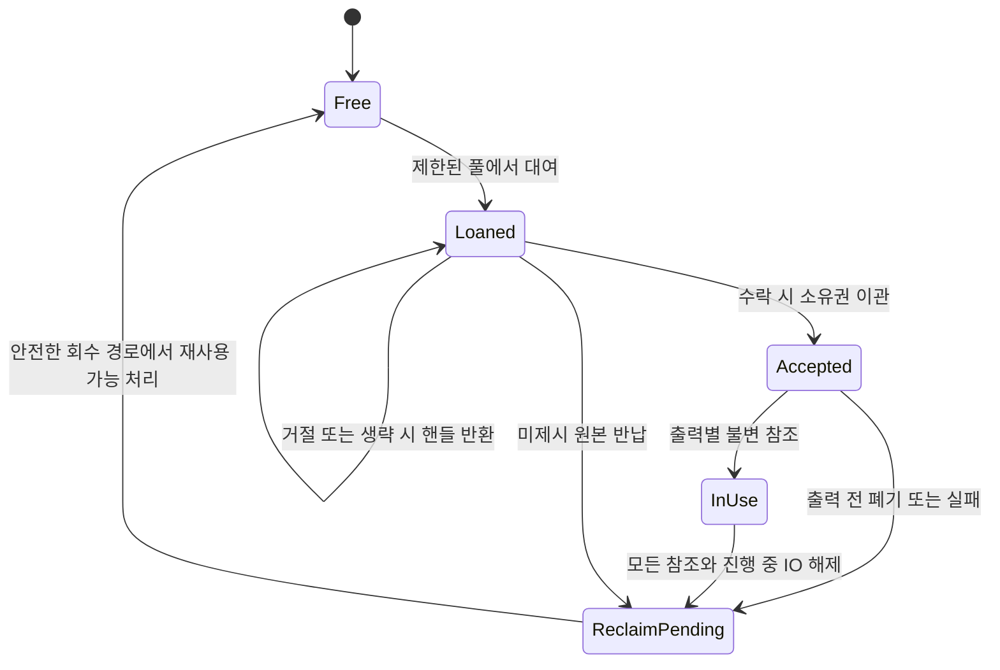

# 핵심 인터페이스 계약

- 관련 Intent: INT-001
- 상태: Approved — 2026-10-26 상세설계·ADR-008/009 기준선 채택. 공개 함수 표기는 설계 계약이며 컴파일/수명·실제 호환 검증은 구현 Task에서 수행한다.
- 해석 우선순위: §13~17과 ADR-008·009가 현재 상세 계약이다. §1~12의 초기 제안/미정 표현은 여기서 구체화한 범위에서 대체된다. 장비별 수치·알고리즘 증명은 미검증이다.
- 승인 기준선: ADR-003~009, US-001~005(US-002 AC6~10 포함)
- 후속 요구: FR-018 — 선택 옵션·기본 비활성은 Human 확정. 활성 시 전원 예고 전체 약 3초·중요 파일 우선 기록, §12·16의 상세 동작도 기준선 채택 완료, 실제 차단 검증 전.
- 갱신: 2026-10-26 / AI

## 1. 제공자·소비자와 실행 경계

| 경로 | 제공자/호출 주체 | 처리 책임 | 완료 의미 |
|------|-----------------|-----------|-----------|
| 등록·설정 | 애플리케이션/관리 클라이언트 | 로거 관리 경로 | 검증·등록/설정 적용 결과 |
| 기록 제시 | 등록된 생산자 | 제한된 수집 경로 | 수락 또는 거절. 저장 완료가 아님 |
| 완료 확인 | 애플리케이션/관리 클라이언트 | 백그라운드 출력/완료 관리 | 요청한 대상/완료 경계까지의 상태 |
| 조회·재생·구독 | 분석/모니터링 클라이언트 | 조회/전달 경로 | 소비 가능한 응답/전달. GUI 표시 완료와 구분 |
| 관측·조절 비교 | 개발자/클라이언트 | 계측·보고 경로 | 조건과 근거가 포함된 관측/검증/추정 보고 |
| 점검·종료 | 관리 클라이언트 | 관리·백그라운드 경로 | 완료/실패/시간 제한·미완료 범위를 포함한 결과 |

RT 호출은 기록 제시까지로 제한하는 안이다. 대기가 필요한 완료 확인·종료·점검·조회는 일반/관리 경로에 둔다. Rust 라이브러리 경계를 먼저 검토하고 원격 프로토콜·실행 배치는 ADR-007·009를 따른다.

## 2. 작업별 계약 검토안

| 작업 | 입력 의미 | 반환/관측 의미 | 검토할 제약 |
|------|-----------|---------------|-------------|
| 생산자/채널 등록 | 목적·스키마·출력 매핑·정책·크기/자원 예산 | 검증된 핸들·설정 revision 또는 구성 오류 | RT 실행 전 등록, 종료 중 등록·등록 수 상한 |
| 기록 가능 여부 확인 | 핸들·레벨/필터·선택 정보 | 현재 정책에서 기록 대상인지 | 공간을 예약한 의미는 아님. 실제 제시는 거절될 수 있음 |
| 소형 기록 제시 | 핸들·시각/순서·작은 구조화 payload·보존 중요도 | 수락 식별 또는 거절 이유 | RT 무대기. payload 생성·포맷·할당과 호출 비용 경계 정의 |
| 원본 기록 제시 | 유효 크기/메타데이터·제한된 원본 소유권 핸들 | 수락 시 소유권 이관, 거절 시 원본 반환을 우선 검토 | 최종 참조 해제/회수·거절 경로의 추가 작업과 수명 보장 |
| 완료 확인 | 기록/범위·대상 집합·원하는 완료 경계·제한 시간 | 대상별 완료/실패/폐기/미처리와 시간 제한 | 일반 경로. 일부 대상만 완료된 결과를 표현 |
| 조회·구독·재생 | 시간/채널/범위·필터·페이지/스트림 상한·재생 제어 | 읽을 수 있는 기록·결측/완료 범위·소비 흐름 | 동시 쓰기 가시성·취소·느린 소비자·메모리/IO 상한 |
| 보고서 조회 | 설정/장비/관측 구간·경로/채널 선택 | 부하·완료·지연·손실·예산·기준 유효성·추정 | 수집 근거와 불확실성을 표시. 계산은 RT 밖에서 수행 |
| 설정 제안/적용 | 현재 revision·개발자 조절 의도·대상 범위 | 검증된 변경안·효과 가정·명시적 적용 결과/새 revision | 고정값 유지·실행 중 변경 범위·되돌리기·기준 만료 |
| 간편 점검 | 재사용할 부하 프로필·완료 경로·시간/CPU/메모리/쓰기/공간 예산 | 실제 시험 범위·통과/실패/중단·추정과 추천 | 명시적 실행·임시 자원 관리·운영 기록 보호·상대 수신자 부재 |
| 종료 | 배출·동기화 범위·종료 제한 시간 | 최종 완료/미완료·실패 범위 | RT 밖에서 수행. 강제 종료/프로세스 중단의 보장 범위 별도 |
| 전원 이상 긴급 기록 | 예고 신호·차단 기한/남은 예산·사전 등록 중요 파일 계획 | 요청 인수와 파일별 영속 완료/실패/미완료 | FR-018. 전체 약 3초에 전달 지연·종료 여유 포함. 상세는 §12 검토안 |

위 작업명은 역할 설명이며 코드 API가 아니다. 어댑터가 요구하는 런타임/네트워크 기능을 수집 API의 필수 의존성으로 정하지 않았다.

## 3. 입력과 소유권·실패

### 3.1 등록·입력·동기 반환

이 절부터의 상세 동작은 권고안이다. 등록은 일반/관리 경로에서 수행하고 생산자·채널·스키마·최대 입력 크기·출력 계획·중요도 정책·자원 상한을 검증한다. RT 핸들은 하나의 직렬 호출 주체가 소유하는 안이다. 여러 스레드가 같은 논리 채널을 쓰려면 생산자 핸들을 각각 등록한다. 핸들의 임의 복제나 동시에 호출하는 공유 핸들은 아직 지원 계약으로 확정하지 않는다.

| 반환 분류 | 의미 | 원본 소유권 / 식별 |
|-----------|------|--------------------|
| Accepted | 처리 책임과 제한된 수집 공간을 로거에 이관 | 원본 핸들 소비, 수락 식별자 반환. 출력 완료 보장 아님 |
| Skipped | 활성 필터·샘플링 등 설정에 따른 의도적 생략 | 원본 핸들 반환, 수락 식별자 없음 |
| Rejected | 잘못된 입력·자원 한계·종료 등으로 수락하지 못함 | 원본 핸들 반환, 수락 식별자 없음 |

거절 이유는 최소한 `InvalidHandle`, `SchemaMismatch`, `TooLarge`, `Capacity(scope)`, `Contended`, `Closing`을 구분하는 안이다. `scope`는 수집 슬롯·원본 bytes·완료 추적 등 제한된 코드로 표현한다. RT 반환에 오류 문자열 포맷·동적 할당·사용자 콜백을 요구하지 않는다. 경합 재시도도 정해진 연산 한도 안에서 끝나야 하며 그 한도와 알고리즘은 후속 검증 사항이다. 등록된 계약 밖의 입력을 필터 생략으로 숨기지 않는다.

RT 수집 호출 내부는 사전 준비된 메모리만 사용하고 동적 할당·블로킹 잠금·OS I/O를 실행하지 않는 방향으로 검증한다. 제한된 복사·자원 판정·계측·동기화 연산까지 전체 경로 비용에 포함한다. 무대기 반환 계약과 특정 OS/장비에서의 호출 지연 목표 달성은 별개다.

소형 입력은 등록된 크기 상한 안의 바이트를 수집 공간으로 복사하는 안이다. 호출 뒤에는 애플리케이션 입력을 빌려 두지 않는다. 문자열 포맷·직렬화·사용자 payload 생성 비용은 호출 전 준비 비용으로 별도 계측한다. 원본 입력은 전체 바이트 복사 대신 §3.2의 제한된 소유권 핸들을 소비한다. 사전 기록 가능 여부 확인은 힌트이며 공간 예약·수락 보장이 아니다.

목표의 256 B는 소형 기록 시험 조건이며 API의 고정 최대 payload가 아니다. 32생산자·16파일·128채널 역시 검증 규모이며 제품의 고정 최대 개수로 변환하지 않는다. 실제 슬롯/bytes/객체 크기 상한은 등록/구성 계약에서 정한다.

### 3.2 원본 수명과 회수

RT 입력의 우선 검토안은 **사전 등록한 제한된 풀의 대여 핸들**이다. 생산자는 대여 중에만 내용을 쓰고, 수락 후에는 읽기·쓰기·재사용하지 않는다. 분배 이후에는 출력들이 불변 원본을 공유한다. 일반 `Vec`·`Arc`·외부 SDK 버퍼를 무조건 RT 입력으로 받는 계약은 두지 않는다. 외부 버퍼는 일반 경로에서 복사/등록하거나 해당 수명·회수 방식을 검증한 어댑터로 연결하는 안이다. 센서 SDK에서 풀로 입력하는 과정과 파일/네트워크 출력까지 완전한 zero-copy를 보장하지 않는다.



| 상황 | 처리 책임과 수명 |
|------|------------------|
| 거절·필터 생략 | 같은 핸들을 호출자에게 돌려준다. 내부 예약은 되돌리며 숨은 원본 참조를 남기지 않는다. 재제시/반납은 호출자가 선택한다. |
| 정상 수락·출력 분기 | 로거가 원본 수명을 책임진다. 각 출력의 참조와 복사/작업 버퍼를 예산에 포함한다. |
| 한 출력의 실패·폐기 | 그 출력이 더 이상 접근하지 않을 때만 참조를 해제한다. 다른 출력의 원본을 무효화하지 않는다. |
| 조회 취소·완료 대기 시간 초과 | 대기/조회만 끝낸다. 수락 기록 처리나 진행 중 IO를 암묵적으로 취소하지 않는다. |
| 종료·강제 중단 요청 | 신규 수락을 닫고 남은 참조/IO를 추적한다. 종료 시간이 지났다고 사용 중 메모리를 재사용하지 않는다. |
| 호출자 핸들·관리 객체 해제 | 풀에 접근 가능한 핸들이 남아 있으면 기반 메모리도 살아 있어야 한다. 최종 풀 소멸은 관리 경로에서 수행하도록 수명 계약을 검증한다. |

대여 핸들의 반납/Drop은 RT에서 큰 payload 해제·외부 SDK 반납 콜백·무한 재시도를 실행하지 않는 계약을 검토한다. 생산자 측에서 핸들이 소멸(Drop)되더라도 즉각적인 메모리 해제(OS deallocation)를 절대 수행하지 않고, 비소유/비차단 역방향 회수 큐(Recycle Queue)로 인계되어 백그라운드 워커에 의해 풀로 환원되는 RAII 안전 래퍼 구조를 검증한다. 회수 대기열이 찼을 때 동기 해제나 누수를 택하는 폴백을 두지 않는다. 슬롯별 반납 상태 또는 모든 대여 슬롯을 감당하는 회수 용량 등 **반납 경로가 포화돼도 반환 책임을 잃지 않는 구조**를 구현 전에 증명한다. 미제시 대여분·실패 후 반환분·회수 대기분도 계속 점유로 센다. 실제 자료구조·메모리 순서·관리 객체의 최종 해제 방식은 미정이며, 검증 전 RT 안전성 달성으로 표시하지 않는다.

근거: Rust의 [Arc 공식 문서](https://doc.rust-lang.org/std/sync/struct.Arc.html)는 마지막 참조 소멸 시 내부 값도 Drop됨을 설명한다. 따라서 공유 포인터를 사용했다는 이유만으로 최종 해제 비용이 RT 밖으로 이동했다고 판단할 수 없다. 제한된 풀/반납 구조는 이 프로젝트의 설계 제안이며 Arc 채택 결정이 아니다.

### 3.3 수락 시점과 설정·출력 계획

수락 판단과 공개는 하나의 논리적 경계를 갖는 안이다. 수락 식별자를 반환할 때는 기록 내용/원본 핸들·고정된 설정 revision·출력 계획·수집 및 추적 예산의 인수가 완료돼 있어야 한다. 중간 예약 실패는 모두 되돌린 뒤 거절하며 부분 수락을 동기 성공으로 반환하지 않는다. 구체 동시성 알고리즘은 미선정이다.

출력 계획에는 대상별 필수/선택 여부와 지원 완료 경계를 넣는다. **수락은 해당 계획의 처리 시도 인수이며 모든 출력 큐 공간이나 향후 성공의 원자적 예약이 아니다.** 후속 분배에서 필수 대상이 포화/실패하면 해당 대상의 실패/폐기를 명시하고 전체 요청을 성공으로 만들지 않는다. 선택 대상의 포화도 숨기지 않는다. 필수 대상 전체의 공간을 미리 예약하는 대안은 더 강한 초기 인수 조건을 주지만 RT 판단 비용과 출력 간 결합이 늘어 권고안에서는 보류한다.

한 기록에는 하나의 불변 revision/출력 계획을 연결하고 재시도·조회에도 유지한다. 설정 변경으로 과거 수락 기록의 대상을 바꾸지 않는다. 이전 설정/출력 계획의 수명도 제한 예산에 포함하고 회수 전 revision을 무제한 쌓지 않는다. 전역 동시 적용·실행 중 변경 가능 항목은 OQ-005로 남는다.

### 3.4 타임스탬프 삼원화 및 시계 동기화 계약

센서 퓨전 및 다중 생산자 분석을 위해 기록 봉투 메타데이터는 3가지 시간축을 선택적으로 다룬다.

| 시간축 | 정의 및 출처 | 용도 및 보장 |
|--------|--------------|--------------|
| `MonoTime` | 시스템 단조 시계 (`CLOCK_MONOTONIC` 또는 OS 동등물) | 필수. 제어 루프 주기 분석, 정렬, 로거 내부 지연 측정. 역행 없음 보장 |
| `RealTime` | 벽시계 (`CLOCK_REALTIME` 또는 OS 동등물) | 필수. 외부 시스템 이벤트 연관 및 절대 시간 조회. NTP/PTP 슬루/점프로 역행/도약 가능 |
| `SourceTime` | 센서 하드웨어/드라이버 생성 타임스탬프 | 선택. 카메라 셔터 시점, LiDAR 패킷 시각 등 정밀 센서 퓨전용 |

- NTP/PTP 시계 동기화로 인한 `RealTime`의 불연속 변화(점프)가 발생하더라도 `MonoTime`은 영향을 받지 않으며, 세션 메타데이터에 시계 기준점(Base Clock Offset)과 보정 이벤트를 기록해 재생/조회 시 시간축 왜곡을 보정할 수 있게 한다.
- 시간 기반 재생(Playback)의 기본 정렬 기준은 `MonoTime`을 권장하며, 벽시계 기반 질의 시에는 `RealTime` 인덱스를 사용한다.

### 3.5 스키마 식별 및 진화(Schema Evolution) 계약

데이터 구조의 변경과 장기 보존 로그의 판독 호환성을 위해 스키마 메타데이터 계약을 검토한다.

- **스키마 등록**: 모든 채널은 등록 시 `(schema_id, schema_version)` 및 필드 기술자(Descriptor/Schema Text)를 로깅 세션 메타데이터에 기록한다.
- **하위 호환 디코딩**: 신규 필드 추가는 선택적/기본값 허용 방식으로 설계하여 구버전 판독기가 신규 로그의 미인식 필드를 건너뛰고(Skip), 신규 판독기가 구버전 로그의 누락 필드를 기본값으로 채울 수 있도록 한다.
- **불가역 변경 격리**: 필드 타입 변경 등 호환 불가능한 변경은 새로운 `schema_id`를 발급하거나 주 버전을 올려 이전 로그 판독과의 혼선을 방지한다.

## 4. 완료 상태와 무결성

| 상태 | 의미 | 보장하지 않는 것 |
|------|------|------------------|
| 수락 | 로거가 해당 기록 처리를 받아들임 | 모든 대상 완료·영속 저장 |
| 파일 쓰기 완료 | 지정한 파일 쓰기 경계에 도달 | 전원 장애 영속성·다른 출력 완료 |
| 영속 동기화 완료 | 지정 범위와 필요한 메타데이터 동기화 결과 확인 | 장치 계약 밖의 고장 보장·미동기화 꼬리의 무손실 |
| 원격 활용 전달 완료 | 지정 수신 프로그램의 검증/소비 전달 경계 확인 | GUI 렌더링·다른 DB/파일 완료 |
| 실패/정책 폐기/미처리 | 경로별 원인·대상·기록/범위가 끝나지 않은 상태 | 임의로 성공 또는 측정된 처리량에 포함 |

### 4.1 식별·순서·완료 확인

수락 식별자는 `(session_id, producer_id, accepted_seq)`의 의미를 갖는 작은 비소유 토큰으로 제안한다. `accepted_seq`는 해당 생산자에서 수락될 때만 증가한다. 센서 프레임 번호/애플리케이션 발생 순서는 별도 입력 메타데이터이며 생략·거절은 반환/카운터로 센다. 세션 재시작이나 생산자 재등록 때 식별자를 재사용하지 않고 sequence 소진 시에는 관리 경로에서 갱신하거나 명시적으로 거절한다.

생산자별 수락 순서는 추적하되 전체 생산자·채널·출력의 전역 순서를 보장하지 않는 안이다. 출력이 순서대로 보이도록 요구하면 실패/폐기된 구간도 함께 표시해야 한다. 최고 완료 sequence만으로 모든 이전 기록의 완료를 추정하지 않는다. 큰 원본과 작은 기록의 처리 완료 순서도 다를 수 있다.

완료 조회는 기록 토큰 또는 **등록된 생산자 집합과 생산자별 수락 상한을 고정한 범위**를 받는다. 범위를 만든 뒤의 수락/신규 생산자는 자동 포함하지 않는다. 전 생산자를 같은 순간에 잘라 내는 전역 원자적 스냅샷은 보장하지 않는다. 조회에는 대상 선택·대상별 완료 경계·대기 기한을 명시하고 폴링/대기는 일반 경로에서만 수행한다. 조회 자체가 추가 전송/동기화를 시작하지 않는다. 요청한 경계가 기록의 처리 계획에 없으면 미지원/계획 오류를 반환하며, 명시적 동기화 실행 요청은 별도 관리 계약에서 정한다.

### 4.2 대상별 진행·결과와 대기 결과

| 구분 | 표현할 의미 |
|------|-------------|
| 진행 상태 | 대상별 최고 확인 경계와 아직 진행 중인 범위 |
| 완료 | 요청한 경계에 도달한 기록/범위 |
| 실패 | 더 진행할 수 없는 원인·대상·범위와 이미 확인한 경계 |
| 정책 폐기 | 구성된 정책에 따라 종료한 대상/범위. 수락 거절과 별도 집계 |
| 원격 결과 불명 | 전송 뒤 연결 단절 등으로 수신 활용 여부를 확인하지 못함. 미전달/성공으로 단정하지 않음 |
| 이력 만료 | 상세 조회 보존 범위를 벗어나 확인 불가. 성공/실패/아직 미처리로 변환하지 않음 |
| 대기 시간 초과/조회 취소 | 조회 작업의 결과이며 기록의 최종 처리 상태가 아님. 마지막 상태를 함께 반환 |
| 미지원/잘못된 범위 | 대상이 제공하지 않는 경계·알 수 없는 대상/세션·유효하지 않은 토큰. 대기 전에 오류 반환 |

쓰기 완료 후 동기화에 실패하면 쓰기 완료 사실을 유지하고 영속 동기화 실패를 별도로 표시한다. `Pending → Written → Synced` 하나로 모든 대상을 모델링하지 않는다. DB/원격의 경계는 어댑터가 선언하고, 수신 애플리케이션의 확인이 없으면 원격 활용 완료를 반환하지 않는다. 재시도로 생길 수 있는 중복/불명 상태를 성공으로 숨기지 않으며 exactly-once 전달은 아직 보장하지 않는다.

범위 결과는 요청한 대상·경계와 완료/실패/폐기/미처리/불명/만료 범위를 돌려주는 안이다. 필수 대상의 모든 요청 범위가 해당 경계에 도달해야 필수 범위 성공이다. 선택 대상도 요청에 포함하면 그 상태를 함께 보고한다. 예를 들어 파일은 쓰기 완료, DB는 실패, 원격은 대기 중이면 전체 출력 완료로 응답하지 않는다.

파일 쓰기 완료는 해당 기록의 인코딩 바이트를 사용자 공간 버퍼에서 OS 쓰기 경계까지 넘긴 의미로 검토한다. 파일 영속 동기화는 그 기록/범위를 포함하는 동기화 작업의 성공과 연결한다. Rust [File::sync_all 공식 문서](https://doc.rust-lang.org/std/fs/struct.File.html#method.sync_all)는 내용/메타데이터 동기화를 별도 연산으로 설명하며 File Drop의 오류는 무시됨을 명시한다. 파일 Drop을 정상 종료/동기화 성공으로 취급하지 않는다. 파일명·디렉터리·회전/인덱스 복구까지 포함한 영속 계약, OS별 구현과 장치 보장은 별도 검토 대상이다.

### 4.3 제한된 완료 이력과 수량 대조

상세 토큰/범위 조회에는 보존 시간·항목/bytes·동시 대기자 상한을 두고 유효 조회 범위를 노출한다. 완료 구간은 연속 범위로 압축하고 결측/실패 구간도 제한된 예산으로 관리하는 안이다. 구간 분열로 추적 예산이 부족하면 신규 수락을 거절하거나 계약된 이력 만료를 명시한다. 미처리 기록 상태를 몰래 버려 성공으로 만들지 않는다. 토큰을 보관한다고 원본 메모리나 상세 이력이 영구 보존되는 것은 아니다. 정확한 상한·집계/만료 방식은 구현 전 확정한다.

고정된 생산자/대상 집합·revision·대조 구간에서 다음 수량을 연결한다.

- 제시 수 = 수락 수 + 의도적 생략 수 + 수락 거절 수.
- 대상별 배정 수 = 해당 대상의 최종 성공 수 + 최종 실패 수 + 정책 폐기 수 + 진행 중 수 + 결과 불명 수. 최종 성공은 선언한 대상 완료 경계 기준이며, 쓰기/동기화 누적 카운터를 더해 기록 수로 쓰지 않는다.
- 대상에 배정되지 않은 기록은 그 대상의 분모에서 제외한다. fan-out 합계는 수락 수보다 클 수 있다.

상세 이력 만료 뒤에도 누적 집계의 범위/손실 여부를 명시한다. 원격 결과 불명을 나중에 해소하면 같은 기록의 상태를 전이하며 중복으로 최종 결과를 더하지 않는다. 실행 중 비동기 스냅샷의 일시적 불일치와 정지/배출 뒤 확정 대조를 구분하고, 애플리케이션이 API에 제시하지 않은 생성 데이터는 로거 자체 집계로 검증했다고 주장하지 않는다.

### 4.4 디스크 공간 부족(ENOSPC) 및 I/O 장애의 Fail-Safe 격리

저장 매체 가득 참(`ENOSPC`, Disk Full)이나 파일 시스템 쓰기 실패는 로깅 시스템의 치명적 상황이지만, 메인 로봇 제어 시스템의 생존을 위협해서는 안 된다.

| 장애 상황 | 로거 백그라운드 동작 | RT 생산자/상위 제어 영향 |
|-----------|----------------------|--------------------------|
| 디스크 풀 (`ENOSPC`) | 영향받는 파일 대상에 `IoFailure(ENOSPC)` 상태 마킹. 백그라운드 재시도 중단 및 손상 방지 파일 닫기 | RT 호출에 패닉·블로킹 전파 금지. 수집 큐 포화 시 정책에 따라 새 입력 거절 또는 카운터 집계 |
| 파일 권한/잠금 충돌 | 대상별 실패 기록, 리포트에 장애 알림 발행 | 정상 출력은 계속 처리하되 공유 CPU/장치 경합의 영향은 별도 계측 |
| 순환 로깅 회전 실패 | 오래된 파일 삭제 실패 시 신규 파일 강제 생성 중단 (디스크 고갈 방지) | 자원 한계에 도달하면 신규 수락을 `Capacity(DiskFull)`로 명시적 거절 |

- 복구 가능한 I/O 오류는 `Result`와 대상별 상태로 처리하며 RT에 panic/대기를 전파하지 않는다. 내장형 구조는 panic=abort·OOM·메모리 손상의 프로세스 장애까지 격리하지 못한다(ADR-007).
- 장애가 감지되면 관측 리포트에 즉각 `StorageDegraded` 지표를 노출하고, 복구(디스크 공간 확보 등) 전까지는 지정된 안전 정책(신규 입력 거절 또는 메모리 내 손실 카운팅)을 따른다.

## 5. 운영 관측·기준 능력·개발자 조절

보고서에는 최소한 설정 revision·측정 구간·생산자/채널/대상 범위·입력/완료량·단위·미처리량·지연·손실/의도적 생략·측정 기준의 출처/유효성을 연결한다. 기준선 목표, 일상 관측, 지정 시험으로 검증된 능력, 모델 추정, 미측정/기준 만료를 구분한다.

버퍼 bytes/슬롯·작업/회수 예산과 실제 원본의 수명 연장을 함께 집계한다. 회전/삭제·압축·중복 출력 후 실제 파일 증가와 파일 시스템 여유를 관측하고 버퍼 포화·출력 정지 가정·디스크 여유·순환 보존 창의 시간을 각각 표시한다.

개발자의 주기/필터·샘플링·원본/필드·출력 변경을 지원하는 API와 설정 단위를 검토한다. 변경안의 이유·절감과 기록 정보 손실·적용 가능한 범위·필요한 재점검을 제공하고 명시적으로 적용한다. 변경 전후의 비교는 조건 차이와 설정 revision을 남기며, 출력만 줄인 효과와 앱에서 기록 생성 작업을 줄인 효과를 구분한다. 자동 설정 변경/자동 제한은 현재 기본 범위에 없다.

## 6. 열려 있는 설계 결정

| 관련 미결 | 정할 내용 | 확정 시점 |
|-----------|-----------|-----------|
| OQ-002 | 실제 dot-probe 장비·제어 주기/부하·소형/원본 타입·크기·단계별 수치 | 실제 장비 대응/검증 설계 및 해당 계약 리뷰 |
| OQ-003 | ADR-008/§13~17 계약 승인. 잔여: 장비별 quota·보호량/허용 손실 수치와 수명/동시성 증명 | TASK-003~009·021·022 및 실제 검증 |
| OQ-004 | ADR-007·009 배치/기술 채택. patch·MSRV 로컬 확인(EV-001). 잔여: native OS/CPU/DB 호환 | TASK-002·019·022 |
| OQ-005 | 설정·리포트·점검 및 계측 목표 승인. FR-015는 별도 제안 | 관련 구현/검증 Task, TASK-018은 범위 승인 후 |

[요구사항 §15.4](../02_project_definition/requirement_spec.md#154-미결을-설계에서-확정할-보완-계획)의 승인된 수집 계획을 따른다. 채택한 계약/기술은 ADR-008·009를 따른다. 미확정 실장비 수치를 임의로 채우지 않는다.

## 7. 관련 기준

- [도메인·모듈 초안](domain_model.md)
- [요구사항](../02_project_definition/requirement_spec.md)
- [승인 Story/AC](../02_project_definition/user_story_registry.md)
- [ADR-005](adrs/ADR-005_design_baseline_and_deferred_decisions.md)


## 8. OS 지원·기능 탐색 계약 (Tier 1 vs Tier 2)

Linux·macOS·Windows에서 공통 수집·기록·조회/재생·리포트/점검·개발자 조절 계약을 제공하되, 플랫폼 역할을 **Tier 1 (Target / Full SLA)**과 **Tier 2 (Compatibility / Best-Effort)**로 분리한다.

- **Tier 1: Linux (PREEMPT_RT / 일반 Linux)**: 실제 로봇 탑재 타겟. 승인된 조건부 실시간 호출 지연(p99 ≤5 µs), 대용량 처리(1.0 GB/s), 활성 구성의 전원 차단 긴급 동기화(FR-018)를 목표로 장비별 검증하며, 백그라운드 워커의 CPU 코어 격리(Pinning) 및 RT 우선순위 설정을 지원한다.
- **Tier 2: Windows, macOS**: 개발자 워크스테이션 및 분석기. 기능적 호환성(API 동작, 데이터 수집/파일 생성, 크로스 파일 판독, 모니터링 클라이언트)을 제공·네이티브 검증하며, 엄격한 실시간 SLA 및 성능 측정 대상에서 제외(Best-effort)한다.

플랫폼/권한에 따라 지원하지 않는 고급 스레드 설정(예: CPU 코어 격리)·계측 지표는 지원 여부와 사유로 표현하는 안이다. 미지원 요청을 조용히 성공 처리하거나 해당 지표를0·정상 여유로 변환하지 않는다. 가능한 공통 경로와 성능/보장 범위를 설명하고, 플랫폼 전용 API/핸들을 일반 호출자의 필수 입력으로 정하지 않는다.

완료 경계와 단위·시각 의미는 공통으로 문서화하고 OS별 파일/영속 동기화·열린 파일 회전/삭제·오류·공간 조회의 실행 동작을 확인한다. R1은 Linux PREEMPT_RT 참조 프로필이며 다른 OS의 측정값·성능 보장으로 재사용하지 않는다. 보고서의 장비/설정/기준 프로필 식별에는 OS와 실행 환경도 포함한다.

- **OS별 영속 동기화 프리미티브**: Linux는 `fdatasync`/`fsync`, macOS는 `fcntl(fd, F_FULLFSYNC)`, Windows는 `FlushFileBuffers`를 기본 매핑 후보로 하며, 각 플랫폼 시스템 콜의 지연 특성과 전원 장애 내구성 보장 차이를 문서화하고 벤치마크 프로필에 반영한다.
- **파일 락 및 공유 플래그 (특히 Windows)**: Windows 환경에서 로거가 기록 중인 파일에 모니터링 클라이언트나 점검 도구가 접근할 때, 또는 순환 로깅 중 이전 세그먼트를 회전/삭제할 때 배타적 락으로 인한 `Access Denied` 실패가 발생하지 않도록 파일 생성 시 `FILE_SHARE_READ | FILE_SHARE_DELETE` (Unix open 플래그와 동등한 의미는 아니며 OS별 검증 필요) 플래그를 기본 적용한다.
- **백그라운드 워커 CPU 코어 격리 (Affinity/Pinning)**: 로거 설정(`WorkerThreadingConfig`)을 통해 백그라운드 I/O 워커들이 동작할 CPU 코어 목록(예: Core 0, 1)을 지정할 수 있다. Tier 1 Linux에서는 `sched_setaffinity`를 통해 RT 제어 코어(Core 2, 3 등)에서 worker 실행을 분리하며 IRQ·공유 자원 간섭은 별도 검증하고, Tier 2 OS에서는 플랫폼 지원 수준에 따라 적용하거나 기본 스케줄러에 위임한다.

[ADR-006](adrs/ADR-006_cross_platform_linux_macos_windows.md), [US-005](../02_project_definition/user_stories/US-005_cross_platform_support.md).

## 9. 중요도·예산과 포화 동작 권고안

### 9.1 기본 동작과 대안

ADR-003의 중요 기록 우선 기본값을 구체화하는 **2026-10-26 승인된 상세 계약**이다. 옵션 지원 방향은 유지하며 RT 호출의 공간/저장 무대기는 기존 확정 계약이다.

| 쟁점 | 권고안 | 대안과 비용 |
|------|--------|-------------|
| 초기 중요도 | `Normal`·`Important` 두 등급, 로그 레벨과 별도 지정 | 다단계는 표현력이 높지만 예약·공정성 조합이 늘어 후속 필요 확인 |
| 중요도 생략 | 명시값 → 채널에 설정한 분류/기본값 → Normal. 레벨 기반 채널은 등록된 매핑으로 분류 | 생략 자체를 오류로 만들면 명시성은 높지만 일반 기록의 사용 비용 증가 |
| 수집 포화 | 중요 기록용 slots와 bytes를 보호하고, 허용 공간이 없으면 새 입력 거절 | 수락된 저중요도 기록 축출은 중요 입력을 더 받을 수 있지만 분배/참조 회수와 완료 이력 처리가 복잡 |
| 같은 중요도 포화 | 먼저 수락한 기록을 유지하고 새 입력 거절 | 오래된 기록 폐기는 최신 관측에 유리할 수 있으나 수락 후 폐기와 순서 공백 처리가 추가됨 |
| 중요 기록까지 포화 | 무대기 거절과 원인 집계. 무손실 보장 없음 | 일반 호출의 제한 시간 대기는 별도 옵션. RT용으로 자동 전환하지 않음 |
| 느린 선택 출력 | 그 출력의 제한 예산 안에서만 유지하고 한계 도달 시 대상별 정책 폐기 보고 | 모든 출력 완료까지 무제한 원본 유지하면 공유 메모리가 고갈됨 |

레벨 기반 매핑을 선택했는데 매핑/채널 기본값이 불완전하면 등록 오류로 처리하는 안이다. Important 지정은 우선 수락 기회를 뜻하며 모든 출력 성공·영구 보존·일정 지연 보장은 아니다. 같은 등급의 원본 대용량 기록이 소형 중요 이벤트용 예약분을 소진하지 않도록 생산자/채널 또는 payload 종류별 예산 분할도 검토한다. 실제 예약 비율·최대 크기·스케줄링 공정성 수치는 장비/부하 확인 전 채우지 않는다.

### 9.2 예산 차감과 출력 장애

관리 예산은 수집 봉투 slots/bytes, 풀 할당·대여/로거 보유 원본 bytes, 출력별 참조/복사·작업 버퍼, 완료 추적/대기자, 회수 대기를 포함한다. 같은 원본 할당은 전역 물리 점유로 한 번 세고 출력별 보유 원인/참조를 별도로 보고한다. 출력이 별도 복사하면 그 바이트를 추가한다. 풀 사전 할당량과 사용 중/재사용 가능량을 구분하고 애플리케이션 외부 할당까지 전체 프로세스 상한에 포함됐다고 주장하지 않는다.

예약 보호는 수집 봉투뿐 아니라 실제 병목 자원에도 적용돼야 한다. 풀의 대여 단계부터 채널/중요도에 맞는 예약분을 보호하고, 대여할 때의 자원 분류와 제시할 때의 분류가 일치하는지 확인하는 안이다. 일반 입력이 중요 풀을 먼저 빌려 보호를 우회할 수 없어야 한다. 자원별 허용 검사를 모두 통과해야 수락하며 슬롯만 남거나 bytes만 남으면 거절한다. 모든 자원에서 Important 예약분을 일반 입력이 잠식하지 않도록 구성 검증한다. 숫자/예약 구현·부족 자원별 판정 순서는 후속 사항이다.

출력 정지 시 필수 대상도 무제한 재시도하지 않는다. 대상별 시도/시간/미처리 bytes 상한과 종료 결과를 사전 구성하고, 소진하면 실패/정책 폐기로 정리하는 안이다. 선택 출력은 해당 출력의 참조를 포기할 수 있지만 이미 진행 중인 IO 접근은 안전하게 끝나거나 취소 확인을 받아야 한다. 다른 출력도 공유 CPU/메모리/SSD 영향을 받을 수 있으며 완전한 성능 격리를 보장하지 않는다.

필수 파일에 실패한 수락 기록을 일반 메모리에서 끝없이 보관하거나 별도 비상 디스크로 자동 우회하지 않는다. 재전송·영속 스풀 같은 추가 수단은 필요성과 예산을 별도 결정한다. 수락 후 실패는 입력의 동기 거절로 소급하지 않는다.

## 10. API 사용 흐름과 종료 검토안

다음은 의미를 검토하기 위한 표기이며 컴파일 가능한 Rust 선언이나 최종 함수명이 아니다. 실제 타입/수명·오류 열거형·고정 크기는 계약 합의와 알고리즘 검증 뒤 정한다.

```text
설정: init_logger(session_config, worker_threading_config) -> Session 또는 오류
      - worker_threading_config: { cpu_affinity: Option<Vec<usize>>, priority: Option<Priority> }
관리: register_producer(channel_plan, limits) -> Producer 또는 구성 오류
준비: try_acquire(pool, channel_class) -> Loan 또는 대여 불가
RT:   try_record_small(producer, metadata, bounded_bytes)
        -> Accepted(receipt) | Skipped(reason) | Rejected(reason)
RT:   try_record_raw(producer, metadata, loan)
        -> Accepted(receipt) | Skipped(reason, loan) | Rejected(reason, loan)
관리: capture_scope(producer_set) -> 생산자별 수락 상한이 고정된 범위
일반: poll_completion(receipt_or_scope, targets_and_boundaries) -> 대상별 상태
일반: wait_completion(receipt_or_scope, targets_and_boundaries, deadline)
        -> Complete | Incomplete | TimedOut(snapshot) | QueryError
관리: shutdown(drain_plan, deadline) -> 완료·실패·미처리·회수 잔여 보고
```

수락 receipt는 원본을 소유하지 않는다. 거절된 loan은 재제시하거나 반납할 수 있다. 재제시는 같은 시도 안의 무한 재시도가 아니며 제어 경로 밖의 명시적 정책으로 다룬다. 소형 입력은 호출 뒤 계속 빌리지 않으므로 반환할 loan이 없다. 일반 호출의 제한 시간 수락 대기는 별도 API/명시 옵션으로 설계하고 RT 핸들에 대기 동작을 숨기지 않는다.

운영 예: 카메라 원본을 제시해 Accepted를 받으면 해당 메모리를 다음 프레임에 재사용할 수 없다. 로거가 사용하는 동안은 풀에서 다른 핸들을 얻는다. 풀 고갈로 대여에 실패하거나 제시가 Rejected면 입력 누락/거절을 구분해 집계한다. 파일 쓰기 완료와 원본 풀 복귀는 서로 다른 상태다. 원본 참조는 동기화보다 먼저 해제될 수도, 다른 출력 때문에 더 오래 유지될 수도 있다.

종료는 `Running → Closing → Closed`의 관리 상태로 검토한다. Closing 전환과 경합한 제시는 수락 경계에 따라 완전 수락하거나 원본을 반환하며 거절한다. Closed 성공은 선언된 배출/동기화 계획과 안전한 정리가 끝났을 때만 반환한다. 제한 시간에 도달하면 미처리 기록·대상·회수/IO 잔여와 계속 살아 있는 관리 책임을 보고한다. 진행 중 IO가 있는 메모리를 무효화하거나 백그라운드 객체를 조용히 버리지 않는다. 프로세스 중단 후 복구 가능 범위와 허용 손실은 형식/동기화 설계에서 별도 확정한다.

## 11. 리뷰 시나리오·승인 범위·잔여 사항

### 11.1 계약 대조 시나리오

아래는 **설계 리뷰 항목**이며 실행된 테스트 기록은 아니다. 세부 AC의 현재 승인 근거는 ADR-008이다. 코드가 없는 현재는 모두 실행 미검증이다.

| 소비자/조건 | 확인할 동작 | 후속 실행 검증 |
|-------------|-------------|----------------|
| 소형/원본 생산자 정상·생략·입력 오류 | 소형 입력을 호출 뒤 빌리지 않음, 원본은 수락만 소비하고 그 외 동일 핸들 반환 | 내용/수명·카운터 대조 |
| slots 여유·bytes 부족 및 반대 | 자원별 명시 거절, 부분 예약/참조가 남지 않음 | 경계값·경합·메모리 상한 |
| 일반 입력 포화 뒤 Important 입력 | 보호한 예약 자원을 사용할 수 있음. 예약분 소진 후 Important도 거절 | 혼합/편중 부하·제어 주기 영향 |
| 풀 반납·회수 경로 포화 | 거절된 핸들의 Drop/반납도 RT에서 동기 해제/콜백·누수로 우회하지 않음 | 최종 참조·관리 객체 해제·회수 중단 |
| 파일 정상·DB 실패·원격 정지 | 대상별 부분 완료와 참조 수명 유지, 무제한 재시도 없음 | 장애 주입·팬아웃·실제 소비 확인 |
| sequence 1 진행 중·2 완료 | 최고 완료 2를 연속 완료로 보고하지 않음 | 범위/결측·실패/폐기 대조 |
| 쓰기 완료 뒤 동기화 실패·회전 | 쓰기 성과를 보존하고 동기화/복구 범위는 별도 보고 | OS별 파일/이름/인덱스 복구 |
| 대기 취소·시간 초과·이력 만료 | 수락 데이터는 계속 추적, 조회 한계/만료를 성공으로 바꾸지 않음 | 제한된 이력·대기자·메모리 |
| 설정 교체·종료와 동시 제시 | 한 revision/계획에 속한 완전 수락 또는 원본 반환 거절 | 경쟁 조건·기존 설정 회수·잔여 IO |
| 보고서·조회/재생 | 제시/수락/거절·대상별 결과와 결측 구분, 읽을 수 있는 범위만 노출 | 집계 정합성·실제 기록 조회·부하 영향 |
| UPS 예고·중요 파일 긴급 기록 | 신호 발생부터 전체 약 3초 안에서 우선순위/최대 보호량·전달 지연·진행 중 IO를 함께 판정 | 실제 전원 차단·재기동 복구, §12 검토안 |

Linux 일반/PREEMPT_RT·macOS·Windows에서 해당 경로를 네이티브 실행하고 OS/장비·설정 revision·부하와 함께 검증한다. 현재 공통 의미만 설계했으며 어느 OS의 지연/영속성 달성도 확인하지 않았다.

### 11.2 이번에 검토할 계약 묶음

Human 검토 대상은 (1) 제한된 원본 풀/소유권 반환·RT 밖 회수, (2) 두 중요도와 예약 보호·신규 거절 기본 동작, (3) 생산자별 수락 식별·revision/출력 계획 고정과 대상별 부분 완료·제한된 조회 이력이다. §9.1의 대안 비용과 함께 검토한다. 기존 ADR-003의 옵션·기본값과 ADR-004의 저장 예산 분리는 유지한다.

2026-10-26 ADR-008·009와 §13~17을 기준선으로 승인받았다. 장비별 quota·보호량·허용 손실 수치와 동시성/회수 알고리즘의 실제 안전성·성능은 구현/검증 Task에서 확인한다. 설계 승인과 제품 실행 증거를 구분한다.

## 12. 전원 이상 시 중요 파일 우선 기록

### 12.1 요구와 예산

**FR-018 기능 방향은 Human 요청이며, 약 3초는 UPS 신호 발생부터 실제 전원 차단까지 전체 시간이다.** 로거 수신 후 3초를 추가로 확보한 것으로 계산하지 않는다. 시간·요구의 기준 본문은 [요구사항 §17](../02_project_definition/requirement_spec.md#17-전원-이상-시-중요-파일-우선-긴급-기록)이다. 아래 API와 동작은 상세 검토안으로서 이전 §11.2 계약 묶음과 함께 검토할 대상이다.

**Human 확정: 기능은 선택 옵션이며 기본값은 비활성이다.** 활성 상태에만 아래 긴급 계획/예산을 적용한다. 비활성 시 긴급 전환·전용 자원 예약을 하지 않으며 일반 기록/종료 계약을 유지한다. 통지 API에는 비활성/미설정 결과를 표현해 인수 성공으로 오인하지 않도록 검토한다. 활성화 구성의 유효성 검증·설정 revision은 관리 경로에서 처리하는 안이며 실행 중 변경과 빌드 기능 분리는 미정이다.

전달/감지 지연과 종료/전원 차단 안전 여유를 뺀 남은 시간 안에 중요 범위의 쓰기·필수 메타데이터·영속 동기화를 완료하도록 설계한다. 보호 범위는 파일/우선순위와 최대 미동기화량으로 제한하며 로거 전체 메모리 배출과 구분한다. 중요 파일의 기본 목록·순위·같은 순위 안의 순서와 정확한 시간 여유는 미정이다.

### 12.2 입력·실행·완료 계약 검토안

| 경계 | 검토안 |
|------|--------|
| 사전 등록 | 중요 파일 ID/순위·보호 범위·최대 미동기화 bytes·필수 복구 메타데이터/완료 경계·신호 전달 지연 상한·안전 여유를 관리 경로에서 검증 |
| 신호 입력 | 장치/OS 어댑터가 원인·신호 발생/수신 시각·검증한 차단 기한 또는 남은 예산을 전달. 하드웨어 시각과 로거 단조 시각의 대응/오차도 명시 |
| 빠른 통지 | 사전 준비한 제어 요청을 게시하고 인수 여부 반환. 인수 성공은 긴급 파일 저장 완료가 아님. 대기/할당/파일 IO를 비동기 OS 신호 핸들러나 RT 호출 안에서 하지 않음 |
| 제어 자원 | 데이터 큐 포화 때도 긴급 통지/계획을 표현할 수 있게 별도 제한된 제어 자원 검토. 기존 관리 대기열 뒤에 무기한 지연되지 않도록 설계 |
| 긴급 진입 | 관리 경로가 기존 Closing/종료 처리와 조정해 고정된 긴급 기록 범위/계획을 만듦. 일반 신규 입력 제한과 마지막 중요 상태 수락 범위는 사전 설정한 별도 예산으로 검토 |
| 우선 실행 | 파일 긴급 순위에 따라 중요 범위를 먼저 처리. 파일 내 앞선 바이트/인덱스 등 복구 의존성도 포함. 기록의 Normal/Important 분류와 별도의 파일 순위를 사용 |
| 비필수 작업 | 조회·압축·원격/DB 등 비필수 작업은 긴급 정책에 따라 유예/축소하되 진행 중 IO와 참조를 안전하게 유지. 중요 로컬 파일 성공이 외부 수신자 응답을 기다리지 않도록 검토 |
| 신호 중복/종료 경합 | 동일 사건을 중복 종료로 실행하지 않고 더 이른 유효 기한을 반영. 중복 수신마다 예산을 3초로 다시 시작하지 않음. 전원 복구 신호만으로 정상 재개할지는 별도 결정 |
| 결과 | 파일/범위별 쓰기·영속 동기화 완료와 실패/미완료, 기한·소요시간·사용한 계획 revision 보고. 전원 차단으로 결과 보고가 없으면 완료 불명으로 다루고 재기동 때 확인 |

#### 긴급 3초 단계별 부하 차단(Load Shedding/Fast Reject) 프로토콜

UPS 신호 감지부터 실제 전원 차단까지의 전체 예산(약 3초) 내에서 핵심 파일의 온전한 보존을 보장하기 위해, 긴급 통지 접수 즉시 3단계 부하 차단을 적용한다.

```text
[UPS 신호 수신]
  │
  ├─ 1단계 (Fast Reject): 신규 일반/대용량 로그 입력 즉시 차단 (Rejected: EmergencyPowerOff)
  │                      (사전 지정된 필수 상태/오류 스냅샷 슬롯만 엄격한 상한 내 수락)
  │
  ├─ 2단계 (Shedding):    원격 네트워크 전송, 시계열 DB 연동, 비중요/선택 파일 Flush 즉시 포기
  │                      진행 중인 저우선 I/O 취소 요청 및 리소스 반환
  │
  └─ 3단계 (Sync Focus):  사전 등록된 순위에 따라 1순위 중요 파일의 쓰기 버퍼 즉시 플러시
                         OS 영속 동기화(fsync/FlushFileBuffers) 집중 실행 후 안전 종료 마진 확보
```

개념 API는 `notify_power_fail(pre_registered_plan, deadline_evidence) -> request_status`와 관리 경로의 상태 조회로 검토한다. RT 생산자가 종료/동기화 완료를 기다리지 않는 기존 계약은 유지한다. 정확한 타입·스레드·큐/장치 어댑터는 미선정이다.

일반 파일의 큰 쓰기/동기화가 이미 진행 중일 수 있으므로 우선순위 변경만으로 시간을 보장하지 않는다. 긴급 경로의 최악 지연을 고려해 평소 처리 단위·중요 파일의 미동기화량을 제한하고, 필요하면 주기적 영속 동기화·별도 자원 배치를 비교한다. 이는 아직 주기/배치 채택 결정이 아니다. 유효한 시간 예산이 없거나 보호 범위가 예산을 넘으면 지원/완료를 성공으로 표시하지 않는다. 기한 초과만으로 진행 중 IO가 안전하게 취소된 것으로 간주하지 않는다.

실제 UPS 어댑터 선택을 위한 참고로 [NUT 구성 문서](https://networkupstools.org/docs/user-manual.chunked/ar01s06.html)는 UPS 통신/안전 종료 구성을 설명한다. 현재 NUT를 채택하거나 이 문서만으로 3초 신호 전달/저장 성능을 입증한 것은 아니다. 파일 쓰기와 영속 동기화의 구분은 §4.2의 Rust 공식 문서 근거를 따른다.

### 12.3 검증·잔여 결정

US-002 AC-6~10의 승인된 추가 수락 기준을 따른다. 기본 비활성의 일반 경로를 확인하고, 활성 구성은 여러 순위 파일·최대 보호량·큰 일반 IO 진행 중·신호 지연/중복·종료 경합·디스크 장애·CPU/IO 편중에서 신호 발생→전원 차단까지 계측해 재기동 후 파일/내용/복구 범위를 확인한다. OS/UPS/SSD·파일 시스템별 실행과 실제 차단 검증은 아직 없다. 우선순위/새 입력 제한·복구 경계는 OQ-003, 장비/보호량은 OQ-002, 어댑터와 계측/수락 조건은 OQ-004·005로 보완한다. 기능 추가는 이전 세 가지 핵심 API 권고안의 자동 승인이 아니다.

## 13. 상세 API 설계안

2026-10-26 추가 및 Human 기준선 채택 완료. §1~12의 초기 논의를 아래 계약으로 구체화했다. ADR-008·009에 따라 새 기본값·오류·소유권·통신을 채택한다. 컴파일/실제 수명 검증은 TASK-003·004에서 한다.

| API 후보 | 입력/결과 | 실행 경계 |
|---|---|---|
| `SessionBuilder::validate/build` | limits·target·schema·worker·durability 계획 → owner 또는 구조화된 설정 오류 | 일반 경로, 모든 quota 합계·최대 단일 원본 검증·예열 |
| `owner.scope(callback)` | scope 안에서 producer/loan을 빌려 사용, owner보다 오래 유지 불가 | RT 스레드 생성 전에 등록. 최종 해제는 scope 종료 후 관리 스레드 |
| `Producer::try_record_small` | 고정 metadata + `&[u8]` → receipt/생략/거절 | `&mut self`, 하나의 생산자·고정 상한 복사 |
| `Producer::try_acquire` | 크기 등급·importance → `Loan<'session>` 또는 Capacity | 유한 풀에서 하나 대여, 외부 SDK 버퍼 아님 |
| `Producer::try_record_raw` | metadata + loan → receipt 또는 이유와 같은 loan | 성공 때만 이동. pool/producer/class 불일치 거절 |
| `Loan::drop` | 슬롯 상태를 ReturnPending으로 게시 | payload free·callback·blocking 없이 반환 의무 보존 |
| `GeneralProducer::record_until` | 입력 + 단조 deadline → receipt 또는 Timeout/Closing | 일반 핸들만 사용, 매 시도 기한 확인. RT API에 대기 옵션 없음 |
| `completion.poll/wait` | receipt 또는 생산자별 고정 상한 + target/boundary | 일반 경로. `Expired`, `UnsupportedBoundary`, `TimedOut(snapshot)` 분리 |
| `control.sync` | 대상/생산자별 scope + deadline | 각 writer의 barrier까지 들어온 기록을 마감·sync. 단순 poll은 sync를 시작하지 않음 |
| `control.shutdown` | drain·sync 계획 + deadline → Closed 또는 Incomplete(report, owner) | timeout이면 owner/IO 메모리 유지. 후속 poll/join으로 정리 |

`SessionOwner`의 무거운 Drop을 RT에서 안전하다고 선언하지 않는다. borrowed producer/loan만 RT-safe Drop 대상이다. scoped API 제약 때문에 dot-probe의 장기 thread 통합이 곤란하면 TASK-004에서 owner 기반 대안을 재검토하고, 미검증 `Arc`로 수명을 우회하지 않는다.

고정 오류 코드는 `InvalidInput`, `SchemaMismatch`, `TooLarge`, `Capacity(resource)`, `RevisionBusy`, `Closing`, `EmergencyPowerOff`, `Unsupported`, `IoFailure`, `DeadlineExceeded`를 포함한다. 동적 진단은 일반 경로의 별도 리포트다. no-op tracing 어댑터도 RT 안전하다고 자동 선언하지 않는다.

TASK-002 구현 범위: `crates/dot-logger/src/config.rs`의 `SessionBuilder::new(config).validate(&PlatformCapabilities)`가 총 메모리·생산자별 소형/원본 고정 slot·중요 예약·worker stack·CPU 목록·required capability를 검증하고 읽기 전용 `ValidatedConfig`를 반환한다. quota/slot 크기는 명시 설정이며 R1 수치를 기본값으로 쓰지 않는다. 지원 미확인·실패·미지원은 구분하고 optional 상태도 결과에 보존한다. 이 API는 worker/IO를 시작하지 않는다. `build`·예열·실제 플랫폼 탐색/적용·target/schema/durability와 실제 metadata 할당 예산 검사는 해당 자원을 구현하는 후속 Task에서 확장한다. 위 표의 owner/수집/완료/종료 API는 설계 계약이며 아직 구현하지 않았다. 로컬 검증은 EV-001, native CI는 GAP-004다.

### 13.1 완료 추적의 실제 상한

생산자별 `accepted_seq mod window_size` 슬롯에 sequence generation과 대상별 bitset/상태를 저장한다. 모든 필수 추적 예산을 먼저 확보한 뒤 수락한다. 미완료 슬롯을 재사용하지 않는다. window가 가득 차면 `Capacity(Completion)`으로 거절한다. 완료 뒤 상세 이력의 보존 한도에 따라 축출하고 그 이전 receipt는 `Expired`다. 최고 sequence만으로 완료 공백을 지우지 않는다.

범위 결과는 bounded page로 반환한다. 각 페이지의 complete/failed/dropped/pending/unknown/expired 구간을 구분하며 상세 구간 개수가 응답 상한을 넘으면 cursor를 제공한다. 전체 성공 판정에는 모든 요청 범위의 결과가 필요하다. 수락 토큰은 원본 메모리를 소유하지 않는다.

## 14. 조회·재생·원격 계약안

| 작업 | 계약 |
|---|---|
| `Query` | session + time_basis(mono/real/source) + [from,to) + 채널/레벨 + snapshot + cursor. source 축은 clock domain·변환 정보 없으면 명시 거절 |
| 소형 페이지 | 기본 시험 상한 1,000건 또는 256 KiB 중 먼저 도달. 커다란 원본은 descriptor와 blob handle을 반환해 페이지 초과 방지 |
| 원본 읽기 | blob ID + offset + bounded length, 만료·보존 삭제는 Gone. 무제한 전체 파일 응답 없음 |
| 정렬 | 오프라인은 `(mono, producer_id, accepted_seq)`로 결정적 정렬. 벽시계 조회는 real + tie-break. live는 수락 순서/부분 순서와 late 여부를 노출 |
| Snapshot | segment/offset·설정 revision 고정. 후속 기록은 다음 snapshot. 핀 만료 시 cursor 만료 오류 |
| Replay | start/pause/resume/seek/stop, 유한 양수 배속. mono 기준 상대 스케줄, seek 때 generation 증가·기존 전송 취소/폐기 구분 |
| 늦은 replay 소비자 | offline은 제한 prefetch 안에서 재생 시계를 늦추고 지연 보고, live는 해당 구독만 drop/disconnect. RT 생산자까지 대기 전파 없음 |
| Subscribe | 필터·최대 records/bytes/age·원본 opt-in. overflow는 Gap(범위/이유) 후 계속 또는 disconnect 정책을 시작 때 선택 |
| 원격 완료 | receiver가 전체 record 조립·검증·소비 큐 인계한 뒤 receipt ACK. 네트워크 send 완료와 구별 |

gRPC/Protobuf를 통신 후보로 한다. `GetStatus`, `Query`, `ReadBlob`, `Replay`, `Subscribe`, `ApplyConfig`, `RunCheck`, `Compare`, `GetCompletion`을 서비스 메서드 후보로 둔다. bulk payload는 최대 256 KiB 조각, 레코드 ID/offset/총 길이/checksum과 완료 ACK를 갖는다. 연결별 동시에 조립할 원본 수·bytes·TTL을 협상해 메모리를 제한한다. 재연결 후 미확인 전송은 Unknown이며 자동 exactly-once를 제공하지 않는다. HTTP/2 흐름제어가 애플리케이션 큐 전체의 예산을 대신하지 않는다.

네트워크 서버는 기본 비활성, 활성화 시 기본 loopback이다. 비-loopback은 인증/TLS 구성을 명시하고 dot-probe의 기존 보안 정책과 연결한다. 파일 읽기·관측 권한과 설정·점검 권한을 구분한다. 원격 요청에서 임의 파일 경로·무제한 데이터/실행 예산을 받지 않는다. 서비스 token/인증 설정은 운영 로그에서 제외한다.

## 15. 설정·운영 계측·점검 계약안

`validate_config(base_revision, patch)`는 차이·예산·정보 손실·재시작 필요 여부를 반환한다. `apply_config`는 명시 요청만 수행하고 revision 불일치면 Conflict다. 라우팅/필터는 producer 경계에서 적용하며 모든 생산자가 같은 순간에 바뀐다는 보장을 하지 않는다. 응답은 posted revision과 per-producer applied revision을 분리한다. old plan을 처리 중이면 추가 업데이트는 RevisionBusy다.

RT는 producer-local 고정 카운터만 갱신하고, 관리 경로는 고정 atomic snapshot을 읽어 1초마다 집계하는 안이다. 상세 지연 histogram은 샘플링 또는 시험 모드로 분리한다. 채널 ID는 등록된 유한 집합이고 문자열 label·record ID를 지표 label로 늘리지 않는다. 기본 이력은 10/60/300초 추세에 필요한 고정 ring이며 raw 관측 무제한 보관은 없다.

보고서 값은 `Observed`, `Validated(profile_id)`, `Estimated(assumptions)`, `Unavailable(reason)`, `Stale`로 구분한다. 부하율의 분모는 동일 장비/기능/부하 조합의 검증된 완료 능력이다. 포화 예상은 가용 bytes와 slots 각각의 양의 순증가율로 계산해 먼저 오는 한계를 표시한다. 거절/폐기로 큐가 정체한 경우 Overloaded를 유지한다. 순환 보존 창과 디스크 소진 시간을 다른 필드로 둔다.

`RunCheck`는 dry-run 계획에서 시간·CPU worker 수·RAM·총 쓰기 bytes·디스크 reserve·상대 수신자·완료 경계를 먼저 보여준다. 실행은 명시 요청이다. 어느 예산이 먼저 소진되거나 운영 오류/공간 reserve 침범·취소가 오면 신규 부하를 중단하고 진행 중 IO를 정리한다. 결과는 Pass/Fail/Aborted/Inconclusive이며 짧은 점검을 24시간/UPS 검증으로 바꾸지 않는다. 사용자가 지정한 전용 시험 디렉터리만 만들고 지운다.

`Compare`는 before/after의 profile/revision/window·완료/지연/손실·의도적 생략·CPU/메모리를 대조한다. 다른 장비·부하/측정 경계는 비비교 가능으로 표시한다. 입력 자체를 조절하는 코드는 사용자 앱의 책임이며 로거의 샘플링은 기록량만 바꾼다. FR-015 추천은 제안 기능으로 명시하고 자동 적용을 하지 않는다.

## 16. 동기화·긴급 동작의 구체안

정상 파일 동기화는 explicit 또는 interval 옵션이다. 시험 프로필은 1초 요청 주기를 쓰되 실제 sync 완료 지연/미동기화 bytes를 계측한다. 제품 데이터 손실 상한으로 해석하지 않는다. 기본 모드·disk quota는 명시 설정이 필요하다. compression은 첫 성능 기준선에서 off, chunk CRC와 인덱스는 on이다.

FR-018 활성화는 재시작 때만 허용하는 안이다. 시작 전에 중요 파일 rank, 최대 미동기화 bytes, 신호 지연 상한, 안전 여유, 현재 장비의 검증 프로필을 받는다. 검증 프로필이 없으면 시험용 활성화임을 표시하고 Supported/3초 보장을 반환하지 않는다. 같은 rank는 target ID 순으로 결정적으로 처리한다.

긴급 통지는 사전 할당 atomic mailbox에 사건 ID와 **가장 이른 deadline**을 게시한다. 중요 snapshot용 사전 예약 슬롯 외의 신규 입력을 닫고, 선택 출력의 신규 작업을 중지한다. 실행 중 OS IO는 즉시 취소됐다고 가정하지 않으며 원본 참조를 유지한다. 이미 진행 중인 파일 sync의 최악 지연도 전체 예산에 포함한다. 정상 종료와 긴급 종료는 동일 coordinator가 상태 전이한다. 긴급 종료 뒤 자동 Running 복귀는 하지 않는다.

`available = poweroff_deadline - signal_received - safety_margin`이며 signal_received가 늦어졌으면 예산도 줄어든다. 전체 판정에는 신호 생성→수신의 지연을 포함한다. 예상 drain/sync가 available보다 크면 Unachievable과 파일별 partial 결과를 보고한다. 비활성에서는 긴급 전용 예약/전이가 없고 Disabled를 반환한다.

## 17. 첫 검증 구성과 상세 리뷰 경계

- 수집: 2 importance, Normal 기본, explicit → channel policy → Normal, Important 예약 slots/bytes, 신규 거절, producer별 FIFO.
- 원본/완료: owner가 메모리 소유, 슬롯별 반납 표시, bounded 완료 window, partial/expired/unknown 구분.
- 파일: MCAP·chunk CRC/index, 제한 회전, active safe offset, 복구 파일 별도 생성, 명시 quota/보존 설정.
- 활용: Rust API + CLI 범위는 승인. query/subscribe/replay·DB/gRPC 상세도 기준선 채택 완료.
- 관측/계측의 승인된 합격선: 안정 합성 입력에서 카운터 정합성은 배출 후 정확 일치, 안정 추세의 포화/소진 시간 추정 오차 ≤20%(5초 이상 예측 구간), 기본 계측 활성/비활성 완료 처리량 차이 ≤5%. RT 호출 목표는 계측 포함해서 기존 §12 목표로 판정한다. 이 추가 목표는 2026-10-26 Human 승인, 실제 달성은 미검증이다.
- 실장비 미확정: R1 조건은 유지하고 OS/CPU/SSD/UPS·제어 주기·deadline의 대응은 TASK-022에서 수집한다. 해당 정보 없이 실물 수락·Gate 4/5 통과로 표시하지 않는다.
