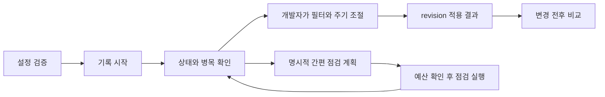

# 클라이언트·CLI 사용 설계

- INT-001 / 2026-10-26
- 제공 형태: **Human 확정 — Rust 클라이언트 API + CLI, dot-probe 기존 화면 연동**.
- 명령/출력 계약: Approved — 2026-10-26 상세 기준선 채택. 별도 GUI 제작은 첫 범위에 포함하지 않는다.

## 1. 사용자 흐름

## 2. 명령 후보와 결과

| 명령 | 핵심 입력 | 결과/오류 |
|---|---|---|
| `dot-logger config validate` | config 파일 | 합계 예산·지원 capability·재시작 필요·오류 위치 |
| `dot-logger status --json` | endpoint 또는 local session | 입력/완료/손실·큐/디스크·프로필과 미측정 상태 |
| `dot-logger query` | 시간축·구간·채널·페이지 상한 | record/descriptor·cursor·결측/만료 |
| `dot-logger tail` | 채널·레벨·원본 선택 | live 기록·Gap·연결 상태, 기본 원본 전송 off |
| `dot-logger replay` | 세션·시간·속도·출력 | 진행 시간·늦음·pause/seek/stop 결과 |
| `dot-logger config diff/apply` | base_revision·patch | 차이와 생략할 데이터, posted/applied revision |
| `dot-logger check plan/run` | profile·시간/쓰기/메모리 예산 | 계획과 명시 실행, Pass/Fail/Aborted/Inconclusive |
| `dot-logger compare` | before/after report | 완료량·지연·손실·자원 변화와 비교 조건 |
| `dot-logger recover` | 입력 파일·별도 출력 디렉터리 | 복구 범위·제외 꼬리·CRC 실패, 원본 보존 |

`config recommend`는 FR-015 별도 제안이며 Must 완료에 몰래 포함하지 않는다. 사람이 읽는 출력과 버전 있는 JSON을 함께 제공한다. 종료 코드는 0 성공, 2 입력/설정 오류, 3 부분 완료/기한 초과, 4 통신/IO 실패다. Ctrl-C는 취소를 요청하고 진행 중 IO 정리/미완료 범위를 보고한다.

## 3. 출력 원칙

보고서는 Observed/Validated/Estimated/Unavailable/Stale을 구분한다. 손실 때문에 큐가 안정된 경우 빨간 Overloaded 상태를 유지하며 원인을 수치로 설명한다. 단위는 records/s, bytes/s, ns/ms, MiB/GiB를 명시한다. 중요도와 로그 레벨, 순환 보존 시간과 공간 소진 시간을 다른 필드로 둔다. token/비밀번호·임의 사용자 payload를 오류 메시지에 노출하지 않는다.

Rust 클라이언트는 같은 결과 타입을 반환하며 dot-probe가 자체 화면으로 표현한다. 화면 렌더링 완료는 원격 데이터 활용 확인의 성능 경계에 포함하지 않는다. 연결 끊김/느린 소비자/재생 seek·만료 오류를 화면 어댑터가 처리할 수 있게 상태를 제공한다.
