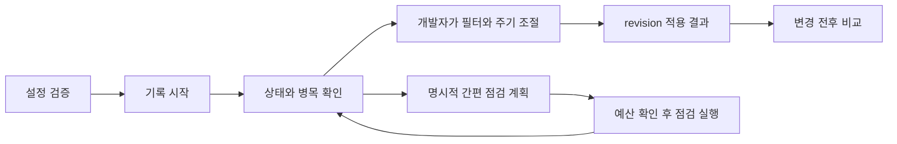

# 클라이언트·CLI 사용 설계

- INT-001 / 2026-10-26
- 제공 형태: **Human 확정 — Rust 클라이언트 API + CLI, dot-probe 기존 화면 연동**.
- 명령/출력 계약: Approved — 2026-10-26 상세 기준선 채택. 별도 GUI 제작은 첫 범위에 포함하지 않는다.

## 1. 사용자 흐름

## 2. 명령 후보와 결과

| 명령 | 핵심 입력 | 결과/오류 |
|---|---|---|
| `dot-logger config validate` | config 파일 | 합계 예산·지원 capability·재시작 필요·오류 위치 |
| `dot-logger status --json` | endpoint 또는 local session | 입력/완료/손실·큐/디스크·프로필과 미측정 상태 |
| `dot-logger query` | 시간축·구간·채널·페이지 상한 | record/descriptor·cursor·결측/만료 |
| `dot-logger tail` | 채널·레벨·원본 선택 | live 기록·Gap·연결 상태, 기본 원본 전송 off |
| `dot-logger replay` | 세션·시간·속도·출력 | 진행 시간·늦음·pause/seek/stop 결과 |
| `dot-logger config diff/apply` | base_revision·patch | 차이와 생략할 데이터, posted/applied revision |
| `dot-logger check plan/run` | profile·시간/쓰기/메모리 예산 | 계획과 명시 실행, Pass/Fail/Aborted/Inconclusive |
| `dot-logger compare` | before/after report | 완료량·지연·손실·자원 변화와 비교 조건 |
| `dot-logger recover` | 입력 파일·별도 출력 디렉터리 | 복구 범위·제외 꼬리·CRC 실패, 원본 보존 |

`config recommend`는 FR-015 별도 제안이며 Must 완료에 몰래 포함하지 않는다. 사람이 읽는 출력과 버전 있는 JSON을 함께 제공한다. 종료 코드는 0 성공, 2 입력/설정 오류, 3 부분 완료/기한 초과, 4 통신/IO 실패다. Ctrl-C는 취소를 요청하고 진행 중 IO 정리/미완료 범위를 보고한다.

## 3. 출력 원칙

보고서는 Observed/Validated/Estimated/Unavailable/Stale을 구분한다. 손실 때문에 큐가 안정된 경우 빨간 Overloaded 상태를 유지하며 원인을 수치로 설명한다. 단위는 records/s, bytes/s, ns/ms, MiB/GiB를 명시한다. 중요도와 로그 레벨, 순환 보존 시간과 공간 소진 시간을 다른 필드로 둔다. token/비밀번호·임의 사용자 payload를 오류 메시지에 노출하지 않는다.

Rust 클라이언트는 같은 결과 타입을 반환하며 dot-probe가 자체 화면으로 표현한다. 화면 렌더링 완료는 원격 데이터 활용 확인의 성능 경계에 포함하지 않는다. 연결 끊김/느린 소비자/재생 seek·만료 오류를 화면 어댑터가 처리할 수 있게 상태를 제공한다.

## 4. TASK-013 현재 구현 범위 — 2026-10-31

EV-025/REV-021로 Rust native client/server·CLI·offline query/timed replay·read-only source·Query/Blob→remote Replay 제어·Ctrl-C·stdout 인계 후 ACK·Gap/Unknown·권한/만료/한도 경로를 로컬 검증했다. [CLI 계약/예제](../../crates/dot-logger-cli/README.md)·[Rust/화면 어댑터 계약](../../crates/dot-logger-client/README.md)을 따른다. 출력은 schema_version1 NDJSON 또는 같은 논리 결과의 human text이며 큰 정수/시각/sequence/handle은 문자열, 128bit ID는 hex다.

위 명령 표는 최종 사용자 범위다. 현재 config validate는 offline session 선언/메모리 예약만 검증하고 source content/runtime capability 판정은 하지 않는다. status의 운영 지표는 Unavailable이며 0/합격으로 채우지 않는다. config apply·compare는 native host proxy다. check plan/run은 API §15.5의 등록 host backend로 연결한다. TASK-016 로컬 설정/비교 API는 API §15.2이며 이를 호출하는 운영 backend·CLI runtime 연결과 TASK-017은 API §15.3/15.4와 §15.5의 고정 host 등록·실제 Linux free probe·PlanCheck/RunCheck·CLI까지 로컬 제공한다. backend 부재는 Unsupported다. 계획은 무부하이고 run은 Manage 권한·단일 사용 ID이며 실제 file 결과 Pass=0/Fail=4/Aborted·Inconclusive=3, timeout은 기존 completion_unconfirmed다. 생산 capture/실제 수신자·dot-probe/실앱·성능/native는 후속이다. config diff는 유한 선언의 차이 여부만 표시하고 값을 노출하지 않는다. offline replay는 start, 실행 중 제어는 Rust API 또는 remote host 제어다.

복구는 단일 전체 immutable source·독립 create_new 출력과 file sync를 지원하고 namespace sync를 주장하지 않는다. partial active prefix recovery는 Unsupported이며 오류 출력은 조사용으로 보존한다. excluded suffix는 교체 index/summary도 포함한다.

Ctrl-C/기한은 협력 취소이고 실제 진행 IO 종료까지 정리한다. remote에서 이미 게시한 명령/ACK는 불명일 수 있으며 자동 reconnect/retry로 성공을 추정하지 않는다. Gone/expired·permission·version을 구분하고 stdout write/flush 실패 기록에는 ACK하지 않는다. 실제 dot-probe 화면/운영 보안 연동·성능/다른 OS는 해당 Task 후속이다.

## 5. TASK-020 S3 화면 구독 불연속 예제 — 2026-11-02

[dot_probe_tail](../../crates/dot-logger-client/examples/dot_probe_tail.rs)은 유한 화면 이력을 한국어 구분선과 JSON으로 표시한다. 대기 만료는 `Unconfirmed`, 종료/취소/오류는 종료 구분선, 명시 재구독은 새 segment다. 화면은 새 구독과 이전 구독의 선을 연결하지 않으며 누락 건수/범위를 추정하지 않는다. 구독 내 overflow만 transfer 범위와 새 span으로 표시한다. chart 계열은 segment/span과 원 source identity로 구분한다.

화면 이력 포화 시 기록 인계를 거절해 ACK하지 않고 종료 전용행을 남긴다. 소비 큐 인계/ACK와 그 뒤 렌더링은 별도이므로 이 예제의 stdout 실패는 이미 받은 기록/확인 ACK를 소급 취소하지 않는다. 실제 CLI tail의 stdout 인계 계약은 위 §4 그대로다. source ID는 hex, 큰 정수/시각은 문자열이며 원 receipt·revision·clock·payload를 보존한다. 실제 지속 화면 적용·장기 tail/복원·환경/성능 검증은 TASK-026/022 후속이다.

## 6. TASK-031 S2 실시간 화면 연결 — 2026-11-18

운영 PC에서 `dot-logger-viewer --upstream <URL> --catalog <JSON>`을 실행하고 출력된 loopback URL을 Foxglove WebSocket 종류로 연다. Raw Messages나 Plot에서 광고된 토픽을 구독한다. 화면 상태에 Upstream Gap(상류 transfer 순번), Viewer Gap(해당 소켓에서 버린 건), Unknown(범위 미확인), 재연결을 표시한다. 스키마 불일치가 관측되면 토픽 광고를 회수하고 로컬 목록 수정·재시작이 필요하다. [실행 예제](../../crates/dot-logger-viewer/README.md) · [API §24](interface_contract.md#24-task-031-s2-실시간-viewer--2026-11-18)

기록 모드는 `--replay-from-ns`·`--replay-to-ns`로 범위를 지정하고 토픽을 구독해 시작한다. viewer 터미널에 `seek MONO_NS`와 `speed N/D`를 입력한다. 시각화 앱은 같은 WS 주소에서 기록과 재생 시각을 받는다. [API §24.2](interface_contract.md#242-task-031-s3-원격-기록-재생--2026-11-18)

## 7. TASK-032 운영 대시보드 — 2026-11-21

[ADR-016](adrs/ADR-016_viewer_embedded_web_dashboard.md)에 따라 viewer 내장 웹(읽기 전용)으로 제공한다. 운영 PC에서 `dot-logger-viewer ... --dashboard 127.0.0.1:0`으로 실행하면 WS URL 다음 줄에 `http://` URL이 출력된다. 이 URL을 브라우저로 연다. [viewer README](../../crates/dot-logger-viewer/README.md#operations-dashboard)

| 단계 | 화면 | 데이터 | 표시 규칙 |
|---|---|---|---|
| S2 | 연결 머리줄 | viewer 설정과 마지막 GetStatus 결과 | endpoint, session, revision·`posted_revision`, 마지막 성공 시각. 실패하면 사유(끊김·권한 없음·시간 초과·Unsupported)와 실패 시각을 따로 표시 |
| S2 | 최근 표본·window | `status.v1`의 `latest`, `windows`(10/60/300초) | 각 값의 상태 배지(Observed·Stale·Unavailable+사유). 실제 from/to 구간. 없는 필드는 "미관측"이며 0으로 그리지 않음 |
| S2 | 전체·필수 출력 | `latest`의 `outputs`·`required_outputs` | 완료·실패·폐기·Unknown·pending 합계. `status.v1`에는 대상별 분해가 없어 두 합계로 표시한다. 0이 아닌 실패·폐기와 Unknown만 강조하고 Unknown은 실패와 다른 색 |
| S2 | snapshot 목록 | `status.v1`의 `snapshots` | ID·revision·epoch·구간. 등록 순서(ID 오름차순) |
| S3 | 전후 비교 | 두 snapshot ID로 Compare → `compare.v1` | `comparable`, 차이 8항목, 변화값 8개와 출처. 비교 불가면 수치 없이 사유만 |
| S3 | 점검 계획 | 계획 ID로 PlanCheck → `check.v1` 미리보기 | 선언 내용만 표시. 실행 버튼 없음(RunCheck는 CLI) |

- **갱신:** 1초 간격으로 GetStatus를 조회하고, 한 번에 하나만 진행한다. 상류가 실패하면 마지막 성공 값을 흐리게 남기고 그 시각을 함께 보인다.
- **기능 미제공:** facade 호스트처럼 Compare가 Gone이거나 PlanCheck가 Unsupported면 해당 영역을 "이 호스트에서 제공하지 않음"으로 표시한다.
- **변경 동작 없음:** ApplyConfig·RunCheck는 CLI(`config apply`, `check run`)를 사용한다.
- **범위 구분:** dot-probe 기존 화면(TASK-026)은 별도로 유지한다.

### 7.1 S2 구현 — 2026-11-21

- **경로:** `GET /`(페이지), `/dashboard.js`, `/dashboard.css`, `/api/status`. 그 밖의 경로는 404, GET 외 메서드는 405다.
- **`/api/status`(`dot_logger.viewer.dashboard.v1`):** `upstream`, `now_unix_ms`, `poll`, `last`로 이뤄진다.
  - `poll`: `interval_ms`, `attempts`, `state`(`pending`·`ok`·`failed`), `last_attempt_unix_ms`, `failure`(`reason`, `at_unix_ms` 또는 null).
  - `last`: 마지막 성공 응답의 `received_at_unix_ms`, `session`, `revision`, `metrics`. 성공 전에는 null이다.
  - `metrics`: 상류 `status.v1`을 그대로 넘긴다. 빈 보고는 `{"state":"Unavailable","reason":"no_runtime_metrics_backend"}`다.
  - 상태 응답이 아니거나 schema가 다르면 `failure.reason="corrupt"`로 기록하고 `last`는 유지한다.
- **실패 사유:** `disconnected`·`permission_denied`·`timed_out`·`unsupported`·`transport`·`corrupt` 등 원격 오류 이름을 snake_case로 쓴다.
- **화면 상태:**
  - 상류 실패: 머리줄에 사유와 시각, 마지막 상태 시각과 경과를 표시한다. 본문은 흐리게 남기고 "Not current" 안내를 붙인다.
  - viewer 무응답: 상류 배지를 내리고 "viewer unreachable since …"로 표시한다.
- **접근 경계:**
  - `Host`는 loopback 이름·주소이면서 listener 포트여야 한다. 형식이 틀리면 400, 다른 이름이면 403이다.
  - Origin은 loopback 또는 `--allow-origin` 값만 허용하고 나머지는 403이다.
  - 본문(Content-Length≠0·Transfer-Encoding)이 있으면 400, 머리 8 KiB 초과는 431이다.
  - 동시 연결은 8개, 머리 읽기 기한 2초, 연결당 요청 1개다. 응답은 `Cache-Control: no-store`와 제한적인 CSP를 붙인다.

### 7.2 S3 구현 — 2026-11-21

- **경로:** `GET /api/compare?before=ID&after=ID`, `GET /api/plan?id=ID`.
  - ID는 10진 u64만 받는다. 이름이 정확해야 하고 각 한 번씩이며, 다른 파라미터는 허용하지 않는다. 어기면 상류에 묻기 전에 400이다.
- **응답(`dot_logger.viewer.request.v1`):** `request`(`compare`·`plan`), `at_unix_ms`, `outcome`(`ok`·`failed`)로 이뤄진다.
  - 성공하면 `report`에 호스트의 `compare.v1` 또는 `check.v1`(kind `plan`)을 그대로 담는다.
  - 실패하면 `reason`만 담고 일부 보고서는 담지 않는다. 사유는 `gone`·`unsupported`·`permission_denied`·`corrupt`·`viewer_busy`·`timed_out` 등이다.
- **상류 사용:** 작업자 하나가 상태 조회와 대기열(4개)의 조회 요청을 한 번에 하나씩 처리한다. 상류 명령 슬롯은 최대 1개다. 전송 계열 오류에서만 연결을 다시 맺고, Gone·Unsupported 같은 호스트 응답은 연결을 유지한다.
- **비교 화면:**
  - snapshot이 2개 이상일 때만 선택 상자를 보인다. 목록이 바뀔 때만 다시 그려 선택이 유지된다.
  - 양쪽 window·조건을 표로 보이고 다른 칸은 강조한다. 차이 나는 조건 이름을 나열한다.
  - 변화 8항목을 상태 배지·방향·`after − before`·출처로 보인다. 비율은 /s(바이트 비율은 B/s)로 환산하고, 정확한 분수는 툴팁에 둔다. `cpu_rate`는 분수 그대로다. Unavailable은 사유와 "—"로 표시한다.
- **계획 미리보기:** 계획 필드를 모두 나열하고 "preview only, not run" 배지와 CLI 실행 안내를 붙인다. 실행 버튼은 없다.
- **기능 미제공:** `unsupported`는 "This host does not provide …", `gone`은 snapshot 해제나 미등록 계획 안내로 표시한다.
