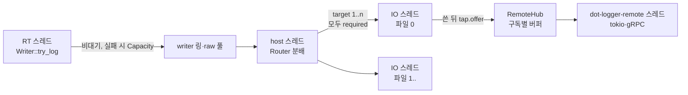
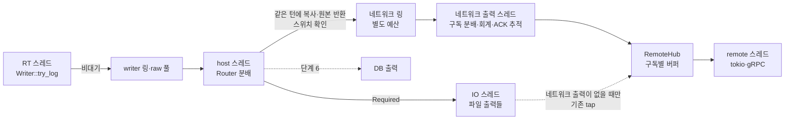

# MS-013 — 출력 구성 선택과 네트워크 전용 모드: 요구사항과 리팩토링 계획

- Intent: INT-001 / 주 Phase: Design → Build / 상태: **Draft r2 — 재리뷰 대기**([REV-075 요청](../../05_verification/reviews/REV-075_REQUEST.md)) / 갱신: 2026-11-27
- 계기: 2026-11-26 InfluxDB 논의 중 Human이 연구개발용 구조를 제안(R1~R3). 2026-11-27 우려 C1~C11 검토 뒤 Human 「내 요구사항과 리팩토링 계획을 한 문서에 작성하고, 리뷰 세션으로 리뷰 받고, 수정하고 다시 리뷰 받는 과정을 한번 거치자」.
- 진행 방식: r1(`da5f6c9`) → 독립 리뷰 [REV-074](../../05_verification/reviews/REV-074_MS013_OUTPUT_DESIGN_REVIEW.md)(Conditional, P1 4·P2 7·P3 1) → **r2(이 문서, 12건 모두 수용·반영, §11)** → 재리뷰 REV-075 → Human 승인(§2.3 H1~H5 포함) → ADR·요구사항 반영·TASK 등록 → 구현. 승인 전에는 제품 코드를 바꾸지 않는다.
- 버전: 공개 API와 원격 wire 계약이 바뀌므로 **0.2**. 착수 순서는 MS-012 → TASK-041(v0.1.1) 뒤(Q1, 리뷰어 동의).

## r2에서 바뀐 핵심 (REV-074)

1. **복사-즉시-반환(§5.1):** 네트워크 출력은 원본(writer 슬롯)을 붙들지 않는다. host가 분배한 그 턴 안에 네트워크 출력 큐를 비워 별도 예산의 **네트워크 링**에 복사하고 원본을 돌려준다. 원본 보유는 host 턴 하나로 한정되어 네트워크가 멈춰도 파일·RT 입구 자원을 잡지 않는다(RV-213).
2. **ACK는 복사본 수준의 보고(§5.3):** 원본 완료 경계는 `Handed`(링 복사) 하나로 고정하고, 수신 ACK는 선택 시 복사본 단위로 추적해 네트워크 보고에만 남긴다. core 종료가 ACK를 기다리지 않는다(RV-216·217). — C6 해석 변경이라 **H1 결정 필요**.
3. **손실 회계를 원본·링·구독 3단으로(§5.4):** 각 단계에서 배타적인 상태와 보존식을 정의하고, 건수와 payload 바이트를 함께 센다(RV-214).
4. **스위치는 분배 시점 컷오프 + epoch 표시 프레임(§5.6):** 생산자별 경계 seq를 담은 표시를, 그것을 요청한 구독에만 별도 frame으로 보낸다. 유휴 heartbeat도 함께 보낸다(RV-215). — wire 변경, **H3 결정 필요**.
5. **종료 순서·예산(§5.9), 메모리 목록(§5.10), 단일 네트워크 출력과 기본 경로(§5.2), 설정 병합표(§5.5), 단계별 수락 범위(§7), 측정 판정(§8.2)** 을 보완했다(RV-218~224).

## 목차

1. 요구사항
2. 결정 기록
3. 현재 구조(코드 확인)
4. 목표 구조
5. 설계 상세
6. 공개 API·wire 변경과 호환
7. 단계별 이행 계획
8. 시험·측정 계획
9. 위험과 열린 질문
10. 연결 문서와 승인 뒤 할 일
11. REV-074 반영표

---

## 1. 요구사항

### 1.1 Human 원문 요구 (2026-11-26)

| ID | 요구 |
|---|---|
| R1 | 시작 때 옵션 파일로 파일·네트워크·DB 출력을 배타적으로 또는 동시에 선택한다. |
| R2 | 초당 ~100 MB 단위동작 기록을 SSD에 쓰지 않고, 정해진 메모리 안에서 네트워크로만 보내 원격(예: 원격 PC의 Redis)에서 분석한다. |
| R3 | 원하는 순간에 외부(네트워크) 전송을 켜고 끈다. |

### 1.2 요구 해석 (2026-11-27 Human 결정 반영)

- **R2의 100 MB/s는 보장 목표가 아니라 사용 예다.** 링크 속도·수신 쪽 정지·Redis 보관량은 사용자 책임이다. 라이브러리의 책임은 네트워크 전용 모드의 **무손실 최대 처리량을 측정해 조건과 함께 공개**하는 것이다.
- **R1의 옵션 파일은 재빌드 없이 구성을 바꾸기 위한 것이다.** 코드 지정과 파일 지정을 둘 다 지원한다.
- R1의 「DB」는 MS-012에서 확인한 InfluxDB 출력이다(§5.7, 단계 6).

### 1.3 정제한 요구사항 (승인 뒤 `requirement_spec.md`에 올릴 후보)

| 후보 ID | 요구 | 수락 기준(초안) | 수락 단계 | 출처 |
|---|---|---|---|---|
| FR-019a | 파일·네트워크 출력을 하나 이상, 임의 조합으로 선언해 시작한다. 파일 출력이 없어도 시작한다. | 파일만/네트워크만/둘 다 시작·종료. 출력 0개는 시작 거절(`Missing::Output`). 충돌 구성(§5.2)은 명시 거절 | 2 | R1 |
| FR-019b | DB 출력을 단독 또는 파일·네트워크와 조합해 선언한다. | §5.7 설계 게이트 통과 뒤 단계 6에서 정한다. **그 전까지 DB 조합은 미수락** | 6 | R1 |
| FR-020 | 같은 구성을 코드(builder)와 옵션 파일 양쪽으로 지정한다. 파일은 시작 때 읽는다. | 같은 내용이면 해석된 구성·`Plan`이 같다. 병합표(§5.5) 대로 병합. 모르는 키·버전 불일치·비밀 값 직접 기재·크기 초과는 시작 전 거절, 오류에 원문·값 미노출 | 3 | R1·C7 |
| FR-021 | 네트워크 전용 모드: 로거 파일 IO 없이, 선언한 메모리 상한 안에서 기록을 원격 구독자에게 보낸다. | 로거가 만든 파일 0(명시 `loss_file` 제외), §5.10 예약 합계가 예산을 넘으면 시작 거절, 재연결·최대 구독·포화 중 heap 상한 유지, RT 무대기 | 2 | R2 |
| FR-022 | 네트워크 손실을 송신 쪽에서 센다. | §5.4 3단 회계의 보존식이 Health·종료 보고에서 성립. 정상 종료된 구독은 client Gap 수와 서버 `gap` 수가 같다 | 2 | C1 |
| FR-023 | 실행 중 네트워크 전송을 켜고 끈다. 켤 때 시작 위치를 돌려준다. | §5.6 계약: 꺼진 동안 새 사용자 payload 분배 0, epoch 표시에 생산자별 경계 seq, 표시를 요청한 구독은 경계를 받거나 명시적으로 끝남 | 4 | R3·C4 |
| NFR-009 | 네트워크 전용 모드의 무손실 최대 처리량을 기록 크기별로 측정해 공개한다. | §8.2 판정(거절·Gap·Unknown·누락·중복 0, 큐 비증가)으로 찾은 최고 속도와 조건 표 | 5 | R2 |
| NFR-010 | 모드별 보장 범위를 문서와 Health에 드러낸다. | §5.8 보장표가 README·rustdoc에, `Health.durability` 보고 | 2 | C10 |

### 1.4 범위 밖

- 옵션 파일 실행 중 다시 읽기(hot reload). 실행 중 변경은 레벨·샘플링과 새 전송 스위치만.
- pre-trigger 창(C4 후속 옵션).
- 원격 명령(gRPC)으로 스위치 조작(C8).
- Redis 등 수신 쪽 어댑터.
- 압축(B1 UC-23), 원격 실패 원인 구분(EV-124·126). keepalive 중 **유휴 heartbeat는 스위치에 필요해 단계 4에 넣는다**(H3). 활성 송신 중 조용한 단절의 즉시 감지는 범위 밖이며 §5.4에 감지 범위를 명시한다(Q6).
- 0.2에서 네트워크 출력 2개 이상(§5.2, H4).

## 2. 결정 기록

### 2.1 Human 결정 (2026-11-27 #001)

| ID | 결정 |
|---|---|
| C1 | 로봇 쪽 원격 손실 집계(구독별 보냄·Gap·끊김·Unknown 건수·바이트)를 Health·종료 보고에 **필수**로. 손실 구간만 남기는 로컬 요약 파일은 **선택 옵션**. |
| C2·C3 | 링크·수신·보관은 사용자 책임. 라이브러리는 최대 처리량을 측정·공개. 버퍼 크기 ÷ 속도 = 흡수하는 정지 시간 관계만 문서화. |
| C4 | 0.2는 「구독 먼저 → 스위치 켜기」 규약 + 켤 때 시작 위치 반환. pre-trigger 창은 후속. |
| C5 | 파일+원격 구성에서 기존 tap 의미 유지. |
| C6 | 원격 기본 완료 기준은 「보냄」, 수신 ACK 완료는 옵션. (r2에서 해석 정밀화 → H1) |
| C7 | 코드와 옵션 파일 **둘 다**. 같은 설정 타입으로 모이고, 파일 로딩은 선택 feature. 비밀은 경로·환경 변수 참조. |
| C8 | 스위치는 로봇 API 먼저. |
| C9 | 원격 전용 스레드, affinity 영향 측정. |
| C10 | 모드별 보장표를 문서에, Health에 내구 보장 수준 표시. |
| C11 | 0.2. keepalive·원격 실패 원인 구분·facade DB 출력과 같은 버전 묶음. |
| 문서 | 요구와 계획을 한 문서(이 MS)에. 독립 리뷰 → 수정 → 재리뷰 1회. |

### 2.2 AI 설계 제안 (리뷰 반영 뒤, 승인 대상)

| ID | 제안 | 위치 |
|---|---|---|
| P1 | 네트워크 출력을 Router 정식 target으로 두되, **소비는 host가 분배 턴 안에서 하고 네트워크 링에 복사 즉시 원본을 반환**한다. 기존 `remote()` tap은 네트워크 출력이 없는 구성에서만 그대로 둔다. | §5.1·§5.2 |
| P2 | 0.2의 출력 역할은 종류로 고정한다: 파일 = Required(지금 의미), 네트워크 = BestEffort. 공개 `OutputRole` 타입은 두지 않는다(공개 항목 절약, 필요 시 후속). | §5.1 |
| P3 | 원본 완료 경계는 새 core 경계 `Boundary::Handed`(링 복사). 수신 ACK는 복사본 수준 보고. | §5.3 |
| P4 | 출력에 이름을 붙이고 이름으로도 선택한다. index는 파일 선언 순서 그대로. | §5.2·§5.5 |
| P5 | 옵션 파일은 TOML, `version = 1`, 모르는 키 거절, feature `config-file`. 설정 타입은 feature 없이 존재. | §5.5 |
| P6 | 스위치 컷오프는 host 복사 시점. 꺼진 동안 **새 사용자 payload 분배 0**(host는 기록당 원자 읽기 1회로 상태 확인). epoch 표시는 별도 frame, 요청한 구독에만. | §5.6 |
| P7 | 측정·공개가 수락 기준. 루프백 4 KiB 이상 ≥ 300 MB/s(≈ 73,200건/s)는 승인 시 **내부 목표**. | §8.2 |

### 2.3 r2에서 새로 필요한 Human 결정

| ID | 질문 | AI 권고 | 이유 |
|---|---|---|---|
| H1 | C6 「수신 ACK 완료는 옵션」을 「수신 ACK **확인**은 옵션이며 결과는 네트워크 보고(복사본 단위)에 남고, 원본 완료·종료 판정에는 묶지 않는다」로 해석해도 되는가 | 예 | 원본을 ACK까지 붙들면 파일·RT 자원을 잠식하고(RV-213) 종료가 ACK 만료를 기다린다(RV-216). 복사본 ACK로도 「받았는지」는 확인된다 |
| H2 | ACK를 켜지 않은 구독의 `sent`는 「전송 계층에 넘김, 수신 미확인」으로 보고하는 것으로 충분한가 | 예 | ACK 없이 끊기면 받은 것과 못 받은 것을 구별할 방법이 없다(RV-214). 확인이 필요하면 ACK 옵션 |
| H3 | 스위치용으로 **유휴 heartbeat**(표시를 요청한 구독, lease/2 주기)를 단계 4에 넣는가(keepalive 안건 일부 선행) | 예 | 「구독 먼저 → 켜기」에서 꺼진 시간이 lease(기본 10 s)보다 길면 구독이 닫힌다(RV-215) |
| H4 | 0.2는 네트워크 출력 **최대 1개**, `remote()`와 `network_output()` 동시 선언은 시작 거절인가 | 예 | 구독 원천·계수 귀속이 모호해지고(RV-219) 구독 wire에 출력 이름이 없다 |
| H5 | 출력을 지정하지 않은 채널(`tracing` 포함)의 기본 경로: 파일 출력이 있으면 **모든 파일 출력**(지금과 같음), 파일 출력이 없으면 **모든 출력**인가 | 예 | 기존 구성의 트래픽을 바꾸지 않으면서 네트워크 전용 구성의 선언 부담을 줄인다 |

## 3. 현재 구조 (2026-11-27 `a9082bc`·`4f7ec58` 코드 확인, REV-074 대조)



| 사실 | 위치 |
|---|---|
| facade 출력은 파일뿐. 파일이 없으면 `StartError::Missing(FileOutput)` | `logger/mod.rs` `Missing::FileOutput` |
| 모든 파일 출력은 Router target `required: true`·`pending_slots: 0`·`max_attempts: 1`·`queue_slots` = 전체 기록 수. 공유 기록 한도가 먼저 차 느린 출력이 RT `Capacity`로 역류. target 한도 초과는 `Capacity`, 큐 삽입 실패는 정책에 따라 `RetryExhausted`·`PendingFull` | `logger/budget.rs`, `routing/mod.rs` |
| Router target ledger는 그 target의 delivery가 살아 있는 동안만 세고, 입력 풀·완료 창 예약을 출력별로 남기지 않는다 → 원본을 오래 붙드는 출력은 writer 풀(특히 작은 raw 풀)을 소진할 수 있다 | `routing/mod.rs`(REV-074 RV-213) |
| 완료 경계는 `Enqueued·Written·Synced·DatabaseAcknowledged·ReceiverAcknowledged` 5개, 완료 표는 `word & 31` 5비트 마스크 | `completion/types.rs`, `completion/mod.rs` |
| 원격은 target이 아니다. 첫 파일 출력 IO 스레드가 배치 쓰기 성공분(오류 시 쓴 prefix)을 `Tap::offer`로 구독마다 복사하고 결과를 버린다 | `logger/host.rs` `write_batch`, `logger/remote.rs` `offer` |
| 원격 손실은 로거 쪽에 집계되지 않는다. 구독자만 Gap을 본다. `offer`가 `Ok(PendingAck)`이어도 뒤에 Gap·Disconnect가 될 수 있다 | `logger/health.rs`, `adapters/remote/hub.rs` |
| 출력 0으로 라우팅되지 않는 채널은 구독에 보이지 않는다. 구독 필터는 채널·레벨·원본 포함 여부이고 출력 이름은 없다 | API §18.12, `adapters/remote/server.rs` |
| facade 원격 한도 기본값: 연결·구독·명령 각 4, `record_bytes` = 가장 큰 slot, `subscription_records` = 모든 slot 수 합, `subscription_bytes` = **max(min(모든 slot 바이트 합, 4 MiB), record_bytes)**, `message_bytes` 32 KiB, `max_age` 10 s(기록 나이 한도이자 협상된 유휴 lease), `request_timeout` 5 s | `logger/remote.rs` `default_limits` |
| `RemoteLimits.message_bytes` 상한 16 MiB(메시지 단위, 큰 기록은 chunk로 나뉨). `reservation()`은 어댑터 버퍼만이고 runtime·TLS·HTTP2는 별도 여유 | `adapters/remote/types.rs` |
| 클라이언트는 모르는 frame kind를 `Corrupt`로 끝낸다 | `dot-logger-client/src/transport.rs` |
| 고급 경로 ACK 관측: `PendingAck`, `RemoteDelivery::poll` → `ReceiverAcknowledged`/Unknown/Dropped(한 delivery ↔ 한 구독) | `adapters/remote/hub.rs` `offer_delivery` |
| core Closed는 optional target까지 포함한 `totals.pending`·drain이 0이어야 한다. facade는 core Closed 뒤에 remote를 멈춘다(정지 뒤 2 s 유예). 주기 sync는 facade가 파일 target 전체 목록을 넘긴다 | `control/mod.rs`, `logger/host.rs` |
| 전역 `worker_failed`가 켜지면 host가 `core.control().close()`로 RT 수락을 닫는다 | `logger/host.rs` |
| 실행 중 변경은 채널 레벨·샘플링뿐. 원격 ApplyConfig도 Route 패치는 InvalidInput | `logger/mod.rs` `set_channel`, API §22.2 |
| 출력 미지정 채널은 모든 파일 출력, 명시 index는 파일 선언 순서. `tracing` 채널도 미지정 경로 | `logger/mod.rs` `route_targets` |
| 파일 예약 토픽 `.logger/meta`·`.logger/loss`(ADR-013 개정) | `storage/codec.rs` |
| facade 공개 이름 항목 **35개**(한도 60, NFR-008), 스냅샷 `tests/api-surface/logger.txt` | `scripts/check-integration-surface.py` |
| 처리량 근거: 고급 경로 루프백 784 MB/s는 **8 MiB 기록**, 유선 1 GbE 약 116 MB/s는 대용량. 4 KiB 소형 근거 없음. Windows 짧은 대기 해상도로 소형 처리량 저하(EV-128) | EV-105·EV-128 |

**이 구조로 R1~R3이 안 되는 이유:** ① 파일 없이 시작 불가 ② 원격이 파일 IO 스레드에 매달려 있음 ③ 원격 손실을 로거가 모름 ④ 옵션 파일 없음 ⑤ 실행 중 전송 on/off 없음.

## 4. 목표 구조



- 출력 = 이름 + 종류(File/Network, 단계 6에 Database). 모두 Router target이다.
- 네트워크 target은 Router에 있지만 **소비자는 host 자신**이다. 분배 턴이 끝날 때 그 target 큐를 비워 링에 복사하고 완료를 `Handed`(복사) 또는 `Dropped`(링 가득·출력 실패)로 즉시 보고한다. 원본은 그 턴 안에 반환된다.
- 네트워크 출력 스레드는 링에서 꺼내 구독 버퍼로 나누고, 구독별 결과와 (선택) 복사본 ACK를 회계한다. 원본과 무관하다.
- 파일 출력은 지금 의미 그대로(Required, Written + sync).
- 시작 조건은 「출력 하나 이상」. 파일이 없으면 `Health.durability = None`.

## 5. 설계 상세

### 5.1 원본 보유와 자원 격리 (P1·P2, RV-213)

- **보유 한계:** 네트워크 target의 delivery는 host가 분배한 **같은 턴** 안에 링 복사 뒤 반환된다. 네트워크 스레드·구독·링크 상태와 무관하다. 그래서 네트워크 출력은 writer의 small·raw·Important 슬롯과 완료 창을 턴 길이 이상 붙들지 않는다.
- **링:** `ring_bytes`(payload + 기록당 메타)·`ring_records` 상한, 별도 예산(§5.10). 링이 차면 새 기록을 넣지 않고 `Dropped(Capacity)`로 완료하고 `ring_full`로 센다(가장 오래된 것을 지우지 않음 — 이미 일부 구독에 나갔을 수 있어 회계가 꼬인다).
- **Router 설정:** 네트워크 target은 `required: false`, `pending_slots: 0`, `queue_slots` = 한 턴의 분배 상한(`records_per_turn`). 턴마다 비우므로 이 큐는 턴 사이에 쌓이지 않는다.
- **비용:** 복사는 host 스레드 CPU를 쓴다(100 MB/s ≈ memcpy 수 ms/s). 파일 경로·RT 지연에 주는 영향은 단계 5에서 잰다(K8).
- **계약(시험 대상):** 같은 부하에서 「파일만」 대비 「파일 + 멈춘 네트워크」의 RT `Capacity` 거절·파일 완료·`is_success`가 같다. 작은 writer quota(raw 2 슬롯), 다중 채널, 구독 정지, 네트워크 스레드 정지(시험 훅)에서 확인한다.
- **Health:** `Failure::IoPoisoned`는 파일(Required) 출력의 IO 실패로 의미를 좁힌다. 네트워크 출력 실패는 `Degraded(OutputLosing)`이며 기록은 계속한다.

### 5.2 네트워크 출력 선언·tap·기본 경로 (P1·P4, C5, RV-219, H4·H5)

- **선언:** `LoggerBuilder::network_output(name, NetworkOutput)` — 서버 설정(`ServerConfig`)·구독 한도(`RemoteLimits`, 생략 시 기존 결정적 규칙)·링 크기·ACK 사용 여부·초기 스위치 상태.
- **개수:** 0.2는 최대 1개(H4). 2개 이상, `remote()`/`remote_with()`와 동시 선언은 `StartError::Conflict`로 거절한다. 네트워크 출력의 서버가 관리 요청(GetStatus, 레벨·샘플링 ApplyConfig)도 맡는다.
- **tap 규칙(C5):** 네트워크 출력이 없는 구성(`remote()`만)은 지금과 완전히 같다. tap 구성에는 스위치가 없다(`set_output_enabled`는 `NotFound`).
- **기본 경로(H5):** 출력 미지정 채널과 `tracing` 채널은 파일 출력이 있으면 모든 파일 출력, 없으면 모든 출력으로 간다. 파일과 네트워크가 함께 있을 때 네트워크로 보내려면 채널마다 이름으로 지정한다(기존 트래픽 불변).
- **이름과 index:** `ChannelOptions::outputs(&[usize])`는 파일 선언 순서 index 그대로(기존 의미 불변), `outputs_named(&[&str])`는 모든 종류. 한 채널에 두 방식을 섞으면 `InvalidOutputs`.
- **차이 문서화:** 네트워크 출력 구독자는 「그 출력으로 라우팅된 것」을 본다(파일 쓰기 실패 기록도 갈 수 있음, 출력 0에 없는 채널도 보임).

### 5.3 완료 경계와 ACK (P3, C6→H1, RV-217)

| 대상 | 경계 | 결정 시점 | 결과 |
|---|---|---|---|
| 원본(core 완료) | `Handed`(새 `Boundary`) | host가 링에 복사할 때 1회 | `Handed` / `Dropped(Capacity)`(링 가득) / `Dropped(...)`(출력 실패) / 정책 생략(스위치 꺼짐) |
| 복사본(구독별) | 보고만 | 네트워크 스레드 | §5.4 L3 상태. ACK를 켠 구독은 `acked`/`unacked` |

- 구독별 결과(필터 제외·Gap·ACK)는 원본 완료에 접지 않는다. 그래서 「0명·필터·부분 ACK일 때 원본은 언제 완료인가」의 답은 항상 「복사 시점에 `Handed`」다(fanout 규칙 불필요).
- **core 변경(단계 1):** `Boundary::Handed = 5` 추가, 완료 마스크 5→6비트(`word & 63`)와 이를 쓰는 조회·집계·abandon·정리 경로, `Boundaries` 상수, 공개 `Boundary` exhaustive match 영향(0.2 breaking). Required 파일 target 계약은 그대로 `Written`.
- **스위치 꺼짐의 완료:** 정책 생략으로 즉시 정산한다. 기존 `DropReason`(Capacity·RetryExhausted·PendingFull·Expired·Cancelled)에 맞는 것이 없으면 `Policy` 계열을 단계 1 S0에서 정한다(손실 보고에서 사고성 손실과 구분).
- **ACK(H1):** `NetworkOutput::acknowledgements(true)`이면 구독이 ACK 창을 협상하고, 네트워크 스레드가 복사본을 ACK·만료까지 추적한다(복사본 메모리는 구독 예산 안). ACK 대기는 원본·core 종료와 무관하다.

### 5.4 손실 회계 (C1·H2, RV-214)

세 단계, 각 단계는 배타적 상태와 보존식을 갖고 **건수와 payload 바이트**를 함께 센다.

| 단계 | 단위 | 보존식 | 상태 |
|---|---|---|---|
| L1 원본 | 네트워크로 라우팅된 원본 | `routed = handed + ring_full + output_failed + switched_off` | `switched_off`는 정책 생략, 나머지 둘은 사고성 손실 |
| L2 링 | 링에서 꺼낸 기록 | `handed = dispatched + no_subscriber + ring_pending` | 꺼낼 때 활성 구독 집합을 고정한다. 0명이면 `no_subscriber`(손실) |
| L3 구독 | 구독별 대상 사본 | `targeted = filtered + offered`, `offered = gap + too_large + sent + cut + in_flight` | `filtered`는 정책 생략. `gap`은 구독 버퍼 포화로 보내지 않음, `too_large`는 한도 초과 기록, `sent`는 마지막 chunk를 스트림에 넘김(H2: ACK 없으면 수신 미확인), `cut`은 넘기기 전·중에 구독 종료, `in_flight`는 스냅샷 시점 진행 중(Closed에서 0) |
| L3 ACK | ACK를 켠 구독의 `sent` | `sent = acked + unacked + ack_pending` | `unacked`는 만료·종료로 확인 못 함(Closed에서 `ack_pending` 0) |

- **구독 식별:** 재연결은 새 구독 ID. 활성 구독은 개별 계수, 끝난 구독은 **최근 8개 상세 + 퇴역 총계**만 유지(이력 무한 증가 방지, RV-218).
- **노출:** `Health.network`(출력별 L1·L2 + 활성 구독 L3 요약), `FacadeReport.network`(Closed 최종, Incomplete는 `in_flight` 포함 중간값임을 표시).
- **client 대조:** 정상 종료(Gap 프레임까지 전달)된 구독에서 client가 본 Gap 수 = 서버 `gap`. Gap 프레임에 바이트 합이 없어 바이트는 서버 계수만.
- **조용한 단절의 감지 범위(Q6):** keepalive가 없으므로 송신 중 경로가 조용히 끊기면 TCP 버퍼가 찰 때까지 `sent`로 센다. 그 뒤 구독 버퍼가 차 `gap`이 늘고, 기록 나이가 `max_age`(기본 10 s)를 넘으면 서버가 구독을 끊어 남은 것을 `cut`으로 센다. **감지 지연 ≤ 구독 버퍼가 차는 시간 + `max_age`**, 그 사이 `sent`는 수신이 보장되지 않는다(H2). 유휴 중 단절은 H3 heartbeat 주기 안에 감지.
- **로컬 손실 파일(C1 옵션):** `NetworkOutput::loss_file(path, max_bytes)` — 명시 옵션이며 **디스크 쓰기가 생긴다**. 네트워크 스레드가 1초마다 그 사이 손실 구간(생산자별 seq 범위·상태)을 합쳐 한 줄 쓴다. `max_bytes`(기본 1 MiB)를 넘으면 앞에서 잘라 돌려 쓴다. 쓰기 오류는 `Degraded(OutputLosing)`로 보고하고 기록은 계속한다. 파일 출력이 있으면 `.logger/loss`에 같은 손실을 남기는 것은 단계 2 S0에서 결정(ADR-013 예약 토픽 규칙과 함께).

### 5.5 설정 타입·옵션 파일·병합 (P4·P5, C7, RV-221)

- **`LoggerConfig`(feature 없음):** budget·출력(이름·종류·종류별 설정)·채널 정책(토픽별 출력 이름·`minimum`·`important_from`)·writer quota·스위치 초기 상태. `LoggerBuilder::config(LoggerConfig)`.
- **코드와 파일의 분담:** 채널 타입(`channel::<T>(topic)`)과 writer 이름은 코드에서 선언한다. 파일은 그것을 이름으로 참조해 정책·출력·예산을 정한다. 파일에만 있는 토픽·writer는 시작 거절.

| 항목 | 병합 단위 | 규칙 |
|---|---|---|
| budget | 필드별 | 뒤 호출이 그 필드를 덮음. 안 준 필드는 유지 |
| preset | 전체 | 지금처럼 resolve 때 **비어 있는 손실 값만** 채움(코드·파일이 준 값이 이김) |
| 출력 | 이름별 | 같은 이름은 뒤가 항목 전체를 교체, 새 이름은 선언 순서대로 추가. 파일 출력 index는 최종 파일 선언 순서 |
| 채널 정책 | 토픽·필드별 | 뒤가 그 필드를 덮음 |
| writer quota | writer 이름별 | 뒤가 교체 |
| 경로 | — | 파일 안 상대 경로는 **설정 파일이 있는 디렉터리 기준** |
| 오류 우선순위 | — | 파일 파싱 오류 → 스키마 오류(모르는 키·버전·비밀 값) → 병합 충돌(이름 중복 종류 불일치) → `start()` 검증 |

- **동등성:** 코드 구성과 파일 구성은 **해석된 `LoggerConfig`와 `Plan`이 같음**으로 시험한다. 값의 출처는 `Plan`에 넣지 않고 별도 `LoggerBuilder::explain() -> PlanSources`로 준다(공개 `Plan` 필드 불변).
- **파일(feature `config-file`):** `LoggerConfig::from_toml_path(path)`·`from_toml_str`. `version = 1` 필수, `deny_unknown_fields`, 크기 상한 1 MiB를 **읽는 중에**(`Read::take`) 적용.
- **오류:** `ConfigFileError { kind: ConfigFileErrorKind, line: Option<u32>, column: Option<u32> }`. `Display`·`Debug`는 kind와 위치만, `source()`는 `None`(TOML 라이브러리 오류·원문 조각을 연결하지 않음). 비밀 키에 값을 쓰면 `SecretValue` kind.
- **의존성(단계 3 S0):** `serde`(workspace에 있음)·`toml` 추가 전 MSRV 1.85 resolver·`cargo audit`·라이선스 확인. feature 조합: 없음 / `config-file`만 / `config-file`+`remote` / +`influxdb`. `config-file`만 켜고 네트워크 출력을 쓴 파일은 `Unsupported`(feature 없음)로 거절.
- **예시(초안, 예산 안에 맞춤 — 단계 3에서 실제 시작 시험):**

```toml
version = 1

[budget]
memory = "1 GiB"          # 링 64 MiB + 구독 2 × 128 MiB + 파일·입력 예약 + 여유
sync_every = "100 ms"
drop_deadline = "3 s"

[[output]]
name = "net"
kind = "network"
bind = "0.0.0.0:7400"
tls_cert_path = "certs/logger.crt"   # 설정 파일 디렉터리 기준
tls_key_path = "certs/logger.key"
subscriptions = 2
subscription_bytes = "128 MiB"
ring_bytes = "64 MiB"
enabled = false                      # R3: 꺼 둔 채 시작

[[output]]
name = "disk"
kind = "file"
directory = "/data/logs"
retention = { ring = "8 GiB" }

[channel."robot/joint"]
outputs = ["net"]
[channel."robot/event"]
outputs = ["net", "disk"]
minimum = "info"
```

### 5.6 전송 스위치 (P6, C4·C8·H3, RV-215)

- **API:** `Logger::set_output_enabled(name, enabled, deadline) -> Result<SwitchReceipt, SwitchError>`, `Logger::output_state(name)`.
- **`SwitchReceipt { epoch, changed, at_ns, subscribers, boundary: Vec<(producer_id, next_seq)> }`** — `subscribers`는 **적용 시점**의 표시 수신 가능 구독 수, `boundary`는 생산자별로 이 epoch에 처음 포함될 `accepted_seq`.
- **선형화:** 명령은 host 명령 큐로 직렬화된다. host가 턴 시작에 적용하며, 이미 같은 상태면 새 epoch 없이 `changed: false`로 현재 epoch를 돌려준다. host가 적용하기 전에 `deadline`이 지나면 **적용하지 않고** `Timeout`(「Timeout = 미적용」 보장). Closing 이후는 `Closing`.
- **컷오프 = host 복사 시점:** 꺼진 동안 수락되어 host에 쌓인 기록도 켠 뒤 복사되면 보낸다. 그 경계는 `boundary`가 생산자별 seq로 정확히 알려준다. 끌 때는 링에 이미 들어간 기록(켜진 epoch 소속)을 다 보낸 뒤 OFF 표시가 나간다. 꺼진 동안 새로 라우팅된 기록은 `switched_off`(정책 생략)로 즉시 정산한다. 그래서 완료 셀이 남지 않는다.
- **비용:** 꺼진 동안 host가 기록당 상태 원자 읽기 1회. **새 사용자 payload 분배·복사 0.**
- **표시 frame(wire):** 구독 요청에 `epoch_markers: bool`(protobuf 새 필드). 서버는 구독 응답에 지원 여부를 돌려주고, 요청한 구독에만 새 frame kind(epoch 표시·유휴 heartbeat)를 보낸다. **요청하지 않은 구독(기존 client 포함)은 새 frame을 절대 받지 않는다.** 표시는 채널 필터를 거치지 않는다. 구독마다 표시용 예약 슬롯 1개가 있고, 앞 표시가 아직 나가지 못해 넣을 수 없으면 서버가 그 구독을 이유 `MarkerOverflow`로 명시적으로 끝낸다(조용히 잃지 않음).
- **유휴 heartbeat(H3):** 표시를 요청한 구독에는 기록이 없을 때 `max_age/2`마다 heartbeat를 보낸다. 그래서 꺼진 시간이 길어도 구독이 유지되고, 유휴 중 단절도 그 주기 안에 드러난다.
- **client:** `dot-logger-client` 구독 옵션 `epoch_markers(true)`와 `RemoteEvent::Epoch { epoch, enabled, boundary }`(0.2 client API 추가).
- **시험:** OFF 중 수락·ON 뒤 분배된 backlog의 첫 수신 payload·receipt를 `boundary`와 대조, 빠른 OFF/ON, 포화 중 표시(전달 또는 명시 종료), 다중 생산자, 종료 경합, 기한 초과 미적용, 중복 토글, 기존 client가 새 frame을 받지 않음.

### 5.7 DB 출력 (단계 6, 설계 게이트, RV-220)

- MS-012 결과: v2 쓰기는 2.9.1·3.12.3 모두 동작, 조회(Flux)는 v3에서 404, 타입 충돌 배치는 v3에서 전체 거절(EV-134). DB 장애 동작은 TASK-047.
- 게이트에서 정할 것: Record → DB 필드 매핑(TASK-044와 함께), 배치 거절·부분 ACK의 완료 보고, 출력 역할(Required/BestEffort), 파일 없는 DB 전용 구성의 종료, `DatabaseAcknowledged`(API ACK) ≠ 내구성 표기.
- **FR-019b는 단계 6까지 미수락**이며 0.2 alpha 범위 표에 「DB 조합 미포함」으로 적는다.

### 5.8 모드별 보장표 (C10, RV-220)

| 구성 | 내구성 | UPS 경보 뒤 마감 | 손실을 누가 아나 | `Health.durability` | 파일 관련 API |
|---|---|---|---|---|---|
| 파일만 | sync 주기마다 확정 | 적용(3 s 예산) | 로거(종료 보고·`.logger/loss`) | `File { sync_every }` | 지금과 같음 |
| 파일 + legacy tap(`remote()`) | 파일과 같음 | 파일만 | 파일은 로거, tap 사본은 구독자 Gap만(로거 집계 없음, 지금과 같음) | `File { .. }` | 지금과 같음 |
| 파일 + 네트워크 출력 | 파일만 | 파일만 | 파일은 로거, 네트워크는 §5.4 회계 + 구독자 Gap | `File { .. }` | 지금과 같음 |
| 네트워크만 | 없음(메모리) | 적용 안 됨 | §5.4 회계(+ 선택 `loss_file`) + 구독자 Gap | `None` | `sync_every` 불필요(주면 시작은 하되 `plan()` 경고 `PlanWarning::Unused` — 같은 설정을 여러 구성에 재사용할 수 있게), `drop_deadline` 필요, `directories()` 빈 목록, 이벤트 보존(`mark_event`) `Unsupported` |
| DB 포함 | API ACK(`DatabaseAcknowledged`)는 디스크 보장 아님 | 게이트에서 결정 | 게이트에서 결정 | 게이트에서 결정 | 단계 6 |

### 5.9 종료 순서와 실패 격리 (RV-216)

1. 입구 닫기(지금과 같음).
2. host 분배 drain: 네트워크 target 몫은 복사 즉시 정산되므로 **core pending에 네트워크가 남지 않는다.**
3. 파일 drain·최종 sync → core Closed 조건(지금과 같음). 주기·최종 sync 목록은 **파일 target만**(네트워크 ID 제외).
4. 네트워크 단계: 링 복사 중지 → 네트워크 스레드가 링 잔여를 `min(남은 기한, network_drain)`(기본 1 s) 동안 보냄 → ACK 창 종료(남은 ACK 대기는 `unacked`) → hub 정지. 기존 2 s 유예는 `min(2 s, 남은 기한)`.
5. 최종 계수 스냅샷 → `FacadeReport.network`. 기한이 먼저 끝나면 `Incomplete`에 `in_flight`·`ack_pending`이 남은 중간값을 담고, `PendingShutdown`의 최종 보고는 Closed 값.
- **성공 판정(Q2):** `is_success()`는 지금 의미(Required 출력 완료·sync·기한)를 유지하고 네트워크 손실은 넣지 않는다. 새 `FacadeReport::is_lossless()` = `is_success()` && 네트워크 사고성 손실(L1 `ring_full`·`output_failed`, L2 `no_subscriber`, L3 `gap`·`too_large`·`cut`, ACK 시 `unacked`) 0. 네트워크 전용에서는 두 판정을 함께 보고한다.
- **네트워크 스레드 실패:** 그 출력만 Failed(`Degraded(OutputLosing)`), 이후 host는 네트워크 몫을 `output_failed`로 정산한다. **전역 `worker_failed`를 켜지 않아 RT 수락을 닫지 않는다.**

### 5.10 메모리 예약 목록 (RV-218)

| 항목 | 크기 | 파티션 |
|---|---|---|
| 네트워크 링 | `ring_bytes` + `ring_records` × 메타 | external |
| 구독 버퍼 | `subscriptions` × `RemoteLimits::reservation()`(payload·메시지·ACK 창 포함) | external |
| 표시 예약 슬롯 | `subscriptions` × 1 frame | external |
| 구독 회계 | 활성 `subscriptions` + 퇴역 상세 8개 + 총계(고정 크기) | control |
| 손실 파일 버퍼 | 1초 합침 버퍼(고정) | control |
| 네트워크 출력 스레드 스택 | `STACK_BYTES` 1개 | worker |
| runtime·TLS·HTTP2 | 예약 밖(기존과 같이 별도 여유로 문서화) | — |

- 합계가 `Budget::memory_bytes`를 넘으면 시작 거절(`StartError::Budget`). `plan()`이 네트워크 예약을 보고한다.
- 시험(단계 2): 예산 경계 ±1 바이트에서 시작 거절/성공, 재연결 1,000회·최대 동시 구독·포화 지속 중 heap 상한(soak heap 표본 방식), 퇴역 이력 고정 크기.

## 6. 공개 API·wire 변경과 호환 (0.2, RV-221·224)

| 구분 | 항목 | 호환 |
|---|---|---|
| 추가(facade) | `network_output`, `NetworkOutput`, `Logger::set_output_enabled`·`output_state`, `SwitchReceipt`, `SwitchError`, `ChannelOptions::outputs_named`, `file_output_named` | 새 항목 |
| 추가(facade) | `LoggerConfig`(+ 하위 설정 타입), `LoggerBuilder::config`·`explain`, `PlanSources`, feature `config-file`의 `from_toml_*`·`ConfigFileError`·`ConfigFileErrorKind` | 새 항목 |
| 추가(facade 보고) | `NetworkHealth`, `NetworkReport`, `SubscriptionReport`, `Durability`, `Health.network`·`Health.durability`, `FacadeReport.network`, `FacadeReport::is_lossless`, `Degradation::OutputLosing` | **기존 struct 필드·enum 변형 추가 → breaking**(리터럴·완전 match) |
| 변경 | `Missing::FileOutput` → `Missing::Output`, `StartError::Conflict`·`PlanWarning::Unused` 추가 | **breaking** |
| 변경(core) | `Boundary::Handed` 추가(완료 마스크 6비트), 정책 생략 `DropReason` 필요 시 추가 | **breaking**(core 공개 enum) |
| 변경(의미) | `Failure::IoPoisoned`는 파일 출력 한정 | 문서 의미 |
| 유지 | `Plan` 공개 필드, `remote()`/`remote_with()` tap 의미, `ChannelOptions::outputs(&[usize])` index 의미 | 유지 |
| wire | 구독 요청 `epoch_markers`, 구독 응답 지원 표시, 새 frame kind(epoch·heartbeat) — 요청한 구독에만 | 기존 client 무영향(새 frame 미수신). 새 client ↔ 옛 서버는 응답에 지원 표시가 없으면 표시 없이 동작 |
| client | `epoch_markers` 옵션, `RemoteEvent::Epoch` | 0.2 client 추가(`RemoteEvent` 완전 match는 breaking) |

- **`#[non_exhaustive]`(Q7):** 새 보고 타입(`NetworkReport` 등)은 처음부터 `#[non_exhaustive]`. 기존 `Health`·`FacadeReport`·`Missing`·`Degradation`에 붙일지는 단계 2 S0에서 dot-probe·예제·외부 소비자 검사(`check-external-consumer.py`)의 이관 비용을 보고 결정한다.
- **NFR-008 공개 항목 예산:** 현재 35/60. 위 새 이름 항목 약 15개 → 약 50. 단계마다 `check-integration-surface.py`로 세고, 55를 넘으면 하위 설정 타입을 하위 모듈로 내리는 방안을 검토한다. L3 「네트워크 전용」 레시피(L1 대비 +6줄 이하)를 단계 2 완료 조건에 넣는다.

## 7. 단계별 이행 계획 (RV-220·223)

각 단계는 TDD이고, 끝날 때 두 Rust 전체 회귀·Clippy·feature 조합·`check-integration-surface.py`·CI를 통과한 상태를 유지한다. TASK 번호는 승인 뒤 채번.

| 단계 | 목표 | 공개 API | 종료 상태(수락) | 인일 초안 |
|---|---|---|---|---|
| 0 | 레거시 동작 고정·사전 확인 | 없음 | **골든 시험**: 대표 구성 N개의 `Plan` 산식 결과, 출력 ID·sync/barrier 순서, 부분 쓰기 tap prefix, 시작 실패 정리(디렉터리·스레드 0), 파일 내구성(UPS 시뮬레이션 기존 시험). host가 target 소비자를 턴 안에서 비울 수 있는지 Router API 확인. 새 스레드 대기 방식의 Windows·macOS 깨우기 측정(EV-128 재현 여부). legacy tap 루프백 처리량 기준선(파일 IO 조건 함께) | 2~3 |
| 1 | 내부 리팩토링 + core 경계 | core `Boundary::Handed`(breaking) | 내부 출력 모델(이름·종류), 내부 네트워크 sink(비공개)와 Router 내부 시험: 작은 raw quota·구독 정지·스레드 정지에서 원본 보유 ≤ 1턴. 단계 0 골든 + 기존 facade 회귀 **수정 없이** Pass | 3~4 |
| 2 | 네트워크 출력·파일 없는 시작·회계·종료 | facade 추가·breaking(§6) | FR-019a·021·022·NFR-010. facade Red 먼저: 네트워크 전용, 혼합 + 구독 정지, 네트워크 스레드 실패(RT 수락 유지), 기한 경합, 예산 경계, 재연결 heap. C5 tap·H4 충돌·H5 기본 경로 구성 시험. NFR-008 항목 수·L3 레시피 | 4~5 |
| 3 | 설정 타입·옵션 파일 | facade 추가 | FR-020: 병합표 시험, 동등성(해석 구성·Plan), 오류 노출 시험(Display·Debug·source·Plan 경로), 읽는 중 크기 상한, feature 조합, 의존성 MSRV·audit | 2.5~3.5 |
| 4 | 전송 스위치·표시 frame·heartbeat | facade·wire·client 추가 | FR-023: §5.6 시험 전부, wire 호환(기존 client·옛 서버) | 3~4 |
| 5 | 무손실 최대 처리량 측정·공개 | 없음(README) | NFR-009: §8.2 판정으로 찾은 최고 속도 표, CPU·RT 지연 영향, EV | 2~2.5 + 실행 |
| 6 | DB 출력(설계 게이트) | 게이트 뒤 | §5.7 설계 승인 → FR-019b 별도 계획 | 미정 |

- 합계(단계 0~5): **16.5~22 인일**(r1 12~18에서 골든 고정·core 경계·wire·heartbeat 추가로 늘었다).
- 단계 1은 공개 동작을 바꾸지 않으므로 **단독으로 리뷰**받는다.
- 단계 2~4 뒤 0.2.0-alpha(GitHub 미리보기) 여부를 MS-010과 함께 정한다. alpha 범위 표에 「DB 조합 미포함(FR-019b)」 명시.

## 8. 시험·측정 계획

### 8.1 시험 (단계별 Red 먼저)

| 요구·지적 | 시험 | 단계 |
|---|---|---|
| 동작 불변 | 단계 0 골든 + 기존 facade·tc_013·레시피 수정 없이 Pass | 0·1 |
| RV-213 격리 | 「파일만」 대비 「파일 + 멈춘 네트워크」: RT `Capacity`·파일 완료·`is_success` 동일. raw 2 슬롯 writer, 다중 채널, 구독 정지, 네트워크 스레드 정지 | 1(내부)·2(facade) |
| FR-019a·H4·H5 | 조합 3종 시작·종료, 출력 0개 거절, `remote`+`network_output` 거절, 기본 경로(파일 유무별, `tracing` 포함), index·이름 혼용 거절 | 2 |
| FR-021·RV-218 | 네트워크 전용 중 로거 파일 0, 예산 경계 ±1, 재연결 1,000회·최대 구독·포화 중 heap 상한 | 2 |
| FR-022·RV-214 | L1~L3 보존식(건수·바이트), 다중 구독·필터 제외·0명·크기 초과·끊김, client Gap = 서버 gap(정상 종료 구독), ACK 구독의 acked/unacked | 2 |
| RV-216 | ACK 미발행 구독이 있어도 파일 `is_success` 기한 내, 네트워크 스레드 실패 시 RT 수락 유지, 기한 경합(Incomplete 중간값 → Closed 최종값) | 2 |
| C5 | `remote()`만 쓴 구성의 기존 tap 시험 그대로 Pass | 2 |
| FR-020 | 병합표 경우별, 해석 구성·Plan 동등, 모르는 키·버전·없는 토픽·비밀 값·크기 초과 거절, 오류에 원문·값 없음 | 3 |
| FR-023·RV-215 | §5.6 시험 목록, wire 호환 | 4 |
| 종료 | 멈춘 구독자가 있어도 `min(2 s, 남은 기한)` 안에 종료(F13 유지) | 2 |
| 플랫폼 | 3 OS × 2 Rust CI. 네트워크 출력 스레드 대기 방식은 단계 0 측정 결과로 정함 | 매 단계 |

### 8.2 측정 (NFR-009, RV-222)

- **판정(무손실 최고 속도):** 같은 실행에서 ① 부하 생성 수 ② RT 수락 수 ③ 네트워크 라우팅 수(L1 `routed`) ④ 구독 대상 수(L3 `offered`) ⑤ client가 받은 고유 기록 수·바이트 ⑥ 종료 시 링·구독 버퍼 배출 완료를 대조한다. 정책 필터를 끈 프로필에서 거절·`ring_full`·`no_subscriber`·Gap·`cut`·Unknown·누락·중복이 **모두 0**이고 링·구독 큐 길이가 지속 증가하지 않는(60 s 구간 기울기 ≤ 0) 가장 높은 속도를 그 크기의 결과로 한다.
- **기록 크기:** 64 B·256 B·4 KiB·64 KiB·1 MiB. 4 KiB에서 300 MB/s는 약 73,200건/s이므로 기록당 비용(host 복사·링·구독 분배·인코딩)을 따로 잰다.
- **조건 명시:** Handed/ACK, 구독 수, client ACK 창, payload 형태, 링크(루프백·1 GbE), TLS 여부, 스레드별 CPU·affinity, 커널(RT/generic), AI 세션 대기 여부(EV-130).
- **환경:** ① 루프백(라이브러리 상한) ② 유선 1 GbE(EV-105 장비). 2.5 GbE 이상은 장비가 생기면(Human 판단).
- **플랫폼:** Linux가 측정 대상(Tier 1). Windows·macOS는 단계 0의 깨우기 측정과 기능 시험만(성능 SLA 아님, NFR-007).
- **legacy tap 기준선:** 단계 0에서 같은 판정으로 측정, 파일 IO 조건(디스크·tmpfs)을 함께 기록.
- **쓰기량·시간:** 네트워크 전용이라 SSD 쓰기 0. 회차당 수 분, 전체 1~2시간(시작 전 Human에게 알림).

## 9. 위험과 열린 질문

### 9.1 위험

| ID | 위험 | 영향 | 대응 |
|---|---|---|---|
| K1 | 원본 보유가 파일·RT 자원을 잠식 | 파일 손실·RT 거절 | §5.1 턴 내 반환, §8.1 RV-213 시험 |
| K2 | `RemoteHub` 잠금·구독별 복사 병목 | 처리량 미달 | 단계 0 기준선, 단계 5 기록당 비용 측정 |
| K3 | 0.2 breaking 폭(facade·core·client·wire) | 사용처 갱신 부담 | §6 목록, 이관 안내, `non_exhaustive` 결정(Q7) |
| K4 | 옵션 파일 스키마가 공개 계약 | 버전 부담 | `version`, 필요한 키만 |
| K5 | 범위 확대(DB·압축·전체 keepalive) | 일정·리뷰 부담 | 단계 6 게이트, §1.4 |
| K6 | 네트워크 스레드·TLS가 RT 코어와 경합 | RT 지연 꼬리 | §5.9·C9 측정, affinity 안내 |
| K7 | 측정 잡음(EV-130) | 수치 신뢰도 | 실행 방식 기록, 반복 |
| K8 | host 턴 안 복사 비용이 파일 분배를 늦춤 | 파일 지연·RT 거절 | 단계 5 측정, 기준 초과 시 복사를 네트워크 스레드로 옮기는 대안(원본 보유 1턴 → 링 대기 상한) 재검토 |
| K9 | wire 변경 호환 실수 | 기존 client 오류 | 요청한 구독에만 새 frame, 옛 client·옛 서버 조합 시험 |
| K10 | NFR-008 공개 항목 60 초과 | 수락 실패 | §6 예산, 단계마다 계수 |
| K11 | Windows·macOS 깨우기 해상도(EV-128) | 소형 처리량 저하 | 단계 0 측정으로 대기 방식 결정 |

### 9.2 열린 질문 (리뷰어 의견 반영 → Human 결정)

| ID | 질문 | 리뷰어(REV-074) | AI 권고(r2) |
|---|---|---|---|
| Q1 | 구현 착수 시점 | 기존 순서 유지 | 유지 |
| Q2 | 네트워크 손실과 `is_success()` | 분리, 네트워크 전용은 성공·무손실 각각 | `is_success` 불변 + `is_lossless()` 추가(§5.9) |
| Q3 | 처리량 목표 | 측정·공개가 수락, 300 MB/s는 내부 목표 | 동의 |
| Q4 | `Handed` 경계 | 독립 경계, core 영향 반영 | 채택(§5.3, 단계 1) |
| Q5 | 코드/파일 우선순위 | 병합표와 함께 채택 가능 | 병합표(§5.5) + `explain()` |
| Q6 | keepalive·실패 원인 구분 | 별도 작업, 조용한 단절 감지 범위는 명시 | 별도 + 유휴 heartbeat만 단계 4(H3), 감지 범위 §5.4 |
| Q7 | `#[non_exhaustive]` | 새 타입부터, 기존은 이관 비용 확인 뒤 | 동의(§6) |
| Q8 | 출력 index 규칙 | 파일 순서 유지 + 이름, 혼용 고정 | 동의(§5.2, 혼용 거절) |

## 10. 연결 문서와 승인 뒤 할 일

- **ADR(승인 뒤):** ADR-017 출력 모델(네트워크 출력 = Router target + host 턴 내 복사, 역할, tap 규칙, `Handed` 경계, ACK 보고 수준, 종료 순서) · ADR-018 설정 파일(TOML·feature·병합표·비밀·오류 노출) · ADR-019 전송 스위치와 wire 확장(epoch·heartbeat frame, 선형화).
- **요구사항:** §1.3 후보(FR-019a/b~023·NFR-009~010)와 추적표.
- **API 계약:** `interface_contract.md` 새 절(§23 예정), API §18.11·§18.12·§22.2 개정 표시.
- **관련:** ADR-002·008·012·013·015, EV-105·123·128·134, [MS-012](MS-012.md), [TASK-044](../tasks/TASK-044.md).
- **리뷰 이력:** r1 → [REV-074](../../05_verification/reviews/REV-074_MS013_OUTPUT_DESIGN_REVIEW.md)(Conditional) → r2 → [REV-075 요청](../../05_verification/reviews/REV-075_REQUEST.md).

## 11. REV-074 반영표

| RV | 중요도 | 판정 | r2 반영 위치 | 요지 |
|---|---|---|---|---|
| RV-213 | P1 | 수용 | §5.1, §8.1, 단계 1·2 | 출력별 큐 상한 대신 host 턴 내 복사·원본 반환. 원본 보유 ≤ 1턴, 「파일만」 대비 동일 판정 시험 |
| RV-214 | P1 | 수용 | §5.4, H2 | 원본·링·구독 3단 배타 상태·보존식(건수·바이트), 정책 생략 구분, 재연결 새 ID, 조용한 단절 감지 범위, 무ACK 수신 미확인 |
| RV-215 | P1 | 수용 | §5.6, H3, §6 wire | 분배 시점 컷오프·생산자별 경계 seq, 명령 직렬화·기한 미적용 보장, 별도 frame은 요청 구독에만, 표시 예약 슬롯·명시 종료, 유휴 heartbeat |
| RV-216 | P1 | 수용 | §5.9, §5.3, H1 | 원본을 ACK까지 붙들지 않음 → core Closed 무영향. 네트워크 단계 순서·예산, 중간/최종 계수, 네트워크 실패는 전역 `worker_failed` 아님, sync 목록은 파일만 |
| RV-217 | P2 | 수용 | §5.3, 단계 1 | 원본 완료 = 복사 시점 `Handed` 1회(구독 결과는 보고). `Handed` core 변경 범위(마스크 6비트 등) 단계 1에 포함 |
| RV-218 | P2 | 수용 | §5.10, §5.5 예시, §5.4 손실 파일 | 예약 목록·퇴역 이력 상한·예산 경계와 heap 시험, TOML 예시를 예산 안으로, `loss_file`은 디스크 쓰기 명시 옵션(주기·크기·스레드·오류) |
| RV-219 | P2 | 수용 | §5.2, H4·H5 | 0.2 네트워크 출력 1개, `remote`+`network_output` 거절, tap 구성 스위치 없음, 기본 경로·혼용 규칙과 시험 |
| RV-220 | P2 | 수용 | §1.3 FR-019a/b, §5.7, §5.8, §7 | 단계 2 부분 수락·단계 6 DB 수락 분리, 보장표에 tap·DB 행과 네트워크 전용의 파일 API 동작 |
| RV-221 | P2 | 수용 | §5.5, §6 | 병합표·경로 기준·오류 우선순위, `Plan` 불변 + `explain()`, 오류 노출 시험·읽는 중 상한, 의존성·feature 확인, §6에 core·client·wire 포함 |
| RV-222 | P2 | 수용 | §8.2, 단계 0 | 6점 대조·모든 손실 0·큐 비증가 판정, 조건 명시, 기록당 비용, Windows·macOS 깨우기 측정 |
| RV-223 | P2 | 수용 | §7 단계 0·1·2, §8.1 | 단계 0 골든 고정, 단계 1은 내부 시험으로 닫음, facade Red는 단계 2, NFR-008 항목·L3 레시피 완료 조건, 인일 갱신 |
| RV-224 | P3 | 수용 | §3, §2.2 P6, §5.6 | 기본 한도 산식(하한 포함), 「새 사용자 payload 분배 0」 표현, `SwitchReceipt`에 `subscribers`(적용 시점) 정의 |

## 부록 A. 안건 원문 (project_state에서 옮김, 2026-11-27)

2026-11-26 기록과 2026-11-27 검토 결과 그대로다. 현재 효력은 본문 §2를 따른다.

계기: InfluxDB 논의 중 Human이 연구개발용 구조를 제안. 상태: **우려 검토 완료(2026-11-27), 계획서 작성 대기** — MS/Task·ADR 전. MS로 등록할 때 이 절을 MS 문서로 옮긴다(project_state 크기 경고선 초과의 주원인). 다음 행동: TASK-041 뒤 상세 리팩토링 계획서(MS 문서·ADR·TASK) 작성 → Human 승인.

**요구(Human):**
- **R1 출력 선택:** 시작 때 옵션 파일로 파일·네트워크·DB를 배타적으로 또는 동시에 선택.
- **R2 네트워크 전용 고부하 모드:** 초당 ~100 MB 단위동작 기록을 SSD에 쓰지 않고 정해진 메모리 안에서 네트워크로만 보내 원격(예: 원격 PC Redis)에서 분석.
- **R3 외부 전송 스위치:** 원하는 순간에 네트워크 전송을 켜고 끔.

**확인한 현재 동작(코드):**
- 흐름: 입력(`try_log`) → writer 링·raw 풀 → host 스레드 Router 분배 → 출력별 큐 → 파일 IO / 원격 tap.
- 파일 출력은 facade에서 모두 `required`·`pending_slots 0`·`max_attempts 1`, 공유 한도가 먼저 차 느린 파일이 입구 RT `Capacity` 거절로 역류(`logger/budget.rs` 주석). 거절은 모든 파일에서 빠지고 손실 보고에 남는다(EV-123 F1).
- 원격은 Router target이 아니라 **첫 번째 파일 출력이 쓴 것의 tap**(`logger/host.rs`)이고 `Tap::offer` 결과를 버린다. 구독별 예산 초과 시 그 구독만 Gap/Disconnect. **로거 쪽 원격 손실 집계 없음**(Health·종료 보고·`.logger` 모두), 구독자만 Gap을 앎. 고급 경로에는 `PendingAck`·`RemoteDelivery`(전송별 Acknowledged/Unknown/Dropped)가 있다.
- 파일 출력 없으면 `start()`가 `Missing::FileOutput`. DB는 facade에 없음. 옵션 파일 로딩 없음(코드 builder만), 실행 중 패치는 레벨·샘플링만. 원격 버퍼는 `remote_with(RemoteLimits)`로 키울 수 있음(기본 구독당 ≤ 4 MiB·`max_age` 10 s).
- 성능 근거: 유선 1 GbE gRPC 대용량 116 MB/s(TCP와 같은 수준, TLS), 256 B 1만 건/s ACK p99 4 ms(EV-105).
- 정확도: 파일(+종료 보고) > DB(`Acknowledged`만 확실) > 원격(구독자만 손실 인지).

**필요한 변경(초안):** 원격을 Router 독립 출력으로(파일 없는 시작 허용) · 필수가 아닌 출력과 출력별 버림 정책 · 원격 손실 집계(Health·종료 보고) · 옵션 파일 형식·로딩 · 외부 전송 스위치 · facade DB 출력(MS-012 결과 뒤).

**우려(초안, 검토 대상):**

| ID | 우려 | 내용 | 검토할 질문 |
|---|---|---|---|
| C1 | 손실 근거 상실 | 파일이 없으면 기준 기록이 없다. 지금 원격 손실은 로거에 남지 않아 「무엇이 빠졌는지」 답할 근거가 없다 | 로봇 쪽 원격 집계(보냄·Gap·끊김·Unknown)를 필수로 할지, 작은 로컬 손실 기록(파일 1개)을 남길지 |
| C2 | 링크 여유 | 1 GbE 실측 상한 ~117 MB/s에 100 MB/s는 85%. 버스트·재전송 여유가 거의 없다 | 2.5/10 GbE 전제인지, 채널 선택·압축으로 줄일지 |
| C3 | 메모리 상한과 버스트 | 로봇 쪽 버퍼 N MB는 100 MB/s에서 N/100 초의 정지만 흡수. 수신(Redis)이 같은 속도를 못 따라가면 Gap. Redis는 메모리 DB(100 MB/s ≈ 6 GB/분) | 버퍼 크기·정지 허용 시간 목표, 수신 쪽 상한·보관 정책 |
| C4 | 구독 전·스위치 전 데이터 | 구독자가 없을 때는 버려진다. 스위치를 켠 순간 구독이 아직 없으면 시작 부분을 잃는다 | 「구독 먼저 → 트리거」 순서 규약인지, 트리거 이전 일정 시간을 메모리에 들고 있다 보내는 pre-trigger 창이 필요한지 |
| C5 | 의미 변경 | 원격이 「파일이 쓴 것」의 tap에서 Router 출력으로 바뀌면 viewer 등 기존 구독자가 보는 순서·내용 보장이 달라진다 | 파일+원격 동시 구성에서 기존 tap 의미를 유지할지 |
| C6 | 완료·종료 판정 | 파일 없는 구성에서 「완료」와 종료 성공의 기준이 없다(지금은 sync) | 수신자 ACK(기존 ACK RPC)를 완료로 볼지, 보냄까지로 볼지 |
| C7 | 옵션 파일 소유와 비밀 | 라이브러리가 파일을 읽으면 형식·버전·검증·비밀(TLS 키·토큰·DB 토큰) 취급이 라이브러리 책임이 된다. 범용 라이브러리 방향과 충돌 가능 | 라이브러리가 읽을지, 직렬화 가능한 설정 타입만 주고 앱이 읽을지 |
| C8 | 외부 스위치 권한·경합 | 원격에서 켜고 끄려면 쓰기 권한(ApplyConfig와 같은 수준)·상태 보고가 필요. 끌 때 진행 중 기록 처리, 꺼진 동안 분배 비용 0 여부 | 스위치 주체(로봇 API / 원격 명령 / 구독 자체)와 끈 동안의 처리 |
| C9 | 호스트 CPU | 100 MB/s 복사·인코딩·TLS가 관리 스레드 CPU를 쓴다. RT 경로는 설계상 분리되지만 같은 PC의 코어 경합·affinity 영향 | 원격 전용 스레드·CPU 배치, 측정 기준 |
| C10 | UPS·내구 보장 범위 | UPS 경보 뒤 3 s 마감·sync 내구 보장은 파일 전제. 네트워크 전용에서는 적용되지 않는다 | 모드별 보장 범위를 문서·Health에 명시 |
| C11 | 버전·검증 비용 | 공개 API·출력 모델 변경이라 0.2. 100 MB/s 네트워크 전용은 새 성능·장애 시험(수신 정지·단절·장시간)이 필요하고 이 PC 네트워크가 1 GbE일 수 있다 | 시험 장비(링크 속도·수신 PC), MS-012·keepalive·facade 원격 재생 안건과 묶을지 |

**검토 결과(2026-11-27 #001 Human 「모두 권고대로」):**
- **C1:** 로봇 쪽 원격 집계(구독별 보냄·Gap·끊김·Unknown 건수·바이트)를 Health·종료 보고에 필수로 넣는다. 손실 구간만 남기는 로컬 요약 파일은 선택 옵션.
- **C2·C3 재정의(Human):** 링크 속도·수신 쪽 정지·Redis 보관량은 사용자 책임이라 라이브러리가 전제하지 않는다. 사용자가 궁금한 것은 「어디까지 지원하냐」이므로, 우리 일은 **최대 처리량을 측정해 조건과 함께 공개**하는 것이다(2.5 GbE 카드 사용도 일반적). 버퍼 크기와 정지 흡수 시간의 관계(N MB ÷ 속도)는 문서에 쓴다. 이 PC는 `enp4s0` 1 GbE라 링크 측정은 1 GbE 상한에 묶이고, 라이브러리 상한은 loopback으로 따로 잰다.
- **C4:** 0.2는 「구독 먼저 → 스위치 켜기」 규약과 켤 때 시작 위치 반환. pre-trigger 메모리 창은 후속 옵션.
- **C7 변경(Human 「재빌드 없이 쓰려고 파일로 하는 것」):** 코드 builder와 옵션 파일을 **둘 다** 지원한다. 두 경로는 같은 설정 타입으로 모이고, 파일 로딩은 선택 feature(log4rs의 설정 파일 feature와 같은 방식). 비밀은 파일에 값으로 넣지 않고 경로·환경 변수 참조로 받는다. 형식·버전·검증 세부는 계획서·ADR에서 승인.
- **C10:** 모드별 보장표를 문서에 두고, Health에 내구 보장 수준(파일 sync / 없음)을 표시.
- **C5·C6·C8·C9·C11:** 초안 권고 수락 — C5 파일+원격 구성에서 기존 tap 의미 유지, C6 기본 완료는 「보냄」·ACK 완료는 옵션, C8 스위치는 로봇 API 먼저, C9 원격 전용 스레드와 affinity 영향 측정, C11 0.2에서 keepalive·원격 실패 원인 구분·facade DB 출력과 묶음.
- **범위 단계:** ① 원격 독립 출력·손실 집계·설정 타입과 옵션 파일(R1) → ② 전송 스위치(R3) → ③ 최대 처리량 측정·공개(R2).
- **상세 리팩토링 계획서(Human 제안, 2026-11-27):** 새 문서 종류를 만들지 않고 MS 상세 문서(현재 구조·목표 구조·단계별 이행·API 변경과 호환·시험·측정 계획·위험)와 ADR, 단계별 TASK로 쓴다. 시점은 정해진 순서대로 TASK-041 뒤 기능 논의 첫 항목이며, MS-012 결과(facade DB 출력 범위)를 반영한다.

관련 기존 안건: keepalive(EV-123 F4) · facade 원격 재생(지금 Query/Replay는 facade에서 `Unsupported`) · 원격 실패 원인 구분(EV-124·126) · facade DB 출력.
