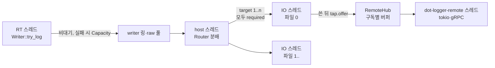
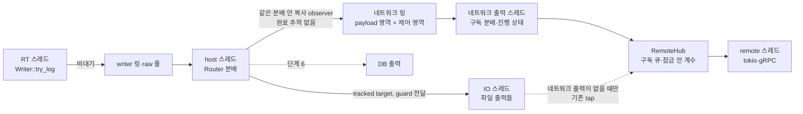

# MS-013 — 출력 구성 선택과 네트워크 전용 모드: 요구사항과 리팩토링 계획

- Intent: INT-001 / 주 Phase: Design → Build / 상태: **Draft r4 — 재리뷰 대기**([REV-077 요청](../../05_verification/reviews/REV-077_REQUEST.md)) / 갱신: 2026-11-27
- 계기: 2026-11-26 InfluxDB 논의 중 Human이 연구개발용 구조를 제안(R1~R3). 2026-11-27 Human 「내 요구사항과 리팩토링 계획을 한 문서에 작성하고, 리뷰 세션으로 리뷰 받고, 수정하고 다시 리뷰 받는 과정을 한번 거치자」, 이어서 「지적이 없을때까지 리뷰 요청하자」.
- 진행 방식: r1 → [REV-074](../../05_verification/reviews/REV-074_MS013_OUTPUT_DESIGN_REVIEW.md)(12건) → r2 → [REV-075](../../05_verification/reviews/REV-075_MS013_R2_DESIGN_REVIEW.md)(10건) → r3(`cda0161`) → [REV-076](../../05_verification/reviews/REV-076_MS013_R3_DESIGN_REVIEW.md)(10건) → **r4(이 문서, 10건 모두 수용, §13)** → REV-077 → … **지적 0건 회차까지 반복** → Human 승인(§2.3) → ADR·요구사항·TASK → 구현. 승인 전에는 제품 코드를 바꾸지 않는다.
- 버전: 공개 API·core Route·원격 구독 wire가 바뀌므로 **0.2**. 착수 순서는 TASK-041(v0.1.1) 뒤(Q1).

## r4에서 바뀐 핵심 (REV-076)

1. **네트워크 = Route의 복사 observer(§5.1·§5.3, RV-235·236·243):** r3의 「복사 *target*」은 완료 셀·dispatcher feedback(`Busy`에서 flush 정지)·OFF 정산·관리 wire bit 5(옛 client가 `confirmed & !31`로 전체 거절)를 새로 만들었다. r4는 네트워크를 **완료 추적 대상에서 뺀다.** Route에 `observe` 표시를 두고, dispatcher가 ingress에서 기록을 꺼내 `SharedPayload`로 분배하는 **그 분배 안에서** 링에 복사한다. 완료 셀·feedback·새 `Boundary`·새 `DispatchOutcome`이 없다. 네트워크 결과는 전부 네트워크 회계(§5.4)에만 있다. 네트워크로만 가는 기록은 core에서 기존 `Unrouted` → `Cause::NoRoute`(의도적 생략)로 정산된다.
2. **복사 예산 초과는 같은 분배에서 네트워크 몫만 버림(RV-235):** 다음 턴 보류 없음. 최대 기록 크기 ≤ 턴 복사 예산을 시작 때 검증.
3. **스위치: 링 제어 영역을 확보한 뒤에만 커밋, host가 절대 기한 재확인, 영수증에서 `subscribers` 제거(RV-237).**
4. **회계: 구독 상태 전이는 hub 잠금 안에서 계수, 진행 상태는 공유 구조에 두어 감독자가 한 번 정산, Health는 bounded 읽기(RV-238).**
5. **종료: 호출자 스레드가 기한 감시, 네트워크 정리가 남으면 기존 `Incomplete` + `PendingShutdown`(파일 성공은 보고에서 바로)(RV-239).**
6. **구독 가입 fence·링 epoch 기준 초기 표시·표시가 Gap을 닫는 순서(RV-240), 숫자 index + 출력 교체 조합 거절(RV-241), packed 크기·인코딩 상한 시작 검증(RV-242), 종료 이유 frame(RV-243), H6 정의와 단계 0 조기 go/no-go(RV-244).**

유지: 원본 guard 미전달(이제 더 강하게 — 네트워크는 guard를 아예 모른다), ACK 기존 흐름 제어 항상, 단일 네트워크 출력, 기본 경로, 병합표, DB 단계 6, 레거시 골든.

## 목차

1. 요구사항
2. 결정 기록
3. 현재 구조(코드 확인)
4. 목표 구조
5. 설계 상세
6. 공개 API·wire 변경과 호환
7. 단계별 이행 계획
8. 시험·측정 계획
9. 위험과 열린 질문
10. 연결 문서와 승인 뒤 할 일
11. REV-074 반영표
12. REV-075 반영표
13. REV-076 반영표

---

## 1. 요구사항

### 1.1 Human 원문 요구 (2026-11-26)

| ID | 요구 |
|---|---|
| R1 | 시작 때 옵션 파일로 파일·네트워크·DB 출력을 배타적으로 또는 동시에 선택한다. |
| R2 | 초당 ~100 MB 단위동작 기록을 SSD에 쓰지 않고, 정해진 메모리 안에서 네트워크로만 보내 원격(예: 원격 PC의 Redis)에서 분석한다. |
| R3 | 원하는 순간에 외부(네트워크) 전송을 켜고 끈다. |

### 1.2 요구 해석 (2026-11-27 Human 결정 반영)

- **R2의 100 MB/s는 보장 목표가 아니라 사용 예다.** 링크 속도·수신 쪽 정지·Redis 보관량은 사용자 책임이다. 라이브러리의 책임은 네트워크 전용 모드의 **무손실 최대 처리량을 측정해 조건과 함께 공개**하는 것이다.
- **R1의 옵션 파일은 재빌드 없이 구성을 바꾸기 위한 것이다.** 코드 지정과 파일 지정을 둘 다 지원한다.
- R1의 「DB」는 MS-012에서 확인한 InfluxDB 출력이다(§5.7, 단계 6).

### 1.3 정제한 요구사항 (승인 뒤 `requirement_spec.md`에 올릴 후보)

| 후보 ID | 요구 | 수락 기준(초안) | 수락 단계 | 출처 |
|---|---|---|---|---|
| FR-019a | 파일·네트워크 출력을 하나 이상, 임의 조합으로 선언해 시작한다. 파일 출력이 없어도 시작한다. | 파일만/네트워크만/둘 다 시작·종료. 출력 0개는 시작 거절(`Missing::Output`). 충돌 구성(§5.2)은 명시 거절 | 2 | R1 |
| FR-019b | DB 출력을 단독 또는 파일·네트워크와 조합해 선언한다. | §5.7 설계 게이트 통과 뒤 단계 6에서 정한다. **그 전까지 DB 조합은 미수락** | 6 | R1 |
| FR-020 | 같은 구성을 코드(builder)와 옵션 파일 양쪽으로 지정한다. 파일은 시작 때 읽는다. | 같은 내용이면 해석된 구성·`Plan`이 같다. 병합표(§5.5) 대로 병합. 모르는 키·버전 불일치·비밀 값 직접 기재·크기 초과는 시작 전 거절, 오류에 원문·값 미노출 | 3 | R1·C7 |
| FR-021 | 네트워크 전용 모드: 로거 파일 IO 없이, 선언한 메모리 상한 안에서 기록을 원격 구독자에게 보낸다. | 로거가 만든 파일 0(명시 `loss_file` 제외), §5.10 관리 예약 합계가 예산을 넘으면 시작 거절, 재연결·최대 구독·포화 중 heap이 관리 예약 + **측정한** runtime 여유 안(runtime·TLS는 보장 아닌 측정 공개), RT 무대기 | 2 | R2 |
| FR-022 | 네트워크 손실을 송신 쪽에서 센다. | §5.4 회계 등식이 최종 보고에서 모두, Health에서 단계 안에서 성립. `is_lossless()`는 손실 0 + 수신 확인. 정상 종료된 구독은 client Gap 수 = 서버 `gap` | 2 | C1 |
| FR-023 | 실행 중 네트워크 전송을 켜고 끈다. 켤 때 시작 위치를 돌려준다. | §5.6 계약: 꺼진 동안 새 사용자 payload 분배 0, epoch 표시에 생산자별 경계 seq, 표시를 요청한 구독은 경계를 받거나 명시적으로 끝남 | 4 | R3·C4 |
| NFR-009 | 네트워크 전용 모드의 무손실 최대 처리량을 기록 크기별로 측정해 공개한다. | §8.2 판정(거절·Gap·Unknown·누락·중복 0, 큐 비증가)으로 찾은 최고 속도와 조건 표 | 5 | R2 |
| NFR-010 | 모드별 보장 범위를 문서와 Health에 드러낸다. | §5.8 보장표가 README·rustdoc에, `Health.durability` 보고 | 2 | C10 |

### 1.4 범위 밖

- 옵션 파일 실행 중 다시 읽기(hot reload). 실행 중 변경은 레벨·샘플링과 새 전송 스위치만.
- pre-trigger 창(C4 후속 옵션).
- 원격 명령(gRPC)으로 스위치 조작(C8).
- Redis 등 수신 쪽 어댑터.
- 압축(B1 UC-23), 원격 실패 원인 구분(EV-124·126). keepalive 중 **유휴 heartbeat는 스위치의 lease 유지에 필요해 단계 4에 넣는다**(H3). 조용한 단절의 **감지 상한**은 응답 확인 메커니즘이 필요해 범위 밖이며, §5.4에 「상한 없음, 손실은 `unacked`·`cut`으로 늦게 드러남」을 명시한다(Q6).
- 0.2에서 네트워크 출력 2개 이상(§5.2, H4).

## 2. 결정 기록

### 2.1 Human 결정 (2026-11-27 #001)

| ID | 결정 |
|---|---|
| C1 | 로봇 쪽 원격 손실 집계(구독별 보냄·Gap·끊김·Unknown 건수·바이트)를 Health·종료 보고에 **필수**로. 손실 구간만 남기는 로컬 요약 파일은 **선택 옵션**. |
| C2·C3 | 링크·수신·보관은 사용자 책임. 라이브러리는 최대 처리량을 측정·공개. 버퍼 크기 ÷ 속도 = 흡수하는 정지 시간 관계만 문서화. |
| C4 | 0.2는 「구독 먼저 → 스위치 켜기」 규약 + 켤 때 시작 위치 반환. pre-trigger 창은 후속. |
| C5 | 파일+원격 구성에서 기존 tap 의미 유지. |
| C6 | 원격 기본 완료 기준은 「보냄」, 수신 ACK 완료는 옵션. (r2에서 해석 정밀화 → H1) |
| C7 | 코드와 옵션 파일 **둘 다**. 같은 설정 타입으로 모이고, 파일 로딩은 선택 feature. 비밀은 경로·환경 변수 참조. |
| C8 | 스위치는 로봇 API 먼저. |
| C9 | 원격 전용 스레드, affinity 영향 측정. |
| C10 | 모드별 보장표를 문서에, Health에 내구 보장 수준 표시. |
| C11 | 0.2. keepalive·원격 실패 원인 구분·facade DB 출력과 같은 버전 묶음. |
| 문서 | 요구와 계획을 한 문서(이 MS)에. 독립 리뷰에서 지적이 없을 때까지 수정·재리뷰 반복(2026-11-27 Human 후속 결정). |

### 2.2 AI 설계 제안 (r4, 승인 대상)

| ID | 제안 | 위치 |
|---|---|---|
| P1 | 네트워크 출력 = Route의 **복사 observer**. 완료 추적 대상이 아니다. dispatcher가 기록을 분배하는 그 자리에서 링에 복사한다. 원본 guard·완료 셀과 무관. 기존 `remote()` tap은 네트워크 출력이 없는 구성에서만 그대로. | §5.1·§5.2 |
| P2 | 파일 = Required(지금 의미), 네트워크 = 관측(완료 판정 밖). 공개 `OutputRole` 없음. | §5.1 |
| P3 | 새 core 완료 경계 없음(r2·r3의 `Handed` 철회). 네트워크 결과는 네트워크 회계. 수신 ACK는 기존 흐름 제어 항상, 복사본 수준 보고. | §5.3 |
| P4 | 출력에 이름, 이름으로도 선택. index는 파일 선언 순서. 출력 교체와 숫자 index는 함께 쓸 수 없음. | §5.2·§5.5 |
| P5 | 옵션 파일 TOML, `version = 1`, 모르는 키 거절, feature `config-file`. `[[output]]`이 있으면 출력 전체 교체. | §5.5 |
| P6 | 스위치 컷오프는 dispatcher 복사 시점. 꺼진 동안 새 사용자 payload 복사 0(기록당 원자 읽기 1회). 표시는 링 제어 영역 → 구독 큐 FIFO, 요청한 구독에만 별도 frame. | §5.6 |
| P7 | 측정·공개가 수락 기준. 루프백 4 KiB 이상 ≥ 300 MB/s(≈ 73,200건/s)는 내부 목표. | §8.2 |

### 2.3 Human 결정이 필요한 항목 (r4)

| ID | 질문 | AI 권고 | 이유 |
|---|---|---|---|
| H1 | C6 「수신 ACK 완료는 옵션」을 「수신 ACK는 기존 흐름 제어로 **항상** 쓰고 결과(acked/unacked)는 네트워크 보고에 남기며, 네트워크는 원본 완료·`is_success`에 묶지 않는다」로 해석 | 예 | 원본을 붙들면 파일·RT 자원 잠식·종료 지연(RV-213·216). 기존 client는 늘 ACK한다(RV-229) |
| H3 | 표시를 요청한 구독에 유휴 heartbeat(`max_age/2`)를 단계 4에. 보장은 건강한 연결의 유휴 lease 유지뿐 | 예 | 꺼진 시간이 lease보다 길면 구독이 닫힘(RV-215), 감지 상한은 keepalive 안건(RV-229) |
| H4 | 0.2 네트워크 출력 최대 1개, `remote()`+`network_output()` 동시 선언 거절 | 예 | 구독 원천·계수 귀속(RV-219) |
| H5 | 출력 미지정 채널(`tracing` 포함): 파일 출력이 있으면 모든 파일, 없으면 모든 출력 | 예 | 기존 트래픽 불변 + 네트워크 전용 부담 감소 |
| H6 | 복사 비용의 파일 영향 허용치. **정의(RV-244):** P = 고정 구성(§8.2 H6 프로필)의 **60 s 지속 무손실 파일 완료율**(건/s·B/s). 「파일 + 네트워크(구독 정상)」에서 0.8P 부하 RT `Capacity`·파일 실패 0, 포화 완료율 감소 ≤ 10%. **단계 0 spike에서 1차 판정(go/no-go), 단계 5 확정** | 위 기준 | 장기 보유는 구조적으로 0(observer), 남는 것은 복사 비용뿐 |
| H7 | 옵션 파일 `[[output]]`이 있으면 코드 출력 **전체 교체**(없으면 유지). 교체가 일어난 구성에서 채널이 숫자 index(`outputs(&[usize])`)를 쓰면 **시작 거절**(이름으로 지정해야 함) | 예 | 전체 교체는 R1의 「재빌드 없이 조합 변경」에 필요(RV-232), 숫자 index가 조용히 다른 파일을 가리키는 것은 막는다(RV-241) |
| H8 | 네트워크로**만** 라우팅된 기록을 core 손실 보고에서 기존 `NoRoute`(의도적 생략, `IntentionalSkip`)로 셈하는 것 | 예 | 새 persisted 분류 없이 「core가 추적하는 출력으로는 가지 않음」을 정확히 표현. 네트워크 쪽 결과는 네트워크 보고에 있음. 파일이 있는 구성의 `.logger/loss`에는 그 채널이 「그 파일로 라우팅 안 됨」으로 남는다(지금 출력 선택과 같은 의미) |

## 3. 현재 구조 (2026-11-27 `a9082bc`·`4f7ec58` 코드 확인, REV-074 대조)



| 사실 | 위치 |
|---|---|
| facade 출력은 파일뿐. 파일이 없으면 `StartError::Missing(FileOutput)` | `logger/mod.rs` `Missing::FileOutput` |
| 모든 파일 출력은 Router target `required: true`·`pending_slots: 0`·`max_attempts: 1`·`queue_slots` = 전체 기록 수. 공유 기록 한도가 먼저 차 느린 출력이 RT `Capacity`로 역류. target 한도 초과는 `Capacity`, 큐 삽입 실패는 정책에 따라 `RetryExhausted`·`PendingFull` | `logger/budget.rs`, `routing/mod.rs` |
| Router target ledger는 그 target의 delivery가 살아 있는 동안만 세고, 입력 풀·완료 창 예약을 출력별로 남기지 않는다 → 원본을 오래 붙드는 출력은 writer 풀(특히 작은 raw 풀)을 소진할 수 있다 | `routing/mod.rs`(REV-074 RV-213) |
| 완료 경계는 `Enqueued·Written·Synced·DatabaseAcknowledged·ReceiverAcknowledged` 5개, 완료 표는 `word & 31` 5비트 마스크 | `completion/types.rs`, `completion/mod.rs` |
| 원격은 target이 아니다. 첫 파일 출력 IO 스레드가 배치 쓰기 성공분(오류 시 쓴 prefix)을 `Tap::offer`로 구독마다 복사하고 결과를 버린다 | `logger/host.rs` `write_batch`, `logger/remote.rs` `offer` |
| 원격 손실은 로거 쪽에 집계되지 않는다. 구독자만 Gap을 본다. `offer`가 `Ok(PendingAck)`이어도 뒤에 Gap·Disconnect가 될 수 있다 | `logger/health.rs`, `adapters/remote/hub.rs` |
| 출력 0으로 라우팅되지 않는 채널은 구독에 보이지 않는다. 구독 필터는 채널·레벨·원본 포함 여부이고 출력 이름은 없다 | API §18.12, `adapters/remote/server.rs` |
| facade 원격 한도 기본값: 연결·구독·명령 각 4, `record_bytes` = 가장 큰 slot, `subscription_records` = 모든 slot 수 합, `subscription_bytes` = **max(min(모든 slot 바이트 합, 4 MiB), record_bytes)**, `message_bytes` 32 KiB, `max_age` 10 s(기록 나이 한도이자 협상된 유휴 lease), `request_timeout` 5 s | `logger/remote.rs` `default_limits` |
| `RemoteLimits.message_bytes` 상한 16 MiB(메시지 단위, 큰 기록은 chunk로 나뉨). `reservation()`은 어댑터 버퍼만이고 runtime·TLS·HTTP2는 별도 여유 | `adapters/remote/types.rs` |
| 클라이언트는 모르는 frame kind를 `Corrupt`로 끝낸다 | `dot-logger-client/src/transport.rs` |
| 고급 경로 ACK 관측: `PendingAck`, `RemoteDelivery::poll` → `ReceiverAcknowledged`/Unknown/Dropped(한 delivery ↔ 한 구독) | `adapters/remote/hub.rs` `offer_delivery` |
| core Closed는 optional target까지 포함한 `totals.pending`·drain이 0이어야 한다. facade는 core Closed 뒤에 remote를 멈춘다(정지 뒤 2 s 유예). 주기 sync는 facade가 파일 target 전체 목록을 넘긴다 | `control/mod.rs`, `logger/host.rs` |
| 전역 `worker_failed`가 켜지면 host가 `core.control().close()`로 RT 수락을 닫는다 | `logger/host.rs` |
| 실행 중 변경은 채널 레벨·샘플링뿐. 원격 ApplyConfig도 Route 패치는 InvalidInput | `logger/mod.rs` `set_channel`, API §22.2 |
| 출력 미지정 채널은 모든 파일 출력, 명시 index는 파일 선언 순서. `tracing` 채널도 미지정 경로 | `logger/mod.rs` `route_targets` |
| 파일 예약 토픽 `.logger/meta`·`.logger/loss`(ADR-013 개정) | `storage/codec.rs` |
| facade 공개 이름 항목 **35개**(한도 60, NFR-008), 스냅샷 `tests/api-surface/logger.txt` | `scripts/check-integration-surface.py` |
| 처리량 근거: 고급 경로 루프백 784 MB/s는 **8 MiB 기록**, 유선 1 GbE 약 116 MB/s는 대용량. 4 KiB 소형 근거 없음. Windows 짧은 대기 해상도로 소형 처리량 저하(EV-128) | EV-105·EV-128 |

**이 구조로 R1~R3이 안 되는 이유:** ① 파일 없이 시작 불가 ② 원격이 파일 IO 스레드에 매달려 있음 ③ 원격 손실을 로거가 모름 ④ 옵션 파일 없음 ⑤ 실행 중 전송 on/off 없음.

## 4. 목표 구조



- 출력 = 이름 + 종류(File/Network, 단계 6 Database). **파일은 Router의 tracked target, 네트워크는 Route의 observer.**
- dispatcher가 ingress에서 기록을 꺼내 분배할 때, route에 observe 표시가 있고 스위치가 켜져 있으면 같은 분배 안에서 링에 복사한다. 그 기록의 완료 셀에는 파일 target만 있다(네트워크만이면 target 0 → `Unrouted`).
- 네트워크 출력 스레드는 링에서 꺼내 구독 큐로 나눈다. 구독 상태 전이와 계수는 hub 잠금 안.
- 시작 조건 「출력 하나 이상」. 파일이 없으면 `Health.durability = None`.

## 5. 설계 상세

### 5.1 복사 observer와 자원 격리 (P1·P2, RV-213·225·235·236, H6·H8)

- **core 변경(단계 1):** `Route`에 `observe: Option<ObserverId>`(0.2는 하나). dispatcher는 ingress에서 기록을 꺼내 `SharedPayload`를 만든 뒤 ① tracked target(파일)에 guard 분배 ② observe가 있고 켜져 있으면 **같은 분배 안에서** 링에 payload 복사. 복사는 `SharedPayload`가 살아 있는 동안 끝나므로 원본을 따로 붙들지 않는다.
- **완료 추적과 무관(RV-236·243):** observer는 completion registry에 없다. 완료 셀·dispatcher feedback·`Delivery::report`·`Busy`·새 `Boundary`·새 `DispatchOutcome`을 쓰지 않는다. 기록의 완료 셀은 tracked target만으로 정해진다. tracked target이 0이면(네트워크 전용 채널) 지금의 `Unrouted` 경로로 정산되고 손실 분류는 `Cause::NoRoute`(H8).
- **복사 예산(RV-235):** 턴당 복사 바이트 상한 `copy_bytes_per_turn`(기본 = `bytes_per_turn`). 한 기록을 복사하면 상한을 넘을 때 **그 분배에서 네트워크 몫만 버리고** `copy_budget_dropped`로 센다(다음 턴 보류 없음, 파일 분배는 그대로). 시작 때 `copy_bytes_per_turn ≥ 가장 큰 기록(small·raw slot 최대)`를 검증해 「한 기록도 못 넣는 턴」을 막는다(아니면 `InvalidBudget`).
- **링:** 단일 생산자(dispatcher)·단일 소비자(네트워크 스레드) 비차단 링. **payload 영역**(`ring_bytes`, 기록 머리 포함)과 **제어 영역**(표시 K개 고정 자리, §5.6)으로 나눈다. payload 영역이 차면 새 기록은 `ring_full`(가장 오래된 것을 지우지 않음).
- **스위치 꺼짐:** dispatcher가 observe 상태를 기록당 원자 읽기 1회로 확인. 꺼져 있으면 복사하지 않고 `switched_off`(정책 생략)로 센다. 완료 셀에 아무것도 남지 않는다(애초에 없음).
- **격리:** ① 장기 보유 = **구조적으로 0**(observer는 guard를 받지 않음). 시험은 「같은 시각」이 아니라 **`SharedPayload` 수명이 분배 1회를 넘지 않음**(시험 빌드 계측: 최대 보유 턴 수 = 0) ② 복사 비용 = H6.
- **Health:** `Failure::IoPoisoned`는 파일 출력 한정. 네트워크 출력 실패는 `Degraded(OutputLosing)`.

### 5.2 네트워크 출력 선언·tap·기본 경로 (P1·P4, C5, RV-219, H4·H5)

- **선언:** `LoggerBuilder::network_output(name, NetworkOutput)` — 서버 설정(`ServerConfig`)·구독 한도(`RemoteLimits`, 생략 시 기존 결정적 규칙)·링 크기(`ring_bytes`)·턴별 복사 한도·`loss_file`·초기 스위치 상태. ACK는 항상 기존 흐름 제어(§5.3, 옵션 없음).
- **개수:** 0.2는 최대 1개(H4). 2개 이상, `remote()`/`remote_with()`와 동시 선언은 `StartError::Conflict`로 거절한다. 네트워크 출력의 서버가 관리 요청(GetStatus, 레벨·샘플링 ApplyConfig)도 맡는다.
- **tap 규칙(C5):** 네트워크 출력이 없는 구성(`remote()`만)은 지금과 완전히 같다. tap 구성에는 스위치가 없다(`set_output_enabled`는 `NotFound`).
- **기본 경로(H5):** 출력 미지정 채널과 `tracing` 채널은 파일 출력이 있으면 모든 파일 출력, 없으면 모든 출력으로 간다. 파일과 네트워크가 함께 있을 때 네트워크로 보내려면 채널마다 이름으로 지정한다(기존 트래픽 불변).
- **이름과 index:** `ChannelOptions::outputs(&[usize])`는 파일 선언 순서 index 그대로(기존 의미 불변, 단 옵션 파일로 출력이 교체된 구성에서는 거절 — §5.5·H7), `outputs_named(&[&str])`는 모든 종류. 한 채널에 두 방식을 섞으면 `InvalidOutputs`.
- **차이 문서화:** 네트워크 출력 구독자는 「그 출력으로 라우팅된 것」을 본다(파일 쓰기 실패 기록도 갈 수 있음, 출력 0에 없는 채널도 보임).

### 5.3 완료와 ACK (P3, C6→H1, RV-217·229·230·236·243)

- **원본 완료:** tracked target(파일)만으로 정해진다. 네트워크는 완료 판정 밖이다. **새 core 경계 없음**(r2·r3의 `Handed`·마스크 6비트·관리 wire 경계 5·CLI `handed`를 철회). 그래서 관리 `GetCompletion` wire와 옛 client decoder(`confirmed & !31`)는 영향이 없다.
- **네트워크 결과:** 링 복사 여부(L1)·구독 분배(L2)·구독별 전송과 ACK(L3)를 네트워크 회계(§5.4)에만 남긴다.
- **ACK(H1):** 모든 구독은 기존 ACK 흐름 제어(ADR-015, client `handoff`가 ACK, hub가 ACK로 창 회수)를 그대로 쓴다. ACK는 hub 잠금 안에서 복사본의 `acked`로 계수되고, 만료·종료는 `unacked`. 「ACK 끄기」 없음.
- **스위치 꺼짐의 정산:** 완료 셀이 없으므로 core 정산이 없다. 네트워크 회계 `switched_off`(정책 생략)만.

### 5.4 손실 회계 (C1, RV-214·226·238)

단위: L1·L2는 **원본 기록**, L3·ACK는 **구독 사본**. 모두 건수 + payload 바이트. RT 입구 거절(`Capacity`)은 core 보고에 있고 여기 포함하지 않는다.

| 단계 | 보존식 | 계수 위치 |
|---|---|---|
| L1 원본 | `observed = copied + ring_full + copy_budget_dropped + switched_off + output_failed` | dispatcher(host). `switched_off` 정책 생략, 나머지는 사고성 |
| L2 링 | `copied = dispatched + no_subscriber + abandoned + ring_pending` | 네트워크 스레드. `dispatched`는 eligible 구독 ≥ 1, 0명은 `no_subscriber`, 실패·기한 잔여는 `abandoned` |
| L3 구독 | `targeted = filtered + offered + not_offered`, `offered = gap + too_large + adapter_failed + queued + partial + sent` | `targeted`·`filtered`·`not_offered`는 네트워크 스레드, 나머지는 **hub 잠금 안** |
| 종결 | 구독이 끝나면 `queued`·`partial` → `cut`, `sent` → `acked` 또는 `unacked` | hub 잠금 안(close 처리) |

- **hub 상태 전이(RV-238):** hub가 구독 큐의 기록마다 상태(`queued` → `partial`(첫 chunk 인계) → `sent`(마지막 chunk) → `acked`)를 두고 **잠금 안에서** 전이마다 계수한다. `offer`의 포화는 `gap`, 한도 초과는 `too_large`. 구독 종료(정상·Gone·Transport·lease 만료) 때 잠금 안에서 남은 `queued`·`partial`을 `cut`, ACK 대기 `sent`를 `unacked`로 옮긴다. 그래서 `PendingAck`가 `Unknown` 하나로 뭉치는 지금 구조와 달리 `cut`과 `unacked`가 구별된다(hub 변경, 단계 2).
- **진행 상태와 감독 정산:** 네트워크 스레드는 「지금 처리 중인 링 항목 ID·eligible 목록·다음 offer index」를 스레드 밖 공유 구조(`Progress`)에 둔다. 스레드가 실패하거나 종료 기한이 되면 **감독자(host, 종료 중이면 종료 감독)** 가 `Progress`로 미시도 eligible을 `not_offered`로, 링 잔여를 `abandoned`로 **한 번** 정산하고 `Progress`를 닫는다(이중 정산 방지 플래그).
- **Health 읽기:** 각 계수 묶음은 seqlock 게시. 읽기는 **최대 3회 시도**, 실패하면 마지막 정상 스냅샷과 `stale: true`. 단계 안 등식은 정상 스냅샷에서 성립, 단계 사이는 순간 차이 가능(문서화). 계수는 `u64` 포화 덧셈(넘침은 `saturated: true`로 표시).
- **최종 보고:** `FacadeReport.network.finalized`가 참일 때만 전 등식 성립을 보장. `is_lossless()`는 `finalized` && 파일 `is_success` && 사고성 손실 합 0 && `unacked` 0.
- **구독 식별:** 재연결은 새 ID. 끝난 구독은 최근 8개 상세 + 퇴역 총계.
- **client 대조:** Gap 프레임까지 전달·정상 종료된 구독에서 client Gap 수 = 서버 `gap`.
- **조용한 단절:** 감지 상한 없음(EV-123 F4). 손실은 hub 종료 처리에서 `cut`·`unacked`로 늦게 드러난다. 상한은 keepalive 안건.
- **로컬 손실 파일(C1 옵션):** `loss_file(path, max_bytes)` — 디스크 쓰기 명시 옵션. 1초 버퍼 최대 1,024 구간(넘으면 합치고 `loss_file_coarsened`), 별도 기록 스레드와 4초분 비차단 큐(차면 `loss_file_dropped`), `max_bytes` 회전, 오류는 `Degraded(OutputLosing)`.

### 5.5 설정 타입·옵션 파일·병합 (P4·P5, C7, RV-221·232·241, H7)

- **`LoggerConfig`(feature 없음):** budget·출력(이름·종류·종류별 설정)·채널 정책(토픽별 출력 이름·`minimum`·`important_from`)·writer quota·스위치 초기 상태. `LoggerBuilder::config(LoggerConfig)`.
- **지원 패턴:** 「코드는 채널 타입(`channel::<T>(topic)`)과 writer 이름만, 파일이 출력·정책·예산을 소유」. 같은 바이너리가 파일 교체로 파일만/네트워크만/혼합을 바꾼다(단계 3 수락 시험). 파일에만 있는 토픽·writer는 시작 거절.

| 항목 | 병합 단위 | 규칙 |
|---|---|---|
| budget | 필드별 | 뒤 호출이 그 필드를 덮음 |
| preset | 전체 | resolve 때 비어 있는 손실 값만 채움 |
| **출력** | 목록 전체(H7) | `config()`에 출력이 하나라도 있으면 그때까지 선언된 출력을 **모두 교체**. 없으면 유지. `config()` 뒤 코드 출력 선언은 목록에 추가. 같은 이름 두 번은 `Duplicate` |
| **숫자 index와 교체(RV-241)** | — | 출력 **교체가 일어난 구성**에서 어떤 채널이든 숫자 index(`outputs(&[usize])`)를 쓰면 `start()`/`plan()`이 `InvalidOutputs`로 거절한다(그 채널의 출력을 설정 파일 정책이나 `outputs_named`로 이름 지정하면 허용). 교체가 없으면 지금 의미 그대로 |
| 이름 없는 코드 출력 | — | `file_output(dir, ..)`은 내부 자동 이름을 받지만 **참조할 수 없다**(`outputs_named`·설정 파일에서 쓰면 `InvalidOutputs`). 사용자 이름에 자동 이름 형식(`file#<N>`, `#` 포함)은 쓸 수 없다 |
| 채널 정책 | 토픽·필드별 | 뒤가 덮음. 없는 출력 이름이면 `InvalidOutputs` |
| writer quota | writer 이름별 | 뒤가 교체 |
| 경로 | — | `from_toml_path`는 설정 파일 디렉터리 기준, `from_toml_str(text, base_dir)`은 인자 기준(없으면 상대 경로 거절) |
| 오류 우선순위 | — | 파싱 → 스키마(모르는 키·버전·비밀 값·예약 이름) → 병합(중복·없는 이름·교체 + 숫자 index) → `start()` 검증 |

- **동등성:** 해석된 `LoggerConfig`와 `Plan`이 같음. 출처는 `LoggerBuilder::explain() -> PlanSources`(공개 `Plan` 필드 불변).
- **파일(feature `config-file`):** `version = 1`, `deny_unknown_fields`, 읽는 중 1 MiB 상한(`Read::take`).
- **오류:** `ConfigFileError { kind, line, column }`, `Display`·`Debug`는 kind와 위치만, `source()` `None`, 비밀 값 기재 `SecretValue`.
- **의존성(단계 3 S0):** `toml` MSRV 1.85·`cargo audit`·라이선스, feature 조합 4종, feature 없는 출력 종류는 `Unsupported`.
- **예시(초안, 단계 3에서 실제 시작 시험):**

```toml
version = 1

[budget]
memory = "1 GiB"          # §5.10 산식으로 단계 3에서 확인
drop_deadline = "3 s"
sync_every = "100 ms"     # 파일 출력이 있을 때만 의미

[[output]]                 # 출력 목록이 있으면 코드의 출력을 모두 교체(H7)
name = "net"
kind = "network"
bind = "0.0.0.0:7400"
tls_cert_path = "certs/logger.crt"
tls_key_path = "certs/logger.key"
subscriptions = 2
subscription_bytes = "128 MiB"
ring_bytes = "64 MiB"
enabled = false

[[output]]
name = "disk"
kind = "file"
directory = "/data/logs"
retention = { ring = "8 GiB" }

[channel."robot/joint"]
outputs = ["net"]
[channel."robot/event"]
outputs = ["net", "disk"]
minimum = "info"
```

### 5.6 전송 스위치 (P6, C4·C8·H3, RV-215·227·229·237·240)

- **API:** `Logger::set_output_enabled(name, enabled, deadline) -> Result<SwitchReceipt, SwitchError>`, `Logger::output_state(name) -> OutputState { epoch, enabled, subscribers }`.
- **`SwitchReceipt { epoch, changed, at_ns, boundary }`** — host가 소유한 값만(RV-237). `boundary`는 생산자별 **하한**(적용 시점 dispatcher의 ingress 커서: 다음으로 꺼낼 `accepted_seq`, packed 12 B). 표시를 받은 구독 수는 영수증에 넣지 않고 `output_state()`·`Health`에서 본다.
- **커밋 순서(host 턴 시작, RV-237):** ① 명령의 **절대 기한·Closing 확인**(지났으면 적용하지 않고 `Timeout`/`Closing`) ② 같은 상태면 `changed: false`로 현재 epoch 응답 ③ **링 제어 영역에 빈 자리가 있는지 확인**(없으면 적용하지 않고 `SwitchError::Busy` — 네트워크 스레드가 표시를 소비하지 못하는 상태) ④ 명령 상태 `Pending → Committed` CAS ⑤ observe 상태 변경 + 제어 영역에 표시 기록(③에서 자리를 확인했으므로 실패하지 않음) ⑥ 같은 단계에서 영수증 응답. ①~⑥은 host 한 단계에서 차단 없이 끝난다.
- **호출자:** 기한이 지나면 `Pending → Cancelled` CAS. 이기면 `Timeout`(미적용 보장). 지면 host가 ⑤까지 끝냈다는 뜻이고 ⑥ 응답은 같은 단계에서 보내지므로 짧게 기다려 받는다(대기 상한 = host 한 단계; 그 사이 host 스레드가 죽으면 `WorkerFailed`). 명령 큐 상한 4(가득 차면 `Busy`).
- **컷오프 = dispatcher 복사 시점:** 적용 턴부터 복사 여부가 바뀐다. 꺼진 동안 수락돼 ingress에 남은 기록도 켠 뒤 분배되면 복사된다(`seq ≥ boundary`). 정확한 첫 위치는 수신자가 표시 뒤 첫 payload의 receipt로 안다.
- **링 안 순서(fence):** payload 영역과 제어 영역은 **하나의 링 일련번호**를 공유해 네트워크 스레드가 일련번호 순서로 꺼낸다(OFF 표시는 그 앞 payload 뒤, ON 표시는 그 뒤 payload 앞). 제어 영역 K = 4 자리(연속 토글 4번까지 네트워크 스레드 정지를 견딤).
- **구독 큐 순서(RV-240):** 네트워크 스레드는 표시를 eligible 여부와 무관하게 표시를 요청한 모든 활성 구독 큐에 넣는다. hub에서 **표시는 fence**다: 구독에 열린 Gap 구간이 있으면 그 Gap frame을 먼저 닫아 내보낸 뒤 표시를 보낸다(Gap이 epoch 경계를 넘어 합쳐지지 않음). 표시는 기록과 기록 사이에만(멀티 chunk 기록 중간에는 끼지 않음) 들어가고 ACK 창을 쓰지 않는다. 구독 큐는 제어 자리 1개를 늘 비워 두고, 앞 표시가 나가기 전에 다음 표시가 와 자리가 없으면 `MarkerOverflow`로 끝낸다(종료 frame, 아래).
- **구독 가입 fence(RV-240):** 구독이 시작되면 네트워크 스레드는 **그 구독의 가입 일련번호** = 다음에 꺼낼 링 일련번호를 기록하고, 그보다 앞선 링 항목은 그 구독의 eligible에서 뺀다. 초기 표시는 host의 최신 epoch가 아니라 **링 위치 기준 epoch**(마지막으로 꺼낸 표시의 epoch)로, kind 0 핸드셰이크 **뒤 첫 이벤트**로 보낸다. 그래서 새 구독이 이전 epoch backlog를 새 epoch로 오인하지 않는다.
- **비용:** 꺼진 동안 dispatcher는 기록당 원자 읽기 1회, 새 사용자 payload 복사 0.
- **wire:** 구독 요청 `epoch_markers: Off | Preferred | Required`(protobuf 새 필드), 응답 지원 표시. 요청한 구독에만 새 frame kind 3개: 표시(epoch·on/off·boundary), heartbeat, **종료 이유(End{reason})**. `Required`인 새 client가 옛 서버를 만나면 `RemoteError::Unsupported`, `Preferred`는 표시 없이. `MarkerOverflow` 등 종료 이유는 End frame으로 전달되어 client가 `RemoteEvent::End(EndReason::MarkerOverflow)`로 구별한다(RV-243 — 지금 `rpc_error`가 이유를 보존하지 못하는 문제를 피함).
- **유휴 heartbeat(H3):** 표시 요청 구독에 기록이 없을 때 `max_age/2`마다. 보장은 건강한 연결의 유휴 lease 유지뿐.
- **표시 인코딩 상한(RV-242):** 표시 frame 최악 protobuf 길이 = 머리 + P × (varint `producer_id` 5 + varint `next_seq` 10) B. 시작 때 `RemoteLimits.message_bytes` 이하인지 검증(넘으면 `InvalidBudget`).
- **시험:** OFF backlog ON 뒤 첫 수신 receipt ≥ `boundary`, 링 제어 영역 가득(`Busy`·미적용), host 선점(기한 직전·직후 CAS), 네트워크 스레드 정지 중 토글, 중복 요청, 연속 토글 K+1, 종료 중 토글, 표시와 payload·Gap 순서, 멀티 chunk 사이 표시 없음, 새 구독 backlog·빠른 토글·포화 Gap 사이 가입, 최대 생산자·최소 `message_bytes`, wire 조합(옛 client·옛 서버 × Off/Preferred/Required).

### 5.7 DB 출력 (단계 6, 설계 게이트, RV-220)

- MS-012 결과: v2 쓰기는 2.9.1·3.12.3 모두 동작, 조회(Flux)는 v3에서 404, 타입 충돌 배치는 v3에서 전체 거절(EV-134). DB 장애 동작은 TASK-047.
- 게이트에서 정할 것: Record → DB 필드 매핑(TASK-044와 함께), 배치 거절·부분 ACK의 완료 보고, 출력 역할(Required/BestEffort), 파일 없는 DB 전용 구성의 종료, `DatabaseAcknowledged`(API ACK) ≠ 내구성 표기.
- **FR-019b는 단계 6까지 미수락**이며 0.2 alpha 범위 표에 「DB 조합 미포함」으로 적는다.

### 5.8 모드별 보장표 (C10, RV-220·234)

| 구성 | 내구성 | UPS 경보 뒤 마감 | 손실을 누가 아나 | `Health.durability` | 파일 관련 API |
|---|---|---|---|---|---|
| 파일만 | sync 주기마다 확정 | 적용(3 s 예산) | 로거(종료 보고·`.logger/loss`) | `File { sync_every }` | 지금과 같음 |
| 파일 + legacy tap(`remote()`) | 파일과 같음 | 파일만 | 파일은 로거, tap 사본은 구독자 Gap만(로거 집계 없음) | `File { .. }` | 지금과 같음 |
| 파일 + 네트워크 출력 | 파일만 | 파일만 | 파일은 로거, 네트워크는 §5.4 회계 + 구독자 Gap | `File { .. }` | 지금과 같음 |
| 네트워크만 | 없음(메모리) | 적용 안 됨 | §5.4 회계(+ 선택 `loss_file`) + 구독자 Gap | `None` | `Plan.sync_every`는 **`Duration::ZERO`**(「주기 sync 없음」, rustdoc 명시). 값을 주면 시작은 하되 `PlanWarning::Unused`. `drop_deadline` 필요. `directories()` 빈 목록. `mark_event`·`release_event`는 **기존 `EventError::NotConfigured`**(새 변형 없음) |
| DB 포함 | API ACK ≠ 디스크 보장 | 게이트에서 결정 | 게이트에서 결정 | 게이트에서 결정 | 단계 6 |

### 5.9 종료 순서와 실패 격리 (RV-216·228·239)

`Logger::shutdown(deadline)`은 **호출자 스레드가 기한 감독자**다(RV-239). 절대 기한 하나를 host와 네트워크 쪽에 넘기고, 호출자는 host의 진행 채널을 그 기한까지만 기다린다. 기한 감시가 멈춘 작업 스레드에 의존하지 않는다.

1. 입구 닫기, host 분배 drain(observer 복사 포함). 마지막 분배 뒤 링 제어 영역에 **종료 표시**(자리는 종료용으로 1개 따로 예약).
2. **병행:** (a) 파일 drain·최종 sync(tracked target만) → core Closed → host가 `Progress::FilesClosed(report)`를 보냄. (b) 네트워크 스레드: 링 잔여 송신 → ACK 대기 → 구독 종료 → hub 정지 → runtime 종료 → `Progress::NetworkFinalized(counts)`.
3. 기한 전에 (b)가 끝나지 않으면 host(또는 host가 멈췄으면 호출자)가 네트워크 쪽에 **취소 신호**를 보내고, §5.4 감독 정산으로 남은 것을 `abandoned`·`not_offered`·`unacked`·`cut`으로 한 번 정산한다(`Progress`·hub 잠금은 짧은 구간만 잡으므로 감독 정산은 차단되지 않는다. hub 잠금 대기에는 기한까지의 `try_lock` 재시도 상한).
4. 호출자 반환(기존 타입·의미 유지, RV-239):
   - (a)와 (b)가 모두 기한 안에 끝남 → `Shutdown::Closed(report)`, `report.network.finalized = true`. **`Closed`는 지금처럼 「모든 정리 완료」**.
   - (a)는 끝났지만 (b) 스레드·runtime이 기한까지 끝나지 않음 → `Shutdown::Incomplete { report, pending }`. `report.core`는 Closed 결과를 담아 **`report.files_complete()`·`report.is_success()`로 파일 성공을 바로 볼 수 있다**. `report.network.finalized`는 감독 정산을 마쳤으면 참(계수는 확정, 스레드 회수만 남음), 정산 중이면 거짓. `pending.wait()`가 스레드 회수 뒤 최종 `Closed`를 준다. `pending`을 버리면 지금처럼 분리(detach): 스레드는 끝나는 대로 스스로 자원을 놓는다.
   - (a)가 끝나지 않음 → 지금과 같은 `Incomplete`(core 미완료).
   - `Shutdown::is_success()`는 지금처럼 `Closed` && 성공. 파일 성공만 보려면 `report.files_complete()`.
5. **`Detached`의 자원:** 분리된 네트워크 스레드·runtime은 그 logger 예산(링·구독 버퍼)을 놓을 때까지 프로세스 메모리에 남는다. 같은 프로세스에서 새 logger를 시작하면 예산은 logger별이라 **프로세스 전체로는 일시적으로 합쳐질 수 있다**(rustdoc 명시). 파일 핸들은 네트워크 쪽에 없다(`loss_file` 기록 스레드 제외 — 그 핸들은 스레드가 끝날 때 닫힘).
- **실패 격리:** 네트워크 스레드 실패는 그 출력만 Failed(`Degraded(OutputLosing)`), dispatcher는 이후 복사하지 않고 `output_failed`로 센다. 전역 `worker_failed`를 켜지 않는다.
- **시험:** host 정지(시험 훅)·네트워크 스레드 정지·종료 표시 자리 가득·느린 파일 sync와 hub 정리 지연 동시·`loss_file` 막힘을 각각과 겹쳐 ① 파일 성공 ② `shutdown()` 반환이 기한 + 작은 여유 안 ③ `finalized`·`pending.wait()` 결과를 판정.

### 5.10 메모리 예약 목록 (RV-218·231·242)

각 항목을 한 번만 더하는 checked 산식. 크기는 **실제 저장 표현**(packed 바이트 배열)으로 센다. P = 생산자 수, S = `subscriptions`.

| 항목 | 산식 | 파티션 |
|---|---|---|
| 링 payload 영역 | `ring_bytes`(기록 머리 포함) | external |
| 링 제어 영역 | (K 4 + 종료 1) × `marker_bytes(P)`, `marker_bytes(P)` = 머리 32 + 12P B(packed) | external |
| 구독·연결·명령 버퍼 | `RemoteLimits::reservation()` 1회 | external |
| 구독 제어 자리 | S × `marker_bytes(P)` | external |
| hub 기록 상태 | `subscription_records` × S × 상태 1 B(`queued`·`partial`·`sent`·`acked`) | external |
| 스위치 명령 | (큐 4 + 처리 중 1) × (명령 머리 + `SwitchReceipt` = 머리 + 12P B) | control |
| logger 현재 epoch·경계 | 머리 + 12P B | control |
| 네트워크 `Progress` | 링 항목 ID + eligible 목록(S × 8 B) + index | control |
| 구독 회계 | (S + 퇴역 8) × 계수 블록 + 총계 | control |
| 손실 파일 | 1,024 구간 × 구간 크기 + 기록 큐 4초분 | control |
| 스레드 스택 | 네트워크 출력 1 + `loss_file` 기록 1(선택) × `STACK_BYTES` | worker |
| tokio runtime·TLS·HTTP2 | **예약 밖**(측정값으로 공개) | — |

- 합계가 `Budget::memory_bytes`를 넘으면 `StartError::Budget`. 표시 인코딩 상한(§5.6)도 시작 때 검증. `plan()`이 항목별 값을 보고.
- **피크:** 위 항목은 모두 고정 상한이라 피크 = 합계다(정리 미완료 상태에서도 새로 할당하지 않음 — 감독 정산은 기존 구조만 갱신).
- **검증:** ① 관리 예약 — 예산 경계 ±1, 최대 생산자·최소 `message_bytes`, 연속 토글·종료 정리를 겹친 경계 시험 ② 실행 중 heap — 재연결 1,000회·최대 구독·포화 중 soak heap 표본이 관리 예약 + 측정 runtime 여유 안.

## 6. 공개 API·wire 변경과 호환 (0.2, RV-221·224·230·233·234·243)

| 구분 | 항목 | 호환 |
|---|---|---|
| 추가(facade) | `network_output`, `NetworkOutput`, `Logger::set_output_enabled`·`output_state`, `SwitchReceipt`, `SwitchError`, `OutputState`, `ChannelOptions::outputs_named`, `file_output_named` | 새 항목 |
| 추가(facade) | `LoggerConfig`(+ 하위 설정 타입), `LoggerBuilder::config`·`explain`, `PlanSources`, feature `config-file`의 `from_toml_*`·`ConfigFileError`·`ConfigFileErrorKind` | 새 항목 |
| 추가(facade 보고) | `NetworkHealth`, `NetworkReport`, `SubscriptionReport`, `Durability`, `Health.network`·`Health.durability`, `FacadeReport.network`, `FacadeReport::files_complete`·`network_loss`·`is_lossless`, `Degradation::OutputLosing` | **기존 struct 필드·enum 변형 추가 → breaking** |
| 변경 | `Missing::FileOutput` → `Missing::Output`, `StartError::Conflict`·`PlanWarning::Unused` 추가 | **breaking** |
| 의미 | `Plan.sync_every`는 파일 출력이 없으면 `Duration::ZERO`, `EventError::NotConfigured`는 「파일 출력 없음」 포함, `Failure::IoPoisoned`는 파일 출력 한정, `Shutdown::Incomplete`는 「core 미완료 또는 네트워크 정리 미완료」(파일 성공은 `report.files_complete()`) | 타입 불변, 의미 문서 |
| 변경(core) | `Route.observe`(복사 observer), observer 링 타입 | **breaking**(공개 `Route` struct 필드 추가). **`Boundary`·`DispatchOutcome`·완료 마스크·관리 `GetCompletion` wire는 불변**(r3 대비 철회) |
| 유지 | `Plan` 공개 필드, `remote()`/`remote_with()` tap, `ChannelOptions::outputs(&[usize])`(교체 없는 구성), persisted loss cause(네트워크 전용 기록은 기존 `NoRoute`, H8) | 유지 |
| wire(구독) | 요청 `epoch_markers: Off/Preferred/Required`, 응답 지원 표시, 새 frame kind 3개(표시·heartbeat·End) — 요청한 구독에만 | 요청하지 않은 구독(기존 client)은 새 frame 미수신. 같은 major에서 옛↔새 client·서버 조합 시험 |
| client | `epoch_markers(..)`, `RemoteEvent::Epoch`·`RemoteEvent::End`, `EndReason` | 0.2 client 추가(`RemoteEvent` 완전 match는 breaking) |

- **`#[non_exhaustive]`(Q7):** 새 보고 타입·`EndReason`은 처음부터. 기존 타입은 단계 2 S0에서 이관 비용 확인 뒤.
- **공개 표면 gate:** 단계마다 `check-integration-surface.py`의 항목 수(≤ 60)와 스냅샷 전체 일치. `--bless`는 그 단계 리뷰에서 diff 확인 뒤. 현재 35/60, 단계마다 실측(초기 추정 약 50).
- **외부 소비자 검증:** 단계 1(core `Route`)·2·4(client)마다 `check-external-consumer.py`와 dot-probe 빌드 영향 목록.
- core·wire 호환 시험은 facade gate와 별도(단계 1 core, 단계 4 wire).

## 7. 단계별 이행 계획 (RV-220·223·225·233·244)

각 단계는 TDD이고, 끝날 때 두 Rust 전체 회귀·Clippy·feature 조합·공개 표면 gate·CI를 통과한 상태를 유지한다. TASK 번호는 승인 뒤 채번.

| 단계 | 목표 | 공개 변경 | 종료 상태(수락) | 인일(범위 추정) |
|---|---|---|---|---|
| 0 | 레거시 고정·조기 확인 | 없음 | **골든**: 대표 구성의 `Plan` 산식, 출력 ID·sync/barrier 순서, 부분 쓰기 tap prefix, 시작 실패 정리, 파일 내구성. **spike(제품 코드 밖)**: ① dispatcher 분배 안 observer 복사(`SharedPayload` 수명 0턴, 네트워크 전용 채널의 `Unrouted`·`NoRoute` 정산, tracked target 0개 구성에서 completion·sync 동작) ② 복사 예산 드롭 ③ 명령 CAS·제어 영역 확인 ④ 호출자 감독 종료. **H6 1차 판정(go/no-go)**: §8.2 H6 프로필로 P와 0.8P·포화 감소 측정 — 탈락하면 단계 1 전에 설계 재검토(예: 복사를 네트워크 스레드 쪽으로 옮기는 대안). 새 스레드 대기 방식의 Windows·macOS 깨우기 측정. legacy tap 기준선 | 3~4 |
| 1 | core observer + 내부 리팩토링 | core `Route.observe`(breaking, 기존 facade 사용 불변) | 내부 출력 모델, observer 내부 시험(최대 보유 턴 0, raw 2 슬롯·Important·파일 포화에서 「구독 정상」 대 「정지」 파일 결과 동일, 복사 예산 드롭, 스위치 원자 읽기). 골든 + 기존 facade 회귀 수정 없이 Pass. 외부 소비자 검증 | 3~4 |
| 2 | 네트워크 출력·파일 없는 시작·회계·종료 | facade 추가·breaking(§6) | FR-019a·021·022·NFR-010. hub 기록 상태·잠금 안 계수, 감독 정산, 호출자 감독 종료. facade Red: 네트워크 전용, 혼합 + 구독 정지, 네트워크 스레드 실패(RT 수락 유지), §5.9 겹친 장애, 예산 경계, 재연결 heap. C5·H4·H5 구성 시험. 표면 gate·L3 「네트워크 전용」 레시피 | 5~6 |
| 3 | 설정 타입·옵션 파일 | facade 추가 | FR-020: 병합표, 같은 바이너리 + 파일 3개 수락, 교체 + 숫자 index 거절, 오류 노출, 읽는 중 상한, feature 조합, 의존성, 표면 gate | 3~3.5 |
| 4 | 전송 스위치·표시·heartbeat·End frame | facade·wire·client 추가 | FR-023: §5.6 시험 전부, wire 호환 행렬, 외부 소비자 검증, 표면 gate | 4~5 |
| 5 | 무손실 최대 처리량 측정·공개 | 없음(README) | NFR-009: §8.2 판정, H6 확정 판정, EV | 2~2.5 + 실행 |
| 6 | DB 출력(설계 게이트) | 게이트 뒤 | §5.7 설계 승인 → FR-019b 별도 계획 | 미정 |

- 합계(단계 0~5): **20~25 인일**(범위 추정 — observer로 core 완료 변경은 줄고 hub 상태·감독 종료가 늘었다. 단계 0 spike 결과로 다시 산정).
- 단계 1은 단독 리뷰. 단계 2~4 뒤 0.2.0-alpha 여부를 MS-010과 함께(「DB 조합 미포함」).

## 8. 시험·측정 계획

### 8.1 시험 (단계별 Red 먼저)

| 요구·지적 | 시험 | 단계 |
|---|---|---|
| 동작 불변 | 단계 0 골든 + 기존 facade·tc_013·레시피 수정 없이 | 0·1 |
| 격리(RV-213·225·235) | 시험 빌드 계측으로 observer가 `SharedPayload`를 분배 1회 넘게 보유하지 않음(최대 보유 턴 0). 같은 입력에서 「구독 정상」 대 「구독 정지」 대 「네트워크 스레드 정지」의 파일 완료·RT `Capacity`·raw 반환 **턴 수** 동일(raw 2 슬롯, Important, 파일 포화). 복사 예산보다 큰 기록 시작 거절, 턴 끝 혼합 기록의 예산 드롭 | 0(spike)·1·2 |
| H6 | §8.2 H6 프로필로 0.8P 거절 0, 포화 감소 ≤ 10% | 0(1차)·5(확정) |
| H8·RV-236 | 네트워크 전용 채널의 core 정산이 `Unrouted`·`NoRoute`(`IntentionalSkip`), 혼합 채널은 파일 target만 셀에, 완료 pending 0 | 1 |
| FR-019a·H4·H5 | 조합 3종, 출력 0개, `remote`+`network_output`, 기본 경로, index·이름 혼용 | 2 |
| FR-021·RV-231·242 | 로거 파일 0, 예산 경계 ±1, 최대 생산자·최소 `message_bytes`, 재연결 1,000회·최대 구독·포화 heap | 2 |
| FR-022·RV-226·238 | L1~L3·종결 등식(건수·바이트), hub 상태 전이별 계수(`queued`·`partial`·`sent` 종결 시 `cut`·`unacked` 구별), 부분 fanout 중 스레드 실패 → 감독 정산 1회(이중 정산 0), Health 읽기 상한·`stale`, client Gap = 서버 gap | 2 |
| RV-228·239 종료 | §5.9 시험 목록(host 정지·네트워크 정지·종료 표시 자리·겹친 지연), `Closed`/`Incomplete`·`files_complete`·`finalized`·`pending.wait()` | 2 |
| C5 | `remote()`만 쓴 구성의 기존 tap 시험 그대로 | 2 |
| FR-020·RV-232·241 | 병합표, 같은 바이너리 + 파일 3개, 교체 + 숫자 index 거절, 자동 이름 참조 거절, 오류 노출 | 3 |
| FR-023·RV-237·240·243 | §5.6 시험 목록, wire 호환 행렬, End frame 이유 구별 | 4 |
| 플랫폼 | 3 OS × 2 Rust CI | 매 단계 |

### 8.2 측정 (NFR-009, RV-222·233·244)

- **공통 관측점(legacy tap과 새 경로 모두):** ① 부하 생성기가 만든 기록 수 ② RT 수락 수 ③ client가 받은 고유 기록 ID 수·바이트 ④ 종료 뒤 client 수신 끝까지의 배출. legacy tap은 이 네 점으로만.
- **새 경로 추가 관측점:** L1 `observed`, L3 `offered`, 링·구독 큐 길이(내부 계측).
- **무손실 최고 속도 판정:** 정책 필터를 끈 프로필에서 공통 관측점 기준 누락·중복 0, 새 경로는 추가로 `ring_full`·`copy_budget_dropped`·`no_subscriber`·Gap·`cut`·`unacked`·`abandoned` 0, 큐 길이 60 s 기울기 ≤ 0인 가장 높은 속도.
- **기록 크기:** 64 B·256 B·4 KiB·64 KiB·1 MiB, 기록당 비용(복사·링·구독 분배·인코딩) 분리.
- **조건 명시:** 구독 수, client ACK 창, payload 형태, 링크(루프백·1 GbE), TLS, 스레드별 CPU·affinity, 커널, AI 세션 대기 여부(EV-130).
- **H6 프로필(RV-244):** 같은 부하 생성기·같은 seed의 **동일 입력 순서**, writer 2개(256 B 소형 + 64 KiB raw, soak 대표 부하 비율), quota·preset 고정, 파일 출력 tmpfs, `sync_every` 100 ms, 측정 60 s 지속. P = 「파일만」에서 파일 완료율(건/s·B/s)이 60 s 동안 무손실로 유지되는 최고 부하. 비교 구성은 「파일 + 네트워크(전 채널 observe, 구독 1개 정상 수신)」 — **복사량이 실제로 발생하는 구성**으로 판정한다(구독 정지는 링이 차서 복사가 생략되므로 비용 판정에 쓰지 않고 격리 판정에만 씀).
- **플랫폼:** Linux 측정(Tier 1), Windows·macOS는 깨우기 측정과 기능 시험.
- **쓰기량·시간:** SSD 쓰기 0, 단계 0 spike 30분 이내, 단계 5 전체 1~2시간(시작 전 알림).

## 9. 위험과 열린 질문

### 9.1 위험

| ID | 위험 | 영향 | 대응 |
|---|---|---|---|
| K1 | 원본 보유가 파일·RT 자원 잠식 | 파일 손실·RT 거절 | observer(guard 미전달), 보유 턴 계측 |
| K2 | `RemoteHub` 잠금·구독별 복사 병목, hub 상태 계수 추가 비용 | 처리량 미달 | 단계 0 기준선, 단계 5 기록당 비용 |
| K3 | 0.2 breaking 폭(facade·core `Route`·client·wire) | 사용처 부담 | §6, 단계별 외부 소비자 검증, Q7 |
| K4 | 옵션 파일 스키마가 공개 계약 | 버전 부담 | `version`, 필요한 키만 |
| K5 | 범위 확대 | 일정·리뷰 부담 | 단계 6 게이트, §1.4 |
| K6 | 네트워크 스레드·TLS의 RT 코어 경합 | RT 지연 꼬리 | C9 측정, affinity 안내 |
| K7 | 측정 잡음(EV-130) | 수치 신뢰도 | 실행 방식 기록, 반복 |
| K8 | dispatcher 안 복사 비용 | 파일 지연·RT 거절 | 턴 예산, H6 단계 0 1차 판정·대안 |
| K9 | wire 변경 호환 실수 | 기존 client 오류 | 요청 구독에만 새 frame, 호환 행렬 |
| K10 | NFR-008 항목 60 초과 | 수락 실패 | 단계별 gate |
| K11 | Windows·macOS 깨우기 해상도 | 소형 처리량 | 단계 0 측정 |
| K12 | tracked target 0개 구성(네트워크 전용)에서 completion·sync·loss bank가 예상과 다르게 동작 | 시작 실패·보고 혼란 | 단계 0 spike ①, H8 |
| K13 | 리뷰가 설계 문서로 확정할 수 없는 구현 세부(스케줄링·잠금 경합)를 계속 지적 | 반복이 수렴하지 않음 | 구현으로만 확인되는 항목은 「단계 0 spike의 판정 기준」으로 명시하고 문서 계약과 구분 |

### 9.2 열린 질문 (리뷰어 의견 반영 → Human 결정)

| ID | 질문 | 리뷰어(REV-074~076) | AI 권고(r4) |
|---|---|---|---|
| Q1 | 구현 착수 시점 | 기존 순서 유지 | 유지(TASK-041 뒤) |
| Q2 | 네트워크 손실과 성공 판정 | 파일 성공·네트워크 정리 분리를 종료 타입 계약과 함께 | `Closed` 의미 유지 + `Incomplete`에서 `files_complete()`(§5.9), `network_loss()`·`is_lossless()`(`finalized` 조건) |
| Q3 | 처리량 목표 | 측정·공개가 수락, 300 MB/s 내부 목표 | 동의 |
| Q4 | 새 완료 경계 | (r2·r3 `Handed` 지지) | **철회** — 네트워크는 완료 추적 밖(observer). core 경계·wire 불변 |
| Q5 | 코드/파일 우선순위 | 병합표, 전체 교체와 위치 route 결합을 함께 결정 | 병합표 + 출력 전체 교체(H7) + 교체 시 숫자 index 거절 |
| Q6 | keepalive·실패 원인 구분 | 별도, 감지 범위 명시 | 별도 + 유휴 heartbeat만 단계 4(H3) |
| Q7 | `#[non_exhaustive]` | 새 타입부터, 기존은 이관 비용 뒤 | 동의 |
| Q8 | 출력 index 규칙 | 파일 순번 유지 + 이름, 교체 결합은 RV-241 | 교체 없으면 유지, 교체 있으면 숫자 index 거절 |

## 10. 연결 문서와 승인 뒤 할 일

- **ADR(승인 뒤):** ADR-017 출력 모델(Route 복사 observer, 완료 추적 밖, tap 규칙, ACK 보고, hub 상태 계수, 호출자 감독 종료) · ADR-018 설정 파일(TOML·feature·병합표·출력 교체·숫자 index 규칙·비밀·오류 노출) · ADR-019 전송 스위치와 wire 확장(하한 경계, 링 제어 영역·fence, 가입 fence, CAS 커밋, 표시·heartbeat·End frame).
- **요구사항:** §1.3 후보(FR-019a/b~023·NFR-009~010)와 추적표.
- **API 계약:** `interface_contract.md` 새 절(§23 예정), API §18.11·§18.12·§22.2 개정 표시.
- **관련:** ADR-002·008·012·013·015, EV-105·123·128·134·135, [MS-012](MS-012.md), [TASK-044](../tasks/TASK-044.md).
- **리뷰 이력:** r1 → REV-074 → r2 → REV-075 → r3 → [REV-076](../../05_verification/reviews/REV-076_MS013_R3_DESIGN_REVIEW.md) → r4 → [REV-077 요청](../../05_verification/reviews/REV-077_REQUEST.md) → 지적 0건까지 반복.

## 11. REV-074 반영표

> 이력 표다. RV-213·217의 해법은 r3(복사 target)를 거쳐 r4에서 Route 복사 observer로 바뀌었다(§13 RV-235·236).

| RV | 중요도 | 판정 | r2 반영 위치 | 요지 |
|---|---|---|---|---|
| RV-213 | P1 | 수용 | §5.1, §8.1, 단계 1·2 | (r2) host 턴 내 복사 → **(r3) Router 복사 target으로 대체(RV-225)**. 원본 guard 미전달 |
| RV-214 | P1 | 수용 | §5.4 | 원본·링·구독 3단 배타 상태·보존식(건수·바이트), 정책 생략 구분, 재연결 새 ID, 조용한 단절 감지 범위. (r2의 무ACK 미확인 H2는 r3에서 ACK 항상으로 불필요 — RV-229) |
| RV-215 | P1 | 수용 | §5.6, H3, §6 wire | 분배 시점 컷오프·생산자별 경계 seq, 명령 직렬화·기한 미적용 보장, 별도 frame은 요청 구독에만, 표시 예약 슬롯·명시 종료, 유휴 heartbeat |
| RV-216 | P1 | 수용 | §5.9, §5.3, H1 | 원본을 ACK까지 붙들지 않음 → core Closed 무영향. 네트워크 단계 순서·예산, 중간/최종 계수, 네트워크 실패는 전역 `worker_failed` 아님, sync 목록은 파일만 |
| RV-217 | P2 | 수용 | §5.3, 단계 1 | 원본 완료 = 복사 시점 `Handed` 1회(구독 결과는 보고). `Handed` core 변경 범위(마스크 6비트 등) 단계 1에 포함 |
| RV-218 | P2 | 수용 | §5.10, §5.5 예시, §5.4 손실 파일 | 예약 목록·퇴역 이력 상한·예산 경계와 heap 시험, TOML 예시를 예산 안으로, `loss_file`은 디스크 쓰기 명시 옵션(주기·크기·스레드·오류) |
| RV-219 | P2 | 수용 | §5.2, H4·H5 | 0.2 네트워크 출력 1개, `remote`+`network_output` 거절, tap 구성 스위치 없음, 기본 경로·혼용 규칙과 시험 |
| RV-220 | P2 | 수용 | §1.3 FR-019a/b, §5.7, §5.8, §7 | 단계 2 부분 수락·단계 6 DB 수락 분리, 보장표에 tap·DB 행과 네트워크 전용의 파일 API 동작 |
| RV-221 | P2 | 수용 | §5.5, §6 | 병합표·경로 기준·오류 우선순위, `Plan` 불변 + `explain()`, 오류 노출 시험·읽는 중 상한, 의존성·feature 확인, §6에 core·client·wire 포함 |
| RV-222 | P2 | 수용 | §8.2, 단계 0 | 6점 대조·모든 손실 0·큐 비증가 판정, 조건 명시, 기록당 비용, Windows·macOS 깨우기 측정 |
| RV-223 | P2 | 수용 | §7 단계 0·1·2, §8.1 | 단계 0 골든 고정, 단계 1은 내부 시험으로 닫음, facade Red는 단계 2, NFR-008 항목·L3 레시피 완료 조건, 인일 갱신 |
| RV-224 | P3 | 수용 | §3, §2.2 P6, §5.6 | 기본 한도 산식(하한 포함), 「새 사용자 payload 분배 0」 표현, `SwitchReceipt`에 `subscribers`(적용 시점) 정의 |

## 12. REV-075 반영표

> 이력 표다. RV-225(복사 target)·RV-230(`Handed` 경계 5)의 해법은 r4에서 observer로 대체되었다(§13 RV-235·236·243).

| RV | 중요도 | 판정 | r3 반영 위치 | 요지 |
|---|---|---|---|---|
| RV-225 | P1 | 수용 | §5.1, §2.3 H6, §7 단계 0·1, §8.1 | host가 큐를 비우는 방식 폐기 → Router **복사 target**(분배 중 링 복사, dispatcher feedback으로 `Handed`·`Dropped`, guard 미전달, `report` `Busy` 경로 없음). 턴별 복사 한도·파일 우선, feedback 용량 산식, raw 회수 위치 불변. 격리를 「장기 보유 0(구조)」과 「복사 비용(H6 허용치)」으로 나눠 판정 |
| RV-226 | P1 | 수용 | §5.4, §5.9 | L2 `abandoned`·`ring_pending`(최종 0), L3 `not_offered`·`adapter_failed`·`Gone/Transport → cut`, eligible 집합 고정, 단계별 단일 기록 스레드·seqlock, Health 단계 안 등식·최종 전 등식. ACK 항상(RV-229)으로 `sent = acked + unacked`, `is_lossless()` = 손실 0 + 수신 확인 |
| RV-227 | P1 | 수용 | §5.6 | `boundary`는 분배 커서 하한, 정확한 첫 위치는 첫 payload receipt. 표시는 링 안 FIFO 제어 항목(앞지름 없음), 구독 큐 제어 자리 1개, 새 구독 초기 표시. 명령 큐 상한 4, `Pending → Committed/Cancelled` CAS로 「Timeout = 미적용」 엄격, `output_state()` 재조회, `subscribers`는 네트워크 스레드 관측 |
| RV-228 | P1 | 수용 | §5.9 | 단일 절대 기한, 파일 sync와 네트워크 정리 병행, 기한 시 강제 정리(`abandoned`·`not_offered`·`unacked`, runtime `shutdown_timeout(0)`), `loss_file` 기록 스레드 분리. `is_success`는 파일만으로, `network.cleanup = Finished/Forced/Detached` 별도. 겹친 장애 시험 |
| RV-229 | P2 | 수용 | §5.3, §5.4, §5.6, H1·H3 | heartbeat 보장은 유휴 lease 유지로 한정, 감지 상한 없음 명시. ACK는 기존 흐름 제어 항상(「ACK 끄기」 없음 → 창 회수 규칙 변경 불필요). `epoch_markers` Off/Preferred/Required와 옛 서버 조합, `MarkerOverflow` → `RemoteError::Limit` + 이유 |
| RV-230 | P2 | 수용 | §5.3, §6 | 관리 wire 경계 0~4 유지 + 5 = Handed, CLI `handed`, 옛 client 영향 범위 명시. 스위치 꺼짐은 새 `DropReason` 없이 `Cause::Policy`(persisted schema 불변), 단계 1 분리 시험 |
| RV-231 | P2 | 수용 | §5.10, §1.3 FR-021 | `reservation()` 1회(중복 곱셈 제거), `ring_bytes` 하나에 메타 포함, `marker_bytes(P)`·영수증·명령 큐를 생산자 수로, checked 산식. 관리 예약(보장)과 runtime 여유(측정)를 나눠 검증. 손실 파일 구간 상한·합침 계수 |
| RV-232 | P2 | 수용 | §5.5, H7 | `[[output]]`이 있으면 출력 전체 교체, 자동 이름·예약어, 교체 뒤 index, `from_toml_str(text, base_dir)`. 같은 바이너리 + 파일 3개 수락 시험 |
| RV-233 | P2 | 수용 | §8.2, §6, §7 | legacy·새 경로 공통 관측점 4개(고유 ID 대조), 새 경로 추가 관측점은 내부 계측으로 구분. 단계별 표면 gate(항목 수 + 스냅샷), core·wire 호환 시험 별도, 단계 1 「기존 facade 사용 불변」으로 좁힘. 인일 20~25 |
| RV-234 | P3 | 수용 | §5.8, §6 | 네트워크 전용 `Plan.sync_every = Duration::ZERO`(+ 값 주면 `PlanWarning::Unused`), 이벤트 API는 기존 `EventError::NotConfigured` 재사용 |

## 13. REV-076 반영표

| RV | 중요도 | 판정 | r4 반영 위치 | 요지 |
|---|---|---|---|---|
| RV-235 | P1 | 수용 | §5.1, §7 단계 0·1, §8.1 | 다음 턴 보류 폐기. 복사 예산을 넘는 기록은 같은 분배에서 네트워크 몫만 버림(`copy_budget_dropped`). 최대 기록 ≤ 턴 예산 시작 검증. 턴 끝 혼합 기록 시험 |
| RV-236 | P1 | 수용 | §5.1, §5.3, H8 | 네트워크를 **완료 추적 대상에서 제외(Route 복사 observer)** — 완료 셀·dispatcher feedback·`Busy`·OFF 정산 문제가 생기지 않음. 네트워크 전용 기록은 기존 `Unrouted` → `Cause::NoRoute`(H8) |
| RV-237 | P1 | 수용 | §5.6 | 커밋 순서: 절대 기한·Closing 확인 → 같은 상태 확인 → 링 제어 영역 자리 확인(없으면 `Busy`·미적용) → CAS → 상태 변경·표시 기록 → 같은 단계 응답. 영수증은 host 소유 값만(`subscribers`는 `output_state()`), 호출자 대기 상한 = host 한 단계 |
| RV-238 | P1 | 수용 | §5.4 | hub 기록 상태(`queued`·`partial`·`sent`·`acked`)와 잠금 안 계수로 `cut`·`unacked` 구별, `Progress` 공유 구조와 감독 1회 정산(이중 정산 방지), Health bounded 읽기(3회)·`stale`·포화 표시, `is_lossless`는 `finalized`에서만, 단위·RT 거절 제외 명시 |
| RV-239 | P1 | 수용 | §5.9, §6 | 호출자 스레드가 기한 감독. `Closed` = 모든 정리 완료(기존 의미 유지), 네트워크 정리만 남으면 기존 `Incomplete` + `PendingShutdown`, 파일 성공은 `report.files_complete()`. 감독 정산의 잠금 대기 상한, 분리된 자원·재시작 시 메모리 합산 명시 |
| RV-240 | P2 | 수용 | §5.6 | 링 일련번호 하나로 payload·표시 순서, 구독 가입 fence(가입 일련번호 이전 제외), 초기 표시는 링 위치 기준 epoch·핸드셰이크 뒤 첫 이벤트, 표시가 열린 Gap을 먼저 닫음, 멀티 chunk 사이 표시 없음, 표시는 ACK 창 미사용 |
| RV-241 | P2 | 수용 | §5.5, H7, Q8 | 출력 교체가 일어난 구성에서 숫자 index 사용 시 시작 거절(이름 지정 필요), 자동 이름은 참조 불가·형식 예약 |
| RV-242 | P2 | 수용 | §5.10, §5.6 | packed 크기(`marker_bytes(P)` = 32 + 12P), 제어 영역·구독 제어 자리·hub 기록 상태·명령·현재 경계·`Progress`를 고정 상한으로 합산(피크 = 합계), 표시 최악 protobuf 길이 ≤ `message_bytes` 시작 검증, 최대 생산자·최소 메시지 경계 시험 |
| RV-243 | P2 | 수용 | §5.3, §5.6, §6 | observer라 관리 `GetCompletion`·`Boundary`·`DispatchOutcome` 불변(옛 client bit 5 문제 소멸). 종료 이유는 표시 요청 구독에만 가는 End frame → `RemoteEvent::End(EndReason)`. 공개 변경 목록에 client 타입·`Route.observe`·외부 소비자 검증 |
| RV-244 | P2 | 수용 | §2.3 H6, §7 단계 0, §8.2 | P = 고정 프로필(동일 입력·quota·tmpfs·sync 100 ms)의 60 s 지속 무손실 파일 완료율, 비교는 복사량이 실제로 생기는 「구독 정상」 구성, 보유는 시각이 아니라 턴 수, 단계 0 1차 go/no-go·단계 5 확정, 인일은 범위 추정 |

## 부록 A. 안건 원문 (project_state에서 옮김, 2026-11-27)

2026-11-26 기록과 2026-11-27 검토 결과 그대로다. 현재 효력은 본문 §2를 따른다.

계기: InfluxDB 논의 중 Human이 연구개발용 구조를 제안. 상태: **우려 검토 완료(2026-11-27), 계획서 작성 대기** — MS/Task·ADR 전. MS로 등록할 때 이 절을 MS 문서로 옮긴다(project_state 크기 경고선 초과의 주원인). 다음 행동: TASK-041 뒤 상세 리팩토링 계획서(MS 문서·ADR·TASK) 작성 → Human 승인.

**요구(Human):**
- **R1 출력 선택:** 시작 때 옵션 파일로 파일·네트워크·DB를 배타적으로 또는 동시에 선택.
- **R2 네트워크 전용 고부하 모드:** 초당 ~100 MB 단위동작 기록을 SSD에 쓰지 않고 정해진 메모리 안에서 네트워크로만 보내 원격(예: 원격 PC Redis)에서 분석.
- **R3 외부 전송 스위치:** 원하는 순간에 네트워크 전송을 켜고 끔.

**확인한 현재 동작(코드):**
- 흐름: 입력(`try_log`) → writer 링·raw 풀 → host 스레드 Router 분배 → 출력별 큐 → 파일 IO / 원격 tap.
- 파일 출력은 facade에서 모두 `required`·`pending_slots 0`·`max_attempts 1`, 공유 한도가 먼저 차 느린 파일이 입구 RT `Capacity` 거절로 역류(`logger/budget.rs` 주석). 거절은 모든 파일에서 빠지고 손실 보고에 남는다(EV-123 F1).
- 원격은 Router target이 아니라 **첫 번째 파일 출력이 쓴 것의 tap**(`logger/host.rs`)이고 `Tap::offer` 결과를 버린다. 구독별 예산 초과 시 그 구독만 Gap/Disconnect. **로거 쪽 원격 손실 집계 없음**(Health·종료 보고·`.logger` 모두), 구독자만 Gap을 앎. 고급 경로에는 `PendingAck`·`RemoteDelivery`(전송별 Acknowledged/Unknown/Dropped)가 있다.
- 파일 출력 없으면 `start()`가 `Missing::FileOutput`. DB는 facade에 없음. 옵션 파일 로딩 없음(코드 builder만), 실행 중 패치는 레벨·샘플링만. 원격 버퍼는 `remote_with(RemoteLimits)`로 키울 수 있음(기본 구독당 ≤ 4 MiB·`max_age` 10 s).
- 성능 근거: 유선 1 GbE gRPC 대용량 116 MB/s(TCP와 같은 수준, TLS), 256 B 1만 건/s ACK p99 4 ms(EV-105).
- 정확도: 파일(+종료 보고) > DB(`Acknowledged`만 확실) > 원격(구독자만 손실 인지).

**필요한 변경(초안):** 원격을 Router 독립 출력으로(파일 없는 시작 허용) · 필수가 아닌 출력과 출력별 버림 정책 · 원격 손실 집계(Health·종료 보고) · 옵션 파일 형식·로딩 · 외부 전송 스위치 · facade DB 출력(MS-012 결과 뒤).

**우려(초안, 검토 대상):**

| ID | 우려 | 내용 | 검토할 질문 |
|---|---|---|---|
| C1 | 손실 근거 상실 | 파일이 없으면 기준 기록이 없다. 지금 원격 손실은 로거에 남지 않아 「무엇이 빠졌는지」 답할 근거가 없다 | 로봇 쪽 원격 집계(보냄·Gap·끊김·Unknown)를 필수로 할지, 작은 로컬 손실 기록(파일 1개)을 남길지 |
| C2 | 링크 여유 | 1 GbE 실측 상한 ~117 MB/s에 100 MB/s는 85%. 버스트·재전송 여유가 거의 없다 | 2.5/10 GbE 전제인지, 채널 선택·압축으로 줄일지 |
| C3 | 메모리 상한과 버스트 | 로봇 쪽 버퍼 N MB는 100 MB/s에서 N/100 초의 정지만 흡수. 수신(Redis)이 같은 속도를 못 따라가면 Gap. Redis는 메모리 DB(100 MB/s ≈ 6 GB/분) | 버퍼 크기·정지 허용 시간 목표, 수신 쪽 상한·보관 정책 |
| C4 | 구독 전·스위치 전 데이터 | 구독자가 없을 때는 버려진다. 스위치를 켠 순간 구독이 아직 없으면 시작 부분을 잃는다 | 「구독 먼저 → 트리거」 순서 규약인지, 트리거 이전 일정 시간을 메모리에 들고 있다 보내는 pre-trigger 창이 필요한지 |
| C5 | 의미 변경 | 원격이 「파일이 쓴 것」의 tap에서 Router 출력으로 바뀌면 viewer 등 기존 구독자가 보는 순서·내용 보장이 달라진다 | 파일+원격 동시 구성에서 기존 tap 의미를 유지할지 |
| C6 | 완료·종료 판정 | 파일 없는 구성에서 「완료」와 종료 성공의 기준이 없다(지금은 sync) | 수신자 ACK(기존 ACK RPC)를 완료로 볼지, 보냄까지로 볼지 |
| C7 | 옵션 파일 소유와 비밀 | 라이브러리가 파일을 읽으면 형식·버전·검증·비밀(TLS 키·토큰·DB 토큰) 취급이 라이브러리 책임이 된다. 범용 라이브러리 방향과 충돌 가능 | 라이브러리가 읽을지, 직렬화 가능한 설정 타입만 주고 앱이 읽을지 |
| C8 | 외부 스위치 권한·경합 | 원격에서 켜고 끄려면 쓰기 권한(ApplyConfig와 같은 수준)·상태 보고가 필요. 끌 때 진행 중 기록 처리, 꺼진 동안 분배 비용 0 여부 | 스위치 주체(로봇 API / 원격 명령 / 구독 자체)와 끈 동안의 처리 |
| C9 | 호스트 CPU | 100 MB/s 복사·인코딩·TLS가 관리 스레드 CPU를 쓴다. RT 경로는 설계상 분리되지만 같은 PC의 코어 경합·affinity 영향 | 원격 전용 스레드·CPU 배치, 측정 기준 |
| C10 | UPS·내구 보장 범위 | UPS 경보 뒤 3 s 마감·sync 내구 보장은 파일 전제. 네트워크 전용에서는 적용되지 않는다 | 모드별 보장 범위를 문서·Health에 명시 |
| C11 | 버전·검증 비용 | 공개 API·출력 모델 변경이라 0.2. 100 MB/s 네트워크 전용은 새 성능·장애 시험(수신 정지·단절·장시간)이 필요하고 이 PC 네트워크가 1 GbE일 수 있다 | 시험 장비(링크 속도·수신 PC), MS-012·keepalive·facade 원격 재생 안건과 묶을지 |

**검토 결과(2026-11-27 #001 Human 「모두 권고대로」):**
- **C1:** 로봇 쪽 원격 집계(구독별 보냄·Gap·끊김·Unknown 건수·바이트)를 Health·종료 보고에 필수로 넣는다. 손실 구간만 남기는 로컬 요약 파일은 선택 옵션.
- **C2·C3 재정의(Human):** 링크 속도·수신 쪽 정지·Redis 보관량은 사용자 책임이라 라이브러리가 전제하지 않는다. 사용자가 궁금한 것은 「어디까지 지원하냐」이므로, 우리 일은 **최대 처리량을 측정해 조건과 함께 공개**하는 것이다(2.5 GbE 카드 사용도 일반적). 버퍼 크기와 정지 흡수 시간의 관계(N MB ÷ 속도)는 문서에 쓴다. 이 PC는 `enp4s0` 1 GbE라 링크 측정은 1 GbE 상한에 묶이고, 라이브러리 상한은 loopback으로 따로 잰다.
- **C4:** 0.2는 「구독 먼저 → 스위치 켜기」 규약과 켤 때 시작 위치 반환. pre-trigger 메모리 창은 후속 옵션.
- **C7 변경(Human 「재빌드 없이 쓰려고 파일로 하는 것」):** 코드 builder와 옵션 파일을 **둘 다** 지원한다. 두 경로는 같은 설정 타입으로 모이고, 파일 로딩은 선택 feature(log4rs의 설정 파일 feature와 같은 방식). 비밀은 파일에 값으로 넣지 않고 경로·환경 변수 참조로 받는다. 형식·버전·검증 세부는 계획서·ADR에서 승인.
- **C10:** 모드별 보장표를 문서에 두고, Health에 내구 보장 수준(파일 sync / 없음)을 표시.
- **C5·C6·C8·C9·C11:** 초안 권고 수락 — C5 파일+원격 구성에서 기존 tap 의미 유지, C6 기본 완료는 「보냄」·ACK 완료는 옵션, C8 스위치는 로봇 API 먼저, C9 원격 전용 스레드와 affinity 영향 측정, C11 0.2에서 keepalive·원격 실패 원인 구분·facade DB 출력과 묶음.
- **범위 단계:** ① 원격 독립 출력·손실 집계·설정 타입과 옵션 파일(R1) → ② 전송 스위치(R3) → ③ 최대 처리량 측정·공개(R2).
- **상세 리팩토링 계획서(Human 제안, 2026-11-27):** 새 문서 종류를 만들지 않고 MS 상세 문서(현재 구조·목표 구조·단계별 이행·API 변경과 호환·시험·측정 계획·위험)와 ADR, 단계별 TASK로 쓴다. 시점은 정해진 순서대로 TASK-041 뒤 기능 논의 첫 항목이며, MS-012 결과(facade DB 출력 범위)를 반영한다.

관련 기존 안건: keepalive(EV-123 F4) · facade 원격 재생(지금 Query/Replay는 facade에서 `Unsupported`) · 원격 실패 원인 구분(EV-124·126) · facade DB 출력.
