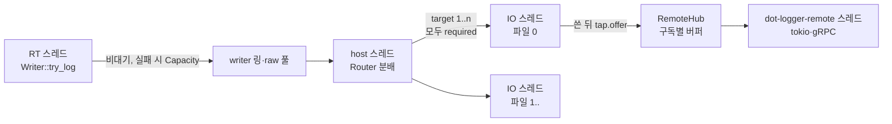
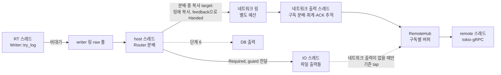

# MS-013 — 출력 구성 선택과 네트워크 전용 모드: 요구사항과 리팩토링 계획

- Intent: INT-001 / 주 Phase: Design → Build / 상태: **Draft r3 — 재리뷰 대기**([REV-076 요청](../../05_verification/reviews/REV-076_REQUEST.md)) / 갱신: 2026-11-27
- 계기: 2026-11-26 InfluxDB 논의 중 Human이 연구개발용 구조를 제안(R1~R3). 2026-11-27 우려 C1~C11 검토 뒤 Human 「내 요구사항과 리팩토링 계획을 한 문서에 작성하고, 리뷰 세션으로 리뷰 받고, 수정하고 다시 리뷰 받는 과정을 한번 거치자」, 이어서 「지적이 없을때까지 리뷰 요청하자」.
- 진행 방식: r1(`da5f6c9`) → [REV-074](../../05_verification/reviews/REV-074_MS013_OUTPUT_DESIGN_REVIEW.md)(Conditional, 12건) → r2(`d9c2da7`) → [REV-075](../../05_verification/reviews/REV-075_MS013_R2_DESIGN_REVIEW.md)(Conditional, 10건) → **r3(이 문서, 10건 모두 수용, §12)** → REV-076 → … **지적 0건 회차까지 반복** → Human 승인(§2.3) → ADR·요구사항·TASK → 구현. 승인 전에는 제품 코드를 바꾸지 않는다.
- 버전: 공개 API·core·원격 wire가 바뀌므로 **0.2**. 착수 순서는 TASK-041(v0.1.1) 뒤(Q1).

## r3에서 바뀐 핵심 (REV-075)

1. **복사 위치를 Router 분배 자리로(§5.1, RV-225):** r2의 「host가 네트워크 target 큐를 턴 안에 비움」은 `Delivery::report`의 `Busy`·feedback 포화 때문에 같은 턴을 보장하지 못한다. r3는 네트워크 target을 Router의 **복사 target**으로 만들어, 분배 중 그 자리에서 링에 복사하고 완료(`Handed`/`Dropped`)를 **dispatcher feedback 경로**로 기록한다. 네트워크는 원본 guard를 한 번도 받지 않는다. 복사 비용의 파일 영향 허용치는 **H6**.
2. **ACK는 기존 흐름 제어 그대로 항상(§5.3, RV-229·226):** 기존 client는 늘 ACK를 보내고 hub는 ACK로 구독 창을 회수한다. 「ACK 끄기」 옵션을 없앤다. 모든 `sent`가 `acked`/`unacked`로 정산되어 무ACK 무손실 오보가 사라진다(H2 불필요).
3. **회계 종결 상태와 일관 스냅샷(§5.4, RV-226):** `abandoned`(링 잔여 폐기), `not_offered`(부분 fanout), `adapter_failed`, 단계별 단일 기록 스레드와 스냅샷 규칙. `is_lossless()`는 관측 손실 0 **그리고** 모든 `sent` ACK 확인.
4. **스위치: 하한 경계·링 내 FIFO 표시·원자적 commit/cancel(§5.6, RV-227):** `boundary`는 분배 커서 기반 **하한**, 정확한 첫 위치는 첫 payload의 epoch+receipt. 표시는 링 안에 payload와 같은 FIFO로. 새 구독에는 현재 epoch 초기 표시. 명령 큐 상한과 CAS로 「Timeout = 미적용」을 엄격히 보장.
5. **종료: 파일과 네트워크 정리 병행, 단일 절대 기한, 정리 상태 별도 보고(§5.9, RV-228).**
6. **옵션 파일의 `[[output]]`은 출력 전체 교체(§5.5, RV-232, H7)**, wire·CLI 경계 값 5와 손실 분류 `Policy` 재사용(§6, RV-230), 메모리 산식 정정(§5.10, RV-231), 측정 공통 관측점·단계별 표면 gate·인일 20~25(§7·§8, RV-233), `Plan.sync_every`·`NotConfigured`(§5.8, RV-234).

r2의 핵심(REV-074 반영)은 유지된다: 원본 완료 = `Handed` 1회, 구독 결과는 보고, 단일 네트워크 출력, 기본 경로, 병합표, DB 단계 6, 레거시 골든.

## 목차

1. 요구사항
2. 결정 기록
3. 현재 구조(코드 확인)
4. 목표 구조
5. 설계 상세
6. 공개 API·wire 변경과 호환
7. 단계별 이행 계획
8. 시험·측정 계획
9. 위험과 열린 질문
10. 연결 문서와 승인 뒤 할 일
11. REV-074 반영표
12. REV-075 반영표

---

## 1. 요구사항

### 1.1 Human 원문 요구 (2026-11-26)

| ID | 요구 |
|---|---|
| R1 | 시작 때 옵션 파일로 파일·네트워크·DB 출력을 배타적으로 또는 동시에 선택한다. |
| R2 | 초당 ~100 MB 단위동작 기록을 SSD에 쓰지 않고, 정해진 메모리 안에서 네트워크로만 보내 원격(예: 원격 PC의 Redis)에서 분석한다. |
| R3 | 원하는 순간에 외부(네트워크) 전송을 켜고 끈다. |

### 1.2 요구 해석 (2026-11-27 Human 결정 반영)

- **R2의 100 MB/s는 보장 목표가 아니라 사용 예다.** 링크 속도·수신 쪽 정지·Redis 보관량은 사용자 책임이다. 라이브러리의 책임은 네트워크 전용 모드의 **무손실 최대 처리량을 측정해 조건과 함께 공개**하는 것이다.
- **R1의 옵션 파일은 재빌드 없이 구성을 바꾸기 위한 것이다.** 코드 지정과 파일 지정을 둘 다 지원한다.
- R1의 「DB」는 MS-012에서 확인한 InfluxDB 출력이다(§5.7, 단계 6).

### 1.3 정제한 요구사항 (승인 뒤 `requirement_spec.md`에 올릴 후보)

| 후보 ID | 요구 | 수락 기준(초안) | 수락 단계 | 출처 |
|---|---|---|---|---|
| FR-019a | 파일·네트워크 출력을 하나 이상, 임의 조합으로 선언해 시작한다. 파일 출력이 없어도 시작한다. | 파일만/네트워크만/둘 다 시작·종료. 출력 0개는 시작 거절(`Missing::Output`). 충돌 구성(§5.2)은 명시 거절 | 2 | R1 |
| FR-019b | DB 출력을 단독 또는 파일·네트워크와 조합해 선언한다. | §5.7 설계 게이트 통과 뒤 단계 6에서 정한다. **그 전까지 DB 조합은 미수락** | 6 | R1 |
| FR-020 | 같은 구성을 코드(builder)와 옵션 파일 양쪽으로 지정한다. 파일은 시작 때 읽는다. | 같은 내용이면 해석된 구성·`Plan`이 같다. 병합표(§5.5) 대로 병합. 모르는 키·버전 불일치·비밀 값 직접 기재·크기 초과는 시작 전 거절, 오류에 원문·값 미노출 | 3 | R1·C7 |
| FR-021 | 네트워크 전용 모드: 로거 파일 IO 없이, 선언한 메모리 상한 안에서 기록을 원격 구독자에게 보낸다. | 로거가 만든 파일 0(명시 `loss_file` 제외), §5.10 관리 예약 합계가 예산을 넘으면 시작 거절, 재연결·최대 구독·포화 중 heap이 관리 예약 + **측정한** runtime 여유 안(runtime·TLS는 보장 아닌 측정 공개), RT 무대기 | 2 | R2 |
| FR-022 | 네트워크 손실을 송신 쪽에서 센다. | §5.4 회계 등식이 최종 보고에서 모두, Health에서 단계 안에서 성립. `is_lossless()`는 손실 0 + 수신 확인. 정상 종료된 구독은 client Gap 수 = 서버 `gap` | 2 | C1 |
| FR-023 | 실행 중 네트워크 전송을 켜고 끈다. 켤 때 시작 위치를 돌려준다. | §5.6 계약: 꺼진 동안 새 사용자 payload 분배 0, epoch 표시에 생산자별 경계 seq, 표시를 요청한 구독은 경계를 받거나 명시적으로 끝남 | 4 | R3·C4 |
| NFR-009 | 네트워크 전용 모드의 무손실 최대 처리량을 기록 크기별로 측정해 공개한다. | §8.2 판정(거절·Gap·Unknown·누락·중복 0, 큐 비증가)으로 찾은 최고 속도와 조건 표 | 5 | R2 |
| NFR-010 | 모드별 보장 범위를 문서와 Health에 드러낸다. | §5.8 보장표가 README·rustdoc에, `Health.durability` 보고 | 2 | C10 |

### 1.4 범위 밖

- 옵션 파일 실행 중 다시 읽기(hot reload). 실행 중 변경은 레벨·샘플링과 새 전송 스위치만.
- pre-trigger 창(C4 후속 옵션).
- 원격 명령(gRPC)으로 스위치 조작(C8).
- Redis 등 수신 쪽 어댑터.
- 압축(B1 UC-23), 원격 실패 원인 구분(EV-124·126). keepalive 중 **유휴 heartbeat는 스위치의 lease 유지에 필요해 단계 4에 넣는다**(H3). 조용한 단절의 **감지 상한**은 응답 확인 메커니즘이 필요해 범위 밖이며, §5.4에 「상한 없음, 손실은 `unacked`·`cut`으로 늦게 드러남」을 명시한다(Q6).
- 0.2에서 네트워크 출력 2개 이상(§5.2, H4).

## 2. 결정 기록

### 2.1 Human 결정 (2026-11-27 #001)

| ID | 결정 |
|---|---|
| C1 | 로봇 쪽 원격 손실 집계(구독별 보냄·Gap·끊김·Unknown 건수·바이트)를 Health·종료 보고에 **필수**로. 손실 구간만 남기는 로컬 요약 파일은 **선택 옵션**. |
| C2·C3 | 링크·수신·보관은 사용자 책임. 라이브러리는 최대 처리량을 측정·공개. 버퍼 크기 ÷ 속도 = 흡수하는 정지 시간 관계만 문서화. |
| C4 | 0.2는 「구독 먼저 → 스위치 켜기」 규약 + 켤 때 시작 위치 반환. pre-trigger 창은 후속. |
| C5 | 파일+원격 구성에서 기존 tap 의미 유지. |
| C6 | 원격 기본 완료 기준은 「보냄」, 수신 ACK 완료는 옵션. (r2에서 해석 정밀화 → H1) |
| C7 | 코드와 옵션 파일 **둘 다**. 같은 설정 타입으로 모이고, 파일 로딩은 선택 feature. 비밀은 경로·환경 변수 참조. |
| C8 | 스위치는 로봇 API 먼저. |
| C9 | 원격 전용 스레드, affinity 영향 측정. |
| C10 | 모드별 보장표를 문서에, Health에 내구 보장 수준 표시. |
| C11 | 0.2. keepalive·원격 실패 원인 구분·facade DB 출력과 같은 버전 묶음. |
| 문서 | 요구와 계획을 한 문서(이 MS)에. 독립 리뷰에서 지적이 없을 때까지 수정·재리뷰 반복(2026-11-27 Human 후속 결정). |

### 2.2 AI 설계 제안 (r3, 승인 대상)

| ID | 제안 | 위치 |
|---|---|---|
| P1 | 네트워크 출력 = Router의 **복사 target**. 분배 중 링에 복사하고 dispatcher feedback으로 완료를 기록한다. 원본 guard를 받지 않는다. 기존 `remote()` tap은 네트워크 출력이 없는 구성에서만 그대로 둔다. | §5.1·§5.2 |
| P2 | 0.2의 출력 역할은 종류로 고정: 파일 = Required, 네트워크 = BestEffort. 공개 `OutputRole` 없음. | §5.1 |
| P3 | 원본 완료 경계는 새 core 경계 `Boundary::Handed`(링 복사). 수신 ACK는 기존 흐름 제어를 항상 쓰고 복사본 수준으로 보고. | §5.3 |
| P4 | 출력에 이름을 붙이고 이름으로도 선택. index는 파일 선언 순서. | §5.2·§5.5 |
| P5 | 옵션 파일은 TOML, `version = 1`, 모르는 키 거절, feature `config-file`. `[[output]]`이 있으면 출력 전체 교체. | §5.5 |
| P6 | 스위치 컷오프는 Router 복사 시점. 꺼진 동안 새 사용자 payload 분배·복사 0(기록당 원자 읽기 1회). 표시는 링 안 FIFO, 요청한 구독에만 별도 frame. | §5.6 |
| P7 | 측정·공개가 수락 기준. 루프백 4 KiB 이상 ≥ 300 MB/s(≈ 73,200건/s)는 내부 목표. | §8.2 |

### 2.3 Human 결정이 필요한 항목 (r3)

| ID | 질문 | AI 권고 | 이유 |
|---|---|---|---|
| H1 | C6 「수신 ACK 완료는 옵션」을 「수신 ACK는 기존 흐름 제어로 **항상** 쓰고, 결과(acked/unacked)는 복사본 단위로 보고하며, 원본 완료·`is_success`에는 묶지 않는다」로 해석해도 되는가 | 예 | 원본을 ACK까지 붙들면 파일·RT 자원을 잠식하고 종료가 ACK를 기다린다(RV-213·216). 기존 client는 이미 항상 ACK하므로 수신 확인은 그대로 얻는다(RV-229). 「ACK 끄기」는 제공하지 않는다 |
| ~~H2~~ | (r2) 무ACK `sent` 보고 방식 | — | r3에서 ACK를 항상 쓰므로 불필요 |
| H3 | 표시를 요청한 구독에 **유휴 heartbeat**(`max_age/2`)를 단계 4에 넣는가. 보장은 「건강한 연결의 유휴 lease 유지」뿐이고 단절 감지 상한은 아니다 | 예 | 꺼진 시간이 lease(기본 10 s)보다 길면 구독이 닫힌다(RV-215). 감지 상한은 응답 확인 메커니즘(keepalive 안건)에서 별도로(RV-229) |
| H4 | 0.2는 네트워크 출력 **최대 1개**, `remote()`와 `network_output()` 동시 선언은 시작 거절 | 예 | 구독 원천·계수 귀속 모호, 구독 wire에 출력 이름 없음 |
| H5 | 출력 미지정 채널(`tracing` 포함): 파일 출력이 있으면 모든 파일 출력, 없으면 모든 출력 | 예 | 기존 트래픽 불변 + 네트워크 전용 선언 부담 감소. 혼합 구성에서 네트워크로 보내려면 채널 이름 지정 필요(리뷰어 확인) |
| H6 | host 복사 비용이 파일 경로에 주는 영향의 허용치 | 「파일만」 포화 처리량의 **80% 이하 부하**에서 「파일 + 네트워크(구독 정지 포함)」의 RT `Capacity`·파일 실패가 **둘 다 0**, 포화 처리량 감소 **≤ 10%** | 포화점에서 거절 수 동일은 일반 보장 불가(RV-225). 느린 네트워크의 **장기 보유는 구조적으로 0**(복사 target)이므로 남는 것은 복사 비용뿐이다 |
| H7 | 옵션 파일에 `[[output]]`이 있으면 코드가 선언한 출력을 **전부 교체**하는가(없으면 코드 출력 유지) | 예 | 이름별 병합만으로는 코드의 파일 출력을 없애 네트워크 전용으로 바꿀 수 없다(RV-232). 「코드는 타입·writer, 파일은 출력·정책·예산」 패턴을 지원 |

## 3. 현재 구조 (2026-11-27 `a9082bc`·`4f7ec58` 코드 확인, REV-074 대조)



| 사실 | 위치 |
|---|---|
| facade 출력은 파일뿐. 파일이 없으면 `StartError::Missing(FileOutput)` | `logger/mod.rs` `Missing::FileOutput` |
| 모든 파일 출력은 Router target `required: true`·`pending_slots: 0`·`max_attempts: 1`·`queue_slots` = 전체 기록 수. 공유 기록 한도가 먼저 차 느린 출력이 RT `Capacity`로 역류. target 한도 초과는 `Capacity`, 큐 삽입 실패는 정책에 따라 `RetryExhausted`·`PendingFull` | `logger/budget.rs`, `routing/mod.rs` |
| Router target ledger는 그 target의 delivery가 살아 있는 동안만 세고, 입력 풀·완료 창 예약을 출력별로 남기지 않는다 → 원본을 오래 붙드는 출력은 writer 풀(특히 작은 raw 풀)을 소진할 수 있다 | `routing/mod.rs`(REV-074 RV-213) |
| 완료 경계는 `Enqueued·Written·Synced·DatabaseAcknowledged·ReceiverAcknowledged` 5개, 완료 표는 `word & 31` 5비트 마스크 | `completion/types.rs`, `completion/mod.rs` |
| 원격은 target이 아니다. 첫 파일 출력 IO 스레드가 배치 쓰기 성공분(오류 시 쓴 prefix)을 `Tap::offer`로 구독마다 복사하고 결과를 버린다 | `logger/host.rs` `write_batch`, `logger/remote.rs` `offer` |
| 원격 손실은 로거 쪽에 집계되지 않는다. 구독자만 Gap을 본다. `offer`가 `Ok(PendingAck)`이어도 뒤에 Gap·Disconnect가 될 수 있다 | `logger/health.rs`, `adapters/remote/hub.rs` |
| 출력 0으로 라우팅되지 않는 채널은 구독에 보이지 않는다. 구독 필터는 채널·레벨·원본 포함 여부이고 출력 이름은 없다 | API §18.12, `adapters/remote/server.rs` |
| facade 원격 한도 기본값: 연결·구독·명령 각 4, `record_bytes` = 가장 큰 slot, `subscription_records` = 모든 slot 수 합, `subscription_bytes` = **max(min(모든 slot 바이트 합, 4 MiB), record_bytes)**, `message_bytes` 32 KiB, `max_age` 10 s(기록 나이 한도이자 협상된 유휴 lease), `request_timeout` 5 s | `logger/remote.rs` `default_limits` |
| `RemoteLimits.message_bytes` 상한 16 MiB(메시지 단위, 큰 기록은 chunk로 나뉨). `reservation()`은 어댑터 버퍼만이고 runtime·TLS·HTTP2는 별도 여유 | `adapters/remote/types.rs` |
| 클라이언트는 모르는 frame kind를 `Corrupt`로 끝낸다 | `dot-logger-client/src/transport.rs` |
| 고급 경로 ACK 관측: `PendingAck`, `RemoteDelivery::poll` → `ReceiverAcknowledged`/Unknown/Dropped(한 delivery ↔ 한 구독) | `adapters/remote/hub.rs` `offer_delivery` |
| core Closed는 optional target까지 포함한 `totals.pending`·drain이 0이어야 한다. facade는 core Closed 뒤에 remote를 멈춘다(정지 뒤 2 s 유예). 주기 sync는 facade가 파일 target 전체 목록을 넘긴다 | `control/mod.rs`, `logger/host.rs` |
| 전역 `worker_failed`가 켜지면 host가 `core.control().close()`로 RT 수락을 닫는다 | `logger/host.rs` |
| 실행 중 변경은 채널 레벨·샘플링뿐. 원격 ApplyConfig도 Route 패치는 InvalidInput | `logger/mod.rs` `set_channel`, API §22.2 |
| 출력 미지정 채널은 모든 파일 출력, 명시 index는 파일 선언 순서. `tracing` 채널도 미지정 경로 | `logger/mod.rs` `route_targets` |
| 파일 예약 토픽 `.logger/meta`·`.logger/loss`(ADR-013 개정) | `storage/codec.rs` |
| facade 공개 이름 항목 **35개**(한도 60, NFR-008), 스냅샷 `tests/api-surface/logger.txt` | `scripts/check-integration-surface.py` |
| 처리량 근거: 고급 경로 루프백 784 MB/s는 **8 MiB 기록**, 유선 1 GbE 약 116 MB/s는 대용량. 4 KiB 소형 근거 없음. Windows 짧은 대기 해상도로 소형 처리량 저하(EV-128) | EV-105·EV-128 |

**이 구조로 R1~R3이 안 되는 이유:** ① 파일 없이 시작 불가 ② 원격이 파일 IO 스레드에 매달려 있음 ③ 원격 손실을 로거가 모름 ④ 옵션 파일 없음 ⑤ 실행 중 전송 on/off 없음.

## 4. 목표 구조



- 출력 = 이름 + 종류(File/Network, 단계 6에 Database). 모두 Router target이다.
- 네트워크 target은 **복사 target**이다. Router가 기록을 분배할 때 파일 target에 guard를 넘긴 뒤 같은 자리에서 링에 복사하고, 그 target의 완료를 dispatcher feedback으로 기록한다. 원본 guard는 네트워크로 가지 않는다.
- 네트워크 출력 스레드는 링에서 꺼내 구독 버퍼로 나누고 구독별 결과와 ACK를 회계한다. 원본과 무관하다.
- 파일 출력은 지금 의미 그대로(Required, Written + sync).
- 시작 조건은 「출력 하나 이상」. 파일이 없으면 `Health.durability = None`.

## 5. 설계 상세

### 5.1 복사 target과 자원 격리 (P1·P2, RV-213·225, H6)

- **복사 target(core 변경, 단계 1):** `TargetConfig`에 종류 `Copy { ring }`을 둔다. dispatcher가 한 기록을 분배할 때 ① 일반(파일) target에 guard를 넣고 ② 복사 target이면 같은 자리에서 링에 payload를 복사한다. 복사 target의 완료는 dispatcher가 이미 쓰는 **feedback 이벤트**(지금 target 포화 `Dropped(Capacity)`를 기록하는 경로 — REV-075가 제안한 경로이며 단계 0 spike로 실제 경로를 확인)로 `Handed` 또는 `Dropped(Capacity)`를 남긴다. `Delivery::report`(완료 셀 경합 시 `Busy`)를 쓰지 않으므로 IO의 1 s 재시도가 host에 들어오지 않는다.
- **feedback 포화:** feedback 용량은 지금 `records × 2`로 잡혀 있다. 복사 target도 기록당 이벤트 1개라 상한 계산에 복사 target 수를 더한다(단계 1 S0에서 산식·포화 동작 확인). 포화되면 dispatcher는 지금처럼 그 턴의 분배를 멈추고 다음 턴에 이어 간다(복사 target이 별도 포화 경로를 만들지 않음).
- **턴별 한도:** 턴당 복사 바이트·건수 상한(`copy_bytes_per_turn`, 기본은 `bytes_per_turn`과 같음). 한도를 넘는 기록은 그 턴에 복사하지 않고 **파일 분배를 먼저 끝낸 뒤** 다음 턴으로 넘긴다(파일 우선). raw 회수 위치(턴 앞)는 그대로.
- **링:** 단일 생산자(host)·단일 소비자(네트워크 스레드)의 비차단 바이트 링. `ring_bytes`는 payload와 기록 머리(메타)를 **합친** 저장 크기 하나다. 링이 차면 새 기록을 넣지 않고 `Dropped(Capacity)`·`ring_full`(가장 오래된 것을 지우지 않음).
- **격리의 두 성분(H6):** ① 느린 네트워크의 장기 보유 = **구조적으로 0**(guard 미전달). 시험: 같은 복사 부하에서 「구독 정상」 대 「구독 정지·네트워크 스레드 정지」의 RT `Capacity`·파일 완료·raw 반환 시각이 같다(raw 2 슬롯·Important·완료 `Busy` 유발 부하·파일 포화). ② host 복사 비용 = 측정값. H6 허용치(80% 부하에서 거절 0, 포화 감소 ≤ 10%)로 판정.
- **Health:** `Failure::IoPoisoned`는 파일 출력 IO 실패로 한정. 네트워크 출력 실패는 `Degraded(OutputLosing)`.

### 5.2 네트워크 출력 선언·tap·기본 경로 (P1·P4, C5, RV-219, H4·H5)

- **선언:** `LoggerBuilder::network_output(name, NetworkOutput)` — 서버 설정(`ServerConfig`)·구독 한도(`RemoteLimits`, 생략 시 기존 결정적 규칙)·링 크기(`ring_bytes`)·턴별 복사 한도·`loss_file`·초기 스위치 상태. ACK는 항상 기존 흐름 제어(§5.3, 옵션 없음).
- **개수:** 0.2는 최대 1개(H4). 2개 이상, `remote()`/`remote_with()`와 동시 선언은 `StartError::Conflict`로 거절한다. 네트워크 출력의 서버가 관리 요청(GetStatus, 레벨·샘플링 ApplyConfig)도 맡는다.
- **tap 규칙(C5):** 네트워크 출력이 없는 구성(`remote()`만)은 지금과 완전히 같다. tap 구성에는 스위치가 없다(`set_output_enabled`는 `NotFound`).
- **기본 경로(H5):** 출력 미지정 채널과 `tracing` 채널은 파일 출력이 있으면 모든 파일 출력, 없으면 모든 출력으로 간다. 파일과 네트워크가 함께 있을 때 네트워크로 보내려면 채널마다 이름으로 지정한다(기존 트래픽 불변).
- **이름과 index:** `ChannelOptions::outputs(&[usize])`는 파일 선언 순서 index 그대로(기존 의미 불변), `outputs_named(&[&str])`는 모든 종류. 한 채널에 두 방식을 섞으면 `InvalidOutputs`.
- **차이 문서화:** 네트워크 출력 구독자는 「그 출력으로 라우팅된 것」을 본다(파일 쓰기 실패 기록도 갈 수 있음, 출력 0에 없는 채널도 보임).

### 5.3 완료 경계와 ACK (P3, C6→H1, RV-217·229·230)

| 대상 | 경계 | 결정 시점 | 결과 |
|---|---|---|---|
| 원본(core 완료) | `Handed`(새 `Boundary`) | dispatcher가 링에 복사할 때 1회(feedback) | `Handed` / `Dropped(Capacity)`(링 가득·턴 한도 아님 — 턴 한도는 다음 턴) / 출력 실패 뒤 `Dropped` / 스위치 꺼짐은 정책 종결 |
| 복사본(구독별) | 보고만 | 네트워크 스레드 | §5.4 L3·ACK 상태 |

- 구독별 결과는 원본 완료에 접지 않는다(fanout 규칙 불필요).
- **ACK(H1):** 모든 구독은 기존 ACK 흐름 제어(ADR-015 묶음·파이프라인 ACK, client `handoff`가 ACK 전송, hub가 ACK로 창 회수)를 그대로 쓴다. 네트워크 스레드는 복사본별 ACK·만료를 추적해 `acked`/`unacked`로 센다. 원본·core 종료와 무관하다. 「ACK 끄기」 옵션은 없다.
- **core 변경(단계 1):** `Boundary::Handed = 5`, 완료 마스크 5→6비트(`word & 63`; 종결 비트 시작 위치 8과 겹치지 않음 — REV-075 확인), 조회·집계·abandon·정리·`Boundaries` 상수.
- **관리 wire·CLI(RV-230):** `GetCompletion` 요청·응답의 경계 숫자 0~4는 그대로 두고 **5 = Handed**를 추가한다. CLI 경계 이름에 `handed`. 옛 client가 5를 받으면 그 항목은 디코드 오류가 된다 — facade는 `GetCompletion`이 `Unsupported`라 facade 구성에서는 생기지 않고, 고급 경로에서 복사 target을 쓰는 host만 해당(§6 wire 표에 명시).
- **스위치 꺼짐의 정산(RV-230):** 새 `DropReason`을 만들지 않는다. 꺼진 출력은 분배 시 그 기록의 route에서 빠진 것으로 정산하고, 손실 분류는 기존 **`Cause::Policy`**(의도적 생략, 레벨 필터·샘플링과 같은 범주)로 남긴다. persisted loss schema에 새 cause가 없다. 단계 1에서 이 정산이 파일 손실(`OutputDropped`)에 섞이지 않는지 시험한다.

### 5.4 손실 회계 (C1, RV-214·226)

단계마다 배타적 상태·보존식·**건수와 payload 바이트**. 각 단계의 계수는 **한 스레드만 쓴다**(L1 host, L2·L3 네트워크 스레드).

| 단계 | 단위 | 보존식 | 상태 |
|---|---|---|---|
| L1 원본 | 네트워크로 라우팅된 원본 | `routed = handed + ring_full + output_failed + switched_off` | `switched_off`는 정책 생략(`Cause::Policy`), 나머지 둘은 사고성 손실 |
| L2 링 | 링에 들어간 기록 | `handed = dispatched + no_subscriber + abandoned + ring_pending` | 꺼낼 때 그 기록의 **대상 구독 집합(eligible)** 을 고정. 0명이면 `no_subscriber`. 네트워크 스레드 실패·종료 기한으로 링에 남은 것은 `abandoned`. `ring_pending`은 스냅샷 시점 링 잔여(최종 보고에서 0, 남은 것은 `abandoned`로 옮김) |
| L3 구독 | 기록 × eligible 구독 | `targeted = filtered + offered + not_offered`, `offered = gap + too_large + adapter_failed + sent + cut + in_flight` | `filtered` 정책 생략. `not_offered`는 부분 fanout 중 스레드 실패·기한으로 offer하지 못함. `offer` 결과: 포화 → `gap`, 한도 초과 → `too_large`, `Gone`·`Transport` → `cut`, 그 밖 오류 → `adapter_failed`. `sent`는 마지막 chunk를 스트림에 넘김, `cut`은 넘기기 전·중 구독 종료, `in_flight`는 스냅샷 시점 진행 중(최종 0) |
| ACK | `sent` | `sent = acked + unacked + ack_pending` | `unacked`는 만료·종료로 확인 못 함(최종 `ack_pending` 0) |

- **스냅샷 일관성:** 각 단계 계수는 그 단계를 쓰는 스레드가 seqlock으로 한 번에 게시한다. `Health`는 **단계 안 등식은 항상 성립**, 단계 사이 등식(L1 `handed` = L2 입력 등)은 스레드 간 시점 차이로 순간적으로 어긋날 수 있음을 문서화한다. **최종 보고(Closed)에서는 모든 등식이 성립**한다.
- **구독 식별:** 재연결은 새 ID. 활성은 개별, 끝난 구독은 **최근 8개 상세 + 퇴역 총계**.
- **노출:** `Health.network`, `FacadeReport.network`(Closed 최종 / Incomplete 중간값 표시).
- **판정(Q2):** `FacadeReport::network_loss()` = 사고성 손실 합(`ring_full`·`output_failed`·`no_subscriber`·`abandoned`·`not_offered`·`gap`·`too_large`·`adapter_failed`·`cut`), `FacadeReport::is_lossless()` = `is_success()` && `network_loss() == 0` && `unacked == 0`. 「손실 0」과 「수신 확인」이 함께 성립해야 무손실이다.
- **client 대조:** Gap 프레임까지 전달되고 정상 종료된 구독에서 client Gap 수 = 서버 `gap`. 바이트는 서버 계수만(Gap 프레임에 바이트 합 없음).
- **조용한 단절의 범위(Q6·RV-229):** 감지 **상한을 보장하지 않는다.** 전송 계층이 차면 스트림이 poll되지 않아 `max_age` 타이머도 독립 상한이 아니다(EV-123 F4). 그 동안 넘긴 것은 ACK가 오지 않아 결국 `unacked`(또는 구독 종료 시 `cut`)로 정산된다 — **손실이 숨겨지지는 않고 늦게 드러난다.** 감지 상한은 응답 확인 메커니즘(keepalive 안건)에서 별도로 정한다.
- **로컬 손실 파일(C1 옵션):** `NetworkOutput::loss_file(path, max_bytes)` — 디스크 쓰기가 생기는 명시 옵션. 네트워크 스레드가 손실 구간을 **최대 1,024 구간**의 1초 버퍼에 합치고(넘으면 인접 구간을 합치며 `loss_file_coarsened`로 센다), 별도 작은 기록 스레드가 비차단 큐(용량 4초분)로 받아 쓴다. 파일이 `max_bytes`(기본 1 MiB)를 넘으면 앞에서 잘라 돌려 쓴다. 기록 스레드가 막히면 큐가 차서 `loss_file_dropped`로 세고 네트워크 스레드는 기다리지 않는다. 쓰기 오류는 `Degraded(OutputLosing)`.

### 5.5 설정 타입·옵션 파일·병합 (P4·P5, C7, RV-221·232, H7)

- **`LoggerConfig`(feature 없음):** budget·출력(이름·종류·종류별 설정)·채널 정책(토픽별 출력 이름·`minimum`·`important_from`)·writer quota·스위치 초기 상태. `LoggerBuilder::config(LoggerConfig)`.
- **지원 패턴(RV-232):** 「코드는 채널 타입(`channel::<T>(topic)`)과 writer 이름만, 파일이 출력·정책·예산을 소유」. 이 패턴으로 **같은 바이너리**가 파일만/네트워크만/혼합 구성을 파일 교체로 바꾼다(단계 3 수락 시험). 파일에만 있는 토픽·writer는 시작 거절.

| 항목 | 병합 단위 | 규칙 |
|---|---|---|
| budget | 필드별 | 뒤 호출이 그 필드를 덮음. 안 준 필드는 유지 |
| preset | 전체 | resolve 때 비어 있는 손실 값만 채움 |
| **출력** | **목록 전체(H7)** | `config()`에 출력이 하나라도 있으면 그때까지 선언된 출력(코드의 `file_output`·`network_output` 포함)을 **모두 교체**한다. 출력이 없으면 기존 출력 유지. `config()` 뒤의 코드 출력 선언은 그 목록에 추가. 같은 이름이 두 번 나오면 `Duplicate` |
| 이름 없는 코드 출력 | — | `file_output(dir, ..)`은 자동 이름 `file0`, `file1`…(선언 순서). 사용자 이름이 `file<N>` 형식이면 `Duplicate` 가능성이 있어 예약어로 거절 |
| 파일 출력 index | — | 최종 출력 목록에서 파일 출력의 순서. 교체되면 index도 새 목록 기준(`explain()`에 표시) |
| 채널 정책 | 토픽·필드별 | 뒤가 그 필드를 덮음. 없는 출력 이름을 가리키면 `InvalidOutputs` |
| writer quota | writer 이름별 | 뒤가 교체 |
| 경로 | — | `from_toml_path`는 **설정 파일이 있는 디렉터리** 기준. `from_toml_str(text, base_dir)`은 기준 디렉터리를 인자로 받는다(없으면 상대 경로 거절) |
| 오류 우선순위 | — | 파일 파싱 → 스키마(모르는 키·버전·비밀 값·예약 이름) → 병합(중복·없는 이름) → `start()` 검증 |

- **동등성:** 코드 구성과 파일 구성은 해석된 `LoggerConfig`와 `Plan`이 같음으로 시험. 출처는 `LoggerBuilder::explain() -> PlanSources`(공개 `Plan` 필드 불변).
- **파일(feature `config-file`):** `version = 1` 필수, `deny_unknown_fields`, 크기 상한 1 MiB를 읽는 중에(`Read::take`) 적용.
- **오류:** `ConfigFileError { kind, line, column }`, `Display`·`Debug`는 kind와 위치만, `source()`는 `None`. 비밀 키 값 기재는 `SecretValue`.
- **의존성(단계 3 S0):** `toml` 추가 전 MSRV 1.85·`cargo audit`·라이선스. feature 조합: 없음 / `config-file` / +`remote` / +`influxdb`. feature가 없는 출력 종류를 쓴 파일은 `Unsupported`.
- **예시(초안, 예산 안 — 단계 3에서 실제 시작 시험):**

```toml
version = 1

[budget]
memory = "1 GiB"          # 링 64 MiB + 구독 예약(2개) + 파일·입력 예약 + 여유, §5.10 산식
drop_deadline = "3 s"
sync_every = "100 ms"     # 파일 출력이 있을 때만 의미(네트워크 전용이면 경고)

[[output]]                 # 출력 목록이 있으면 코드의 출력을 모두 교체(H7)
name = "net"
kind = "network"
bind = "0.0.0.0:7400"
tls_cert_path = "certs/logger.crt"
tls_key_path = "certs/logger.key"
subscriptions = 2
subscription_bytes = "128 MiB"
ring_bytes = "64 MiB"
enabled = false

[[output]]
name = "disk"
kind = "file"
directory = "/data/logs"
retention = { ring = "8 GiB" }

[channel."robot/joint"]
outputs = ["net"]
[channel."robot/event"]
outputs = ["net", "disk"]
minimum = "info"
```

### 5.6 전송 스위치 (P6, C4·C8·H3, RV-215·227·229)

- **API:** `Logger::set_output_enabled(name, enabled, deadline) -> Result<SwitchReceipt, SwitchError>`, `Logger::output_state(name) -> OutputState { epoch, enabled }`(기한 뒤 재조회용).
- **`SwitchReceipt { epoch, changed, at_ns, subscribers, boundary: Vec<(producer_id, next_seq)> }`**
  - `subscribers`: 표시를 큐에 넣은 시점에 네트워크 스레드가 본 **표시 수신 가능 구독 수**(host가 아니라 네트워크 스레드의 관측, 응답은 그 관측 뒤).
  - `boundary`: 생산자별 **하한**. 적용 시점 Router 분배 커서(각 생산자 다음으로 분배할 `accepted_seq`). 이 epoch의 네트워크 기록은 모두 `seq ≥ next_seq`다. 첫 네트워크 기록의 정확한 seq는 커서 위치 기록이 파일 전용일 수 있어 미리 알 수 없다 — **정확한 첫 위치는 수신자가 표시 뒤 첫 payload의 receipt로 안다**(링 포화·필터가 있으면 첫 수신은 더 뒤일 수 있고, 그것은 `ring_full`·`filtered` 계수로 드러난다). 빈 생산자는 현재 커서를 그대로 넣는다.
- **명령 선형화(RV-227):** 명령 큐는 **상한 4**(가득 차면 `SwitchError::Busy`). 명령마다 공유 상태 `Pending → Committed | Cancelled`를 CAS로 결정한다. host는 적용 직전 `Pending → Committed`, 호출자는 기한이 지나면 `Pending → Cancelled`를 시도한다. **이긴 쪽만 유효**: 호출자가 이기면 host는 적용하지 않고(`Timeout` = 미적용 엄격 보장), host가 이기면 호출자는 기한이 지났어도 영수증을 받을 때까지 짧게 더 기다린다(host는 commit 직후 응답). 같은 상태 요청은 새 epoch 없이 `changed: false`. Closing 이후 `Closing`.
- **컷오프 = Router 복사 시점:** 적용 턴부터 그 출력의 복사 target 상태가 바뀐다. 꺼진 동안 수락돼 host에 쌓인 기록도 켠 뒤 분배되면 복사된다(하한 `boundary` 이상). 꺼진 동안 그 출력으로 라우팅된 기록은 정책 종결(`switched_off`, `Cause::Policy`).
- **FIFO fence(RV-227):** ON/OFF 표시는 별도 슬롯이 아니라 **링 안의 제어 항목**으로 payload와 같은 순서에 들어간다. 네트워크 스레드는 각 구독 큐에도 같은 순서로 넣는다. 그래서 OFF 표시는 그 앞의 payload·부분 chunk·Gap 뒤에, ON 표시는 그 뒤 payload보다 앞에 온다. 구독 큐는 제어 항목 1개 자리를 늘 비워 둔다(payload 포화로는 표시가 밀리지 않음). 앞 표시가 아직 나가지 못한 채 다음 표시가 와 자리가 없으면 서버가 그 구독을 `MarkerOverflow`로 명시 종료.
- **새 구독의 초기 표시:** 표시를 요청한 구독이 시작될 때 현재 epoch·상태·현재 커서 하한을 담은 표시를 첫 frame으로 받는다(이미 켜진 epoch에 붙는 경우).
- **비용:** 꺼진 동안 host가 기록당 상태 원자 읽기 1회. 새 사용자 payload 분배·복사 0.
- **wire(RV-229):** 구독 요청에 `epoch_markers: Off | Preferred | Required`(protobuf 새 필드), 구독 응답에 지원 여부. 서버는 요청한 구독에만 새 frame kind(표시·heartbeat)를 보낸다. `Required`인 새 client가 옛 서버(응답에 지원 표시 없음)를 만나면 구독을 `RemoteError::Unsupported`로 끝내고, `Preferred`는 표시 없이 계속한다. `MarkerOverflow`는 기존 종료 이유 메타데이터(`REASON_KEY`)에 새 이유 문자열로 실어 client에서 `ClientError::Remote(RemoteError::Limit)` + 이유로 노출한다.
- **유휴 heartbeat(H3):** 표시를 요청한 구독에 기록이 없을 때 `max_age/2`마다. **보장은 건강한 연결의 유휴 lease 유지뿐**이며 단절 감지 상한은 아니다(§5.4).
- **client:** `epoch_markers(..)` 옵션, `RemoteEvent::Epoch { epoch, enabled, boundary }`.
- **시험:** OFF backlog를 ON 뒤 분배했을 때 첫 수신 receipt ≥ `boundary`, 표시와 payload 순서(앞지름 없음), 빠른 OFF/ON, 포화 중 표시(전달 또는 `MarkerOverflow`), 다중 생산자, 빈 생산자, 새 구독 초기 표시, 종료 경합, CAS 경합(기한 직전 적용·기한 직후 취소), 명령 큐 포화, wire 조합(옛 client·옛 서버 × Off/Preferred/Required).

### 5.7 DB 출력 (단계 6, 설계 게이트, RV-220)

- MS-012 결과: v2 쓰기는 2.9.1·3.12.3 모두 동작, 조회(Flux)는 v3에서 404, 타입 충돌 배치는 v3에서 전체 거절(EV-134). DB 장애 동작은 TASK-047.
- 게이트에서 정할 것: Record → DB 필드 매핑(TASK-044와 함께), 배치 거절·부분 ACK의 완료 보고, 출력 역할(Required/BestEffort), 파일 없는 DB 전용 구성의 종료, `DatabaseAcknowledged`(API ACK) ≠ 내구성 표기.
- **FR-019b는 단계 6까지 미수락**이며 0.2 alpha 범위 표에 「DB 조합 미포함」으로 적는다.

### 5.8 모드별 보장표 (C10, RV-220·234)

| 구성 | 내구성 | UPS 경보 뒤 마감 | 손실을 누가 아나 | `Health.durability` | 파일 관련 API |
|---|---|---|---|---|---|
| 파일만 | sync 주기마다 확정 | 적용(3 s 예산) | 로거(종료 보고·`.logger/loss`) | `File { sync_every }` | 지금과 같음 |
| 파일 + legacy tap(`remote()`) | 파일과 같음 | 파일만 | 파일은 로거, tap 사본은 구독자 Gap만(로거 집계 없음) | `File { .. }` | 지금과 같음 |
| 파일 + 네트워크 출력 | 파일만 | 파일만 | 파일은 로거, 네트워크는 §5.4 회계 + 구독자 Gap | `File { .. }` | 지금과 같음 |
| 네트워크만 | 없음(메모리) | 적용 안 됨 | §5.4 회계(+ 선택 `loss_file`) + 구독자 Gap | `None` | `Plan.sync_every`는 **`Duration::ZERO`**(「주기 sync 없음」, rustdoc 명시). 값을 주면 시작은 하되 `PlanWarning::Unused`. `drop_deadline` 필요. `directories()` 빈 목록. `mark_event`·`release_event`는 **기존 `EventError::NotConfigured`**(새 변형 없음) |
| DB 포함 | API ACK ≠ 디스크 보장 | 게이트에서 결정 | 게이트에서 결정 | 게이트에서 결정 | 단계 6 |

### 5.9 종료 순서와 실패 격리 (RV-216·228)

`shutdown(deadline)`은 **절대 기한 하나**(`now + deadline`)를 만들어 모든 작업에 넘긴다.

1. 입구 닫기(지금과 같음).
2. host 분배 drain. 복사 target은 분배 중 정산되므로 core pending에 네트워크가 남지 않는다. 마지막 복사가 끝나면 링에 **종료 표시**를 넣는다.
3. **병행:** (a) 파일 drain·최종 sync(파일 target만) → core Closed, (b) 네트워크 스레드: 링 잔여 송신 → ACK 대기 → 구독 종료 → hub 정지. (b)는 (a)를 기다리지 않는다.
4. 기한에 도달하면 (b)는 **강제 정리**: 남은 링 → `abandoned`, offer 못 한 eligible → `not_offered`, ACK 대기 → `unacked`, tokio runtime은 `shutdown_timeout(0)`으로 남은 연결을 끊고 thread join. `loss_file` 기록 스레드가 IO에 막혀 있으면 기다리지 않고 분리(`Detached`)한다.
5. 보고:
   - `FacadeReport.core`·`is_success()`는 **(a)만**으로 결정된다. 네트워크 정리 지연이 파일 성공을 가리지 않는다.
   - `FacadeReport.network`에 `cleanup: Finished | Forced | Detached(thread)`와 최종 계수. `Forced`도 계수 등식은 성립(강제 정리 몫이 `abandoned`·`not_offered`·`unacked`로 들어감).
   - (a)가 기한 안에 끝나지 않으면 지금처럼 `Shutdown::Incomplete`(core 미완료). (a)는 끝났고 (b)만 `Forced`·`Detached`면 `Closed`이며 보고에 그 상태를 담는다.
   - `Detached`된 스레드는 IO가 풀리면 스스로 끝나고, 그 메모리는 그때 반환된다(보고에 명시).
- **실패 격리:** 네트워크 스레드 실패는 그 출력만 Failed(`Degraded(OutputLosing)`), 이후 복사 target 몫은 `output_failed`. 전역 `worker_failed`를 켜지 않아 RT 수락을 닫지 않는다.
- **시험:** 같은 기한으로 느린 파일 sync(시험 훅) + 멈춘 구독 + `loss_file` 막힘을 겹쳐 ① 파일 성공 판정 ② `shutdown()` 반환이 기한 + 작은 여유 안 ③ 자원 회수(`cleanup` 상태별)를 각각 판정. 파일 단독·혼합·네트워크 전용에서 ACK 미발행, 네트워크 스레드 실패, 기한 경합.

### 5.10 메모리 예약 목록 (RV-218·231)

각 항목을 **한 번만** 더하는 checked 산식(`checked_add`·`checked_mul`, 넘치면 `InvalidBudget`).

| 항목 | 산식 | 파티션 |
|---|---|---|
| 네트워크 링 | `ring_bytes`(payload + 기록 머리 포함 저장 크기 하나) | external |
| 구독·연결·명령 버퍼 | `RemoteLimits::reservation()` **1회**(이미 `subscriptions ×` 구독 예약 + 공유 연결·명령 비용 포함) | external |
| 표시 제어 자리 | `subscriptions × marker_bytes(P)`, `marker_bytes(P)` = 머리 + `P ×` (`producer_id` 4 + `next_seq` 8) B, P = 생산자 수 | external |
| 스위치 영수증·명령 큐 | 명령 4 × (`SwitchReceipt` 머리 + `P × 12` B) | control |
| 구독 회계 | (활성 `subscriptions` + 퇴역 상세 8) × 계수 블록 + 총계 | control |
| 손실 파일 | 1초 버퍼 1,024 구간 × 구간 크기 + 기록 큐 4초분 | control |
| 스레드 스택 | 네트워크 출력 1 + `loss_file` 기록 1(선택) × `STACK_BYTES` | worker |
| tokio runtime·TLS·HTTP2 | **예약 밖** — 별도 여유로 문서화 | — |

- 합계가 `Budget::memory_bytes`를 넘으면 `StartError::Budget`. `plan()`이 항목별 값을 보고.
- **검증 범위(FR-021, RV-231):** ① 관리 예약 — 예산 경계 ±1 바이트 시작 거절/성공, 퇴역 이력 고정 크기. ② 실행 중 heap — 재연결 1,000회·최대 동시 구독·포화 지속 중 soak heap 표본으로 **관리 예약 + 측정한 runtime 여유** 안인지. runtime·TLS 몫은 보장이 아니라 측정값으로 공개한다.

## 6. 공개 API·wire 변경과 호환 (0.2, RV-221·224·230·233·234)

| 구분 | 항목 | 호환 |
|---|---|---|
| 추가(facade) | `network_output`, `NetworkOutput`, `Logger::set_output_enabled`·`output_state`, `SwitchReceipt`, `SwitchError`, `OutputState`, `ChannelOptions::outputs_named`, `file_output_named` | 새 항목 |
| 추가(facade) | `LoggerConfig`(+ 하위 설정 타입), `LoggerBuilder::config`·`explain`, `PlanSources`, feature `config-file`의 `from_toml_*`·`ConfigFileError`·`ConfigFileErrorKind` | 새 항목 |
| 추가(facade 보고) | `NetworkHealth`, `NetworkReport`, `SubscriptionReport`, `NetworkCleanup`, `Durability`, `Health.network`·`Health.durability`, `FacadeReport.network`, `FacadeReport::network_loss`·`is_lossless`, `Degradation::OutputLosing` | **기존 struct 필드·enum 변형 추가 → breaking** |
| 변경 | `Missing::FileOutput` → `Missing::Output`, `StartError::Conflict`·`PlanWarning::Unused` 추가 | **breaking** |
| 의미 | `Plan.sync_every`는 파일 출력이 없으면 `Duration::ZERO`, `EventError::NotConfigured`는 「파일 출력 없음」도 포함, `Failure::IoPoisoned`는 파일 출력 한정 | 문서 의미(타입 불변) |
| 변경(core) | `Boundary::Handed = 5`(완료 마스크 6비트), `TargetConfig` 복사 target 종류 | **breaking**(core 공개 enum·struct) |
| 유지 | `Plan` 공개 필드, `remote()`/`remote_with()` tap, `ChannelOptions::outputs(&[usize])` index, persisted loss cause(새 cause 없음, `Policy` 재사용) | 유지 |
| wire(관리) | `GetCompletion` 경계 5 = Handed 추가, CLI `handed` | 0~4 유지. 옛 client가 5를 받으면 그 항목 디코드 오류 — 고급 경로 복사 target host만 해당 |
| wire(구독) | 요청 `epoch_markers: Off/Preferred/Required`, 응답 지원 표시, 새 frame kind(표시·heartbeat), 종료 이유 `marker_overflow` | 요청하지 않은 구독(기존 client)은 새 frame 미수신. 새 client `Required` ↔ 옛 서버는 `Unsupported`로 종료, `Preferred`는 표시 없이 동작 |
| client | `epoch_markers(..)`, `RemoteEvent::Epoch` | 0.2 client 추가(`RemoteEvent` 완전 match는 breaking) |

- **`#[non_exhaustive]`(Q7):** 새 보고 타입은 처음부터. 기존 타입은 단계 2 S0에서 이관 비용(dot-probe·예제·`check-external-consumer.py`) 확인 뒤 결정.
- **공개 표면 gate(RV-233):** 단계마다 `check-integration-surface.py`의 **항목 수(≤ 60)와 스냅샷 전체 일치**를 gate로 둔다. 스냅샷 갱신(`--bless`)은 그 단계의 리뷰에서 diff를 확인한 뒤에만. 현재 35/60, 단계 2·3·4 뒤 실제 이름·재노출로 다시 센다(초기 추정 약 50). 55를 넘으면 하위 설정 타입을 하위 모듈로 내리는 방안을 그 단계에서 검토.
- **core·wire 호환 시험은 facade 표면 gate와 별도**로 둔다(단계 1 core, 단계 4 wire).

## 7. 단계별 이행 계획 (RV-220·223·225·233)

각 단계는 TDD이고, 끝날 때 두 Rust 전체 회귀·Clippy·feature 조합·**공개 표면 gate(항목 수 + 스냅샷)**·CI를 통과한 상태를 유지한다. TASK 번호는 승인 뒤 채번.

| 단계 | 목표 | 공개 변경 | 종료 상태(수락) | 인일 초안 |
|---|---|---|---|---|
| 0 | 레거시 고정·조기 확인 | 없음 | **골든**: 대표 구성 N개의 `Plan` 산식, 출력 ID·sync/barrier 순서, 부분 쓰기 tap prefix, 시작 실패 정리, 파일 내구성(UPS 시뮬레이션). **조기 확인(spike, 제품 코드에 넣지 않음)**: ① dispatcher feedback으로 복사 target 완료를 기록하는 경로·feedback 포화 동작 ② 턴별 복사 한도와 파일 우선 순서 ③ 명령 CAS 중재 ④ 종료 병행(파일 sync와 네트워크 정리). 새 스레드 대기 방식의 Windows·macOS 깨우기 측정(EV-128). **legacy tap 기준선**(§8.2 공통 관측점) | 3~4 |
| 1 | core 복사 target·경계 + 내부 리팩토링 | core `Boundary::Handed`·`TargetConfig` 복사 종류(breaking, **기존 facade 사용은 불변**) | 내부 출력 모델, 복사 target과 Router 내부 시험: raw 2 슬롯·Important·완료 `Busy` 유발 부하·파일 포화에서 「구독 정상」 대 「정지」 동일, feedback 포화, 턴 한도. `Cause::Policy` 정산이 파일 손실에 섞이지 않음. 관리 wire 경계 5·CLI. 단계 0 골든 + 기존 facade 회귀 **수정 없이** Pass | 4~5 |
| 2 | 네트워크 출력·파일 없는 시작·회계·종료 | facade 추가·breaking(§6) | FR-019a·021·022·NFR-010. facade Red 먼저: 네트워크 전용, 혼합 + 구독 정지, 네트워크 스레드 실패(RT 수락 유지), §5.9 겹친 장애 종료, 예산 경계, 재연결 heap. C5·H4·H5 구성 시험. 표면 gate·L3 「네트워크 전용」 레시피(+6줄 이하) | 4.5~5.5 |
| 3 | 설정 타입·옵션 파일 | facade 추가 | FR-020: 병합표 경우별, **같은 바이너리 + 파일 3개(파일만·네트워크만·혼합) 수락 시험**, 동등성, 오류 노출 시험, 읽는 중 크기 상한, feature 조합, 의존성 MSRV·audit, 표면 gate | 3~3.5 |
| 4 | 전송 스위치·표시·heartbeat | facade·wire·client 추가 | FR-023: §5.6 시험 전부, wire 호환 행렬, 표면 gate | 3.5~4.5 |
| 5 | 무손실 최대 처리량 측정·공개 | 없음(README) | NFR-009: §8.2 판정, H6 판정, EV | 2~2.5 + 실행 |
| 6 | DB 출력(설계 게이트) | 게이트 뒤 | §5.7 설계 승인 → FR-019b 별도 계획 | 미정 |

- 합계(단계 0~5): **20~25 인일**(r2 16.5~22에서 조기 확인 spike·복사 target core·종료 병행·wire 행렬 추가).
- 단계 1은 단독 리뷰. 단계 2~4 뒤 0.2.0-alpha 여부를 MS-010과 함께(alpha 범위 표에 「DB 조합 미포함」).

## 8. 시험·측정 계획

### 8.1 시험 (단계별 Red 먼저)

| 요구·지적 | 시험 | 단계 |
|---|---|---|
| 동작 불변 | 단계 0 골든 + 기존 facade·tc_013·레시피 수정 없이 Pass | 0·1 |
| RV-213·225 격리 | 같은 복사 부하에서 구독 정상 대 구독·네트워크 스레드 정지: RT `Capacity`·파일 완료·raw 반환 동일(raw 2 슬롯, Important, 완료 `Busy` 유발, 파일 포화). H6 허용치 판정(80% 부하 거절 0, 포화 감소 ≤ 10%) | 1(내부)·2(facade)·5(H6) |
| FR-019a·H4·H5 | 조합 3종, 출력 0개, `remote`+`network_output` 거절, 기본 경로, index·이름 혼용 | 2 |
| FR-021·RV-218·231 | 로거 파일 0, 예산 경계 ±1, 재연결 1,000회·최대 구독·포화 heap(관리 예약 + 측정 runtime 여유) | 2 |
| FR-022·RV-214·226 | L1~L3·ACK 등식(건수·바이트), 단계 안 Health 등식, 최종 보고 전 등식, 다중 구독·필터·0명·크기 초과·`Gone`·`Transport`·부분 fanout 중 스레드 실패·종료 기한 잔여, client Gap = 서버 gap | 2 |
| RV-216·228 종료 | 겹친 장애(느린 파일 sync + 멈춘 구독 + `loss_file` 막힘)에서 파일 성공·반환 기한·`cleanup` 상태 각각, 네트워크 스레드 실패 시 RT 수락 유지 | 2 |
| C5 | `remote()`만 쓴 구성의 기존 tap 시험 그대로 | 2 |
| FR-020·RV-232 | 병합표, 같은 바이너리 + 파일 3개 수락, 오류 노출 | 3 |
| FR-023·RV-215·227·229 | §5.6 시험 목록, wire 호환 행렬 | 4 |
| RV-230 | 관리 wire 경계 0~5 왕복, CLI `handed`, `Cause::Policy` 분리 | 1 |
| 플랫폼 | 3 OS × 2 Rust CI | 매 단계 |

### 8.2 측정 (NFR-009, RV-222·233)

- **공통 관측점(legacy tap과 새 경로 모두):** ① 부하 생성기가 만든 기록 수 ② RT 수락 수(`try_log` 결과) ③ client가 받은 **고유 기록 ID** 수·바이트(중복·누락 판별) ④ 종료 뒤 client 수신 끝 표시까지의 배출. legacy tap은 `offer` 결과를 버리므로 이 네 점으로만 판정한다.
- **새 경로 추가 관측점:** L1 `routed`, L3 `offered`, 링·구독 큐 길이(내부 계측 — legacy에는 없음을 표에 명시).
- **판정(무손실 최고 속도):** 정책 필터를 끈 프로필에서 공통 관측점 기준 누락·중복 0, 새 경로는 추가로 거절·`ring_full`·`no_subscriber`·Gap·`cut`·`unacked`·`abandoned` 0, 큐 길이 60 s 기울기 ≤ 0인 가장 높은 속도.
- **기록 크기:** 64 B·256 B·4 KiB·64 KiB·1 MiB. 4 KiB 300 MB/s ≈ 73,200건/s이므로 기록당 비용(복사·링·구독 분배·인코딩)을 따로 잰다.
- **조건 명시:** 구독 수, client ACK 창, payload 형태, 링크(루프백·1 GbE), TLS, 스레드별 CPU·affinity, 커널, AI 세션 대기 여부(EV-130).
- **H6 측정:** 「파일만」 포화 처리량 P를 먼저 구하고, 0.8P 부하에서 「파일 + 네트워크(구독 정상·정지)」 거절·파일 실패, 그리고 포화 처리량을 비교.
- **플랫폼:** Linux 측정(Tier 1), Windows·macOS는 깨우기 측정과 기능 시험(NFR-007).
- **쓰기량·시간:** SSD 쓰기 0(H6의 파일 쪽은 tmpfs), 전체 1~2시간(시작 전 알림).

## 9. 위험과 열린 질문

### 9.1 위험

| ID | 위험 | 영향 | 대응 |
|---|---|---|---|
| K1 | 원본 보유가 파일·RT 자원 잠식 | 파일 손실·RT 거절 | 복사 target(guard 미전달), §8.1 시험 |
| K2 | `RemoteHub` 잠금·구독별 복사 병목 | 처리량 미달 | 단계 0 기준선, 단계 5 기록당 비용 |
| K3 | 0.2 breaking 폭(facade·core·client·wire) | 사용처 부담 | §6, 이관 안내, Q7 |
| K4 | 옵션 파일 스키마가 공개 계약 | 버전 부담 | `version`, 필요한 키만 |
| K5 | 범위 확대 | 일정·리뷰 부담 | 단계 6 게이트, §1.4 |
| K6 | 네트워크 스레드·TLS의 RT 코어 경합 | RT 지연 꼬리 | C9 측정, affinity 안내 |
| K7 | 측정 잡음(EV-130) | 수치 신뢰도 | 실행 방식 기록, 반복 |
| K8 | dispatcher 복사 비용이 파일 분배를 늦춤 | 파일 지연·RT 거절 | 턴별 한도·파일 우선, H6 허용치, 단계 5 |
| K9 | wire 변경 호환 실수 | 기존 client 오류 | 요청 구독에만 새 frame, 호환 행렬 |
| K10 | NFR-008 항목 60 초과 | 수락 실패 | 단계별 gate |
| K11 | Windows·macOS 깨우기 해상도 | 소형 처리량 | 단계 0 측정 |
| K12 | core `Router`에 복사 target이라는 새 종류가 들어가 범용 경로가 복잡해짐 | core 회귀 | 단계 0 spike로 먼저 확인, 단계 1 단독 리뷰, Miri 범위에 복사 경로 포함 |
| K13 | feedback 용량 산식 변경이 기존 구성의 메모리 예약을 바꿈 | 기존 `Plan` 값 변화 | 복사 target이 없으면 산식 불변(골든 시험) |

### 9.2 열린 질문 (리뷰어 의견 반영 → Human 결정)

| ID | 질문 | 리뷰어(REV-074·075) | AI 권고(r3) |
|---|---|---|---|
| Q1 | 구현 착수 시점 | 기존 순서 유지 | 유지(TASK-041 뒤) |
| Q2 | 네트워크 손실과 성공 판정 | 파일 성공·송신 중 손실·수신 확인을 구분해 드러냄 | `is_success` 불변 + `network_loss()`·`is_lossless()`(수신 확인 포함) |
| Q3 | 처리량 목표 | 측정·공개가 수락, 300 MB/s는 내부 목표 | 동의 |
| Q4 | `Handed` 경계 | 독립 경계, core·wire 영향 반영 | 채택(§5.3, 경계 5) |
| Q5 | 코드/파일 우선순위 | 병합표와 함께 채택 가능, 전체 교체는 RV-232에서 | 병합표 + 출력 전체 교체(H7) |
| Q6 | keepalive·실패 원인 구분 | 별도 작업, 감지 범위 명시 | 별도 + 유휴 heartbeat만 단계 4(H3), 감지 상한 없음 명시 |
| Q7 | `#[non_exhaustive]` | 새 타입부터, 기존은 이관 비용 뒤 | 동의 |
| Q8 | 출력 index 규칙 | 파일 순번 유지 + 이름 | 동의, 교체 시 새 목록 기준 |

## 10. 연결 문서와 승인 뒤 할 일

- **ADR(승인 뒤):** ADR-017 출력 모델(복사 target, 역할, tap 규칙, `Handed`, ACK 보고, 종료 병행) · ADR-018 설정 파일(TOML·feature·병합표·출력 교체·비밀·오류 노출) · ADR-019 전송 스위치와 wire 확장(하한 경계, 링 내 표시, CAS 선형화, epoch·heartbeat frame).
- **요구사항:** §1.3 후보(FR-019a/b~023·NFR-009~010)와 추적표.
- **API 계약:** `interface_contract.md` 새 절(§23 예정), API §18.11·§18.12·§22.2 개정 표시.
- **관련:** ADR-002·008·012·013·015, EV-105·123·128·134·135, [MS-012](MS-012.md), [TASK-044](../tasks/TASK-044.md).
- **리뷰 이력:** r1 → [REV-074](../../05_verification/reviews/REV-074_MS013_OUTPUT_DESIGN_REVIEW.md) → r2 → [REV-075](../../05_verification/reviews/REV-075_MS013_R2_DESIGN_REVIEW.md) → r3 → [REV-076 요청](../../05_verification/reviews/REV-076_REQUEST.md) → 지적 0건까지 반복.

## 11. REV-074 반영표

| RV | 중요도 | 판정 | r2 반영 위치 | 요지 |
|---|---|---|---|---|
| RV-213 | P1 | 수용 | §5.1, §8.1, 단계 1·2 | (r2) host 턴 내 복사 → **(r3) Router 복사 target으로 대체(RV-225)**. 원본 guard 미전달 |
| RV-214 | P1 | 수용 | §5.4 | 원본·링·구독 3단 배타 상태·보존식(건수·바이트), 정책 생략 구분, 재연결 새 ID, 조용한 단절 감지 범위. (r2의 무ACK 미확인 H2는 r3에서 ACK 항상으로 불필요 — RV-229) |
| RV-215 | P1 | 수용 | §5.6, H3, §6 wire | 분배 시점 컷오프·생산자별 경계 seq, 명령 직렬화·기한 미적용 보장, 별도 frame은 요청 구독에만, 표시 예약 슬롯·명시 종료, 유휴 heartbeat |
| RV-216 | P1 | 수용 | §5.9, §5.3, H1 | 원본을 ACK까지 붙들지 않음 → core Closed 무영향. 네트워크 단계 순서·예산, 중간/최종 계수, 네트워크 실패는 전역 `worker_failed` 아님, sync 목록은 파일만 |
| RV-217 | P2 | 수용 | §5.3, 단계 1 | 원본 완료 = 복사 시점 `Handed` 1회(구독 결과는 보고). `Handed` core 변경 범위(마스크 6비트 등) 단계 1에 포함 |
| RV-218 | P2 | 수용 | §5.10, §5.5 예시, §5.4 손실 파일 | 예약 목록·퇴역 이력 상한·예산 경계와 heap 시험, TOML 예시를 예산 안으로, `loss_file`은 디스크 쓰기 명시 옵션(주기·크기·스레드·오류) |
| RV-219 | P2 | 수용 | §5.2, H4·H5 | 0.2 네트워크 출력 1개, `remote`+`network_output` 거절, tap 구성 스위치 없음, 기본 경로·혼용 규칙과 시험 |
| RV-220 | P2 | 수용 | §1.3 FR-019a/b, §5.7, §5.8, §7 | 단계 2 부분 수락·단계 6 DB 수락 분리, 보장표에 tap·DB 행과 네트워크 전용의 파일 API 동작 |
| RV-221 | P2 | 수용 | §5.5, §6 | 병합표·경로 기준·오류 우선순위, `Plan` 불변 + `explain()`, 오류 노출 시험·읽는 중 상한, 의존성·feature 확인, §6에 core·client·wire 포함 |
| RV-222 | P2 | 수용 | §8.2, 단계 0 | 6점 대조·모든 손실 0·큐 비증가 판정, 조건 명시, 기록당 비용, Windows·macOS 깨우기 측정 |
| RV-223 | P2 | 수용 | §7 단계 0·1·2, §8.1 | 단계 0 골든 고정, 단계 1은 내부 시험으로 닫음, facade Red는 단계 2, NFR-008 항목·L3 레시피 완료 조건, 인일 갱신 |
| RV-224 | P3 | 수용 | §3, §2.2 P6, §5.6 | 기본 한도 산식(하한 포함), 「새 사용자 payload 분배 0」 표현, `SwitchReceipt`에 `subscribers`(적용 시점) 정의 |

## 12. REV-075 반영표

| RV | 중요도 | 판정 | r3 반영 위치 | 요지 |
|---|---|---|---|---|
| RV-225 | P1 | 수용 | §5.1, §2.3 H6, §7 단계 0·1, §8.1 | host가 큐를 비우는 방식 폐기 → Router **복사 target**(분배 중 링 복사, dispatcher feedback으로 `Handed`·`Dropped`, guard 미전달, `report` `Busy` 경로 없음). 턴별 복사 한도·파일 우선, feedback 용량 산식, raw 회수 위치 불변. 격리를 「장기 보유 0(구조)」과 「복사 비용(H6 허용치)」으로 나눠 판정 |
| RV-226 | P1 | 수용 | §5.4, §5.9 | L2 `abandoned`·`ring_pending`(최종 0), L3 `not_offered`·`adapter_failed`·`Gone/Transport → cut`, eligible 집합 고정, 단계별 단일 기록 스레드·seqlock, Health 단계 안 등식·최종 전 등식. ACK 항상(RV-229)으로 `sent = acked + unacked`, `is_lossless()` = 손실 0 + 수신 확인 |
| RV-227 | P1 | 수용 | §5.6 | `boundary`는 분배 커서 하한, 정확한 첫 위치는 첫 payload receipt. 표시는 링 안 FIFO 제어 항목(앞지름 없음), 구독 큐 제어 자리 1개, 새 구독 초기 표시. 명령 큐 상한 4, `Pending → Committed/Cancelled` CAS로 「Timeout = 미적용」 엄격, `output_state()` 재조회, `subscribers`는 네트워크 스레드 관측 |
| RV-228 | P1 | 수용 | §5.9 | 단일 절대 기한, 파일 sync와 네트워크 정리 병행, 기한 시 강제 정리(`abandoned`·`not_offered`·`unacked`, runtime `shutdown_timeout(0)`), `loss_file` 기록 스레드 분리. `is_success`는 파일만으로, `network.cleanup = Finished/Forced/Detached` 별도. 겹친 장애 시험 |
| RV-229 | P2 | 수용 | §5.3, §5.4, §5.6, H1·H3 | heartbeat 보장은 유휴 lease 유지로 한정, 감지 상한 없음 명시. ACK는 기존 흐름 제어 항상(「ACK 끄기」 없음 → 창 회수 규칙 변경 불필요). `epoch_markers` Off/Preferred/Required와 옛 서버 조합, `MarkerOverflow` → `RemoteError::Limit` + 이유 |
| RV-230 | P2 | 수용 | §5.3, §6 | 관리 wire 경계 0~4 유지 + 5 = Handed, CLI `handed`, 옛 client 영향 범위 명시. 스위치 꺼짐은 새 `DropReason` 없이 `Cause::Policy`(persisted schema 불변), 단계 1 분리 시험 |
| RV-231 | P2 | 수용 | §5.10, §1.3 FR-021 | `reservation()` 1회(중복 곱셈 제거), `ring_bytes` 하나에 메타 포함, `marker_bytes(P)`·영수증·명령 큐를 생산자 수로, checked 산식. 관리 예약(보장)과 runtime 여유(측정)를 나눠 검증. 손실 파일 구간 상한·합침 계수 |
| RV-232 | P2 | 수용 | §5.5, H7 | `[[output]]`이 있으면 출력 전체 교체, 자동 이름·예약어, 교체 뒤 index, `from_toml_str(text, base_dir)`. 같은 바이너리 + 파일 3개 수락 시험 |
| RV-233 | P2 | 수용 | §8.2, §6, §7 | legacy·새 경로 공통 관측점 4개(고유 ID 대조), 새 경로 추가 관측점은 내부 계측으로 구분. 단계별 표면 gate(항목 수 + 스냅샷), core·wire 호환 시험 별도, 단계 1 「기존 facade 사용 불변」으로 좁힘. 인일 20~25 |
| RV-234 | P3 | 수용 | §5.8, §6 | 네트워크 전용 `Plan.sync_every = Duration::ZERO`(+ 값 주면 `PlanWarning::Unused`), 이벤트 API는 기존 `EventError::NotConfigured` 재사용 |

## 부록 A. 안건 원문 (project_state에서 옮김, 2026-11-27)

2026-11-26 기록과 2026-11-27 검토 결과 그대로다. 현재 효력은 본문 §2를 따른다.

계기: InfluxDB 논의 중 Human이 연구개발용 구조를 제안. 상태: **우려 검토 완료(2026-11-27), 계획서 작성 대기** — MS/Task·ADR 전. MS로 등록할 때 이 절을 MS 문서로 옮긴다(project_state 크기 경고선 초과의 주원인). 다음 행동: TASK-041 뒤 상세 리팩토링 계획서(MS 문서·ADR·TASK) 작성 → Human 승인.

**요구(Human):**
- **R1 출력 선택:** 시작 때 옵션 파일로 파일·네트워크·DB를 배타적으로 또는 동시에 선택.
- **R2 네트워크 전용 고부하 모드:** 초당 ~100 MB 단위동작 기록을 SSD에 쓰지 않고 정해진 메모리 안에서 네트워크로만 보내 원격(예: 원격 PC Redis)에서 분석.
- **R3 외부 전송 스위치:** 원하는 순간에 네트워크 전송을 켜고 끔.

**확인한 현재 동작(코드):**
- 흐름: 입력(`try_log`) → writer 링·raw 풀 → host 스레드 Router 분배 → 출력별 큐 → 파일 IO / 원격 tap.
- 파일 출력은 facade에서 모두 `required`·`pending_slots 0`·`max_attempts 1`, 공유 한도가 먼저 차 느린 파일이 입구 RT `Capacity` 거절로 역류(`logger/budget.rs` 주석). 거절은 모든 파일에서 빠지고 손실 보고에 남는다(EV-123 F1).
- 원격은 Router target이 아니라 **첫 번째 파일 출력이 쓴 것의 tap**(`logger/host.rs`)이고 `Tap::offer` 결과를 버린다. 구독별 예산 초과 시 그 구독만 Gap/Disconnect. **로거 쪽 원격 손실 집계 없음**(Health·종료 보고·`.logger` 모두), 구독자만 Gap을 앎. 고급 경로에는 `PendingAck`·`RemoteDelivery`(전송별 Acknowledged/Unknown/Dropped)가 있다.
- 파일 출력 없으면 `start()`가 `Missing::FileOutput`. DB는 facade에 없음. 옵션 파일 로딩 없음(코드 builder만), 실행 중 패치는 레벨·샘플링만. 원격 버퍼는 `remote_with(RemoteLimits)`로 키울 수 있음(기본 구독당 ≤ 4 MiB·`max_age` 10 s).
- 성능 근거: 유선 1 GbE gRPC 대용량 116 MB/s(TCP와 같은 수준, TLS), 256 B 1만 건/s ACK p99 4 ms(EV-105).
- 정확도: 파일(+종료 보고) > DB(`Acknowledged`만 확실) > 원격(구독자만 손실 인지).

**필요한 변경(초안):** 원격을 Router 독립 출력으로(파일 없는 시작 허용) · 필수가 아닌 출력과 출력별 버림 정책 · 원격 손실 집계(Health·종료 보고) · 옵션 파일 형식·로딩 · 외부 전송 스위치 · facade DB 출력(MS-012 결과 뒤).

**우려(초안, 검토 대상):**

| ID | 우려 | 내용 | 검토할 질문 |
|---|---|---|---|
| C1 | 손실 근거 상실 | 파일이 없으면 기준 기록이 없다. 지금 원격 손실은 로거에 남지 않아 「무엇이 빠졌는지」 답할 근거가 없다 | 로봇 쪽 원격 집계(보냄·Gap·끊김·Unknown)를 필수로 할지, 작은 로컬 손실 기록(파일 1개)을 남길지 |
| C2 | 링크 여유 | 1 GbE 실측 상한 ~117 MB/s에 100 MB/s는 85%. 버스트·재전송 여유가 거의 없다 | 2.5/10 GbE 전제인지, 채널 선택·압축으로 줄일지 |
| C3 | 메모리 상한과 버스트 | 로봇 쪽 버퍼 N MB는 100 MB/s에서 N/100 초의 정지만 흡수. 수신(Redis)이 같은 속도를 못 따라가면 Gap. Redis는 메모리 DB(100 MB/s ≈ 6 GB/분) | 버퍼 크기·정지 허용 시간 목표, 수신 쪽 상한·보관 정책 |
| C4 | 구독 전·스위치 전 데이터 | 구독자가 없을 때는 버려진다. 스위치를 켠 순간 구독이 아직 없으면 시작 부분을 잃는다 | 「구독 먼저 → 트리거」 순서 규약인지, 트리거 이전 일정 시간을 메모리에 들고 있다 보내는 pre-trigger 창이 필요한지 |
| C5 | 의미 변경 | 원격이 「파일이 쓴 것」의 tap에서 Router 출력으로 바뀌면 viewer 등 기존 구독자가 보는 순서·내용 보장이 달라진다 | 파일+원격 동시 구성에서 기존 tap 의미를 유지할지 |
| C6 | 완료·종료 판정 | 파일 없는 구성에서 「완료」와 종료 성공의 기준이 없다(지금은 sync) | 수신자 ACK(기존 ACK RPC)를 완료로 볼지, 보냄까지로 볼지 |
| C7 | 옵션 파일 소유와 비밀 | 라이브러리가 파일을 읽으면 형식·버전·검증·비밀(TLS 키·토큰·DB 토큰) 취급이 라이브러리 책임이 된다. 범용 라이브러리 방향과 충돌 가능 | 라이브러리가 읽을지, 직렬화 가능한 설정 타입만 주고 앱이 읽을지 |
| C8 | 외부 스위치 권한·경합 | 원격에서 켜고 끄려면 쓰기 권한(ApplyConfig와 같은 수준)·상태 보고가 필요. 끌 때 진행 중 기록 처리, 꺼진 동안 분배 비용 0 여부 | 스위치 주체(로봇 API / 원격 명령 / 구독 자체)와 끈 동안의 처리 |
| C9 | 호스트 CPU | 100 MB/s 복사·인코딩·TLS가 관리 스레드 CPU를 쓴다. RT 경로는 설계상 분리되지만 같은 PC의 코어 경합·affinity 영향 | 원격 전용 스레드·CPU 배치, 측정 기준 |
| C10 | UPS·내구 보장 범위 | UPS 경보 뒤 3 s 마감·sync 내구 보장은 파일 전제. 네트워크 전용에서는 적용되지 않는다 | 모드별 보장 범위를 문서·Health에 명시 |
| C11 | 버전·검증 비용 | 공개 API·출력 모델 변경이라 0.2. 100 MB/s 네트워크 전용은 새 성능·장애 시험(수신 정지·단절·장시간)이 필요하고 이 PC 네트워크가 1 GbE일 수 있다 | 시험 장비(링크 속도·수신 PC), MS-012·keepalive·facade 원격 재생 안건과 묶을지 |

**검토 결과(2026-11-27 #001 Human 「모두 권고대로」):**
- **C1:** 로봇 쪽 원격 집계(구독별 보냄·Gap·끊김·Unknown 건수·바이트)를 Health·종료 보고에 필수로 넣는다. 손실 구간만 남기는 로컬 요약 파일은 선택 옵션.
- **C2·C3 재정의(Human):** 링크 속도·수신 쪽 정지·Redis 보관량은 사용자 책임이라 라이브러리가 전제하지 않는다. 사용자가 궁금한 것은 「어디까지 지원하냐」이므로, 우리 일은 **최대 처리량을 측정해 조건과 함께 공개**하는 것이다(2.5 GbE 카드 사용도 일반적). 버퍼 크기와 정지 흡수 시간의 관계(N MB ÷ 속도)는 문서에 쓴다. 이 PC는 `enp4s0` 1 GbE라 링크 측정은 1 GbE 상한에 묶이고, 라이브러리 상한은 loopback으로 따로 잰다.
- **C4:** 0.2는 「구독 먼저 → 스위치 켜기」 규약과 켤 때 시작 위치 반환. pre-trigger 메모리 창은 후속 옵션.
- **C7 변경(Human 「재빌드 없이 쓰려고 파일로 하는 것」):** 코드 builder와 옵션 파일을 **둘 다** 지원한다. 두 경로는 같은 설정 타입으로 모이고, 파일 로딩은 선택 feature(log4rs의 설정 파일 feature와 같은 방식). 비밀은 파일에 값으로 넣지 않고 경로·환경 변수 참조로 받는다. 형식·버전·검증 세부는 계획서·ADR에서 승인.
- **C10:** 모드별 보장표를 문서에 두고, Health에 내구 보장 수준(파일 sync / 없음)을 표시.
- **C5·C6·C8·C9·C11:** 초안 권고 수락 — C5 파일+원격 구성에서 기존 tap 의미 유지, C6 기본 완료는 「보냄」·ACK 완료는 옵션, C8 스위치는 로봇 API 먼저, C9 원격 전용 스레드와 affinity 영향 측정, C11 0.2에서 keepalive·원격 실패 원인 구분·facade DB 출력과 묶음.
- **범위 단계:** ① 원격 독립 출력·손실 집계·설정 타입과 옵션 파일(R1) → ② 전송 스위치(R3) → ③ 최대 처리량 측정·공개(R2).
- **상세 리팩토링 계획서(Human 제안, 2026-11-27):** 새 문서 종류를 만들지 않고 MS 상세 문서(현재 구조·목표 구조·단계별 이행·API 변경과 호환·시험·측정 계획·위험)와 ADR, 단계별 TASK로 쓴다. 시점은 정해진 순서대로 TASK-041 뒤 기능 논의 첫 항목이며, MS-012 결과(facade DB 출력 범위)를 반영한다.

관련 기존 안건: keepalive(EV-123 F4) · facade 원격 재생(지금 Query/Replay는 facade에서 `Unsupported`) · 원격 실패 원인 구분(EV-124·126) · facade DB 출력.
