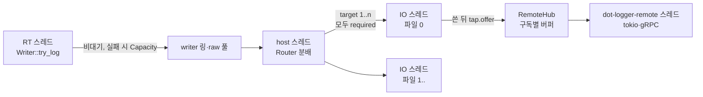
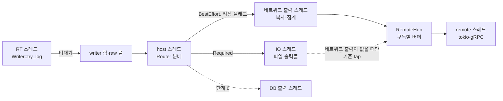

# MS-013 — 출력 구성 선택과 네트워크 전용 모드: 요구사항과 리팩토링 계획

- Intent: INT-001 / 주 Phase: Design → Build / 상태: **Draft — 리뷰 1회차 대기**([REV-074 요청](../../05_verification/reviews/REV-074_REQUEST.md)) / 갱신: 2026-11-27
- 계기: 2026-11-26 InfluxDB 논의 중 Human이 연구개발용 구조를 제안(R1~R3). 2026-11-27 우려 C1~C11 검토 뒤 Human 「내 요구사항과 리팩토링 계획을 한 문서에 작성하고, 리뷰 세션으로 리뷰 받고, 수정하고 다시 리뷰 받는 과정을 한번 거치자」.
- 진행 방식: 이 문서 → 독립 리뷰(REV-074) → 수정 → 재리뷰(REV-075) → Human 승인 → ADR·요구사항 반영·TASK 등록 → 구현. 리뷰가 끝나기 전에는 제품 코드를 바꾸지 않는다.
- 버전: 공개 API가 바뀌므로 **0.2**. 착수 순서는 기존 결정대로 MS-012 → TASK-041(v0.1.1) 뒤(§9 Q1에서 확인).

## 목차

1. 요구사항
2. 결정 기록
3. 현재 구조(코드 확인)
4. 목표 구조
5. 설계 상세
6. 공개 API 변경과 호환
7. 단계별 이행 계획
8. 시험·측정 계획
9. 위험과 열린 질문
10. 연결 문서와 승인 뒤 할 일

---

## 1. 요구사항

### 1.1 Human 원문 요구 (2026-11-26)

| ID | 요구 |
|---|---|
| R1 | 시작 때 옵션 파일로 파일·네트워크·DB 출력을 배타적으로 또는 동시에 선택한다. |
| R2 | 초당 ~100 MB 단위동작 기록을 SSD에 쓰지 않고, 정해진 메모리 안에서 네트워크로만 보내 원격(예: 원격 PC의 Redis)에서 분석한다. |
| R3 | 원하는 순간에 외부(네트워크) 전송을 켜고 끈다. |

### 1.2 요구 해석 (2026-11-27 Human 결정 반영)

- **R2의 100 MB/s는 라이브러리가 보장할 목표가 아니라 사용 예다.** 링크 속도(1/2.5/10 GbE), 수신 쪽 정지, Redis 보관량은 사용자 책임이다. 라이브러리의 책임은 **네트워크 전용 모드의 최대 처리량을 측정해 조건과 함께 공개**하는 것이다(「사용하는 사람은 최대 성능으로 쓰고 싶은데 이 라이브러리가 어디까지 지원하냐만 궁금할 것」).
- **R1의 옵션 파일은 재빌드 없이 구성을 바꾸기 위한 것이다.** 코드 지정과 파일 지정을 **둘 다** 지원한다.
- R1의 「DB」는 MS-012에서 확인 중인 InfluxDB 출력이다(§5.7, 단계 6).

### 1.3 정제한 요구사항 (승인 뒤 `requirement_spec.md`에 FR로 올릴 후보)

| 후보 ID | 요구 | 수락 기준(초안) | 출처 |
|---|---|---|---|
| FR-019 | 출력 종류(파일·네트워크·DB)를 하나 이상, 임의 조합으로 선언해 시작한다. 파일 출력이 없어도 시작한다. | 파일 없이 네트워크 출력만으로 `start()` 성공. 출력이 하나도 없으면 시작 거절(무엇이 빠졌는지 보고) | R1 |
| FR-020 | 같은 구성을 코드(builder)와 옵션 파일 양쪽으로 지정한다. 파일은 시작 때 읽는다. | 같은 내용의 코드 구성과 파일 구성이 같은 `Plan`을 만든다. 모르는 키·버전 불일치·비밀 값 직접 기재는 시작 전 거절 | R1·C7 |
| FR-021 | 네트워크 전용 모드: 파일 IO 없이, 선언한 메모리 상한 안에서 기록을 원격 구독자에게 보낸다. | SSD 쓰기 0(로거 파일 없음), 메모리 예약이 `Plan`에 보이고 넘지 않음, RT 경로는 기다리지 않음 | R2 |
| FR-022 | 네트워크 손실을 로봇(송신) 쪽에서 센다. | 구독별 보냄·Gap·끊김·Unknown 건수·바이트가 Health와 종료 보고에 있고, 「들어온 것 = 보냄 + 손실 분류 합」이 맞는다 | C1 |
| FR-023 | 실행 중 네트워크 전송을 켜고 끈다. 켤 때 시작 위치를 돌려준다. | 끈 동안 네트워크 출력으로 분배되는 기록 0, 켠 시점 이후 기록만 구독자에게 감, 수신자가 경계를 식별 | R3·C4 |
| NFR-009 | 네트워크 전용 모드의 최대 처리량을 기록 크기별로 측정해 공개한다. | README에 크기별 최대 처리량(MB/s·건/s)·CPU·측정 조건·손실 0 기준 표 | R2 |
| NFR-010 | 모드별 보장 범위(내구성·UPS 마감·손실 인지)를 문서와 Health에 드러낸다. | 보장표가 README·rustdoc에 있고 Health가 현재 내구 수준을 보고 | C10 |

### 1.4 범위 밖

- 옵션 파일 실행 중 다시 읽기(hot reload). 실행 중 변경은 지금처럼 레벨·샘플링과 새 전송 스위치만.
- 트리거 직전 데이터를 메모리에 들고 있다가 함께 보내는 pre-trigger 창(C4, 후속 옵션).
- 원격 명령(gRPC)으로 스위치 조작(C8, 쓰기 권한 체계 뒤).
- Redis 등 수신 쪽 어댑터. 수신은 기존 client(`dot-logger-client`)의 구독 API가 제공하고, 그 뒤 저장은 사용자 몫.
- 압축(B1 UC-23), keepalive(EV-123 F4)·원격 실패 원인 구분(EV-124·126)은 0.2 묶음 후보이지만 이 MS의 단계에는 넣지 않는다(§9 Q6).

## 2. 결정 기록

### 2.1 Human 결정 (2026-11-27 #001)

| ID | 결정 |
|---|---|
| C1 | 로봇 쪽 원격 손실 집계(구독별 보냄·Gap·끊김·Unknown 건수·바이트)를 Health·종료 보고에 **필수**로. 손실 구간만 남기는 로컬 요약 파일은 **선택 옵션**. |
| C2·C3 | 링크·수신·보관은 사용자 책임. 라이브러리는 최대 처리량을 측정·공개. 버퍼 크기 ÷ 속도 = 흡수하는 정지 시간 관계만 문서화. |
| C4 | 0.2는 「구독 먼저 → 스위치 켜기」 규약 + 켤 때 시작 위치 반환. pre-trigger 창은 후속. |
| C5 | 파일+원격 구성에서 기존 tap 의미 유지. |
| C6 | 원격 기본 완료 기준은 「보냄」, 수신 ACK 완료는 옵션. |
| C7 | 코드와 옵션 파일 **둘 다**. 같은 설정 타입으로 모이고, 파일 로딩은 선택 feature. 비밀은 경로·환경 변수 참조. |
| C8 | 스위치는 로봇 API 먼저. |
| C9 | 원격 전용 스레드, affinity 영향 측정. |
| C10 | 모드별 보장표를 문서에, Health에 내구 보장 수준 표시. |
| C11 | 0.2. keepalive·원격 실패 원인 구분·facade DB 출력과 같은 버전 묶음. |
| 문서 | 요구와 계획을 한 문서(이 MS)에. 독립 리뷰 → 수정 → 재리뷰 1회. |

### 2.2 이 문서에서 AI가 제안하는 설계 결정 (리뷰·Human 승인 대상)

| ID | 제안 | 근거 위치 |
|---|---|---|
| P1 | 네트워크 출력을 Router의 **정식 출력(target)**으로 만든다. 기존 `remote()` tap은 네트워크 출력을 선언하지 않은 구성에서만 그대로 둔다. | §5.1·§5.2 |
| P2 | 출력에 **역할**을 둔다: `Required`(지금 파일 의미, 역류→RT `Capacity`)와 `BestEffort`(자기 큐 상한에서 버리고 센다). 파일 기본 `Required`, 네트워크 기본 `BestEffort`. | §5.1 |
| P3 | 네트워크 출력의 완료 경계 기본값은 「구독 송신 버퍼에 복사됨(Handed)」. 수신 ACK 경계(`ReceiverAcknowledged`)는 선택이며 이때 원본을 ACK까지 붙든다. | §5.3 |
| P4 | 출력에 **이름**을 붙인다. 채널의 출력 선택을 이름으로도 받는다(기존 index는 유지). 옵션 파일은 이름만 쓴다. | §5.5·§6 |
| P5 | 옵션 파일 형식은 **TOML**, `version = 1` 필수, 모르는 키 거절, feature `config-file`(serde + toml). 설정 타입 `LoggerConfig`는 feature 없이도 있다. | §5.5 |
| P6 | 전송 스위치는 Router 출력 단위의 **켜짐 플래그**로 구현해 끈 동안 분배 비용을 0으로. 켜고 끌 때 스트림에 경계 표시 기록(`.logger/remote`)을 넣는다. | §5.6 |
| P7 | 측정 목표(초안): 루프백에서 4 KiB 이상 기록으로 **≥ 300 MB/s**(2.5 GbE ≈ 290 MB/s를 라이브러리가 막지 않음), 작은 기록은 건/s 상한을 공개. 수치 목표 자체는 Human 확인. | §8.2·§9 Q3 |

## 3. 현재 구조 (2026-11-27 `a9082bc` 코드 확인)



| 사실 | 위치 |
|---|---|
| facade 출력은 파일뿐(`outputs: Vec<(PathBuf, Retention)>`). 파일이 없으면 `StartError::Missing(FileOutput)` | `logger/mod.rs` `Missing::FileOutput`, `LoggerBuilder.outputs` |
| 모든 파일 출력은 Router target `required: true`·`pending_slots: 0`·`max_attempts: 1`·`queue_slots` = 전체 기록 수. 공유 기록 한도가 먼저 차 느린 출력이 RT `Capacity` 거절로 역류 | `logger/budget.rs` 「Routing: the shared record budget saturates before any target queue」 |
| 완료 경계는 `Written`, 내구성은 sync 장벽 | `logger/budget.rs` `TargetContract { completion: Boundary::Written }` |
| 원격은 target이 아니다. 첫 번째 파일 출력의 IO 스레드가 배치 쓰기 성공분을 `Tap::offer`로 구독마다 복사하고 결과를 버린다(`let _ = self.hub.offer(..)`) | `logger/host.rs` `tap: if index == 0 { remote.tap() }`, `write_batch`; `logger/remote.rs` `offer` |
| 원격 손실은 로거 쪽에 집계되지 않는다(Health·`FacadeReport`·`.logger/loss` 모두 없음). 구독자만 Gap을 본다 | `logger/health.rs` `Health`, `logger/mod.rs` `FacadeReport` |
| 출력 0으로 라우팅되지 않는 채널은 구독에 보이지 않는다 | API §18.12 remote 영향 |
| facade 원격 한도 기본값: 연결·구독·명령 각 4, `subscription_bytes` = min(모든 slot 바이트, 4 MiB), `message_bytes` 32 KiB, `max_age` 10 s. `remote_with`로 직접 지정 | `logger/remote.rs` `default_limits`, API §18.11 |
| `RemoteLimits.message_bytes` 상한 16 MiB | `adapters/remote/types.rs` |
| 고급 경로에는 ACK 관측(`PendingAck`, `RemoteDelivery::poll` → `ReceiverAcknowledged`/Unknown/Dropped)이 있다 | `adapters/remote/hub.rs` |
| Router target은 `required` 여부와 큐·대기 상한을 이미 지원한다(`pending_slots: 0`이면 가득 찰 때 대기 없이 버림) | `routing/types.rs` `TargetConfig` |
| Health `Failure::IoPoisoned` 설명이 「모든 출력이 required」를 전제 | `logger/health.rs` |
| 실행 중 변경은 채널 레벨·샘플링(`set_channel`)뿐. 원격 ApplyConfig도 레벨·샘플링만, Route 패치는 InvalidInput | `logger/mod.rs` `set_channel`, API §22.2 |
| 옵션 파일 로딩 없음. `serde`는 cli·viewer만 쓰고 core는 `serde_json`(선택 feature)만 | `Cargo.toml` |
| 처리량 근거: 고급 경로 유선 1 GbE gRPC 대용량 116 MB/s, 루프백 대용량 784 MB/s(8 MiB 기록), 256 B 1만 건/s ACK p99 4 ms | EV-105 |

**이 구조로 R1~R3이 안 되는 이유:** ① 파일 없이 시작 불가 ② 원격이 파일 IO 스레드에 매달려 있어 파일이 없으면 원격 경로 자체가 없다 ③ 원격 손실을 로거가 모른다 ④ 옵션 파일 없음 ⑤ 실행 중 전송 on/off 없음.

## 4. 목표 구조



- 출력 = 이름 + 종류(File/Network/Database) + 역할(Required/BestEffort). 모두 Router target이다.
- 네트워크 출력은 자기 스레드에서 Router 큐를 비우며 구독 버퍼로 복사하고 원본을 바로 돌려준다(기본 경계 Handed). 구독 버퍼가 차면 그 구독의 Gap으로 세고, 네트워크 출력 큐가 차면 Router가 그 출력에서만 버리고 센다.
- 파일 출력은 지금 의미 그대로(Required, Written + sync).
- 시작 조건은 「출력 하나 이상」. 파일이 없으면 내구 보장 수준은 `None`.

## 5. 설계 상세

### 5.1 출력 모델과 역할 (P1·P2)

| 역할 | 큐가 찰 때 | 공유 기록 한도와의 관계 | 종료 판정 | 기본 적용 |
|---|---|---|---|---|
| `Required` | 공유 한도가 먼저 차서 RT `Capacity`로 역류(지금과 같음) | `queue_slots` = 전체 기록 수 | 미완료가 있으면 `is_success() == false` | 파일 |
| `BestEffort` | 그 출력에서만 버림(`Dropped(Capacity)`), 손실 집계 | `queue_slots` < 전체 기록 수(아래). 느린 출력이 공유 한도를 다 잡지 못함 | 손실은 보고에만, `is_success`에 넣지 않음(§9 Q2) | 네트워크 |

- **공유 한도 잠식 방지:** BestEffort 출력의 `queue_slots`·`retained_bytes`는 전체의 일부로 제한한다(초안: 기본 전체 기록 수의 1/2, 설정 가능). 그래야 네트워크가 멈춰도 그 출력이 붙든 원본이 Required 출력과 RT 입구를 막지 않는다. 정확한 기본값은 단계 1 측정으로 정한다.
- **순서:** Router가 출력별 FIFO를 유지하므로 생산자별 순서는 출력 안에서 유지된다(단계 0에서 시험으로 확인).
- **Health:** `Failure::IoPoisoned`는 「Required 출력의 IO 실패」로 의미를 좁힌다. BestEffort 출력 실패는 `Degraded`(새 변형 `OutputLosing`)로 보고하고 기록은 계속한다.

### 5.2 네트워크 출력과 기존 tap (P1, C5)

- **선언:** `LoggerBuilder::network_output(name, NetworkOutput)` — `NetworkOutput`은 서버 설정(`ServerConfig`)·한도(`RemoteLimits`, 생략 시 기존 결정적 기본값 규칙)·역할·완료 경계·초기 스위치 상태를 담는다.
- **서버는 하나:** `remote(ServerConfig)`와 `network_output`을 함께 쓰면 같은 listener·hub를 쓴다. 관리 요청(GetStatus, 레벨·샘플링 ApplyConfig)은 지금과 같다.
- **tap 유지 규칙(C5):** 네트워크 출력을 선언하지 **않은** 구성(`remote()`만)은 지금과 완전히 같다 — 첫 파일 출력이 쓴 것의 사본. 네트워크 출력을 선언한 구성에서는 tap을 끄고 네트워크 출력만 구독 원천이 된다(중복 전송 방지). 두 원천을 동시에 켜는 구성은 만들지 않는다.
- **차이 문서화:** 네트워크 출력 구독자는 「파일이 쓴 것」이 아니라 「그 출력으로 라우팅된 것」을 본다. 파일 쓰기가 실패한 기록도 네트워크로는 갈 수 있고, 출력 0에 없는 채널도 네트워크 출력으로 라우팅하면 보인다.

### 5.3 완료 경계 (P3, C6)

| 경계 | 의미 | 원본 붙듦 | 용도 |
|---|---|---|---|
| `Handed`(기본) | 네트워크 출력 스레드가 활성 구독 버퍼에 복사함 | 복사 직후 반환 | 고부하 관측·분석 |
| `ReceiverAcknowledged`(선택) | 수신 애플리케이션 ACK(기존 ADR-015 경로) | ACK·만료까지 | 손실 확인이 필요한 소량 경로 |

- 구독이 하나도 없을 때 들어온 기록은 `NoSubscriber`로 센다(손실 분류, 정책 생략이 아님). C4 규약(구독 먼저 → 켜기)을 지키면 0이다.
- 「보냄(socket 기록)」은 tokio 스트림 안쪽이라 기록 단위로 관측하지 않는다. 구독 버퍼에 남은 채 끊기면 그 수를 `Disconnected`로 센다.
- core에 `Boundary::Handed`가 없으면 새 경계를 추가하는 대신 Network 출력의 `TargetContract`를 `Written` 의미로 재사용할지 단계 1 S0에서 결정한다(공개 enum 변경 여부, §9 Q4).

### 5.4 원격 손실 집계 (C1)

- **구독별 계수:** `handed_records/bytes`, `gap_records/bytes`(구독 버퍼 포화), `disconnected_records`(끊길 때 버퍼에 남은 것), `unknown_records`(ACK 모드 만료), 구독 시작·끝 시각.
- **출력별 계수:** `routed`, `dropped_queue_full`(Router 큐 포화), `no_subscriber`, `switched_off`(꺼진 동안 0이어야 함, 시험용).
- **불변식(시험 대상):** 출력별 `routed = Σ구독(handed) 기준 사본 수 + dropped_queue_full + no_subscriber` 및 구독별 `handed = 전송 완료 추정 + gap + disconnected`. 정확한 식은 단계 2 S0에서 고정한다.
- **노출:** `Health.network: Vec<NetworkHealth>`(출력별, 구독별 요약), `FacadeReport.network: Vec<NetworkReport>`(종료 시 최종 계수). `.logger/loss`에 해당하는 손실 구간 기록은 파일 출력이 있을 때 그 파일에, 없으면 선택 옵션 `loss_file(path)`로 지정한 작은 로컬 파일에 쓴다(C1 선택 옵션). 기록 본문은 쓰지 않는다.
- **구독자 쪽과 대조:** 기존 client는 Gap을 이미 본다. 시험에서 송신 쪽 `gap` 합과 수신 쪽 Gap 합이 같은지 확인한다.

### 5.5 설정 타입과 옵션 파일 (P4·P5, C7)

- **`LoggerConfig`(feature 없음):** budget·출력(이름·종류·역할·파일 경로/보관, 네트워크 서버·한도, DB 접속 참조)·채널 정책(토픽별 출력 이름·`minimum`·`important_from`)·writer 할당량·스위치 초기 상태. `LoggerBuilder::config(LoggerConfig)`로 적용.
- **코드와 파일의 분담:** 채널 타입(`channel::<T>(topic)`)과 writer 이름은 Rust 타입이 필요해 **코드에서 선언**한다. 파일은 그 토픽·writer를 **이름으로 참조해 정책·출력·예산을 정한다**. 파일에 코드에 없는 토픽·writer가 있으면 시작 거절(오타 방지).
- **우선순위:** builder 호출 순서대로 적용하고 뒤가 이긴다(초안). `plan()`이 각 값의 출처(코드/파일)를 보고한다. 대안(파일이 항상 이김)은 §9 Q5.
- **파일(feature `config-file`):** `LoggerConfig::from_toml_path(path)` / `from_toml_str`. `version = 1` 필수, `deny_unknown_fields`, 크기 상한(예: 1 MiB). 오류는 줄·키를 알려주되 값(특히 비밀)은 출력하지 않는다.
- **비밀:** TLS 키·DB 토큰은 파일에 값으로 쓰지 않는다 — `tls_key_path`, `token_env = "INFLUX_TOKEN"`처럼 참조만. 값을 직접 쓰면 거절.
- **예시(초안):**

```toml
version = 1

[budget]
memory = "256 MiB"
sync_every = "100 ms"
drop_deadline = "3 s"

[[output]]
name = "net"
kind = "network"
bind = "0.0.0.0:7400"
tls_cert_path = "/etc/robot/logger.crt"
tls_key_path = "/etc/robot/logger.key"
subscription_bytes = "128 MiB"
enabled = false          # R3: 시작 때 꺼 두고 실행 중 켠다

[[output]]
name = "disk"
kind = "file"
directory = "/data/logs"
retention = { ring = "8 GiB" }

[channel."robot/joint"]
outputs = ["net"]        # 네트워크 전용
[channel."robot/event"]
outputs = ["net", "disk"]
minimum = "info"
```

### 5.6 전송 스위치 (P6, C4·C8)

- **API:** `Logger::set_output_enabled(name, bool, deadline) -> Result<SwitchReceipt, ConfigError>`. `SwitchReceipt { revision, at_ns }`.
- **구현:** Router target에 켜짐 플래그를 둔다. 꺼진 출력은 분배 단계에서 건너뛴다(기록당 원자 읽기 1회, host 스레드). RT 경로 변화 없음.
- **경계 표시:** 켜고 끌 때 그 출력의 스트림에 `.logger/remote` 경계 기록(revision·시각·on/off)을 넣는다. 수신자는 이것으로 「여기부터 완전함」을 안다. 켠 뒤 첫 사용자 기록은 경계 기록 뒤에 온다.
- **규약(C4):** 구독 먼저 → 켜기. 켤 때 구독이 0이면 `SwitchReceipt`에 `subscribers: 0`을 담아 알린다(거절하지 않음).
- **원격 명령:** 이번 범위 밖(C8). 나중에 ApplyConfig에 넣을 때 쓰기 권한과 함께.

### 5.7 DB 출력 (단계 6, 설계 게이트)

- MS-012 결과: v2 쓰기는 2.9.1·3.12.3 모두 동작, 조회(Flux)는 v3에서 404, 타입 충돌 배치는 v3에서 전체 거절.
- 걸림돌: facade `Record`는 바이트로 인코딩만 하므로 DB 필드(정수·실수·불리언·이벤트)로 바꾸는 매핑이 없다. 매핑 trait(`Record`에 선택 메서드 추가 또는 별도 `DbRecord`) 설계가 필요하고 TASK-044(derive/prost)와 겹친다.
- 그래서 DB 출력은 **단계 6에서 별도 설계 게이트**(설계 문서·Human 승인) 뒤 진행한다. 단계 1의 출력 모델은 DB 출력이 BestEffort 또는 Required target으로 들어올 수 있게 만든다.

### 5.8 모드별 보장표 (C10)

| 구성 | 내구성 | UPS 경보 뒤 마감 | 손실을 누가 아나 | `Health.durability` |
|---|---|---|---|---|
| 파일만 | sync 주기마다 확정 | 적용(3 s 예산) | 로거(종료 보고·`.logger/loss`) | `File { sync_every }` |
| 파일 + 네트워크 | 파일은 위와 같음, 네트워크는 없음 | 파일만 적용 | 파일은 로거, 네트워크는 로거 집계 + 구독자 Gap | `File { sync_every }` |
| 네트워크만 | 없음(메모리) | 적용 안 됨 | 로거 집계(Health·종료 보고·선택 `loss_file`) + 구독자 Gap | `None` |

### 5.9 스레드와 CPU (C9)

- 네트워크 출력 스레드 1개(출력당)를 새로 둔다. 복사·집계는 이 스레드, 인코딩·TLS·송신은 기존 `dot-logger-remote` tokio 스레드.
- `worker_cpus`가 있으면 같은 규칙으로 고정. 단계 5에서 「네트워크 출력 스레드 + remote 스레드를 RT 코어와 분리했을 때와 겹쳤을 때」 `try_log` 지연을 측정한다(EV-129 방식).

## 6. 공개 API 변경과 호환 (0.2)

| 구분 | 항목 | 호환 |
|---|---|---|
| 추가 | `LoggerBuilder::network_output`, `NetworkOutput`, `OutputRole`, `Completion`(Handed/ReceiverAcknowledged) | 새 항목 |
| 추가 | `LoggerBuilder::config`, `LoggerConfig`(+ feature `config-file`의 `from_toml_*`) | 새 항목 |
| 추가 | `Logger::set_output_enabled`, `SwitchReceipt` | 새 항목 |
| 추가 | `ChannelOptions::outputs_named(&[&str])`, `file_output_named` | 새 항목. 기존 `outputs(&[usize])`는 유지(아래 index 규칙) |
| 추가 | `Health.network`, `Health.durability`, `FacadeReport.network`, `Degradation::OutputLosing` | **공개 struct·enum 필드·변형 추가 → 0.2 breaking**(구조체 리터럴·완전 match) |
| 변경 | `Missing::FileOutput` → `Missing::Output` | **breaking** |
| 변경 | `Failure::IoPoisoned` 의미를 Required 출력으로 한정 | 문서 의미 변경 |
| 유지 | `remote()`·`remote_with()` tap 의미(네트워크 출력이 없을 때) | 유지(C5) |
| 규칙 | `ChannelOptions::outputs(&[usize])`의 index는 **파일 출력 선언 순서** 그대로. 네트워크·DB 출력은 이름으로만 선택 | 기존 코드 의미 불변 |

- 대안으로 `#[non_exhaustive]`를 이번에 `Health`·`FacadeReport`·`Missing`·`Degradation`에 붙여 이후 추가를 non-breaking으로 만드는 것을 제안한다(§9 Q7).
- NFR-008(통합 접점 한도): 레시피 L3에 「네트워크 전용」 레시피를 추가할지, 줄 수 한도를 어떻게 셀지 단계 2에서 정한다.

## 7. 단계별 이행 계획

각 단계는 TDD(실패 시험 → 최소 구현 → 리팩토링)이고, **단계가 끝날 때마다 두 Rust 전체 회귀·Clippy·feature 조합·CI가 통과**한 상태를 유지한다. TASK 번호는 승인 뒤 채번한다(현재 다음 번호 TASK-048).

| 단계 | 목표 | 공개 API | 주요 변경 위치 | 종료 상태 | 인일 초안 |
|---|---|---|---|---|---|
| 0 | 기준선과 사전 확인 | 없음 | 하네스·시험만 | 현재 facade 원격(tap) 루프백 최대 처리량(크기별)·CPU 측정 EV. Router 출력별 순서·BestEffort 버림 동작을 core 시험으로 고정 | 1~1.5 |
| 1 | 출력 모델 내부 리팩토링 | 없음 | `logger/budget.rs`(target 역할·큐 상한), `logger/host.rs`(출력 종류별 스레드), `logger/remote.rs` | 내부적으로 출력=이름·종류·역할. 기존 시험 모두 그대로 Pass(동작 불변) | 2~3 |
| 2 | 네트워크 출력·파일 없는 시작·손실 집계 | 추가·breaking(§6) | `logger/mod.rs`, 새 `logger/network.rs`, `logger/health.rs`, `adapters/remote/hub.rs`(계수 노출) | FR-019·021·022, 보장표(NFR-010), C5 tap 규칙 시험 | 3~4 |
| 3 | 설정 타입과 옵션 파일 | 추가 | 새 `logger/config_file.rs`(feature), `Cargo.toml` | FR-020: 코드/파일 같은 `Plan`, 거절 경우들, 비밀 값 거절·미출력 | 2~3 |
| 4 | 전송 스위치 | 추가 | `routing`(켜짐 플래그), `logger/mod.rs`, `logger/host.rs` | FR-023: 끈 동안 분배 0, 경계 기록, `SwitchReceipt` | 1.5~2 |
| 5 | 최대 처리량 측정·공개 | 없음(README) | 측정 하네스, README | NFR-009 표(루프백·1 GbE), RT 지연 영향, EV | 1.5~2 + 실행 |
| 6 | DB 출력(설계 게이트) | 추가 | 설계 문서 → 승인 뒤 구현 | §5.7 매핑 설계 승인, 그 뒤 별도 계획 | 미정 |

- 단계 1은 동작을 바꾸지 않는 리팩토링이라 **먼저 단독으로 리뷰받는다**(리뷰 범위를 작게).
- 단계 2~4가 끝나면 0.2.0-alpha(GitHub 미리보기)를 낼지 MS-010과 함께 정한다.
- 각 단계 끝에 문서 갱신: API 계약(`interface_contract.md` 새 절), rustdoc, README, CHANGELOG.

## 8. 시험·측정 계획

### 8.1 시험 (단계별 Red 먼저)

| 요구 | 시험 | 단계 |
|---|---|---|
| 동작 불변 | 기존 facade 시험·tc_013·레시피 전부 수정 없이 Pass | 1 |
| BestEffort 격리 | 네트워크 출력 소비를 멈춘 채 부하: RT `try_log`가 기다리지 않음, Required 파일 출력 완료·`is_success` 유지, 네트워크 손실만 증가 | 1·2 |
| FR-019 | 파일 없이 시작, 출력 0개 거절(`Missing::Output`), 출력 조합(파일만/네트워크만/둘 다) | 2 |
| FR-021 | 네트워크 전용 실행 중 로거가 만든 파일 0, 메모리 예약 = `Plan` 값 | 2 |
| FR-022 | 계수 불변식, 송신 쪽 Gap 합 = 수신 client Gap 합, 끊김 시 `disconnected` | 2 |
| C5 | `remote()`만 쓴 구성의 기존 tap 시험 그대로 Pass, 네트워크 출력 선언 시 tap 꺼짐(중복 0) | 2 |
| FR-020 | 코드 구성 = 파일 구성 → 같은 `Plan`, 모르는 키·버전·없는 토픽·비밀 값 기재 거절, 오류 메시지에 비밀 없음 | 3 |
| FR-023 | 끈 동안 `switched_off` 외 분배 0, 켠 뒤 경계 기록 다음부터 수신, 켜고 끄기 경합(동시 기록 중) | 4 |
| 종료 | 멈춘 구독자가 있어도 종료가 2 s 유예 안에 끝남(F13 유지), `FacadeReport.network` 최종 계수 | 2 |
| 플랫폼 | Linux·macOS·Windows CI(3 OS × 2 Rust), Miri는 새 unsafe가 없으면 기존 범위 | 매 단계 |

### 8.2 측정 (NFR-009, C2·C3 재정의)

- **무엇을:** 네트워크 전용 모드의 지속 최대 처리량(Gap 0 기준, 60 s 유지)과 그때 CPU(host·네트워크 출력·remote 스레드), RT `try_log` 지연 분포.
- **기록 크기:** 64 B·256 B·4 KiB·64 KiB·1 MiB.
- **환경:** ① 루프백(라이브러리 상한, 이 PC) ② 유선 1 GbE(링크 상한 참고, EV-105와 같은 장비). 2.5 GbE 이상은 장비가 생기면 추가(Human 판단).
- **목표(초안 P7):** 루프백 4 KiB 이상 ≥ 300 MB/s. 미달이면 병목(복사·hub 잠금·인코딩·TLS)을 측정으로 찾아 단계 5 안에서 개선하거나 한계로 공개.
- **쓰기량·시간:** 네트워크 전용이라 SSD 쓰기 0. 회차당 수 분, 전체 1~2시간 이내(시작 전 Human에게 시간 알림).
- **공개:** README에 표(크기별 MB/s·건/s·CPU·조건·커밋), EV 링크. 측정 조건에 AI 세션 대기 여부(EV-130) 기록.

## 9. 위험과 열린 질문

### 9.1 위험

| ID | 위험 | 영향 | 대응 |
|---|---|---|---|
| K1 | BestEffort 출력이 공유 기록 한도를 잡아 Required 출력·RT 입구가 막힘 | 파일 기록 손실·RT `Capacity` 증가 | §5.1 큐 상한, 단계 1·2 격리 시험 |
| K2 | `RemoteHub`의 `Mutex<Registry>`·구독별 복사가 고부하에서 병목 | 처리량 목표 미달 | 단계 0 기준선, 단계 5 측정 뒤 잠금 분할·묶음 offer 검토 |
| K3 | 0.2 breaking이 커져 사용처(dot-probe) 갱신 부담 | 채택 지연 | §6 `non_exhaustive` 한 번에 적용, 변경표·마이그레이션 안내 |
| K4 | 옵션 파일 스키마가 공개 계약이 되어 이후 변경이 어려움 | 버전 부담 | `version` 필드, 처음엔 필요한 키만, 실험 키 없음 |
| K5 | 범위 확대(DB 매핑·압축·keepalive를 끼워 넣음) | 일정·리뷰 부담 | 단계 6 게이트, §1.4 범위 밖 명시 |
| K6 | 네트워크 출력 스레드·TLS가 RT 코어와 경합 | RT 지연 꼬리 증가 | §5.9 측정, affinity 안내 |
| K7 | 측정 환경 잡음(EV-130 주기적 코어 감속) | 수치 신뢰도 | 실행 방식 기록, 반복 측정 |

### 9.2 열린 질문 (리뷰어 의견 → Human 결정)

| ID | 질문 | AI 권고 |
|---|---|---|
| Q1 | 구현 착수 시점: 기존 순서(MS-012 → TASK-041 → MS-013)를 유지할지 | 유지. 리뷰 2회는 그 사이에 진행 |
| Q2 | BestEffort 출력 손실이 `is_success()`에 영향을 줄지 | 주지 않음. 대신 `FacadeReport::is_lossless()` 같은 별도 판정 추가 |
| Q3 | 처리량 목표 수치(P7)를 둘지, 측정·공개만 할지 | 루프백 4 KiB ≥ 300 MB/s를 설계 목표로 두고 미달 시 한계로 공개 |
| Q4 | `Handed` 경계를 core `Boundary`에 새로 넣을지 | 넣음(의미가 `Written`과 달라 재사용하면 혼동) |
| Q5 | 코드/파일 우선순위: 호출 순서(뒤가 이김) vs 파일이 항상 이김 | 호출 순서 + `plan()` 출처 보고 |
| Q6 | keepalive·원격 실패 원인 구분을 이 MS 단계에 넣을지 | 넣지 않고 0.2 묶음의 별도 Task |
| Q7 | 공개 보고 타입에 `#[non_exhaustive]`를 이번에 붙일지 | 붙임(0.2에서 한 번에) |
| Q8 | 출력 선택 index 규칙: 파일 선언 순서 유지(§6) vs 전체 출력 선언 순서 | 파일 순서 유지 + 이름 선택 추가 |

## 10. 연결 문서와 승인 뒤 할 일

- **ADR(승인 뒤 작성):** ADR-017 출력 모델(네트워크 출력을 Router 출력으로, 역할, tap 유지 규칙, 완료 경계) · ADR-018 설정 파일(TOML·feature·비밀 참조·우선순위).
- **요구사항:** §1.3 후보를 `requirement_spec.md`(FR-019~023·NFR-009~010)와 추적표에.
- **API 계약:** `interface_contract.md` 새 절(§23 예정).
- **관련 기존 문서:** API §18.11(remote)·§18.12(출력 선택)·§22.2(실행 중 변경), ADR-012(facade)·ADR-015(ACK)·ADR-009, EV-105(처리량), [MS-012](MS-012.md)(DB), [TASK-044](../tasks/TASK-044.md)(derive/prost).
- **리뷰 이력:** 1회차 [REV-074 요청](../../05_verification/reviews/REV-074_REQUEST.md)(2026-11-27) → 결과 반영 뒤 2회차.

## 부록 A. 안건 원문 (project_state에서 옮김, 2026-11-27)

2026-11-26 기록과 2026-11-27 검토 결과 그대로다. 현재 효력은 본문 §2를 따른다.

계기: InfluxDB 논의 중 Human이 연구개발용 구조를 제안. 상태: **우려 검토 완료(2026-11-27), 계획서 작성 대기** — MS/Task·ADR 전. MS로 등록할 때 이 절을 MS 문서로 옮긴다(project_state 크기 경고선 초과의 주원인). 다음 행동: TASK-041 뒤 상세 리팩토링 계획서(MS 문서·ADR·TASK) 작성 → Human 승인.

**요구(Human):**
- **R1 출력 선택:** 시작 때 옵션 파일로 파일·네트워크·DB를 배타적으로 또는 동시에 선택.
- **R2 네트워크 전용 고부하 모드:** 초당 ~100 MB 단위동작 기록을 SSD에 쓰지 않고 정해진 메모리 안에서 네트워크로만 보내 원격(예: 원격 PC Redis)에서 분석.
- **R3 외부 전송 스위치:** 원하는 순간에 네트워크 전송을 켜고 끔.

**확인한 현재 동작(코드):**
- 흐름: 입력(`try_log`) → writer 링·raw 풀 → host 스레드 Router 분배 → 출력별 큐 → 파일 IO / 원격 tap.
- 파일 출력은 facade에서 모두 `required`·`pending_slots 0`·`max_attempts 1`, 공유 한도가 먼저 차 느린 파일이 입구 RT `Capacity` 거절로 역류(`logger/budget.rs` 주석). 거절은 모든 파일에서 빠지고 손실 보고에 남는다(EV-123 F1).
- 원격은 Router target이 아니라 **첫 번째 파일 출력이 쓴 것의 tap**(`logger/host.rs`)이고 `Tap::offer` 결과를 버린다. 구독별 예산 초과 시 그 구독만 Gap/Disconnect. **로거 쪽 원격 손실 집계 없음**(Health·종료 보고·`.logger` 모두), 구독자만 Gap을 앎. 고급 경로에는 `PendingAck`·`RemoteDelivery`(전송별 Acknowledged/Unknown/Dropped)가 있다.
- 파일 출력 없으면 `start()`가 `Missing::FileOutput`. DB는 facade에 없음. 옵션 파일 로딩 없음(코드 builder만), 실행 중 패치는 레벨·샘플링만. 원격 버퍼는 `remote_with(RemoteLimits)`로 키울 수 있음(기본 구독당 ≤ 4 MiB·`max_age` 10 s).
- 성능 근거: 유선 1 GbE gRPC 대용량 116 MB/s(TCP와 같은 수준, TLS), 256 B 1만 건/s ACK p99 4 ms(EV-105).
- 정확도: 파일(+종료 보고) > DB(`Acknowledged`만 확실) > 원격(구독자만 손실 인지).

**필요한 변경(초안):** 원격을 Router 독립 출력으로(파일 없는 시작 허용) · 필수가 아닌 출력과 출력별 버림 정책 · 원격 손실 집계(Health·종료 보고) · 옵션 파일 형식·로딩 · 외부 전송 스위치 · facade DB 출력(MS-012 결과 뒤).

**우려(초안, 검토 대상):**

| ID | 우려 | 내용 | 검토할 질문 |
|---|---|---|---|
| C1 | 손실 근거 상실 | 파일이 없으면 기준 기록이 없다. 지금 원격 손실은 로거에 남지 않아 「무엇이 빠졌는지」 답할 근거가 없다 | 로봇 쪽 원격 집계(보냄·Gap·끊김·Unknown)를 필수로 할지, 작은 로컬 손실 기록(파일 1개)을 남길지 |
| C2 | 링크 여유 | 1 GbE 실측 상한 ~117 MB/s에 100 MB/s는 85%. 버스트·재전송 여유가 거의 없다 | 2.5/10 GbE 전제인지, 채널 선택·압축으로 줄일지 |
| C3 | 메모리 상한과 버스트 | 로봇 쪽 버퍼 N MB는 100 MB/s에서 N/100 초의 정지만 흡수. 수신(Redis)이 같은 속도를 못 따라가면 Gap. Redis는 메모리 DB(100 MB/s ≈ 6 GB/분) | 버퍼 크기·정지 허용 시간 목표, 수신 쪽 상한·보관 정책 |
| C4 | 구독 전·스위치 전 데이터 | 구독자가 없을 때는 버려진다. 스위치를 켠 순간 구독이 아직 없으면 시작 부분을 잃는다 | 「구독 먼저 → 트리거」 순서 규약인지, 트리거 이전 일정 시간을 메모리에 들고 있다 보내는 pre-trigger 창이 필요한지 |
| C5 | 의미 변경 | 원격이 「파일이 쓴 것」의 tap에서 Router 출력으로 바뀌면 viewer 등 기존 구독자가 보는 순서·내용 보장이 달라진다 | 파일+원격 동시 구성에서 기존 tap 의미를 유지할지 |
| C6 | 완료·종료 판정 | 파일 없는 구성에서 「완료」와 종료 성공의 기준이 없다(지금은 sync) | 수신자 ACK(기존 ACK RPC)를 완료로 볼지, 보냄까지로 볼지 |
| C7 | 옵션 파일 소유와 비밀 | 라이브러리가 파일을 읽으면 형식·버전·검증·비밀(TLS 키·토큰·DB 토큰) 취급이 라이브러리 책임이 된다. 범용 라이브러리 방향과 충돌 가능 | 라이브러리가 읽을지, 직렬화 가능한 설정 타입만 주고 앱이 읽을지 |
| C8 | 외부 스위치 권한·경합 | 원격에서 켜고 끄려면 쓰기 권한(ApplyConfig와 같은 수준)·상태 보고가 필요. 끌 때 진행 중 기록 처리, 꺼진 동안 분배 비용 0 여부 | 스위치 주체(로봇 API / 원격 명령 / 구독 자체)와 끈 동안의 처리 |
| C9 | 호스트 CPU | 100 MB/s 복사·인코딩·TLS가 관리 스레드 CPU를 쓴다. RT 경로는 설계상 분리되지만 같은 PC의 코어 경합·affinity 영향 | 원격 전용 스레드·CPU 배치, 측정 기준 |
| C10 | UPS·내구 보장 범위 | UPS 경보 뒤 3 s 마감·sync 내구 보장은 파일 전제. 네트워크 전용에서는 적용되지 않는다 | 모드별 보장 범위를 문서·Health에 명시 |
| C11 | 버전·검증 비용 | 공개 API·출력 모델 변경이라 0.2. 100 MB/s 네트워크 전용은 새 성능·장애 시험(수신 정지·단절·장시간)이 필요하고 이 PC 네트워크가 1 GbE일 수 있다 | 시험 장비(링크 속도·수신 PC), MS-012·keepalive·facade 원격 재생 안건과 묶을지 |

**검토 결과(2026-11-27 #001 Human 「모두 권고대로」):**
- **C1:** 로봇 쪽 원격 집계(구독별 보냄·Gap·끊김·Unknown 건수·바이트)를 Health·종료 보고에 필수로 넣는다. 손실 구간만 남기는 로컬 요약 파일은 선택 옵션.
- **C2·C3 재정의(Human):** 링크 속도·수신 쪽 정지·Redis 보관량은 사용자 책임이라 라이브러리가 전제하지 않는다. 사용자가 궁금한 것은 「어디까지 지원하냐」이므로, 우리 일은 **최대 처리량을 측정해 조건과 함께 공개**하는 것이다(2.5 GbE 카드 사용도 일반적). 버퍼 크기와 정지 흡수 시간의 관계(N MB ÷ 속도)는 문서에 쓴다. 이 PC는 `enp4s0` 1 GbE라 링크 측정은 1 GbE 상한에 묶이고, 라이브러리 상한은 loopback으로 따로 잰다.
- **C4:** 0.2는 「구독 먼저 → 스위치 켜기」 규약과 켤 때 시작 위치 반환. pre-trigger 메모리 창은 후속 옵션.
- **C7 변경(Human 「재빌드 없이 쓰려고 파일로 하는 것」):** 코드 builder와 옵션 파일을 **둘 다** 지원한다. 두 경로는 같은 설정 타입으로 모이고, 파일 로딩은 선택 feature(log4rs의 설정 파일 feature와 같은 방식). 비밀은 파일에 값으로 넣지 않고 경로·환경 변수 참조로 받는다. 형식·버전·검증 세부는 계획서·ADR에서 승인.
- **C10:** 모드별 보장표를 문서에 두고, Health에 내구 보장 수준(파일 sync / 없음)을 표시.
- **C5·C6·C8·C9·C11:** 초안 권고 수락 — C5 파일+원격 구성에서 기존 tap 의미 유지, C6 기본 완료는 「보냄」·ACK 완료는 옵션, C8 스위치는 로봇 API 먼저, C9 원격 전용 스레드와 affinity 영향 측정, C11 0.2에서 keepalive·원격 실패 원인 구분·facade DB 출력과 묶음.
- **범위 단계:** ① 원격 독립 출력·손실 집계·설정 타입과 옵션 파일(R1) → ② 전송 스위치(R3) → ③ 최대 처리량 측정·공개(R2).
- **상세 리팩토링 계획서(Human 제안, 2026-11-27):** 새 문서 종류를 만들지 않고 MS 상세 문서(현재 구조·목표 구조·단계별 이행·API 변경과 호환·시험·측정 계획·위험)와 ADR, 단계별 TASK로 쓴다. 시점은 정해진 순서대로 TASK-041 뒤 기능 논의 첫 항목이며, MS-012 결과(facade DB 출력 범위)를 반영한다.

관련 기존 안건: keepalive(EV-123 F4) · facade 원격 재생(지금 Query/Replay는 facade에서 `Unsupported`) · 원격 실패 원인 구분(EV-124·126) · facade DB 출력.
