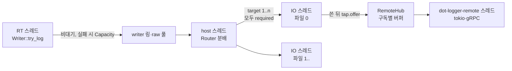
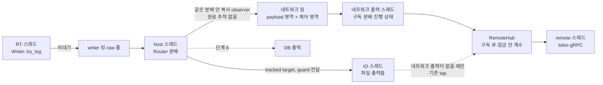

# MS-013 — 출력 구성 선택과 네트워크 전용 모드: 요구사항과 리팩토링 계획

- Intent: INT-001 / 주 Phase: Design → Build / 상태: **Draft r9 — 설계 결정 승인됨, 리뷰 반복 중**([REV-082](../../05_verification/reviews/REV-082_MS013_R9_DESIGN_REVIEW.md)) / 갱신: 2026-11-28
- **승인(2026-11-28 Human 「모두 권고대로 승인」):** §2.2 P1~P7, §2.3 H1·H3~H8, §9.2 Q1~Q8, 리뷰 중 바뀐 공개 의미(§2.4)를 모두 AI 권고대로 승인. 리뷰가 지적 0건으로 끝나면 재승인 없이 §10의 ADR·요구사항·TASK 등록으로 넘어간다. 이후 회차의 개정이 승인된 결정 자체(H·Q·P·§2.4)를 바꾸면 그 항목만 다시 묻는다.
- 계기: 2026-11-26 InfluxDB 논의 중 Human이 연구개발용 구조를 제안(R1~R3). 2026-11-27 Human 「내 요구사항과 리팩토링 계획을 한 문서에 작성하고, 리뷰 세션으로 리뷰 받고, 수정하고 다시 리뷰 받는 과정을 한번 거치자」, 이어서 「지적이 없을때까지 리뷰 요청하자」.
- 진행 방식: r1 → [REV-074](../../05_verification/reviews/REV-074_MS013_OUTPUT_DESIGN_REVIEW.md)(12건) → r2 → [REV-075](../../05_verification/reviews/REV-075_MS013_R2_DESIGN_REVIEW.md)(10건) → r3(`cda0161`) → [REV-076](../../05_verification/reviews/REV-076_MS013_R3_DESIGN_REVIEW.md)(10건) → r4(`3901fa3`) → [REV-077](../../05_verification/reviews/REV-077_MS013_R4_DESIGN_REVIEW.md)(6건) → r5(`fe0f8d5`) → [REV-078](../../05_verification/reviews/REV-078_MS013_R5_DESIGN_REVIEW.md)(5건) → r6(`7fe024c`) → [REV-079](../../05_verification/reviews/REV-079_MS013_R6_DESIGN_REVIEW.md)(5건) → r7(`405cf39`) → [REV-080](../../05_verification/reviews/REV-080_MS013_R7_DESIGN_REVIEW.md)(4건) → r8(`b392eb7`) → [REV-081](../../05_verification/reviews/REV-081_MS013_R8_DESIGN_REVIEW.md)(3건) → **r9(이 문서, 3건 모두 수용, §18)** → REV-082 → … **지적 0건 회차까지 반복** → Human 승인(§2.3) → ADR·요구사항·TASK → 구현. 승인 전에는 제품 코드를 바꾸지 않는다.
- 버전: 공개 API·core Route·원격 구독 wire가 바뀌므로 **0.2**. 착수 순서는 TASK-041(v0.1.1) 뒤(Q1).

## r9에서 바뀐 것 (REV-081, 3건)

REV-081은 「RV-261 해소, r8이 host 종료 증거·발행 미확인·계수 확정과 회수를 분리했고 남은 것은 파일 작업자 실패와 출력 종류가 없는 구성의 `Closed` 조건, `AckGone`의 대기 기한」이라고 판정했다. r9는 그 셋만 닫았다.

1. **파일 작업자 실패와 회수(§5.9, RV-265):** 발행 셀을 **IO 스레드마다** 두고, 정상 `finish`·panic 경로(`drain_failed` 전)·IO 스레드 진입 closure 끝·host 보조 확인의 네 경로 모두 `Pending`에서 나가는 CAS로 종결한다 — `finish` 없이 끝난 IO 스레드도 `Failed`로 확정된다. 발행 결과(`files_published`)와 IO 스레드 회수(`files_reclaimed`)를 나눠 `Closed`는 둘 다 요구하고, 파일 판정은 발행 결과만으로 정한다. `io_failed`가 이미 켜졌으면 다른 셀이 `Pending`이어도 실패 확정.
2. **구성된 자원만 기다림(§5.4·§5.8·§5.9·§6, RV-266):** `Closed` 조건을 「core Closed && 파일 쪽 && 네트워크 쪽 && tap 쪽」으로 쓰고 없는 쪽은 공허 참으로 했다. 모드 4종의 완료 조건·보고 값 표: 파일만·파일 + tap은 `network = None`, tap은 리스너 스레드 회수까지, 네트워크만은 `files_late = Some(false)`·`files_complete()` = `core.is_success() && !worker_failed`. `is_lossless()`는 「구성된 모든 출력 기준」이라 네트워크 전용도 참이 될 수 있다.
3. **`AckGone` 기한(§5.6, RV-267):** 기한 = **`Gone`을 처음 관측한 시각 + 기존 `timeout`**, 어느 메서드가 관측했든 같고 재설정하지 않는다(중간 Record·heartbeat가 늘리지 않음). 기한 뒤 처음 불린 메서드는 스트림을 읽지 않고 `Failed` — 판정은 「읽은 시각」 기준.

## r8에서 바뀐 것 (REV-080, 4건)

REV-080은 「`offer_pending`(RV-257)과 route revision 규칙(RV-260)은 해소, 남은 것은 host 종료 증거·발행 기한 판정의 관측 경계·감독 정산 뒤 최종 종료·End 이후 ACK API」라고 판정했다. r8은 그 넷만 닫았다.

1. **host 종료 증거(§5.6, RV-261):** 명령 셀을 host 밖에서 종결하는 근거를 `worker_failed`에서 **host 전용 `host_exited`**(host 스레드가 `run` 반환·unwind를 마친 뒤 세움)로 바꿨다. 파일 IO panic으로 `worker_failed`만 켜진 동안 host는 살아서 명령을 처리한다(커밋 전 → `Closing`, `Committed` → `Applied`).
2. **발행 셀(§5.9, RV-262):** IO 스레드가 `finish` 결과와 시각을 **발행 셀**에 쓰고, host는 보고를 작성할 때마다 셀을 직접 읽는다. 셀이 아직 `Pending`이면 `files_late = None`(미확인)이고 지연으로 확정하지 않는다. `files_settled()`를 두어 「확정된 실패」와 「아직 증명 못 함」을 구분한다. *(r9: IO 스레드별 셀·종결 주체 4경로·`files_reclaimed` — RV-265)*
3. **네트워크 완료 = 계수 확정 + 스레드 회수(§5.4·§5.9, RV-263):** `finalized`와 `reclaimed`를 나누고, host가 매 턴 스레드 종료를 확인해 join한다 — `NetworkFinalized` 없이 실패한 스레드도 host가 감독 정산 → join → `Closed`. 회수가 끝나지 않으면 `finalized` 참·`reclaimed` 거짓 `Incomplete`, `wait`는 `Unresponsive`(상한 없음, 분리 가능). *(r9: 구성된 자원만 기다리는 모드별 `Closed` 조건 — RV-266)*
4. **구독 상태를 모든 메서드에(§5.6·§6, RV-264):** `Open` → `AckGone` → `Ended` / `Failed`. `flush()`·`handoff()`가 `Gone`을 먼저 받아도 스트림을 닫지 않아 `next()`가 End를 볼 수 있다. End 뒤 `next` `Ok(None)`, `handoff` `Disconnected`, `flush`는 End 시점 `ack_unknown`으로 즉시, `acknowledged()`는 End 때 고정(불변식 `acknowledged() + ack_unknown = handoff 수`). *(r9: `AckGone` 기한 = 첫 `Gone` 관측 + `timeout`, 재설정 없음 — RV-267)*

r7 이전 변경은 §11~16 반영표를 따른다.

## 목차

1. 요구사항
2. 결정 기록
3. 현재 구조(코드 확인)
4. 목표 구조
5. 설계 상세
6. 공개 API·wire 변경과 호환
7. 단계별 이행 계획
8. 시험·측정 계획
9. 위험과 열린 질문
10. 연결 문서와 승인 뒤 할 일
11. REV-074 반영표
12. REV-075 반영표
13. REV-076 반영표
14. REV-077 반영표
15. REV-078 반영표
16. REV-079 반영표
17. REV-080 반영표
18. REV-081 반영표

---

## 1. 요구사항

### 1.1 Human 원문 요구 (2026-11-26)

| ID | 요구 |
|---|---|
| R1 | 시작 때 옵션 파일로 파일·네트워크·DB 출력을 배타적으로 또는 동시에 선택한다. |
| R2 | 초당 ~100 MB 단위동작 기록을 SSD에 쓰지 않고, 정해진 메모리 안에서 네트워크로만 보내 원격(예: 원격 PC의 Redis)에서 분석한다. |
| R3 | 원하는 순간에 외부(네트워크) 전송을 켜고 끈다. |

### 1.2 요구 해석 (2026-11-27 Human 결정 반영)

- **R2의 100 MB/s는 보장 목표가 아니라 사용 예다.** 링크 속도·수신 쪽 정지·Redis 보관량은 사용자 책임이다. 라이브러리의 책임은 네트워크 전용 모드의 **무손실 최대 처리량을 측정해 조건과 함께 공개**하는 것이다.
- **R1의 옵션 파일은 재빌드 없이 구성을 바꾸기 위한 것이다.** 코드 지정과 파일 지정을 둘 다 지원한다.
- R1의 「DB」는 MS-012에서 확인한 InfluxDB 출력이다(§5.7, 단계 6).

### 1.3 정제한 요구사항 (승인 뒤 `requirement_spec.md`에 올릴 후보)

| 후보 ID | 요구 | 수락 기준(초안) | 수락 단계 | 출처 |
|---|---|---|---|---|
| FR-019a | 파일·네트워크 출력을 하나 이상, 임의 조합으로 선언해 시작한다. 파일 출력이 없어도 시작한다. | 파일만/네트워크만/둘 다 시작·종료. 출력 0개는 시작 거절(`Missing::Output`). 충돌 구성(§5.2)은 명시 거절 | 2 | R1 |
| FR-019b | DB 출력을 단독 또는 파일·네트워크와 조합해 선언한다. | §5.7 설계 게이트 통과 뒤 단계 6에서 정한다. **그 전까지 DB 조합은 미수락** | 6 | R1 |
| FR-020 | 같은 구성을 코드(builder)와 옵션 파일 양쪽으로 지정한다. 파일은 시작 때 읽는다. | 같은 내용이면 해석된 구성·`Plan`이 같다. 병합표(§5.5) 대로 병합. 모르는 키·버전 불일치·비밀 값 직접 기재·크기 초과는 시작 전 거절, 오류에 원문·값 미노출 | 3 | R1·C7 |
| FR-021 | 네트워크 전용 모드: 로거 파일 IO 없이, 선언한 메모리 상한 안에서 기록을 원격 구독자에게 보낸다. | 로거가 만든 파일 0(명시 `loss_file` 제외), §5.10 관리 예약 합계가 예산을 넘으면 시작 거절, 재연결·최대 구독·포화 중 heap이 관리 예약 + **측정한** runtime 여유 안(runtime·TLS는 보장 아닌 측정 공개), RT 무대기 | 2 | R2 |
| FR-022 | 네트워크 손실을 송신 쪽에서 센다. | §5.4 회계 등식이 최종 보고에서 모두, Health에서 단계 안에서 성립(진행 중 사본은 순간값 `offer_pending`으로 포함). `is_lossless()`는 손실 0 + 수신 확인. 정상 종료된 구독은 client Gap 수 = 서버 `gap` | 2 | C1 |
| FR-023 | 실행 중 네트워크 전송을 켜고 끈다. 켤 때 시작 위치를 돌려준다. | §5.6 계약: 꺼진 동안 새 사용자 payload 분배 0, epoch 표시에 생산자별 경계 seq, 표시를 요청한 구독은 경계를 받거나 명시적으로 끝남 | 4 | R3·C4 |
| NFR-009 | 네트워크 전용 모드의 무손실 최대 처리량을 기록 크기별로 측정해 공개한다. | §8.2 판정(거절·Gap·Unknown·누락·중복 0, 큐 비증가)으로 찾은 최고 속도와 조건 표 | 5 | R2 |
| NFR-010 | 모드별 보장 범위를 문서와 Health에 드러낸다. | §5.8 보장표가 README·rustdoc에, `Health.durability` 보고 | 2 | C10 |

### 1.4 범위 밖

- 옵션 파일 실행 중 다시 읽기(hot reload). 실행 중 변경은 레벨·샘플링과 새 전송 스위치만.
- pre-trigger 창(C4 후속 옵션).
- 원격 명령(gRPC)으로 스위치 조작(C8).
- Redis 등 수신 쪽 어댑터.
- 압축(B1 UC-23), 원격 실패 원인 구분(EV-124·126). keepalive 중 **유휴 heartbeat는 스위치의 lease 유지에 필요해 단계 4에 넣는다**(H3). 조용한 단절의 **감지 상한**은 응답 확인 메커니즘이 필요해 범위 밖이며, §5.4에 「상한 없음, 손실은 `unacked`·`cut`으로 늦게 드러남」을 명시한다(Q6).
- 0.2에서 네트워크 출력 2개 이상(§5.2, H4).

## 2. 결정 기록

### 2.1 Human 결정 (2026-11-27 #001)

| ID | 결정 |
|---|---|
| C1 | 로봇 쪽 원격 손실 집계(구독별 보냄·Gap·끊김·Unknown 건수·바이트)를 Health·종료 보고에 **필수**로. 손실 구간만 남기는 로컬 요약 파일은 **선택 옵션**. |
| C2·C3 | 링크·수신·보관은 사용자 책임. 라이브러리는 최대 처리량을 측정·공개. 버퍼 크기 ÷ 속도 = 흡수하는 정지 시간 관계만 문서화. |
| C4 | 0.2는 「구독 먼저 → 스위치 켜기」 규약 + 켤 때 시작 위치 반환. pre-trigger 창은 후속. |
| C5 | 파일+원격 구성에서 기존 tap 의미 유지. |
| C6 | 원격 기본 완료 기준은 「보냄」, 수신 ACK 완료는 옵션. (r2에서 해석 정밀화 → H1) |
| C7 | 코드와 옵션 파일 **둘 다**. 같은 설정 타입으로 모이고, 파일 로딩은 선택 feature. 비밀은 경로·환경 변수 참조. |
| C8 | 스위치는 로봇 API 먼저. |
| C9 | 원격 전용 스레드, affinity 영향 측정. |
| C10 | 모드별 보장표를 문서에, Health에 내구 보장 수준 표시. |
| C11 | 0.2. keepalive·원격 실패 원인 구분·facade DB 출력과 같은 버전 묶음. |
| 문서 | 요구와 계획을 한 문서(이 MS)에. 독립 리뷰에서 지적이 없을 때까지 수정·재리뷰 반복(2026-11-27 Human 후속 결정). |

### 2.2 AI 설계 제안 (r4 — 2026-11-28 Human 「모두 권고대로 승인」)

| ID | 제안 | 위치 |
|---|---|---|
| P1 | 네트워크 출력 = Route의 **복사 observer**. 완료 추적 대상이 아니다. dispatcher가 기록을 분배하는 그 자리에서 링에 복사한다. 원본 guard·완료 셀과 무관. 기존 `remote()` tap은 네트워크 출력이 없는 구성에서만 그대로. | §5.1·§5.2 |
| P2 | 파일 = Required(지금 의미), 네트워크 = 관측(완료 판정 밖). 공개 `OutputRole` 없음. | §5.1 |
| P3 | 새 core 완료 경계 없음(r2·r3의 `Handed` 철회). 네트워크 결과는 네트워크 회계. 수신 ACK는 기존 흐름 제어 항상, 복사본 수준 보고. | §5.3 |
| P4 | 출력에 이름, 이름으로도 선택. index는 파일 선언 순서. 출력 교체와 숫자 index는 함께 쓸 수 없음. | §5.2·§5.5 |
| P5 | 옵션 파일 TOML, `version = 1`, 모르는 키 거절, feature `config-file`. `[[output]]`이 있으면 출력 전체 교체. | §5.5 |
| P6 | 스위치 컷오프는 dispatcher 복사 시점. 꺼진 동안 새 사용자 payload 복사 0(기록당 원자 읽기 1회). 표시는 링 제어 영역 → 구독 큐 FIFO, 요청한 구독에만 별도 frame. | §5.6 |
| P7 | 측정·공개가 수락 기준. 루프백 4 KiB 이상 ≥ 300 MB/s(≈ 73,200건/s)는 내부 목표. | §8.2 |

### 2.3 Human 결정 항목 (r4 — 2026-11-28 Human 「모두 권고대로 승인」)

| ID | 질문 | AI 권고 | 이유 |
|---|---|---|---|
| H1 | C6 「수신 ACK 완료는 옵션」을 「수신 ACK는 기존 흐름 제어로 **항상** 쓰고 결과(acked/unacked)는 네트워크 보고에 남기며, 네트워크는 원본 완료·`is_success`에 묶지 않는다」로 해석 | 예 | 원본을 붙들면 파일·RT 자원 잠식·종료 지연(RV-213·216). 기존 client는 늘 ACK한다(RV-229) |
| H3 | 표시를 요청한 구독에 유휴 heartbeat(`max_age/2`)를 단계 4에. 보장은 건강한 연결의 유휴 lease 유지뿐 | 예 | 꺼진 시간이 lease보다 길면 구독이 닫힘(RV-215), 감지 상한은 keepalive 안건(RV-229) |
| H4 | 0.2 네트워크 출력 최대 1개, `remote()`+`network_output()` 동시 선언 거절 | 예 | 구독 원천·계수 귀속(RV-219) |
| H5 | 출력 미지정 채널(`tracing` 포함): 파일 출력이 있으면 모든 파일, 없으면 모든 출력 | 예 | 기존 트래픽 불변 + 네트워크 전용 부담 감소 |
| H6 | 복사 비용의 파일 영향 허용치. **정의(RV-244):** P = 고정 구성(§8.2 H6 프로필)의 **60 s 지속 무손실 파일 완료율**(건/s·B/s). 「파일 + 네트워크(구독 정상)」에서 0.8P 부하 RT `Capacity`·파일 실패 0, 포화 완료율 감소 ≤ 10%. **단계 0 spike에서 1차 판정(go/no-go), 단계 5 확정** | 위 기준 | 장기 보유는 구조적으로 0(observer), 남는 것은 복사 비용뿐 |
| H7 | 옵션 파일 `[[output]]`이 있으면 코드 출력 **전체 교체**(없으면 유지). 교체가 일어난 구성에서 채널이 숫자 index(`outputs(&[usize])`)를 쓰면 **시작 거절**(이름으로 지정해야 함) | 예 | 전체 교체는 R1의 「재빌드 없이 조합 변경」에 필요(RV-232), 숫자 index가 조용히 다른 파일을 가리키는 것은 막는다(RV-241) |
| H8 | 네트워크로**만** 라우팅된 기록(observer-only)을 core 손실·완료 집계에서 **제외**(어떤 cause로도 세지 않음)하고 결과는 네트워크 회계 L1 `observed`에만 두는 것. core `Unrouted` 이벤트도 내지 않는다. 구성 전체 tracked target 0개는 observer가 있을 때만 허용. **판정 규칙 전체는 §5.1 경우표 하나**(r6, RV-255) | 예 | 기존 `Cause::NoRoute`·`Unrouted`는 「어느 출력에도 라우팅되지 않음」이라 observer 성공에 붙이면 의미가 바뀐다(RV-248). 파일이 있는 구성의 `.logger/loss`에는 그 채널이 지금 「B만 선택한 채널을 A 파일에서 볼 때」처럼 나타나지 않는다. 기록의 route에 observer가 없는 경우(구성 전체 출력 0 거절, 고급 Router의 채널별 빈 route `Unrouted` + `NoRoute` — 다른 채널에 observer가 있는 구성 포함, facade 빈 선택 거절)는 **지금 그대로**(RV-255·260) |

**결정:** H1·H3~H8 모두 「AI 권고」 열대로 승인(2026-11-28). H6 수치는 0.8P·포화 감소 ≤ 10% 그대로.

### 2.4 리뷰 중 바뀐 공개 의미 (r5~r9 — 2026-11-28 Human 「모두 권고대로 승인」)

| 항목 | 승인된 내용 | 위치 |
|---|---|---|
| `is_lossless()` | 구성된 모든 출력 기준. 네트워크 전용 구성도 참이 될 수 있음 | §5.4, RV-266 |
| `files_late: Option<bool>`·`files_settled()` | 기한 보고에서 파일 판정이 미확인일 수 있고 `Closed`에서 확정 | §5.9, RV-262·265 |
| `FacadeReport.network: Option` | 네트워크 출력이 없으면 `None` | §5.9·§6, RV-266 |
| `SwitchError` | `WorkerFailed`(미적용 보장), `Committed`·`HostFailed`가 `{ id, epoch }` | §5.6, RV-256·261 |
| client 표시 요청 구독 | `flush`·`handoff`가 `Gone`을 받아도 스트림 유지, End는 `AckGone` 기한(첫 `Gone` 관측 + `timeout`) 안에 `next()`로 | §5.6, RV-264·267 |
| `shutdown()` | 수신 상한 기한 + `REPORT_GRACE`·반환 타입 불변, `Closed`는 구성된 자원 정리 뒤(회수 상한 없음, 분리 가능) | §5.9, RV-258·263·266 |

## 3. 현재 구조 (2026-11-27 `a9082bc`·`4f7ec58` 코드 확인, REV-074 대조)



| 사실 | 위치 |
|---|---|
| facade 출력은 파일뿐. 파일이 없으면 `StartError::Missing(FileOutput)` | `logger/mod.rs` `Missing::FileOutput` |
| 모든 파일 출력은 Router target `required: true`·`pending_slots: 0`·`max_attempts: 1`·`queue_slots` = 전체 기록 수. 공유 기록 한도가 먼저 차 느린 출력이 RT `Capacity`로 역류. target 한도 초과는 `Capacity`, 큐 삽입 실패는 정책에 따라 `RetryExhausted`·`PendingFull` | `logger/budget.rs`, `routing/mod.rs` |
| Router target ledger는 그 target의 delivery가 살아 있는 동안만 세고, 입력 풀·완료 창 예약을 출력별로 남기지 않는다 → 원본을 오래 붙드는 출력은 writer 풀(특히 작은 raw 풀)을 소진할 수 있다 | `routing/mod.rs`(REV-074 RV-213) |
| 완료 경계는 `Enqueued·Written·Synced·DatabaseAcknowledged·ReceiverAcknowledged` 5개, 완료 표는 `word & 31` 5비트 마스크 | `completion/types.rs`, `completion/mod.rs` |
| 원격은 target이 아니다. 첫 파일 출력 IO 스레드가 배치 쓰기 성공분(오류 시 쓴 prefix)을 `Tap::offer`로 구독마다 복사하고 결과를 버린다 | `logger/host.rs` `write_batch`, `logger/remote.rs` `offer` |
| 원격 손실은 로거 쪽에 집계되지 않는다. 구독자만 Gap을 본다. `offer`가 `Ok(PendingAck)`이어도 뒤에 Gap·Disconnect가 될 수 있다 | `logger/health.rs`, `adapters/remote/hub.rs` |
| 출력 0으로 라우팅되지 않는 채널은 구독에 보이지 않는다. 구독 필터는 채널·레벨·원본 포함 여부이고 출력 이름은 없다 | API §18.12, `adapters/remote/server.rs` |
| facade 원격 한도 기본값: 연결·구독·명령 각 4, `record_bytes` = 가장 큰 slot, `subscription_records` = 모든 slot 수 합, `subscription_bytes` = **max(min(모든 slot 바이트 합, 4 MiB), record_bytes)**, `message_bytes` 32 KiB, `max_age` 10 s(기록 나이 한도이자 협상된 유휴 lease), `request_timeout` 5 s | `logger/remote.rs` `default_limits` |
| `RemoteLimits.message_bytes` 상한 16 MiB(메시지 단위, 큰 기록은 chunk로 나뉨). `reservation()`은 어댑터 버퍼만이고 runtime·TLS·HTTP2는 별도 여유 | `adapters/remote/types.rs` |
| 클라이언트는 모르는 frame kind를 `Corrupt`로 끝낸다 | `dot-logger-client/src/transport.rs` |
| 고급 경로 ACK 관측: `PendingAck`, `RemoteDelivery::poll` → `ReceiverAcknowledged`/Unknown/Dropped(한 delivery ↔ 한 구독) | `adapters/remote/hub.rs` `offer_delivery` |
| core Closed는 optional target까지 포함한 `totals.pending`·drain이 0이어야 한다. facade는 core Closed 뒤에 remote를 멈춘다(정지 뒤 2 s 유예). 주기 sync는 facade가 파일 target 전체 목록을 넘긴다 | `control/mod.rs`, `logger/host.rs` |
| 전역 `worker_failed`가 켜지면 host가 `core.control().close()`로 RT 수락을 닫는다 | `logger/host.rs` |
| 실행 중 변경은 채널 레벨·샘플링뿐. 원격 ApplyConfig도 Route 패치는 InvalidInput | `logger/mod.rs` `set_channel`, API §22.2 |
| 출력 미지정 채널은 모든 파일 출력, 명시 index는 파일 선언 순서. `tracing` 채널도 미지정 경로 | `logger/mod.rs` `route_targets` |
| 파일 예약 토픽 `.logger/meta`·`.logger/loss`(ADR-013 개정) | `storage/codec.rs` |
| facade 공개 이름 항목 **35개**(한도 60, NFR-008), 스냅샷 `tests/api-surface/logger.txt` | `scripts/check-integration-surface.py` |
| 처리량 근거: 고급 경로 루프백 784 MB/s는 **8 MiB 기록**, 유선 1 GbE 약 116 MB/s는 대용량. 4 KiB 소형 근거 없음. Windows 짧은 대기 해상도로 소형 처리량 저하(EV-128) | EV-105·EV-128 |

**이 구조로 R1~R3이 안 되는 이유:** ① 파일 없이 시작 불가 ② 원격이 파일 IO 스레드에 매달려 있음 ③ 원격 손실을 로거가 모름 ④ 옵션 파일 없음 ⑤ 실행 중 전송 on/off 없음.

## 4. 목표 구조



- 출력 = 이름 + 종류(File/Network, 단계 6 Database). **파일은 Router의 tracked target, 네트워크는 Route의 observer.**
- dispatcher가 ingress에서 기록을 꺼내 분배할 때, route에 observe 표시가 있고 스위치가 켜져 있으면 같은 분배 안에서 링에 복사한다. 그 기록의 완료 셀에는 파일 target만 있다(네트워크만이면 셀 0, core 이벤트·손실 계수 없음 — §5.1 경우표 ④).
- 네트워크 출력 스레드는 링에서 꺼내 구독 큐로 나눈다. 구독 상태 전이와 계수는 hub 잠금 안.
- 시작 조건 「출력 하나 이상」. 파일이 없으면 `Health.durability = None`.

## 5. 설계 상세

### 5.1 복사 observer와 자원 격리 (P1·P2, RV-213·225·235·236·248·255·260, H6·H8)

- **core 변경(단계 1):** `Route`에 `observe: Option<ObserverId>`(0.2는 하나). dispatcher는 ingress에서 기록을 꺼내 `SharedPayload`를 만든 뒤 ① tracked target(파일)에 guard 분배 ② observe가 있고 켜져 있으면 **같은 분배 안에서** 링에 payload 복사. 복사는 `SharedPayload`가 살아 있는 동안 끝나므로 원본을 따로 붙들지 않는다.
- **완료 추적과 무관(RV-236·243·248):** observer는 completion registry에 없다. 완료 셀·dispatcher feedback·`Delivery::report`·`Busy`·새 `Boundary`·새 `DispatchOutcome`을 쓰지 않는다. 기록의 완료 셀은 tracked target만으로 정해진다.
- **route 경우표(RV-248·255·260 — observer-only와 빈 route의 유일한 기준, H8·§4·§6·§7·§8.1은 이 표를 따른다):** ①은 **구성** 단위, ②·④·⑤는 **기록이 가진 route revision**의 `targets`·`observe` 단위로 판정한다. 같은 구성 안에서도 채널마다 경우가 다를 수 있다(예: A 채널은 ④, B 채널은 ②).

  | 경우 | 시작 검증 | dispatcher core 이벤트 | core 완료·손실 | 네트워크 회계 |
  |---|---|---|---|---|
  | ① 구성 전체에 출력 0(파일·네트워크 모두 없음) | facade `Missing::Output`, core `Router::new`·completion `Registry`의 `targets.is_empty()` 거절 **그대로** | — | — | — |
  | ② 시작 검증을 통과한 구성에서 기록의 route가 `targets=[]` **그리고** `observe=None`(고급 Router API) — 구성의 다른 채널에 observer가 있어도 같다 | **지금처럼 허용**(`tc_003_routing` `empty_route_reports_intentional_omission_…` 불변) | `DispatchOutcome::Unrouted` 그대로 | 입구 등록 때 `Cause::NoRoute`, 셀 0 그대로, raw 회수 그대로 | — (observer 대상이 아니므로 L1에 없음) |
  | ③ facade 빈 선택(`outputs(&[])`·`outputs_named(&[])`)·범위 밖 index·중복 | **지금처럼 `InvalidOutputs`**(`route_targets` 검사) | — | — | — |
  | ④ observer-only: 기록의 route가 `targets=[]` + `observe=Some` | 허용. 구성 전체 tracked target 0도 observer가 하나라도 구성돼 있으면 허용(네트워크 전용) — `Router::new`·`Registry`의 거절은 **이 조건에서만** 완화(이 조건만 구성 단위) | **없음**(`Unrouted`를 내지 않음 — 「출력 없음」 진단 의미 보존). 복사 또는 생략만 | 입구 등록 때 셀 0·즉시 종결, **손실 계수 없음**(어떤 cause도 아님), `.logger/loss`·`ShutdownReport` 손실 합계에 없음. 입구 수락·raw 회수는 그대로 | L1 `observed` 1 → `copied`·`ring_full`·`copy_budget_dropped`·`switched_off`·`output_failed` 중 하나 |
  | ⑤ 혼합: 기록의 route가 `targets` ≥ 1 + `observe=Some` | 허용 | 파일 target별 기존 이벤트 | 파일 target만 셀 | L1 `observed` |

  route revision 기준은 셀 수를 정하는 기준과 같아 입구 등록과 분배가 어긋나지 않는다. 단계 0 spike 합격 조건: ④ 구성의 시작·입구 수락·raw 회수·주기 sync 생략·네트워크 단절 중 종료, ①~③ 기존 동작 불변, **혼합 구성(파일 target + 네트워크 observer)에서 A 채널 ④·B 채널 ②일 때 B의 `Unrouted`·`NoRoute`·raw 회수가 observer 없는 구성과 같음**(RV-260).
- **복사 예산(RV-235):** 턴당 복사 바이트 상한 `copy_bytes_per_turn`(기본 = `bytes_per_turn`). 한 기록을 복사하면 상한을 넘을 때 **그 분배에서 네트워크 몫만 버리고** `copy_budget_dropped`로 센다(다음 턴 보류 없음, 파일 분배는 그대로). 시작 때 `copy_bytes_per_turn ≥ 가장 큰 기록(small·raw slot 최대)`를 검증해 「한 기록도 못 넣는 턴」을 막는다(아니면 `InvalidBudget`).
- **링:** 단일 생산자(dispatcher)·단일 소비자(네트워크 스레드) 비차단 링. **payload 영역**(`ring_bytes`, 기록 머리 포함)과 **제어 영역**(표시 K개 고정 자리, §5.6)으로 나눈다. payload 영역이 차면 새 기록은 `ring_full`(가장 오래된 것을 지우지 않음).
- **스위치 꺼짐:** dispatcher가 observe 상태를 기록당 원자 읽기 1회로 확인. 꺼져 있으면 복사하지 않고 `switched_off`(정책 생략)로 센다. 완료 셀에 아무것도 남지 않는다(애초에 없음).
- **격리:** ① 장기 보유 = **구조적으로 0**(observer는 guard를 받지 않음). 시험은 「같은 시각」이 아니라 **`SharedPayload` 수명이 분배 1회를 넘지 않음**(시험 빌드 계측: 최대 보유 턴 수 = 0) ② 복사 비용 = H6.
- **Health:** `Failure::IoPoisoned`는 파일 출력 한정. 네트워크 출력 실패는 `Degraded(OutputLosing)`.

### 5.2 네트워크 출력 선언·tap·기본 경로 (P1·P4, C5, RV-219, H4·H5)

- **선언:** `LoggerBuilder::network_output(name, NetworkOutput)` — 서버 설정(`ServerConfig`)·구독 한도(`RemoteLimits`, 생략 시 기존 결정적 규칙)·링 크기(`ring_bytes`)·턴별 복사 한도·`loss_file`·초기 스위치 상태. ACK는 항상 기존 흐름 제어(§5.3, 옵션 없음).
- **개수:** 0.2는 최대 1개(H4). 2개 이상, `remote()`/`remote_with()`와 동시 선언은 `StartError::Conflict`로 거절한다. 네트워크 출력의 서버가 관리 요청(GetStatus, 레벨·샘플링 ApplyConfig)도 맡는다.
- **tap 규칙(C5):** 네트워크 출력이 없는 구성(`remote()`만)은 지금과 완전히 같다. tap 구성에는 스위치가 없다(`set_output_enabled`는 `NotFound`).
- **기본 경로(H5):** 출력 미지정 채널과 `tracing` 채널은 파일 출력이 있으면 모든 파일 출력, 없으면 모든 출력으로 간다. 파일과 네트워크가 함께 있을 때 네트워크로 보내려면 채널마다 이름으로 지정한다(기존 트래픽 불변).
- **이름과 index:** `ChannelOptions::outputs(&[usize])`는 파일 선언 순서 index 그대로(기존 의미 불변, 단 옵션 파일로 출력이 교체된 구성에서는 거절 — §5.5·H7), `outputs_named(&[&str])`는 모든 종류. 한 채널에 두 방식을 섞으면 `InvalidOutputs`.
- **차이 문서화:** 네트워크 출력 구독자는 「그 출력으로 라우팅된 것」을 본다(파일 쓰기 실패 기록도 갈 수 있음, 출력 0에 없는 채널도 보임).

### 5.3 완료와 ACK (P3, C6→H1, RV-217·229·230·236·243)

- **원본 완료:** tracked target(파일)만으로 정해진다. 네트워크는 완료 판정 밖이다. **새 core 경계 없음**(r2·r3의 `Handed`·마스크 6비트·관리 wire 경계 5·CLI `handed`를 철회). 그래서 관리 `GetCompletion` wire와 옛 client decoder(`confirmed & !31`)는 영향이 없다.
- **네트워크 결과:** 링 복사 여부(L1)·구독 분배(L2)·구독별 전송과 ACK(L3)를 네트워크 회계(§5.4)에만 남긴다.
- **ACK(H1):** 모든 구독은 기존 ACK 흐름 제어(ADR-015, client `handoff`가 ACK, hub가 ACK로 창 회수)를 그대로 쓴다. ACK는 hub 잠금 안에서 복사본의 `acked`로 계수되고, 만료·종료는 `unacked`. 「ACK 끄기」 없음.
- **스위치 꺼짐의 정산:** 완료 셀이 없으므로 core 정산이 없다. 네트워크 회계 `switched_off`(정책 생략)만.

### 5.4 손실 회계 (C1, RV-214·226·238·246·252·257)

단위: L1·L2는 **원본 기록**, L3·ACK는 **구독 사본**. 모두 건수 + payload 바이트. RT 입구 거절(`Capacity`)은 core 보고에 있고 여기 포함하지 않는다.

| 단계 | 보존식 | 계수 위치 |
|---|---|---|
| L1 원본 | `observed = copied + ring_full + copy_budget_dropped + switched_off + output_failed` | dispatcher(host). `switched_off` 정책 생략, 나머지는 사고성 |
| L2 링 | `copied = dispatched + no_subscriber + abandoned + ring_pending` | 네트워크 스레드의 항목 시작 구간(hub 잠금 안). `dispatched`는 대상 구독 ≥ 1, 0명은 `no_subscriber`, 항목 시작 전에 남은 링 항목은 감독 정산에서 `abandoned`. `ring_pending`은 순간값(최종 0) |
| L3 구독(누적) | `targeted = filtered + offered + not_offered + offer_pending`, `offered = gap + too_large + adapter_failed + enqueued`, `enqueued = cut + sent + in_queue`, `sent = acked + unacked + ack_pending` | **모두 hub 잠금 구간**(네트워크 스레드의 항목 시작·offer·항목 끝, remote 스레드의 송신·ACK, 감독 정산). `offer_pending`(현재 항목의 `Unsettled` entry, RV-257)·`in_queue`(`queued`+`partial`)·`ack_pending`은 순간값, 나머지는 누적값 |
| 종결 | 구독이 끝나면 잠금 안에서 `in_queue` → `cut`, `ack_pending` → `unacked`(그 구독의 `Unsettled` entry는 항목 끝·봉인에서 `not_offered`). **최종 보고에서 `offer_pending = in_queue = ack_pending = 0`** | hub 잠금 안(close 처리) |

- **hub 상태 전이(RV-238):** hub가 구독 큐의 기록마다 상태(`queued` → `partial`(첫 chunk 인계) → `sent`(마지막 chunk) → `acked`)를 두고 **잠금 안에서** 전이마다 계수한다. `offer`의 포화는 `gap`, 한도 초과는 `too_large`. 구독 종료(정상·Gone·Transport·lease 만료) 때 잠금 안에서 남은 `queued`·`partial`을 `cut`, ACK 대기 `sent`를 `unacked`로 옮긴다. 그래서 `PendingAck`가 `Unknown` 하나로 뭉치는 지금 구조와 달리 `cut`과 `unacked`가 구별된다(hub 변경, 단계 2).
- **정확히 한 번 정산(RV-246·252):** 근거는 플래그도 「수락한 마지막 위치」도 아니고 **현재 링 항목의 구독별 정산 상태**다. 네트워크 스레드의 계수 전이는 모두 아래 세 종류의 hub 잠금 구간이고, 각 구간은 **먼저 봉인 여부를 확인**해 봉인됐으면 아무것도 바꾸지 않는다.
  1. **항목 시작:** `Progress = { seq: 링 읽기 위치, entries }`를 쓴다. `entries`는 가입 fence를 통과한 그 순간의 활성 구독 전부(≤ S)이고 각 `(구독 ID, Unsettled)`. 같은 구간에서 `targeted`와 L2(`dispatched`/`no_subscriber`)를 센다. 필터로 빠지는 구독은 이 구간에서 바로 `filtered`로 세고 `Settled`. 남은 `Unsettled` entry 수만큼 **`offer_pending`을 더한다**(건수 +1·바이트 + payload 크기씩) — 이 구간 직후의 정상 스냅샷에서도 `targeted = filtered + offer_pending`으로 L3 등식이 성립한다(RV-257).
  2. **구독별 offer:** offer 결과가 무엇이든(`gap`·`too_large`·`adapter_failed`·`enqueued`) 그 계수와 **같은 구간에서** 해당 entry를 `Settled`로 바꾸고 `offer_pending`에서 뺀다. 그래서 Gap으로 정산된 사본이 나중에 `not_offered`로 다시 세지지 않고, 부분 fanout 중 스냅샷에서도 등식이 성립한다.
  3. **항목 끝:** 모든 entry가 `Settled`면 링 읽기 위치 +1, `Progress` 비움(이때 `offer_pending` = 0).
  - 구독이 항목 도중 끝나 hub 구독 목록에서 빠져도 entry는 `Progress`에 남는다(증거는 구독 수명과 독립). 끝난 구독의 entry가 `Unsettled`면 그동안 `offer_pending`에 남아 있다가 항목 끝 구간에서 `not_offered`로 옮긴다(같은 구간에서 `offer_pending` −1, `not_offered` +1).
- **감독 정산(네트워크 스레드 실패·종료 기한, host가 수행):** ① **생산 닫기** — host가 그 출력을 Failed/Closing으로 바꿔 이후 복사하지 않는다(실패면 이후 기록은 L1 `output_failed`, 종료면 §5.9 1에서 이미 입구·분배가 끝남). host 자신이 dispatcher라 이 순서는 같은 스레드 안에서 정해지고, 이 뒤로 링 쓰기 위치가 고정된다. ② **봉인**(hub 잠금 구간 하나): 봉인 표시를 세우고, 같은 구간에서 모든 구독을 종결 처리(`in_queue` → `cut`, `ack_pending` → `unacked`)한다. 이후 늦게 깨어난 네트워크 스레드·remote 스레드의 항목 시작·offer·항목 끝·송신·ACK 계수는 모두 거절된다(뒤늦은 ACK는 client에 `Gone`). ③ **위치 정산**(같은 잠금 구간): `Progress`가 있으면 `Unsettled` entry를 `offer_pending`에서 `not_offered`로 옮김(그 항목은 이미 L2에 셈), 그 다음 항목부터 고정된 링 쓰기 위치까지를 `abandoned`, 링 읽기 위치 = 쓰기 위치. `Progress`가 없으면(항목 시작 전) 읽기 위치부터 전부 `abandoned`. ④ 계수 전체를 한 스냅샷으로 게시. 재실행하면 `Progress`가 비고 읽기 = 쓰기 위치라 바뀌는 것이 없다(멱등).
- **`finalized = true` 조건:** L1 고정(생산 닫힘 — 종료 경로에서만 성립) **그리고** 정상 종료(`NetworkFinalized`) 또는 봉인 + 위치 정산 게시 완료. 실행 중 네트워크 스레드 실패의 감독 정산은 L2·L3를 고정하지만 L1 `output_failed`는 종료까지 계속 늘므로 `finalized`는 종료 때만 참이 된다. 계수 확정(`finalized`)과 스레드 회수(`reclaimed`)는 별개이고, 둘 다 host가 판정·통지한다(§5.9 2, RV-263).
- **시험(단계 2):** 항목 시작 전·필터 직후·Gap 직후·`too_large` 직후·offer 성공 직후·항목 끝 직전 각각에서 중단, 항목 도중 구독 종료, 봉인 뒤 worker 재개(계수 변경 0), 봉인 뒤 ACK 도착(`Gone`·`unacked`), 감독 정산 재실행 — 모든 경우 누적식 성립·단위별 정확히 1회. **Health 스냅샷(RV-257):** 항목 시작 직후(대상 2·offer 0 → `offer_pending` 2), 부분 fanout 중(1개 offer 뒤 `offer_pending` 1), 대상 구독이 도중 종료된 뒤 항목 끝 전(`offer_pending`에 남음)에서 L3 등식 성립(건수·바이트), 최종 `offer_pending` 0.
- **Health 읽기:** 각 계수 묶음은 seqlock 게시. 읽기는 **최대 3회 시도**, 실패하면 마지막 정상 스냅샷과 `stale: true`. 단계 안 등식(순간값 포함)은 정상 스냅샷에서 성립, 단계 사이는 순간 차이 가능(문서화). 계수는 `u64` 포화 덧셈(넘침은 `saturated: true`로 표시).
- **최종 보고:** `FacadeReport.network.finalized`가 참일 때만 전 등식(누적식 + 순간값 0) 성립을 보장. `is_lossless()`는 **구성된 모든 출력 기준**: `files_complete()` && (네트워크 출력이 없거나 `finalized` && 사고성 손실 합 0 && `unacked` 0). 파일 출력이 없는 구성의 `files_complete()`는 IO 항이 공허 참이라 네트워크 전용도 무손실 판정이 가능하다(§5.9 모드별 완료 조건, RV-266).
- **구독 식별:** 재연결은 새 ID. 끝난 구독은 최근 8개 상세 + 퇴역 총계.
- **client 대조:** Gap 프레임까지 전달·정상 종료된 구독에서 client Gap 수 = 서버 `gap`.
- **조용한 단절:** 감지 상한 없음(EV-123 F4). 손실은 hub 종료 처리에서 `cut`·`unacked`로 늦게 드러난다. 상한은 keepalive 안건.
- **로컬 손실 파일(C1 옵션):** `loss_file(path, max_bytes)` — 디스크 쓰기 명시 옵션. 1초 버퍼 최대 1,024 구간(넘으면 합치고 `loss_file_coarsened`), 별도 기록 스레드와 4초분 비차단 큐(차면 `loss_file_dropped`), `max_bytes` 회전, 오류는 `Degraded(OutputLosing)`.

### 5.5 설정 타입·옵션 파일·병합 (P4·P5, C7, RV-221·232·241, H7)

- **`LoggerConfig`(feature 없음):** budget·출력(이름·종류·종류별 설정)·채널 정책(토픽별 출력 이름·`minimum`·`important_from`)·writer quota·스위치 초기 상태. `LoggerBuilder::config(LoggerConfig)`.
- **지원 패턴:** 「코드는 채널 타입(`channel::<T>(topic)`)과 writer 이름만, 파일이 출력·정책·예산을 소유」. 같은 바이너리가 파일 교체로 파일만/네트워크만/혼합을 바꾼다(단계 3 수락 시험). 파일에만 있는 토픽·writer는 시작 거절.

| 항목 | 병합 단위 | 규칙 |
|---|---|---|
| budget | 필드별 | 뒤 호출이 그 필드를 덮음 |
| preset | 전체 | resolve 때 비어 있는 손실 값만 채움 |
| **출력** | 목록 전체(H7) | `config()`에 출력이 하나라도 있으면 그때까지 선언된 출력을 **모두 교체**. 없으면 유지. `config()` 뒤 코드 출력 선언은 목록에 추가. 같은 이름 두 번은 `Duplicate` |
| **숫자 index와 교체(RV-241)** | — | 출력 **교체가 일어난 구성**에서 어떤 채널이든 숫자 index(`outputs(&[usize])`)를 쓰면 `start()`/`plan()`이 `InvalidOutputs`로 거절한다(그 채널의 출력을 설정 파일 정책이나 `outputs_named`로 이름 지정하면 허용). 교체가 없으면 지금 의미 그대로 |
| 이름 없는 코드 출력 | — | `file_output(dir, ..)`은 내부 자동 이름을 받지만 **참조할 수 없다**(`outputs_named`·설정 파일에서 쓰면 `InvalidOutputs`). 사용자 이름에 자동 이름 형식(`file#<N>`, `#` 포함)은 쓸 수 없다 |
| 채널 정책 | 토픽·필드별 | 뒤가 덮음. 없는 출력 이름이면 `InvalidOutputs` |
| writer quota | writer 이름별 | 뒤가 교체 |
| 경로 | — | `from_toml_path`는 설정 파일 디렉터리 기준, `from_toml_str(text, base_dir)`은 인자 기준(없으면 상대 경로 거절) |
| 오류 우선순위 | — | 파싱 → 스키마(모르는 키·버전·비밀 값·예약 이름) → 병합(중복·없는 이름·교체 + 숫자 index) → `start()` 검증 |

- **동등성:** 해석된 `LoggerConfig`와 `Plan`이 같음. 출처는 `LoggerBuilder::explain() -> PlanSources`(공개 `Plan` 필드 불변).
- **파일(feature `config-file`):** `version = 1`, `deny_unknown_fields`, 읽는 중 1 MiB 상한(`Read::take`).
- **오류:** `ConfigFileError { kind, line, column }`, `Display`·`Debug`는 kind와 위치만, `source()` `None`, 비밀 값 기재 `SecretValue`.
- **의존성(단계 3 S0):** `toml` MSRV 1.85·`cargo audit`·라이선스, feature 조합 4종, feature 없는 출력 종류는 `Unsupported`.
- **예시(초안, 단계 3에서 실제 시작 시험):**

```toml
version = 1

[budget]
memory = "1 GiB"          # §5.10 산식으로 단계 3에서 확인
drop_deadline = "3 s"
sync_every = "100 ms"     # 파일 출력이 있을 때만 의미

[[output]]                 # 출력 목록이 있으면 코드의 출력을 모두 교체(H7)
name = "net"
kind = "network"
bind = "0.0.0.0:7400"
tls_cert_path = "certs/logger.crt"
tls_key_path = "certs/logger.key"
subscriptions = 2
subscription_bytes = "128 MiB"
ring_bytes = "64 MiB"
enabled = false

[[output]]
name = "disk"
kind = "file"
directory = "/data/logs"
retention = { ring = "8 GiB" }

[channel."robot/joint"]
outputs = ["net"]
[channel."robot/event"]
outputs = ["net", "disk"]
minimum = "info"
```

### 5.6 전송 스위치 (P6, C4·C8·H3, RV-215·227·229·237·240·245·249·250·251·254·256·259·261·264·267)

- **API:** `Logger::set_output_enabled(name, enabled, deadline) -> Result<SwitchReceipt, SwitchError>`, `Logger::output_state(name) -> OutputState { epoch, enabled, subscribers }`.
- **`SwitchReceipt { epoch, changed, at_ns, boundary }`** — host가 소유한 값만(RV-237). `boundary`는 생산자별 **하한**(적용 시점 dispatcher의 ingress 커서: 다음으로 꺼낼 `accepted_seq`, packed 12 B). 표시를 받은 구독 수는 영수증에 넣지 않고 `output_state()`·`Health`에서 본다.
- **명령 결과 = CAS 하나(RV-237·245·251·256):** 명령마다 상태 셀 하나를 둔다. **모든 결과는 `Pending`(또는 커밋 뒤 `Committed`)에서 나가는 CAS 한 번으로 정해지고**, CAS에 진 쪽은 아무 효과도 내지 않는다. 그래서 한 명령에 결과가 둘 생기지 않는다.

  | 경로 | 전이 | 호출자 반환 |
  |---|---|---|
  | host ① 종료 중(shutdown 진행 또는 `worker_failed` — 파일 IO 실패 포함, RV-261) | `Pending → Rejected(Closing)` | `Err(Closing)` |
  | host ② 이미 그 상태 | `Pending → Applied(receipt { changed: false })` — **무효과 응답도 CAS**(r5의 「CAS 없이」 철회) | `Ok(receipt)` |
  | host ③ 링 제어 영역 자리 없음 | `Pending → Rejected(Busy)` | `Err(Busy)`, 미적용 |
  | host ④ 기한 지남(최적화) | `Pending → Cancelled` | `Err(Timeout)`, 미적용 |
  | host ⑤ 변경 | `Pending → Committed { epoch: e }`(e = 현재 epoch + 1, CAS와 함께 셀에 기록) → ⑥ observe 상태 변경 → 표시 기록·링 게시 → 셀에 receipt 기록 → **마지막으로 logger 현재 epoch = e 게시** → ⑦ `Committed → Applied(receipt)`(⑥은 host만 씀) | `Ok(receipt)` |
  | 호출자 기한 | `Pending → Cancelled` | 이기면 `Err(Timeout)` = 미적용 보장 |
  | 호출자가 CAS에 짐 | — (host가 위 어느 결과를 이미 냄) | 결과가 종결이면 그 결과, `Committed`면 **유예 100 ms**까지 `Applied`를 기다리고 아니면 `Err(SwitchError::Committed { id, epoch })` |
  | host 종료 증거 `host_exited` 관측 — 셀이 `Pending`(큐·처리 중 자리, 커밋 전) | 관측한 쪽(대기 중 호출자)이 `Pending → Rejected(HostFailed)` | `Err(SwitchError::WorkerFailed)` = **미적용 보장**(커밋 전이고 죽은 host는 커밋하지 않음). 기한이 남아 있어도 기다리지 않는다. ID는 내보내지 않음 |
  | host 종료 증거 `host_exited` 관측 — 셀이 `Committed { epoch: e }` | 관측한 쪽(대기 중 호출자 또는 `switch_status` 조회자)이 logger 현재 epoch를 읽어 **≥ e면 `Committed → Applied(셀의 receipt)`**(⑥ 완료, ⑦만 대신함), **< e면 `Committed → HostFailed`** | 유예 안의 첫 호출자: `Ok(receipt)` 또는 `Err(SwitchError::HostFailed { id, epoch })`. 이미 `Committed`를 받은 호출자는 `switch_status(id)`로 같은 결과 |

  - **host 종료 증거(RV-261):** 셀을 host 밖에서 종결하는 근거는 `worker_failed`가 아니라 **host 전용 종료 표시 `host_exited`** 하나다. host 스레드가 `run`의 반환 또는 unwind를 모두 마친 뒤(`catch_unwind` 밖 — 지금 `host.rs`가 host 실패 때 `worker_failed`를 세우는 그 자리, 정상 종료 포함) 세운다. 이 표시가 보이면 host 코드는 더 실행되지 않으므로 셀·observe 상태·링·epoch를 더 쓰지 않는다. host는 `host_exited`를 세운 직후 명령 대기자를 모두 깨우고, 대기자는 보조로 10 ms마다 다시 확인한다. 반환 상한 **기한 + 100 ms**는 그대로다.
  - **`worker_failed`는 셀 종결 근거가 아니다(RV-261):** 이 표시는 지금처럼 파일 IO 스레드 panic(`io_main`)에서도 켜지는 「logger 실패」 표시이고, 그때 host는 살아서 입구를 닫고 실패를 정산한다. 그동안 host는 명령을 계속 처리한다 — 커밋 전 명령은 ①에서 `Rejected(Closing)`(지금 `ConfigError::Closing` 판정과 같음), 이미 `Committed`인 명령은 host가 ⑥⑦을 마쳐 `Applied`. 대기 중 호출자는 `worker_failed`만 보고 셀을 바꾸지 않고 평소처럼 기한·유예 규칙을 따른다(`Committed` 유예가 지나면 `Err(Committed { id, epoch })`).
  - **`SwitchError` 변형과 보장:** `Closing`·`Busy`·`Timeout`·`WorkerFailed`(커밋 전 `host_exited`)는 모두 **미적용 보장**. `Committed { id, epoch }`(r5의 `Pending` 개명)는 「커밋 권리를 host가 얻었고 **게시는 아직 확인 못 함**」 — host가 재개하면 효과는 정확히 1회, host가 그 전에 죽으면 `HostFailed`. `HostFailed { id, epoch }`는 「커밋 뒤 host 종료, epoch 미게시」 — observe 상태 변경·표시 게시가 일부 됐을 수 있다(구독자가 표시를 받았을 수도 아닐 수도). 다만 host가 죽은 logger는 이후 어떤 기록도 분배하지 않으므로 **뒤 기록에 대한 효과는 없다.** `Health`는 `WorkerFailed`.
  - **epoch로 판별(RV-256):** epoch는 변경 명령마다 1씩, ⑥의 **마지막 단계에서만** 전진한다. host는 명령을 하나씩 처리하므로(앞 명령 ⑦ 뒤에 다음 명령 커밋) 뒤 명령이 epoch를 전진시켰다면 앞 명령도 게시를 마쳤다. 따라서 `output_state().epoch ≥ e` ⇔ 그 명령 게시 완료, `< e`이면서 종결이면 `HostFailed`다. 이 규칙은 이력에서 밀려난 뒤에도 `(id, epoch)`만으로 성립한다.
  - `Logger::switch_status(CommandId) -> SwitchStatus { Committed, Applied(SwitchReceipt), HostFailed, Unknown }`. CommandId는 `Committed`·`HostFailed` 반환 때만 호출자에게 나가므로 `Pending`·`Cancelled`·`Rejected`는 조회 대상이 아니다.
  - **보관:** 미종결 명령(`Pending`·`Committed`)은 명령 자리 5개(큐 4 + 처리 중 1)에 있고 **종결 전에는 밀려나지 않는다.** 5개가 모두 미종결이면 새 요청은 명령을 만들지 않고 즉시 `Err(Busy)`. 종결되면 결과를 **종결 이력 8개**(별도 링)로 옮기고 자리를 비운다. 이력에서 밀려난 ID는 `Unknown` — 호출자가 가진 `epoch`로 위 규칙에 따라 판별한다(rustdoc 명시). 두 보관소 모두 §5.10에 넣었다.
  - observe 상태를 읽는 dispatcher는 host 자신이라 ⑥ 도중을 다른 스레드가 보지 않는다(네트워크 스레드는 링 게시 뒤에만 표시를 봄). API 반환 상한은 **기한 + 100 ms**. 명령 큐 상한 4(가득 차면 `Busy`).
  - 단계 0 spike 판정: CAS 직후 host 정지에서 기한 + 100 ms 안에 `Committed` 반환·재개 뒤 효과 1회, 같은 상태 응답 CAS와 호출자 취소 CAS 경합에서 결과 하나, 커밋 전 host 종료 → 기한 전 `WorkerFailed`·효과 0, epoch 게시 전 host 종료 → `HostFailed { id, epoch }`, epoch 게시 뒤 ⑦ 전 host 종료 → `Applied`, **`Committed`에서 host 선점 중 IO 스레드 panic(`worker_failed`만 켜짐) → 호출자가 셀을 바꾸지 않고 host 재개 뒤 `Applied`·효과 1회**(RV-261).
- **컷오프 = dispatcher 복사 시점:** 적용 턴부터 복사 여부가 바뀐다. 꺼진 동안 수락돼 ingress에 남은 기록도 켠 뒤 분배되면 복사된다(`seq ≥ boundary`). 정확한 첫 위치는 수신자가 표시 뒤 첫 payload의 receipt로 안다.
- **링 안 순서(fence):** payload 영역과 제어 영역은 **하나의 링 일련번호**를 공유해 네트워크 스레드가 일련번호 순서로 꺼낸다(OFF 표시는 그 앞 payload 뒤, ON 표시는 그 뒤 payload 앞). 제어 영역 K = 4 자리(연속 토글 4번까지 네트워크 스레드 정지를 견딤).
- **구독 큐 순서(RV-240):** 네트워크 스레드는 표시를 eligible 여부와 무관하게 표시를 요청한 모든 활성 구독 큐에 넣는다. hub에서 **표시는 fence**다: 구독에 열린 Gap 구간이 있으면 그 Gap frame을 먼저 닫아 내보낸 뒤 표시를 보낸다(Gap이 epoch 경계를 넘어 합쳐지지 않음). 표시는 기록과 기록 사이에만(멀티 chunk 기록 중간에는 끼지 않음) 들어가고 ACK 창을 쓰지 않는다. 구독 큐는 제어 자리 1개를 늘 비워 두고, 앞 표시가 나가기 전에 다음 표시가 와 자리가 없으면 `MarkerOverflow`로 끝낸다(종료 frame, 아래).
- **구독 가입 fence(RV-240):** 구독이 시작되면 네트워크 스레드는 **그 구독의 가입 일련번호** = 다음에 꺼낼 링 일련번호를 기록하고, 그보다 앞선 링 항목은 그 구독의 eligible에서 뺀다. 초기 표시는 host의 최신 epoch가 아니라 **링 위치 기준 epoch**(마지막으로 꺼낸 표시의 epoch)로, kind 0 핸드셰이크 **뒤 첫 이벤트**로 보낸다. 그래서 새 구독이 이전 epoch backlog를 새 epoch로 오인하지 않는다.
- **비용:** 꺼진 동안 dispatcher는 기록당 원자 읽기 1회, 새 사용자 payload 복사 0.
- **wire:** 구독 요청 `epoch_markers: Off | Preferred | Required`(protobuf 새 필드), 응답 지원 표시. 요청한 구독에만 새 frame kind 3개: 표시, heartbeat, **End{reason, cut, unacked}**(§5.6 End 수치). `Required` + 옛 서버 → `RemoteError::Unsupported`, `Preferred` → 표시 없이.
- **End 수치(RV-254):** `End{reason, cut, unacked}`의 두 수는 **서버가 그 구독을 종결 처리한 직후의 hub 계수**(§5.4 종결)다 — `cut` = 보내지 못한 사본, `unacked` = 보냈으나 서버가 ACK를 반영하지 않은 사본. client가 무엇을 받았는지는 들어 있지 않다. client는 이 값으로 자기 ACK 상태를 덮지 않고 따로 보고한다: `RemoteEvent::End { reason, server_cut, server_unacked, ack_unknown }`. 두 관점이 다를 수 있음을 rustdoc에 적는다.
- **`ack_unknown`의 확정 경계(RV-259):** client가 **End를 읽은 순간** handoff를 마쳤지만 ACK 성공 응답을 받지 못한 사본 수다 — 보내지 않고 대기 중인 ACK, 응답을 기다리는 ACK RPC의 묶음 전체, 실패한 RPC의 묶음 전체. End를 읽은 뒤에는 새 ACK를 보내지 않고, 응답 대기 중이던 RPC는 기다리지 않으며 **그 뒤 도착한 응답은 반영하지 않는다**(서버는 End 전에 ACK 접수를 닫았으므로 그 응답은 End 전 반영분이거나 `Gone`이다 — 어느 쪽이든 client 관점에서는 End 시점 미확인). 그래서 같은 실행에서 `ack_unknown`은 결정적이다.

  | End를 읽은 시점의 상황 | `server_unacked` | client `ack_unknown` |
  |---|---|---|
  | ACK RPC 응답 대기 중(서버는 End 전에 반영, 응답만 늦음·유실) | 포함 안 됨 | 포함(묶음 전체) |
  | ACK RPC 응답 대기 중(서버 미반영 — End 뒤 도착해 `Gone`) | 포함 | 포함 |
  | 묶음 ACK 부분 반영 뒤 `Gone` 응답(서버 종결로 뒤 항목 거절)을 먼저 받고 이어 End | 반영 못 한 항목만 | 묶음 전체 |
  | handoff했으나 ACK 미전송(대기 중) | 포함 | 포함 |
  | 서버가 보냈으나 client가 End 전에 받지 못함·handoff 전 | 포함 | 포함 안 됨(ACK를 보낼 사본이 아님) |

- **End·ACK·EOF 순서(RV-249·254, 표시 요청 구독만):**

  | 종료 | 서버 순서 | ACK 접수 | client |
  |---|---|---|---|
  | 정상 drain(종료·구독 해지) | 새 payload 중지 → 남은 큐 송신 → ACK 창이 빌 때까지 또는 drain 기한까지 ACK 접수 → 종결 처리 → `End{Shutdown, cut, unacked}` → EOF | 종결 처리 때 닫음(End는 그 뒤) | End 앞에 이미 온 payload·heartbeat·표시는 평소대로 처리(payload는 사용자에게 전달하되 End 뒤 ACK는 보내지 않음) → `RemoteEvent::End` 보고 후 종료 |
  | 강제(`MarkerOverflow`·한도·lease) | 새 payload 즉시 중지 → 종결 처리(남은 큐 `cut`) → `End{reason, cut, unacked}` → EOF | 종결 처리 때 닫음(뒤늦은 ACK는 `Gone`, 이미 `unacked`) | 같음 |
  | End를 보낼 수 없음(스트림 끊김) | — | — | 지금처럼 transport 오류(`ClientError::Transport`), End 없음 |

  **End와 ACK 오류의 우선순위(RV-254·259, 표시 요청 구독):** client는 ACK RPC 실패를 지금처럼 `unknown()`으로 접기 **전에 gRPC 원인(Gone인지 아닌지)을 내부에 보관**한다(공개 타입 불변). 결과는 client가 `next()`에서 **먼저 관측한 것**으로 정한다. `next()`는 지금처럼 끝난 ACK RPC를 먼저 확인(reap)한 뒤 스트림을 읽으므로, 한 호출에서 ACK 결과와 End가 둘 다 준비돼 있으면 ACK 결과가 먼저다(결정적 순서, 시험 훅으로 각 순서를 만든다).

  | 먼저 관측한 것 | 호출자 결과 | 그 뒤 |
  |---|---|---|
  | End | `RemoteEvent::End { reason, server_cut, server_unacked, ack_unknown }` — `ack_unknown`은 위 확정 경계 | 새 ACK 없음, EOF까지 읽고 닫음. 다음 `next()`는 `Ok(None)` |
  | ACK 실패, 원인 `Gone` | 바로 오류로 내지 않고 스트림을 계속 읽는다. 이미 송신된 payload·heartbeat·표시는 위 순서표대로 처리(ACK는 더 보내지 않음) | **End가 오면 End**(Gone은 End에 흡수, 그 묶음은 `ack_unknown`에 포함). EOF면 지금 동작(`AcknowledgementUnknown`). **`AckGone` 기한**(아래) 안에 End도 EOF도 없으면 `AcknowledgementUnknown` |
  | ACK 실패, 원인이 `Gone`이 아님(transport 오류·RPC 시간 초과 — 응답 유실이 시간 초과로 드러난 경우 포함) | 지금처럼 `ClientError::AcknowledgementUnknown`, **End 없음** | `unknown()`이 스트림을 닫는다. 서버 쪽 결과는 서버의 `SubscriptionReport`(종료 이유 transport, `cut`·`unacked`)에만 남는다 |

  그래서 「ACK 응답 유실」은 End가 RPC 시간 초과보다 먼저 오면 End 행(두 관점 차이가 `RemoteEvent::End`에 드러남), 시간 초과가 먼저면 `AcknowledgementUnknown` 행이다. 표시를 요청하지 않은 구독(옛 client 포함)은 End를 받지 않고 지금 EOF 동작 그대로.

  **구독 상태와 공개 메서드(RV-264, 표시 요청 구독):** 위 「먼저 관측한 것」은 `next()`만이 아니라 **ACK 결과를 읽는 모든 메서드**(`next`·`handoff`·`flush`, 내부 reap)에 같은 규칙으로 적용된다. 구독은 상태 하나를 가진다: `Open` → `AckGone`(원인 `Gone`인 ACK 실패를 어느 메서드든 관측) → `Ended`(End를 읽음), 또는 `Open`/`AckGone` → `Failed`(Gone 아닌 ACK 실패 관측, 또는 `AckGone`에서 EOF·timeout). 「handoff한 사본」 = consumer가 수락한 사본이다.

  | 상태 | `next()` | `handoff()` | `flush()` | `acknowledged()` |
  |---|---|---|---|---|
  | `Open` | 지금과 같음 | 지금과 같음 | 지금과 같음 | 지금과 같음(서버 확인 누적) |
  | `AckGone` — 전이를 일으킨 호출 | (`next`가 관측하면) 스트림을 계속 읽음 | `Err(AcknowledgementUnknown)`(지금 rustdoc의 「앞선 ACK 실패」), **스트림은 닫지 않음** | `Err(AcknowledgementUnknown)` 즉시, **스트림은 닫지 않음** | — |
  | `AckGone` — 이후 호출 | `AckGone` 기한까지 스트림을 계속 읽어 End·EOF(선착 순서표 `Gone` 행). 기한이 지났으면 읽지 않고 `Failed` | consumer를 호출해 data는 전달하되 **ACK는 보내지 않고** 그 사본을 미확인으로 세며 `Err(AcknowledgementUnknown)` | `Err(AcknowledgementUnknown)` 즉시(새 ACK 없음, 응답 대기 RPC를 기다리지 않음) | 그때까지의 성공 응답 누적(응답 대기 RPC가 성공하면 End 전까지는 증가 가능) |
  | `Ended` | `Ok(None)` | consumer를 호출하지 않고 `Err(Disconnected)`(handoff 전이므로 `ack_unknown`에 없음) | End 시점 값으로 즉시: `ack_unknown = 0`이면 `Ok(())`, 아니면 `Err(AcknowledgementUnknown)` | **End를 읽을 때 고정한 값.** 응답 대기 RPC는 그때 중단하고 늦은 성공도 더하지 않는다. 불변식: End 뒤 `acknowledged() + ack_unknown` = handoff한 사본 수 |
  | `Failed` | 지금처럼 `AcknowledgementUnknown`(sticky), End 없음 | 지금처럼 `AcknowledgementUnknown` | 지금처럼 `AcknowledgementUnknown` | 지금처럼(서버 확인 누적, 늦은 성공 응답 포함) |

  - **`AckGone` 기한(RV-267):** `Gone`을 **처음 관측한 시각** t_g에 한 번 정하는 절대 기한 `t_g + timeout`(client 설정의 기존 `timeout`). 어느 메서드(`next`·`handoff`·`flush`·내부 reap)가 관측했든 같고, **재설정하지 않는다** — 그 사이 `next()`가 Record·heartbeat·표시를 돌려줘도 늘어나지 않는다. `AckGone`에서 `next()`의 대기 상한은 「자기 호출의 기존 `timeout`」과 「`AckGone` 기한」 중 이른 쪽이고, `t_g` 뒤에 시작한 호출에서는 늘 `AckGone` 기한이 먼저다. 기한 전에 End를 읽으면 `Ended`, EOF면 `Failed`, 기한에 이르면 `Failed`(`AcknowledgementUnknown`, sticky). 기한이 지난 뒤 처음 불린 `next()`·`handoff()`·`flush()`는 스트림을 더 읽지 않고 `Failed`로 전이한다. 읽기 전용 `acknowledged(&self)`는 성공 응답 누적값만 반환한다. 그 사이 End가 버퍼에 와 있었어도 읽은 시각이 기한 뒤이므로 End로 보지 않는다(판정은 「읽은 시각」 기준이라 결정적). End는 기한 전에 `next()`에서 읽어야 볼 수 있음을 rustdoc에 적는다.

  그래서 `flush()`나 `handoff()`가 `Gone`을 먼저 받아도 스트림은 열려 있고, 이후 `next()`가 `AckGone` 기한 안에 End를 볼 수 있다. Gone 아닌 실패를 어느 메서드가 먼저 받든 지금처럼 스트림을 닫고 End는 없다.
  **wire 시험(경우마다 1건 이상, 기대값은 위 두 표):** 마지막 기록 ACK 대기 중 End, **ACK 응답 대기 중 End 선착**(서버 반영 → `server_unacked`에 없음·`ack_unknown`에 있음), **ACK 응답 유실로 RPC 시간 초과 선착**(`AcknowledgementUnknown`·End 없음, 서버 보고의 `unacked`와 대조), 묶음 ACK 부분 반영 뒤 `Gone` → End, handoff 뒤 ACK 미전송 중 End, handoff 전 End, ACK `Gone` 뒤 heartbeat 다음 End, ACK `Gone` 뒤 EOF, ACK `Gone` 뒤 timeout, Gone 아닌 ACK 실패, 한 `next()`에서 ACK 실패와 End가 함께 준비됨, End 뒤 늦은 ACK 응답(`ack_unknown`·`acknowledged()` 불변), **`flush()`가 `Gone`을 먼저 받은 뒤 `next()`의 End, `handoff()`가 `Gone`을 먼저 받은 뒤 End(그 사본 `ack_unknown`에 포함), `AckGone` 중 `handoff()`·`flush()`, End 뒤 `next`·`handoff`·`flush`·`acknowledged`(불변식), Gone 아닌 실패를 `flush()`가 먼저 받음(End 없음)**(RV-264), **`flush()`가 `Gone`을 본 뒤 두 번의 `next()`에 Record와 End가 나뉘어 도착 — End가 `t_g + timeout` 전이면 End, 뒤면 `AcknowledgementUnknown`, 첫 `next()`의 Record가 기한을 늘리지 않음, 기한 뒤 `acknowledged()` 조회는 상태를 바꾸지 않고 이후 첫 `next()`는 스트림을 읽지 않은 채 실패**(RV-267), 멀티 chunk 기록 직후 End.
- **유휴 heartbeat(H3):** 표시 요청 구독에 기록이 없을 때 `max_age/2`마다. 보장은 건강한 연결의 유휴 lease 유지뿐.
- **표시 표현과 인코딩 상한(RV-242·250):** 표시 메시지 = `epoch`(uint64)·`enabled`(bool)·`at_ns`(uint64)·`boundary`(**`bytes` 하나** — 생산자별 little-endian `u32 producer_id` + `u64 next_seq`, 12P B packed, repeated message 아님). 시작 때 **최악값(모든 정수 최대, P = 생산자 수)으로 실제 frame을 인코딩해 길이를 재고** `RemoteLimits.message_bytes` 이하인지 검증(넘으면 `InvalidBudget`). 산식 대신 실제 encoder로 재므로 태그·길이 prefix·frame 머리가 모두 포함된다. 최대 생산자·최소 `message_bytes` 경계 시험. 메모리 크기(§5.10 `marker_bytes(P)`)와는 별도 검증.
- **시험:** OFF backlog ON 뒤 첫 수신 receipt ≥ `boundary`, 링 제어 영역 가득(`Busy`·미적용), host 선점(기한 직전·직후 CAS), 같은 상태 응답 직후 기한(결과 하나), 커밋 전 host 종료(기한 전 `WorkerFailed`·효과 0), IO 스레드 panic 뒤 새 명령(`Closing`)·`Committed` 명령(host가 `Applied`, `HostFailed` 없음), `Committed` 유예 중 host 종료(`HostFailed { id, epoch }`, epoch 게시 뒤면 `Applied`), `Committed` 반환 뒤 host 종료(`switch_status` 결과와 epoch 판별 일치), 미종결 5개(`Busy`), 종결 이력 교체(`Unknown` + 뒤 명령이 epoch를 전진시킨 경우의 epoch 판별), 네트워크 스레드 정지 중 토글, 중복 요청, 연속 토글 K+1, 종료 중 토글, 표시와 payload·Gap 순서, 멀티 chunk 사이 표시 없음, 새 구독 backlog·빠른 토글·포화 Gap 사이 가입, 최대 생산자·최소 `message_bytes`, wire 조합(옛 client·옛 서버 × Off/Preferred/Required).

### 5.7 DB 출력 (단계 6, 설계 게이트, RV-220)

- MS-012 결과: v2 쓰기는 2.9.1·3.12.3 모두 동작, 조회(Flux)는 v3에서 404, 타입 충돌 배치는 v3에서 전체 거절(EV-134). DB 장애 동작은 TASK-047.
- 게이트에서 정할 것: Record → DB 필드 매핑(TASK-044와 함께), 배치 거절·부분 ACK의 완료 보고, 출력 역할(Required/BestEffort), 파일 없는 DB 전용 구성의 종료, `DatabaseAcknowledged`(API ACK) ≠ 내구성 표기.
- **FR-019b는 단계 6까지 미수락**이며 0.2 alpha 범위 표에 「DB 조합 미포함」으로 적는다.

### 5.8 모드별 보장표 (C10, RV-220·234·266)

종료 때 기다리는 자원과 보고 값은 §5.9 「`Closed` 조건」 표가 모드별로 정한다.


| 구성 | 내구성 | UPS 경보 뒤 마감 | 손실을 누가 아나 | `Health.durability` | 파일 관련 API |
|---|---|---|---|---|---|
| 파일만 | sync 주기마다 확정 | 적용(3 s 예산) | 로거(종료 보고·`.logger/loss`) | `File { sync_every }` | 지금과 같음 |
| 파일 + legacy tap(`remote()`) | 파일과 같음 | 파일만 | 파일은 로거, tap 사본은 구독자 Gap만(로거 집계 없음) | `File { .. }` | 지금과 같음 |
| 파일 + 네트워크 출력 | 파일만 | 파일만 | 파일은 로거, 네트워크는 §5.4 회계 + 구독자 Gap | `File { .. }` | 지금과 같음 |
| 네트워크만 | 없음(메모리) | 적용 안 됨 | §5.4 회계(+ 선택 `loss_file`) + 구독자 Gap | `None` | `Plan.sync_every`는 **`Duration::ZERO`**(「주기 sync 없음」, rustdoc 명시). 값을 주면 시작은 하되 `PlanWarning::Unused`. `drop_deadline` 필요. `directories()` 빈 목록. `mark_event`·`release_event`는 **기존 `EventError::NotConfigured`**(새 변형 없음) |
| DB 포함 | API ACK ≠ 디스크 보장 | 게이트에서 결정 | 게이트에서 결정 | 게이트에서 결정 | 단계 6 |

### 5.9 종료 순서와 실패 격리 (RV-216·228·239·247·253·258·262·263·265·266)

`Logger::shutdown(deadline)`은 **호출자 스레드가 기한 감독자**다(RV-239). 절대 기한 하나를 host와 네트워크 쪽에 넘기고, 호출자는 host 보고를 **기한 + `REPORT_GRACE`**(지금 5 s, `logger/mod.rs`)까지 기다린다 — 지금과 같은 수신 상한이고 `shutdown()` 반환 상한도 지금처럼 기한 + `REPORT_GRACE`다(RV-258). 기한 감시는 멈춘 작업 스레드에 의존하지 않는다: host가 멈추면 이 상한에서 `Unresponsive`.

1. 입구 닫기, host 분배 drain(observer 복사 포함). 마지막 분배 뒤 링 제어 영역에 **종료 표시**(자리는 종료용으로 1개 따로 예약).
2. **병행:** (a) 파일 drain·최종 sync(tracked target만) → core Closed → IO 스레드가 마지막 세그먼트를 발행(`log.finish()`)하고 결과를 **발행 셀**에 쓴다. (b) 네트워크 스레드: 링 잔여 송신 → ACK 대기 → End·구독 종료 → hub 정지 → runtime 종료 → host 내부 이벤트 `NetworkFinalized(counts)` → 스레드 종료.
   - **발행 셀(RV-262·265):** **IO 스레드마다** 원자 상태 하나(각 스레드는 파일 출력 묶음을 맡는다, `host.rs`) — `Pending` → `Published { at }` 또는 `Failed`(`Pending`에서 나가는 CAS 한 번). 스레드는 맡은 모든 출력의 `finish`가 성공했을 때만 `Published`로 종결한다. `at`은 그 묶음의 마지막 `finish` 반환 **직후 읽은 단조 시각**이고 이것이 「마지막 발행 시각」의 정의다(`finish` 완료와 시각 읽기 사이에 선점되면 늦은 쪽으로 판정 — 보수적). 발행 실패는 `Failed` + `io_failed`(파일 성공으로 발표되지 않음, RV-247). **host는 이벤트를 기다리지 않고 보고를 작성할 때마다 발행 셀을 직접 읽는다** — 그래서 「IO 스레드는 기한 전에 썼는데 host가 아직 이벤트를 처리하지 못함」 상태가 생기지 않는다. 보고의 `files_late`는 `Option<bool>`: 셀이 `Published { at }`이면 `Some(at > 기한)`, `Pending`이면 **`None`(미확인)** — 시각을 읽었지만 셀에 쓰기 전에 IO 스레드가 정지한 경우처럼 `at` ≤ 기한일 수 있으므로 지연으로 확정하지 않는다. `Failed`면 `None`이고 `io_failed`로 실패 확정. 여러 IO 스레드의 셀은 이렇게 합친다: 하나라도 `Failed`이거나 `io_failed`가 켜져 있으면 파일 실패 **확정**(나머지 셀 상태와 무관), 모두 `Published`면 `at` = 그중 최댓값으로 `Some(at > 기한)`, 그 밖(`Failed` 없음 + `Pending` 있음)은 `None`.
   - **셀을 종결하는 주체(RV-265):** 셀은 IO 스레드가 어떤 경로로 끝나든 종결된다. ① 맡은 출력의 `finish`가 모두 성공 → `Published { at }`, 하나라도 실패 → `Failed` ② `io_main`의 panic 경로(지금 `worker_failed`·`io_failed`를 세우고 `drain_failed`로 가는 자리) → `drain_failed` 전에 `Failed` ③ IO 스레드 진입 closure가 끝날 때(배치 실패로 `io_main`에 들어가지 못한 경우 포함) 셀이 아직 `Pending`이면 `Failed` ④ 보조: host가 IO 스레드 종료를 확인했는데 셀이 `Pending`이면 host가 `Failed`로 CAS. 모두 `Pending`에서 나가는 CAS라 결과는 하나다. 그래서 `finish` 없이 끝난 IO 스레드도 셀이 영원히 `Pending`으로 남지 않는다.
   - **발행 결과와 IO 회수는 별개(RV-265):** `files_published` = 모든 IO 셀이 `Pending`이 아님, `files_reclaimed` = 모든 IO 스레드가 끝나 host가 join함. host는 네트워크 스레드와 같은 방식으로 매 턴 IO 스레드 핸들의 종료 여부를 확인해 join한다(지금은 `thread::scope` 끝에서 블로킹 join — 0.2는 루프 안에서 확인). 셀 기록 직후 IO 스레드가 정지하면 `files_published`는 참이어도 `files_reclaimed`가 거짓이라 `Closed`가 되지 않는다(지금의 「Closed = 모든 정리 완료」 유지). 파일 판정(`files_complete()`·`files_settled()`)은 발행 결과만으로 정해지고 회수 여부와 무관하다.
   - **네트워크 쪽 완료 = 두 조건(RV-263):** ① 계수 확정 `network.finalized`(§5.4: L1 고정 + `NetworkFinalized` 수신 또는 봉인·위치 정산 게시) ② 자원 회수 `network.reclaimed` = 네트워크 스레드(그리고 `loss_file` 기록 스레드)가 끝나 host가 join함. host는 매 턴 스레드 핸들의 종료 여부(`JoinHandle::is_finished`)를 확인해 끝났으면 join한다 — 정상 종료·panic·취소 뒤 종료가 모두 같은 경로라 **`NetworkFinalized` 없이도 회수된다.** 스레드가 `NetworkFinalized` 없이 끝났으면(실패) host가 그 턴에 감독 정산(봉인 → 위치 정산, 이미 했으면 멱등)을 해 계수를 확정한다. **완료 판정과 통지는 언제나 host가 한다**(네트워크 스레드는 통지 주체가 아님). 실행 중 네트워크 스레드 실패면 host가 그때 감독 정산·join을 하고 출력을 Failed로 두므로, 종료 때는 L1 고정만으로 `finalized`, `reclaimed`는 이미 참.
   - **회수 상한 없음:** 계수 확정 뒤에도 스레드가 끝나지 않으면(취소 신호 뒤 runtime 종료가 멈춤 등) host는 계속 기다린다. 그 동안의 보고는 `finalized = true`·`reclaimed = false`인 `Incomplete`, 이후 `wait(timeout)`은 스레드가 끝날 때까지 `Unresponsive(self)`, 끝나면 `Closed`. `pending`을 버리면 분리(아래 5).
   - 이 결과들(발행 셀·`NetworkFinalized`·스레드 종료)은 **호출자에게 가지 않는다**(RV-258). 지금 host는 core Closed 뒤 루프를 빠져 IO 스레드 join(`finish`)을 기한 감시 없이 기다리지만, 0.2 host는 이들을 기다리는 동안에도 **루프 안에서 기한을 본다**(기한 보고를 보낼 수 있도록).
   - **`Closed` 조건 = 구성된 자원만 기다림(RV-265·266):** core Closed && 파일 쪽 완료 && 네트워크 쪽 완료 && tap 쪽 완료. 출력이 없는 쪽은 공허 참이다.

     | 구성(§5.8) | 파일 쪽 완료 | 네트워크 쪽 완료 | legacy tap 완료 | 보고 값 |
     |---|---|---|---|---|
     | 파일만 | `files_published` && `files_reclaimed` | 공허 참 | — | `network = None`, `network_loss()` = `None`, `is_lossless()` = `files_complete()` |
     | 파일 + legacy tap(`remote()`) | 같음 | 공허 참 | 리스너 정지 요청 뒤 그 스레드가 끝나 host가 join(지금 `Closed` 직전의 `remote.stop()`과 같은 정리, 0.2는 루프 안에서 종료 확인) | 위와 같음. tap 사본은 회계 대상 아님(§5.8) |
     | 파일 + 네트워크 출력 | `files_published` && `files_reclaimed` | `finalized` && `reclaimed` | — | 둘 다 채움 |
     | 네트워크만 | 공허 참(IO 스레드·셀 없음) | `finalized` && `reclaimed` | — | `files_closed_at = None`, `files_late = Some(false)`(발행할 세그먼트 없음), `files_complete()` = `core.is_success()` && `!worker_failed`(IO 항 공허), `files_settled()` 참 |

     네트워크 출력이 있으면 그 서버가 관리 요청도 맡으므로 tap 행이 따로 없다(§5.2, H4).
3. **기한 경로(host):** host가 기한을 넘긴 첫 턴에 (i) (b)가 미완료면 네트워크 쪽에 취소 신호를 보내고 §5.4 감독 정산(봉인 → 위치 기반 정산)을 시도한다. 봉인 잠금은 `try_lock`으로만 잡고 못 잡으면 다음 턴에 다시 한다(host는 잠금을 기다리며 멈추지 않음). (ii) 그 턴의 상태로 **기한 보고를 1회** 보낸다. 호출자는 정산을 직접 하지 않고 받은 스냅샷만 읽는다(RV-247). 정산이 아직이면 그 보고는 `finalized = false`이고 정산은 계속된다.
4. **호출자에게 가는 보고는 지금과 같은 두 가지뿐이다:** 기한 보고 `Progress::Incomplete`(최대 1회, `host.rs`의 현재 기한 보고 — host가 기한을 넘긴 첫 턴, 작성 시각 t_r ≥ 기한)와 최종 `Progress::Closed`(위 `Closed` 조건). 기한 보고를 보내기 전에 조건이 다 차면 기한 보고 없이 `Closed`. 기한 보고에는 작성 시각에 읽은 파일 쪽 상태(`files_closed_at`·`files_late: Option<bool>`·`io_failed`)와 네트워크 스냅샷(`finalized`·`reclaimed`)을 싣는다.

   **파일 성공은 마지막 발행 시각(`at`) 기준이고 보고가 작성·도착한 시각이 아니다.** `FacadeReport::files_complete()` = `core.is_success()`(core 기한 성공) && `!worker_failed` && `!io_failed` && **`files_late == Some(false)`**. `FacadeReport::files_settled()` = 파일 판정이 더 바뀌지 않음 = `!core.is_success()` || `worker_failed` || `io_failed` || `files_late.is_some()`(RV-262). `files_complete()`가 false라도 `files_settled()`가 false면 「아직 성공을 증명하지 못함」이고 최종 `Closed`에서 확정된다(`Closed`는 늘 `files_settled()`). `FacadeReport::is_success()`는 지금처럼 파일 쪽 성공이고 `files_complete()`와 같다(네트워크는 `is_lossless()`, H1). `Shutdown::is_success()`는 지금처럼 `Closed` && `report.is_success()`. 보고 작성 시각 t_r에 `Pending` 셀이 남으면 `files_late = None`이다. 그때 이미 `Failed` 셀이나 `io_failed`가 있으면 파일 판정은 실패로 확정된다(RV-262·265).

   `shutdown()` — 수신 상한(기한 + `REPORT_GRACE`) 안의 **첫 보고**로 반환:

   | 첫 보고(작성 시각 t_r의 상태) | 반환 | 파일 판정(파일 출력이 없으면 §5.9 2의 모드별 표) | 네트워크(`finalized` / `reclaimed`, 네트워크 출력이 없으면 해당 없음) |
   |---|---|---|---|
   | `Closed`(기한 보고 전에 `Closed` 조건이 참) | `Shutdown::Closed(report)`. **`Closed`는 지금처럼 「모든 정리 완료」** | `files_complete()`(확정). 기한과 첫 기한 확인 턴 사이에 발행됐으면 `files_late = Some(true)`일 수 있다 → `is_success()` 거짓 | 참 / 참 |
   | 기한 보고 — core 미완료 | `Shutdown::Incomplete { report, pending }`(지금과 같음) | false **확정**(core 기한 실패) | `finalized`: 감독 정산 게시 뒤면 참 / `reclaimed`: 스레드 join 여부 |
   | 기한 보고 — core Closed, `Pending` 셀이 남고 `Failed`·`io_failed` 없음(`finish` 진행 중, 또는 끝났지만 셀 기록 전) | `Incomplete` | `files_late = None` → `files_complete()` false·**미확정**(`files_settled()` false), 최종 `Closed`에서 확정 | 〃 |
   | 기한 보고 — 모든 발행 셀이 `Published`, 최대 `at` ≤ 기한, 구성된 자원 정리 미완료 | `Incomplete` | `files_complete()`로 **바로 확정** | 〃(`finalized` 참·`reclaimed` 거짓이면 스레드 회수만 남음) |
   | 기한 보고 — 모든 발행 셀이 `Published`, 최대 `at` > 기한, 구성된 자원 정리 미완료 | `Incomplete` | `files_late = Some(true)` → false **확정** | 〃 |
   | 기한 보고 — 어느 IO 셀이 `Failed`, 또는 `io_failed`가 이미 켜짐(`finish` 전 IO panic 포함 — 다른 셀이 `Pending`이어도) | `Incomplete` | false **확정**(`files_settled()` 참) | 〃 |
   | 기한 보고 — 모든 셀 확정, IO 스레드 회수만 남음 | `Incomplete` | 셀로 **확정** | 〃 — `Closed`는 `files_reclaimed` 뒤 |
   | 기한 보고가 host 턴 지연으로 기한 뒤 늦게 도착(수신 상한 안) | 위 해당 행과 같음 — 도착 시각은 판정에 쓰지 않음 | 위와 같음 | 위와 같음 |
   | 수신 상한 안에 보고 없음(host 무응답, 또는 기한 보고가 상한 뒤) | 지금처럼 `ShutdownError::Unresponsive(PendingShutdown)` | 반환 시점에는 모름 | — |

   `PendingShutdown::wait(timeout)` — 지금 의미 그대로(기한 보고는 최대 1회, 이후는 `Closed`뿐):

   | `timeout` 안의 다음 보고 | 반환 | 판정 |
   |---|---|---|
   | 아직 전달되지 않은 기한 보고(`Unresponsive` 반환 뒤 처음 `wait`) | `Shutdown::Incomplete { report, pending }` | 위 기한 보고 행과 같음 |
   | `Closed` | `Shutdown::Closed(report)` | 파일 판정 확정(`files_late`는 `Some`, 또는 `Failed`면 `io_failed`): 기한 직전 core Closed 뒤 기한을 넘겨 `finish`가 성공하면 **`Closed`여도 `is_success()` 거짓**, `at` ≤ 기한이면 기한 보고가 `None`이었거나 보고가 늦게 와도 성공. `finalized`·`reclaimed` 참 |
   | 없음 | `ShutdownError::Unresponsive(self)` — 두 번째 `Incomplete`가 아니라 「아직 닫히지 않음」(지금 rustdoc 그대로). 계수 확정 뒤 스레드 회수만 남은 경우도 이 행(RV-263) | — |
   | host가 `Closed` 없이 끝남(채널 끊김) | `ShutdownError::WorkerFailed` | — |

   `pending`을 버리면 지금처럼 분리(detach): 스레드는 끝나는 대로 스스로 자원을 놓는다.
5. **`Detached`의 자원:** 분리된 네트워크 스레드·runtime은 그 logger 예산(링·구독 버퍼)을 놓을 때까지 프로세스 메모리에 남는다. 같은 프로세스에서 새 logger를 시작하면 예산은 logger별이라 **프로세스 전체로는 일시적으로 합쳐질 수 있다**(rustdoc 명시). 파일 핸들은 네트워크 쪽에 없다(`loss_file` 기록 스레드 제외 — 그 핸들은 스레드가 끝날 때 닫힘).
- **실패 격리:** 네트워크 스레드 실패는 그 출력만 Failed(`Degraded(OutputLosing)`), dispatcher는 이후 복사하지 않고 `output_failed`로 센다. 전역 `worker_failed`를 켜지 않는다.
- **시험:** host 정지(시험 훅)·네트워크 스레드 정지·종료 표시 자리 가득·느린 파일 sync와 hub 정리 지연 동시·`loss_file` 막힘을 각각과 겹쳐 ① 파일 성공 ② `shutdown()` 반환이 기한 + `REPORT_GRACE` 안 ③ `finalized`·`pending.wait()` 결과를 판정. 판정표 행별(RV-258): 기한 보고 지연(수신 상한 안 → `Incomplete`, 상한 밖 → `Unresponsive` 뒤 첫 `wait`에서 `Incomplete`), core Closed 뒤 기한을 넘긴 `finish` + 네트워크 미완료(`files_late`), `finish` 진행 중 기한 보고, 봉인 잠금을 못 잡은 기한 턴(`finalized = false` → 다음 턴 정산), `wait(timeout)` 시간 초과·host 패닉(`WorkerFailed`). RV-262: `finish` 완료·시각 읽기 뒤 **발행 셀 기록 전 IO 스레드 정지**(기한 보고 `files_late = None`·`files_settled()` false → 재개 뒤 `Closed` 성공), **셀 기록 뒤 host 턴 지연**(기한 보고가 셀을 읽어 바로 확정). RV-265: 한 IO 스레드가 맡은 두 출력 중 하나만 발행 실패(셀 `Failed`·파일 실패 확정), `finish` 전 IO panic(기한 보고 false 확정 → IO 회수 뒤 실패 담은 `Closed`), IO 배치 실패로 `io_main` 미진입(셀 `Failed`), 셀 게시 직후 IO 스레드 정지(`Closed` 지연, 판정은 확정), IO 스레드 여러 개 중 하나만 늦음(`None`). RV-266: 모드 4종 각각 정상 종료 `Closed`·보고 값(네트워크 전용 `is_lossless()` 참 가능, 파일만 `network = None`), legacy tap 리스너 정지 지연 중 `Incomplete`. RV-263: `NetworkFinalized` 없이 네트워크 스레드 panic(host 감독 정산 → join → `Closed`), 실행 중 실패 뒤 종료, 계수 확정 뒤 스레드가 끝나지 않음(`Incomplete` `finalized` 참·`reclaimed` 거짓 → `wait` `Unresponsive` → 스레드 종료 뒤 `Closed`), 그 상태에서 `pending` 분리.

### 5.10 메모리 예약 목록 (RV-218·231·242·251)

각 항목을 한 번만 더하는 checked 산식. 크기는 **실제 저장 표현**(packed 바이트 배열)으로 센다. P = 생산자 수, S = `subscriptions`.

| 항목 | 산식 | 파티션 |
|---|---|---|
| 링 payload 영역 | `ring_bytes`(기록 머리 포함) | external |
| 링 제어 영역 | (K 4 + 종료 1) × `marker_bytes(P)`, `marker_bytes(P)` = 머리 32 + 12P B(packed). 전송 길이는 §5.6에서 실제 인코딩으로 따로 검증 | external |
| 구독·연결·명령 버퍼 | `RemoteLimits::reservation()` 1회 | external |
| 구독 제어 자리 | S × `marker_bytes(P)` | external |
| hub 기록 상태 | `subscription_records` × S × 상태 1 B(`queued`·`partial`·`sent`·`acked`) | external |
| 스위치 명령(미종결) | (큐 4 + 처리 중 1) × (명령 머리·상태 셀(커밋 epoch 8 B 포함, RV-256) + `SwitchReceipt` = 머리 + 12P B) | control |
| 스위치 종결 이력(RV-251) | 8 × (`CommandId` 8 B + epoch 8 B + 결과 머리 + `SwitchReceipt` 머리 + 12P B) | control |
| logger 현재 epoch·경계 | 머리 + 12P B | control |
| 네트워크 `Progress` | 링 항목 일련번호 8 B + entries S × (구독 ID 8 B + 상태 1 B) | control |
| 구독 회계 | (S + 퇴역 8) × 계수 블록 + 총계 | control |
| 손실 파일 | 1,024 구간 × 구간 크기 + 기록 큐 4초분 | control |
| 스레드 스택 | 네트워크 출력 1 + `loss_file` 기록 1(선택) × `STACK_BYTES` | worker |
| tokio runtime·TLS·HTTP2 | **예약 밖**(측정값으로 공개) | — |

- 합계가 `Budget::memory_bytes`를 넘으면 `StartError::Budget`. 표시 인코딩 상한(§5.6)도 시작 때 검증. `plan()`이 항목별 값을 보고.
- **피크:** 위 항목은 모두 고정 상한이라 피크 = 합계다(정리 미완료 상태에서도 새로 할당하지 않음 — 감독 정산은 기존 구조만 갱신).
- **검증:** ① 관리 예약 — 예산 경계 ±1, 최대 생산자·최소 `message_bytes`, 연속 토글·종료 정리를 겹친 경계 시험 ② 실행 중 heap — 재연결 1,000회·최대 구독·포화 중 soak heap 표본이 관리 예약 + 측정 runtime 여유 안.

## 6. 공개 API·wire 변경과 호환 (0.2, RV-221·224·230·233·234·243)

| 구분 | 항목 | 호환 |
|---|---|---|
| 추가(facade) | `network_output`, `NetworkOutput`, `Logger::set_output_enabled`·`output_state`·`switch_status`, `SwitchReceipt`, `SwitchError`(`Closing`·`Busy`·`Timeout`·`WorkerFailed` = 미적용 보장, `Committed { id, epoch }`·`HostFailed { id, epoch }`, RV-256), `CommandId`, `SwitchStatus`(`Committed`·`Applied`·`HostFailed`·`Unknown`), `OutputState`, `ChannelOptions::outputs_named`, `file_output_named` | 새 항목 |
| 추가(facade) | `LoggerConfig`(+ 하위 설정 타입), `LoggerBuilder::config`·`explain`, `PlanSources`, feature `config-file`의 `from_toml_*`·`ConfigFileError`·`ConfigFileErrorKind` | 새 항목 |
| 추가(facade 보고) | `NetworkHealth`, `NetworkReport`, `SubscriptionReport`, `Durability`, `Health.network`·`Health.durability`, `FacadeReport.network: Option<NetworkReport>`(`finalized`·`reclaimed` 포함, 네트워크 출력이 없으면 `None` — RV-263·266)·`files_closed_at`·`files_late: Option<bool>`(RV-262), `FacadeReport::files_complete`·`files_settled`·`network_loss`·`is_lossless`, `Degradation::OutputLosing` | **기존 struct 필드·enum 변형 추가 → breaking** |
| 변경 | `Missing::FileOutput` → `Missing::Output`, `StartError::Conflict`·`PlanWarning::Unused` 추가 | **breaking** |
| 의미 | 기한 + `REPORT_GRACE`까지 host 보고가 없으면 기존 `ShutdownError::Unresponsive` 그대로(수신 상한·`Incomplete` 최대 1회·`wait` 의미 불변, §5.9 판정표, RV-258), `Plan.sync_every`는 파일 출력이 없으면 `Duration::ZERO`, `EventError::NotConfigured`는 「파일 출력 없음」 포함, `Failure::IoPoisoned`는 파일 출력 한정, `Shutdown::Incomplete`는 「core 또는 구성된 파일 IO·네트워크 출력·legacy tap의 종료 조건 미충족」(파일 성공은 `report.files_complete()`, §5.9 모드별 표), `FacadeReport::is_success()`에 마지막 파일 발행 ≤ 기한(`files_late == Some(false)`) 추가(§5.9 판정표), 스위치 명령 셀의 외부 종결은 `host_exited`만 근거(RV-261) | 타입 불변, 의미 문서 |
| 변경(core) | `Route.observe`(복사 observer), observer 링 타입 | **breaking**(공개 `Route` struct 필드 추가). **`Boundary`·`DispatchOutcome`·완료 마스크·관리 `GetCompletion` wire는 불변**(r3 대비 철회) |
| 유지 | `Plan` 공개 필드, `remote()`/`remote_with()` tap, `ChannelOptions::outputs(&[usize])`(교체 없는 구성), persisted loss cause 집합·의미(observer-only 기록은 어느 cause로도 세지 않음, 기록의 route가 `targets=[]`·`observe=None`이면 다른 채널에 observer가 있는 구성에서도 지금처럼 `Unrouted` + `NoRoute` — §5.1 경우표, RV-260), `DispatchOutcome` 변형 | 유지 |
| wire(구독) | 요청 `epoch_markers: Off/Preferred/Required`, 응답 지원 표시, 새 frame kind 3개(표시[`boundary`는 packed `bytes`]·heartbeat·End{reason, cut, unacked} — 서버 관점 수) — 요청한 구독에만, End 수치·End·ACK·EOF 순서표(§5.6) | 요청하지 않은 구독(기존 client)은 새 frame 미수신. 같은 major에서 옛↔새 client·서버 조합 시험 |
| client | `epoch_markers(..)`, `RemoteEvent::Epoch`·`RemoteEvent::End { reason, server_cut, server_unacked, ack_unknown }`, `EndReason`, 표시 요청 구독에서 End·ACK 오류 선착 순서표(End 선착 → End, `Gone` 선착 → End 우선, 그 외 ACK 실패 → 지금처럼 `AcknowledgementUnknown`), `ack_unknown`은 End 수신 시점 확정(§5.6, RV-259), 내부에 ACK 실패 원인 보관. 구독 상태 `Open`/`AckGone`/`Ended`/`Failed`를 `next`·`handoff`·`flush`·`acknowledged`가 공유(End 뒤 `acknowledged()` 고정, `flush`·`handoff`의 `Gone`은 스트림을 닫지 않음 — RV-264) | 0.2 client 추가(`RemoteEvent` 완전 match는 breaking) |

- **`#[non_exhaustive]`(Q7):** 새 보고 타입·`EndReason`은 처음부터. 기존 타입은 단계 2 S0에서 이관 비용 확인 뒤.
- **공개 표면 gate:** 단계마다 `check-integration-surface.py`의 항목 수(≤ 60)와 스냅샷 전체 일치. `--bless`는 그 단계 리뷰에서 diff 확인 뒤. 현재 35/60, 단계마다 실측(초기 추정 약 50).
- **외부 소비자 검증:** 단계 1(core `Route`)·2·4(client)마다 `check-external-consumer.py`와 dot-probe 빌드 영향 목록.
- core·wire 호환 시험은 facade gate와 별도(단계 1 core, 단계 4 wire).

## 7. 단계별 이행 계획 (RV-220·223·225·233·244)

각 단계는 TDD이고, 끝날 때 두 Rust 전체 회귀·Clippy·feature 조합·공개 표면 gate·CI를 통과한 상태를 유지한다. TASK 번호는 승인 뒤 채번.

| 단계 | 목표 | 공개 변경 | 종료 상태(수락) | 인일(범위 추정) |
|---|---|---|---|---|
| 0 | 레거시 고정·조기 확인 | 없음 | **골든**: 대표 구성의 `Plan` 산식, 출력 ID·sync/barrier 순서, 부분 쓰기 tap prefix, 시작 실패 정리, 파일 내구성. **spike(제품 코드 밖)**: ① dispatcher 분배 안 observer 복사(`SharedPayload` 수명 0턴, tracked target 0개 구성에서 completion·sync 동작) ② 복사 예산 드롭 ③ 명령 CAS·제어 영역 확인(§5.6 명령 결과표: CAS 직후 host 정지에서 기한 + 100 ms 반환·재개 뒤 1회 효과, 같은 상태 응답과 취소 경합의 결과 하나, 커밋 전 host 종료 → `WorkerFailed`·효과 0, epoch 게시 전후 host 종료 → `HostFailed { id, epoch }`/`Applied`, IO 스레드 panic(`worker_failed`만) 중 `Committed` → host가 `Applied`) ④ 호출자 감독 종료(무보고 host 정지 → 기한 + `REPORT_GRACE`에 `Unresponsive`, core Closed 뒤 `finish` 실패 → 파일 실패 보고, core Closed 뒤 기한 넘긴 `finish` 성공 → `files_late`, `finish` 대기 중에도 host 기한 보고 1회, 봉인 잠금 실패 턴 → `finalized = false`, 발행 셀 기록 전 IO 정지 → `files_late = None`·최종 성공, `NetworkFinalized` 없는 네트워크 스레드 panic → host 정산·join·`Closed`, 회수 지연 → `finalized` 참·`reclaimed` 거짓, `finish` 전 IO panic → 셀 `Failed`·IO 회수 뒤 `Closed`, 모드 4종(파일만·파일 + tap·혼합·네트워크만)의 `Closed` 조건과 보고 값) ⑤ §5.1 경우표 ①~⑤ — ④ observer-only는 core 이벤트·손실 계수 0, ①~③은 기존 동작 불변, 혼합 구성의 ② 채널 불변(RV-260). **H6 1차 판정(go/no-go)**: §8.2 H6 프로필로 P와 0.8P·포화 감소 측정 — 탈락하면 단계 1 전에 설계 재검토(예: 복사를 네트워크 스레드 쪽으로 옮기는 대안). 새 스레드 대기 방식의 Windows·macOS 깨우기 측정. legacy tap 기준선 | 3~4 |
| 1 | core observer + 내부 리팩토링 | core `Route.observe`(breaking, 기존 facade 사용 불변) | 내부 출력 모델, observer 내부 시험(최대 보유 턴 0, raw 2 슬롯·Important·파일 포화에서 「구독 정상」 대 「정지」 파일 결과 동일, 복사 예산 드롭, 스위치 원자 읽기). 골든 + 기존 facade 회귀 수정 없이 Pass. 외부 소비자 검증 | 3~4 |
| 2 | 네트워크 출력·파일 없는 시작·회계·종료 | facade 추가·breaking(§6) | FR-019a·021·022·NFR-010. hub 기록 상태·잠금 안 계수, 감독 정산, 호출자 감독 종료. facade Red: 네트워크 전용, 혼합 + 구독 정지, 네트워크 스레드 실패(RT 수락 유지), §5.9 겹친 장애, 예산 경계, 재연결 heap. C5·H4·H5 구성 시험. 표면 gate·L3 「네트워크 전용」 레시피 | 5~6 |
| 3 | 설정 타입·옵션 파일 | facade 추가 | FR-020: 병합표, 같은 바이너리 + 파일 3개 수락, 교체 + 숫자 index 거절, 오류 노출, 읽는 중 상한, feature 조합, 의존성, 표면 gate | 3~3.5 |
| 4 | 전송 스위치·표시·heartbeat·End frame | facade·wire·client 추가 | FR-023: §5.6 시험 전부, wire 호환 행렬, 외부 소비자 검증, 표면 gate | 4~5 |
| 5 | 무손실 최대 처리량 측정·공개 | 없음(README) | NFR-009: §8.2 판정, H6 확정 판정, EV | 2~2.5 + 실행 |
| 6 | DB 출력(설계 게이트) | 게이트 뒤 | §5.7 설계 승인 → FR-019b 별도 계획 | 미정 |

- 합계(단계 0~5): **20~25 인일**(범위 추정 — observer로 core 완료 변경은 줄고 hub 상태·감독 종료가 늘었다. 단계 0 spike 결과로 다시 산정).
- 단계 1은 단독 리뷰. 단계 2~4 뒤 0.2.0-alpha 여부를 MS-010과 함께(「DB 조합 미포함」).

## 8. 시험·측정 계획

### 8.1 시험 (단계별 Red 먼저)

| 요구·지적 | 시험 | 단계 |
|---|---|---|
| 동작 불변 | 단계 0 골든 + 기존 facade·tc_013·레시피 수정 없이 | 0·1 |
| 격리(RV-213·225·235) | 시험 빌드 계측으로 observer가 `SharedPayload`를 분배 1회 넘게 보유하지 않음(최대 보유 턴 0). 같은 입력에서 「구독 정상」 대 「구독 정지」 대 「네트워크 스레드 정지」의 파일 완료·RT `Capacity`·raw 반환 **턴 수** 동일(raw 2 슬롯, Important, 파일 포화). 복사 예산보다 큰 기록 시작 거절, 턴 끝 혼합 기록의 예산 드롭 | 0(spike)·1·2 |
| H6 | §8.2 H6 프로필로 0.8P 거절 0, 포화 감소 ≤ 10% | 0(1차)·5(확정) |
| H8·RV-236·248·255·260 | §5.1 경우표 경우별: ④ observer-only 기록은 core 이벤트 0·손실 계수 0(`NoRoute` 증가 0)·완료 pending 0, ⑤ 혼합 채널은 파일 target만 셀에, ① 구성 전체 출력 0 거절, ② 고급 Router 채널별 빈 route의 `Unrouted` + `NoRoute`(기존 `tc_003` 시험 수정 없이) — **파일 target + 네트워크 observer 구성에서 A 채널만 observe, B 채널 `targets=[]`·`observe=None`일 때 B의 이벤트·손실·raw 회수가 observer 없는 구성과 같음**, ③ facade 빈 선택 `InvalidOutputs` | 0(spike)·1 |
| FR-019a·H4·H5 | 조합 3종, 출력 0개, `remote`+`network_output`, 기본 경로, index·이름 혼용 | 2 |
| FR-021·RV-231·242 | 로거 파일 0, 예산 경계 ±1, 최대 생산자·최소 `message_bytes`, 재연결 1,000회·최대 구독·포화 heap | 2 |
| FR-022·RV-226·238·246·252·257 | §5.4 시험 목록(항목 시작 전·필터·Gap·`too_large`·offer 성공 직후·항목 끝 직전 중단, 항목 도중 구독 종료, 봉인 뒤 worker 재개·ACK 도착), Health 스냅샷의 `offer_pending` 포함 L3 등식(항목 시작 직후·부분 fanout 중·도중 종료 구독의 항목 끝 전), 누적식·순간값 0(최종), 단위별 정확히 1회 정산, 봉인 뒤 늦은 worker 변경 0, 감독 정산 재실행 멱등. 이하 기존: L1~L3·종결 등식(건수·바이트), hub 상태 전이별 계수(`queued`·`partial`·`sent` 종결 시 `cut`·`unacked` 구별), 부분 fanout 중 스레드 실패 → 감독 정산 1회(이중 정산 0), Health 읽기 상한·`stale`, client Gap = 서버 gap | 2 |
| RV-228·239·247·253·258·262·263·265·266 종료 | §5.9 두 판정표(`shutdown()`·`wait(timeout)`)·모드별 `Closed` 조건표 행별과 §5.9 시험의 RV-262·263·265·266 항목(발행 셀 기록 전 정지·host 턴 지연, `NetworkFinalized` 없는 실패·회수 지연, `finish` 전 IO panic·IO 회수 지연, 모드 4종) — 기한 보고 지연(수신 상한 안/밖), `finish` 대기 중 host 기한 보고, 기한 뒤 발행 + 네트워크 미완료, `wait` 시간 초과·`WorkerFailed`, 반환 ≤ 기한 + `REPORT_GRACE`: 기한 직전 core Closed 뒤 기한을 넘긴 `finish` 성공 → `files_complete()`·`is_success()` 거짓(즉시 반환과 `pending.wait()` 둘 다), `at` ≤ 기한인데 보고만 늦게 도착 → `wait()` 뒤 성공. 무보고 host → `Unresponsive`, `finish` 실패 → 파일 성공 아님, 호출자 스냅샷 읽기만. 이하 기존: §5.9 시험 목록(host 정지·네트워크 정지·종료 표시 자리·겹친 지연), `Closed`/`Incomplete`·`files_complete`·`finalized`·`pending.wait()` | 2 |
| C5 | `remote()`만 쓴 구성의 기존 tap 시험 그대로 | 2 |
| FR-020·RV-232·241 | 병합표, 같은 바이너리 + 파일 3개, 교체 + 숫자 index 거절, 자동 이름 참조 거절, 오류 노출 | 3 |
| FR-023·RV-237·240·243·245·249·250·251·254·256·259·261·264·267 | §5.6 시험 목록(IO panic 중 명령·`host_exited` 종결, 구독 상태 표의 메서드별 경우, `AckGone` 기한 경계), End 수치 표 경우별, 명령 결과표 경로별 결과 하나(host 종료 관측 두 행 포함)·`switch_status`·보관 교체·epoch 판별, End·ACK·EOF 순서표 경우별, End·ACK 오류 선착 순서표 경우별(`ack_unknown` 확정 경계), 최악 표시 인코딩 길이 경계, wire 호환 행렬 | 4 |
| 플랫폼 | 3 OS × 2 Rust CI | 매 단계 |

### 8.2 측정 (NFR-009, RV-222·233·244)

- **공통 관측점(legacy tap과 새 경로 모두):** ① 부하 생성기가 만든 기록 수 ② RT 수락 수 ③ client가 받은 고유 기록 ID 수·바이트 ④ 종료 뒤 client 수신 끝까지의 배출. legacy tap은 이 네 점으로만.
- **새 경로 추가 관측점:** L1 `observed`, L3 `offered`, 링·구독 큐 길이(내부 계측).
- **무손실 최고 속도 판정:** 정책 필터를 끈 프로필에서 공통 관측점 기준 누락·중복 0, 새 경로는 추가로 `ring_full`·`copy_budget_dropped`·`no_subscriber`·Gap·`cut`·`unacked`·`abandoned` 0, 큐 길이 60 s 기울기 ≤ 0인 가장 높은 속도.
- **기록 크기:** 64 B·256 B·4 KiB·64 KiB·1 MiB, 기록당 비용(복사·링·구독 분배·인코딩) 분리.
- **조건 명시:** 구독 수, client ACK 창, payload 형태, 링크(루프백·1 GbE), TLS, 스레드별 CPU·affinity, 커널, AI 세션 대기 여부(EV-130).
- **H6 프로필(RV-244):** 같은 부하 생성기·같은 seed의 **동일 입력 순서**, writer 2개(256 B 소형 + 64 KiB raw, soak 대표 부하 비율), quota·preset 고정, 파일 출력 tmpfs, `sync_every` 100 ms, 측정 60 s 지속. P = 「파일만」에서 파일 완료율(건/s·B/s)이 60 s 동안 무손실로 유지되는 최고 부하. 비교 구성은 「파일 + 네트워크(전 채널 observe, 구독 1개 정상 수신)」 — **복사량이 실제로 발생하는 구성**으로 판정한다(구독 정지는 링이 차서 복사가 생략되므로 비용 판정에 쓰지 않고 격리 판정에만 씀).
- **플랫폼:** Linux 측정(Tier 1), Windows·macOS는 깨우기 측정과 기능 시험.
- **쓰기량·시간:** SSD 쓰기 0, 단계 0 spike 30분 이내, 단계 5 전체 1~2시간(시작 전 알림).

## 9. 위험과 열린 질문

### 9.1 위험

| ID | 위험 | 영향 | 대응 |
|---|---|---|---|
| K1 | 원본 보유가 파일·RT 자원 잠식 | 파일 손실·RT 거절 | observer(guard 미전달), 보유 턴 계측 |
| K2 | `RemoteHub` 잠금·구독별 복사 병목, hub 상태 계수 추가 비용 | 처리량 미달 | 단계 0 기준선, 단계 5 기록당 비용 |
| K3 | 0.2 breaking 폭(facade·core `Route`·client·wire) | 사용처 부담 | §6, 단계별 외부 소비자 검증, Q7 |
| K4 | 옵션 파일 스키마가 공개 계약 | 버전 부담 | `version`, 필요한 키만 |
| K5 | 범위 확대 | 일정·리뷰 부담 | 단계 6 게이트, §1.4 |
| K6 | 네트워크 스레드·TLS의 RT 코어 경합 | RT 지연 꼬리 | C9 측정, affinity 안내 |
| K7 | 측정 잡음(EV-130) | 수치 신뢰도 | 실행 방식 기록, 반복 |
| K8 | dispatcher 안 복사 비용 | 파일 지연·RT 거절 | 턴 예산, H6 단계 0 1차 판정·대안 |
| K9 | wire 변경 호환 실수 | 기존 client 오류 | 요청 구독에만 새 frame, 호환 행렬 |
| K10 | NFR-008 항목 60 초과 | 수락 실패 | 단계별 gate |
| K11 | Windows·macOS 깨우기 해상도 | 소형 처리량 | 단계 0 측정 |
| K12 | tracked target 0개 구성(네트워크 전용)에서 completion·sync·loss bank가 예상과 다르게 동작 | 시작 실패·보고 혼란 | 단계 0 spike ①, H8 |
| K13 | 리뷰가 설계 문서로 확정할 수 없는 구현 세부(스케줄링·잠금 경합)를 계속 지적 | 반복이 수렴하지 않음 | 구현으로만 확인되는 항목은 「단계 0 spike의 판정 기준」으로 명시하고 문서 계약과 구분 |

### 9.2 열린 질문 (리뷰어 의견 반영 → 2026-11-28 Human 「모두 권고대로 승인」)

| ID | 질문 | 리뷰어(REV-074~076) | AI 권고(r4) |
|---|---|---|---|
| Q1 | 구현 착수 시점 | 기존 순서 유지 | 유지(TASK-041 뒤) |
| Q2 | 네트워크 손실과 성공 판정 | 파일 성공·네트워크 정리 분리를 종료 타입 계약과 함께 | `Closed` 의미 유지 + `Incomplete`에서 `files_complete()`·`files_settled()`(§5.9), `network_loss()`·`is_lossless()`(구성된 모든 출력 기준, 네트워크는 `finalized` 조건 — r9, §2.4) |
| Q3 | 처리량 목표 | 측정·공개가 수락, 300 MB/s 내부 목표 | 동의 |
| Q4 | 새 완료 경계 | (r2·r3 `Handed` 지지) | **철회** — 네트워크는 완료 추적 밖(observer). core 경계·wire 불변 |
| Q5 | 코드/파일 우선순위 | 병합표, 전체 교체와 위치 route 결합을 함께 결정 | 병합표 + 출력 전체 교체(H7) + 교체 시 숫자 index 거절 |
| Q6 | keepalive·실패 원인 구분 | 별도, 감지 범위 명시 | 별도 + 유휴 heartbeat만 단계 4(H3) |
| Q7 | `#[non_exhaustive]` | 새 타입부터, 기존은 이관 비용 뒤 | 동의 |
| Q8 | 출력 index 규칙 | 파일 순번 유지 + 이름, 교체 결합은 RV-241 | 교체 없으면 유지, 교체 있으면 숫자 index 거절 |

## 10. 연결 문서와 승인 뒤 할 일

- **승인 뒤 할 일의 시점:** 결정은 2026-11-28 승인됨. 아래 등록은 리뷰가 지적 0건으로 끝난 직후 AI가 진행·보고한다(재승인 없음). 구현 착수는 Q1대로 TASK-041 v0.1.1 뒤.
- **ADR(승인 뒤):** ADR-017 출력 모델(Route 복사 observer, 완료 추적 밖, tap 규칙, ACK 보고, hub 상태 계수, 호출자 감독 종료) · ADR-018 설정 파일(TOML·feature·병합표·출력 교체·숫자 index 규칙·비밀·오류 노출) · ADR-019 전송 스위치와 wire 확장(하한 경계, 링 제어 영역·fence, 가입 fence, CAS 커밋, 표시·heartbeat·End frame).
- **요구사항:** §1.3 후보(FR-019a/b~023·NFR-009~010)와 추적표.
- **API 계약:** `interface_contract.md` 새 절(§23 예정), API §18.11·§18.12·§22.2 개정 표시.
- **관련:** ADR-002·008·012·013·015, EV-105·123·128·134·135, [MS-012](MS-012.md), [TASK-044](../tasks/TASK-044.md).
- **리뷰 이력:** r1 → REV-074 → r2 → REV-075 → r3 → [REV-076](../../05_verification/reviews/REV-076_MS013_R3_DESIGN_REVIEW.md) → r4 → [REV-077](../../05_verification/reviews/REV-077_MS013_R4_DESIGN_REVIEW.md) → r5 → [REV-078](../../05_verification/reviews/REV-078_MS013_R5_DESIGN_REVIEW.md) → r6 → [REV-079](../../05_verification/reviews/REV-079_MS013_R6_DESIGN_REVIEW.md) → r7 → [REV-080](../../05_verification/reviews/REV-080_MS013_R7_DESIGN_REVIEW.md) → r8 → [REV-081](../../05_verification/reviews/REV-081_MS013_R8_DESIGN_REVIEW.md) → r9 → [REV-082 요청](../../05_verification/reviews/REV-082_REQUEST.md) → 지적 0건까지 반복.

## 11. REV-074 반영표

> 이력 표다. RV-213·217의 해법은 r3(복사 target)를 거쳐 r4에서 Route 복사 observer로 바뀌었다(§13 RV-235·236).

| RV | 중요도 | 판정 | r2 반영 위치 | 요지 |
|---|---|---|---|---|
| RV-213 | P1 | 수용 | §5.1, §8.1, 단계 1·2 | (r2) host 턴 내 복사 → **(r3) Router 복사 target으로 대체(RV-225)**. 원본 guard 미전달 |
| RV-214 | P1 | 수용 | §5.4 | 원본·링·구독 3단 배타 상태·보존식(건수·바이트), 정책 생략 구분, 재연결 새 ID, 조용한 단절 감지 범위. (r2의 무ACK 미확인 H2는 r3에서 ACK 항상으로 불필요 — RV-229) |
| RV-215 | P1 | 수용 | §5.6, H3, §6 wire | 분배 시점 컷오프·생산자별 경계 seq, 명령 직렬화·기한 미적용 보장, 별도 frame은 요청 구독에만, 표시 예약 슬롯·명시 종료, 유휴 heartbeat |
| RV-216 | P1 | 수용 | §5.9, §5.3, H1 | 원본을 ACK까지 붙들지 않음 → core Closed 무영향. 네트워크 단계 순서·예산, 중간/최종 계수, 네트워크 실패는 전역 `worker_failed` 아님, sync 목록은 파일만 |
| RV-217 | P2 | 수용 | §5.3, 단계 1 | 원본 완료 = 복사 시점 `Handed` 1회(구독 결과는 보고). `Handed` core 변경 범위(마스크 6비트 등) 단계 1에 포함 |
| RV-218 | P2 | 수용 | §5.10, §5.5 예시, §5.4 손실 파일 | 예약 목록·퇴역 이력 상한·예산 경계와 heap 시험, TOML 예시를 예산 안으로, `loss_file`은 디스크 쓰기 명시 옵션(주기·크기·스레드·오류) |
| RV-219 | P2 | 수용 | §5.2, H4·H5 | 0.2 네트워크 출력 1개, `remote`+`network_output` 거절, tap 구성 스위치 없음, 기본 경로·혼용 규칙과 시험 |
| RV-220 | P2 | 수용 | §1.3 FR-019a/b, §5.7, §5.8, §7 | 단계 2 부분 수락·단계 6 DB 수락 분리, 보장표에 tap·DB 행과 네트워크 전용의 파일 API 동작 |
| RV-221 | P2 | 수용 | §5.5, §6 | 병합표·경로 기준·오류 우선순위, `Plan` 불변 + `explain()`, 오류 노출 시험·읽는 중 상한, 의존성·feature 확인, §6에 core·client·wire 포함 |
| RV-222 | P2 | 수용 | §8.2, 단계 0 | 6점 대조·모든 손실 0·큐 비증가 판정, 조건 명시, 기록당 비용, Windows·macOS 깨우기 측정 |
| RV-223 | P2 | 수용 | §7 단계 0·1·2, §8.1 | 단계 0 골든 고정, 단계 1은 내부 시험으로 닫음, facade Red는 단계 2, NFR-008 항목·L3 레시피 완료 조건, 인일 갱신 |
| RV-224 | P3 | 수용 | §3, §2.2 P6, §5.6 | 기본 한도 산식(하한 포함), 「새 사용자 payload 분배 0」 표현, `SwitchReceipt`에 `subscribers`(적용 시점) 정의 |

## 12. REV-075 반영표

> 이력 표다. RV-225(복사 target)·RV-230(`Handed` 경계 5)의 해법은 r4에서 observer로 대체되었다(§13 RV-235·236·243).

| RV | 중요도 | 판정 | r3 반영 위치 | 요지 |
|---|---|---|---|---|
| RV-225 | P1 | 수용 | §5.1, §2.3 H6, §7 단계 0·1, §8.1 | host가 큐를 비우는 방식 폐기 → Router **복사 target**(분배 중 링 복사, dispatcher feedback으로 `Handed`·`Dropped`, guard 미전달, `report` `Busy` 경로 없음). 턴별 복사 한도·파일 우선, feedback 용량 산식, raw 회수 위치 불변. 격리를 「장기 보유 0(구조)」과 「복사 비용(H6 허용치)」으로 나눠 판정 |
| RV-226 | P1 | 수용 | §5.4, §5.9 | L2 `abandoned`·`ring_pending`(최종 0), L3 `not_offered`·`adapter_failed`·`Gone/Transport → cut`, eligible 집합 고정, 단계별 단일 기록 스레드·seqlock, Health 단계 안 등식·최종 전 등식. ACK 항상(RV-229)으로 `sent = acked + unacked`, `is_lossless()` = 손실 0 + 수신 확인 |
| RV-227 | P1 | 수용 | §5.6 | `boundary`는 분배 커서 하한, 정확한 첫 위치는 첫 payload receipt. 표시는 링 안 FIFO 제어 항목(앞지름 없음), 구독 큐 제어 자리 1개, 새 구독 초기 표시. 명령 큐 상한 4, `Pending → Committed/Cancelled` CAS로 「Timeout = 미적용」 엄격, `output_state()` 재조회, `subscribers`는 네트워크 스레드 관측 |
| RV-228 | P1 | 수용 | §5.9 | 단일 절대 기한, 파일 sync와 네트워크 정리 병행, 기한 시 강제 정리(`abandoned`·`not_offered`·`unacked`, runtime `shutdown_timeout(0)`), `loss_file` 기록 스레드 분리. `is_success`는 파일만으로, `network.cleanup = Finished/Forced/Detached` 별도. 겹친 장애 시험 |
| RV-229 | P2 | 수용 | §5.3, §5.4, §5.6, H1·H3 | heartbeat 보장은 유휴 lease 유지로 한정, 감지 상한 없음 명시. ACK는 기존 흐름 제어 항상(「ACK 끄기」 없음 → 창 회수 규칙 변경 불필요). `epoch_markers` Off/Preferred/Required와 옛 서버 조합, `MarkerOverflow` → `RemoteError::Limit` + 이유 |
| RV-230 | P2 | 수용 | §5.3, §6 | 관리 wire 경계 0~4 유지 + 5 = Handed, CLI `handed`, 옛 client 영향 범위 명시. 스위치 꺼짐은 새 `DropReason` 없이 `Cause::Policy`(persisted schema 불변), 단계 1 분리 시험 |
| RV-231 | P2 | 수용 | §5.10, §1.3 FR-021 | `reservation()` 1회(중복 곱셈 제거), `ring_bytes` 하나에 메타 포함, `marker_bytes(P)`·영수증·명령 큐를 생산자 수로, checked 산식. 관리 예약(보장)과 runtime 여유(측정)를 나눠 검증. 손실 파일 구간 상한·합침 계수 |
| RV-232 | P2 | 수용 | §5.5, H7 | `[[output]]`이 있으면 출력 전체 교체, 자동 이름·예약어, 교체 뒤 index, `from_toml_str(text, base_dir)`. 같은 바이너리 + 파일 3개 수락 시험 |
| RV-233 | P2 | 수용 | §8.2, §6, §7 | legacy·새 경로 공통 관측점 4개(고유 ID 대조), 새 경로 추가 관측점은 내부 계측으로 구분. 단계별 표면 gate(항목 수 + 스냅샷), core·wire 호환 시험 별도, 단계 1 「기존 facade 사용 불변」으로 좁힘. 인일 20~25 |
| RV-234 | P3 | 수용 | §5.8, §6 | 네트워크 전용 `Plan.sync_every = Duration::ZERO`(+ 값 주면 `PlanWarning::Unused`), 이벤트 API는 기존 `EventError::NotConfigured` 재사용 |

## 13. REV-076 반영표

| RV | 중요도 | 판정 | r4 반영 위치 | 요지 |
|---|---|---|---|---|
| RV-235 | P1 | 수용 | §5.1, §7 단계 0·1, §8.1 | 다음 턴 보류 폐기. 복사 예산을 넘는 기록은 같은 분배에서 네트워크 몫만 버림(`copy_budget_dropped`). 최대 기록 ≤ 턴 예산 시작 검증. 턴 끝 혼합 기록 시험 |
| RV-236 | P1 | 수용 | §5.1, §5.3, H8 | 네트워크를 **완료 추적 대상에서 제외(Route 복사 observer)** — 완료 셀·dispatcher feedback·`Busy`·OFF 정산 문제가 생기지 않음. 네트워크 전용 기록은 기존 `Unrouted` → `Cause::NoRoute`(H8) |
| RV-237 | P1 | 수용 | §5.6 | 커밋 순서: 절대 기한·Closing 확인 → 같은 상태 확인 → 링 제어 영역 자리 확인(없으면 `Busy`·미적용) → CAS → 상태 변경·표시 기록 → 같은 단계 응답. 영수증은 host 소유 값만(`subscribers`는 `output_state()`), 호출자 대기 상한 = host 한 단계 |
| RV-238 | P1 | 수용 | §5.4 | hub 기록 상태(`queued`·`partial`·`sent`·`acked`)와 잠금 안 계수로 `cut`·`unacked` 구별, `Progress` 공유 구조와 감독 1회 정산(이중 정산 방지), Health bounded 읽기(3회)·`stale`·포화 표시, `is_lossless`는 `finalized`에서만, 단위·RT 거절 제외 명시 |
| RV-239 | P1 | 수용 | §5.9, §6 | 호출자 스레드가 기한 감독. `Closed` = 모든 정리 완료(기존 의미 유지), 네트워크 정리만 남으면 기존 `Incomplete` + `PendingShutdown`, 파일 성공은 `report.files_complete()`. 감독 정산의 잠금 대기 상한, 분리된 자원·재시작 시 메모리 합산 명시 |
| RV-240 | P2 | 수용 | §5.6 | 링 일련번호 하나로 payload·표시 순서, 구독 가입 fence(가입 일련번호 이전 제외), 초기 표시는 링 위치 기준 epoch·핸드셰이크 뒤 첫 이벤트, 표시가 열린 Gap을 먼저 닫음, 멀티 chunk 사이 표시 없음, 표시는 ACK 창 미사용 |
| RV-241 | P2 | 수용 | §5.5, H7, Q8 | 출력 교체가 일어난 구성에서 숫자 index 사용 시 시작 거절(이름 지정 필요), 자동 이름은 참조 불가·형식 예약 |
| RV-242 | P2 | 수용 | §5.10, §5.6 | packed 크기(`marker_bytes(P)` = 32 + 12P), 제어 영역·구독 제어 자리·hub 기록 상태·명령·현재 경계·`Progress`를 고정 상한으로 합산(피크 = 합계), 표시 최악 protobuf 길이 ≤ `message_bytes` 시작 검증, 최대 생산자·최소 메시지 경계 시험 |
| RV-243 | P2 | 수용 | §5.3, §5.6, §6 | observer라 관리 `GetCompletion`·`Boundary`·`DispatchOutcome` 불변(옛 client bit 5 문제 소멸). 종료 이유는 표시 요청 구독에만 가는 End frame → `RemoteEvent::End(EndReason)`. 공개 변경 목록에 client 타입·`Route.observe`·외부 소비자 검증 |
| RV-244 | P2 | 수용 | §2.3 H6, §7 단계 0, §8.2 | P = 고정 프로필(동일 입력·quota·tmpfs·sync 100 ms)의 60 s 지속 무손실 파일 완료율, 비교는 복사량이 실제로 생기는 「구독 정상」 구성, 보유는 시각이 아니라 턴 수, 단계 0 1차 go/no-go·단계 5 확정, 인일은 범위 추정 |

## 14. REV-077 반영표

| RV | 중요도 | 판정 | r5 반영 위치 | 요지 |
|---|---|---|---|---|
| RV-245 | P1 | 수용 | §5.6 커밋·호출자, §6, §7 단계 0 | 커밋 지점 = CAS 하나, 같은 상태는 CAS 없이 무효과 응답. 취소 CAS 승 = `Timeout` 미적용, 패 = 100 ms 유예 뒤 영수증 또는 `SwitchError::Pending(CommandId)` + `switch_status()`(최근 8개). 반환 상한 기한 + 100 ms, 효과 정확히 1회, host 사망 시 `Pending` + `WorkerFailed` |
| RV-246 | P1 | 수용 | §5.4 | L3 누적/순간 구분(`enqueued = cut + sent + in_queue`, `sent = acked + unacked + ack_pending`), 최종 순간값 0. 정산 근거 = 단조 위치(`Progress.current`를 처리 전 기록·링 읽기 위치는 offer 뒤 전진·hub 구독별 `last_offered_seq`를 offer와 같은 잠금 구간에서 갱신), 감독 정산 전 hub 봉인, 멱등 |
| RV-247 | P1 | 수용 | §5.9 | `FilesClosed`에 IO 스레드 `log.finish()` 결과·`io_failed`·시각 포함, host 무보고면 기존 `ShutdownError::Unresponsive`, 정산은 host가 하고 호출자는 게시된 스냅샷만, 미완료면 `finalized = false`로 `PendingShutdown`에 넘김 |
| RV-248 | P2 | 수용 | §2.3 H8(개정), §5.1, §8.1 | observer-only는 `NoRoute`가 아니라 core 손실·완료 집계에서 제외(셀 없음), `Router::new`·`Registry`의 target 0 거절은 observer가 있을 때만 완화, spike 합격 조건(시작·입구·raw 회수·sync 생략·단절 중 종료·빈 구성 거절 유지) |
| RV-249 | P2 | 수용 | §5.6 End·ACK·EOF 순서표, §6 | 정상 drain/강제/전달 불가별 서버 순서·ACK 접수 종료 시점·client 처리, `End{reason, unconfirmed}`, 표시 요청 구독에서 ACK `Gone`은 다음 스트림 항목 확인 뒤(End 우선), 옛 client는 지금 EOF 그대로 |
| RV-250 | P2 | 수용 | §5.6 표시 표현, §5.10, §6 | `boundary`는 packed `bytes` 하나(repeated message 아님), 시작 때 최악값 frame을 실제 encoder로 인코딩해 `message_bytes`와 비교, 메모리 산식과 별도 |

## 15. REV-078 반영표

| RV | 중요도 | 판정 | r6 반영 위치 | 요지 |
|---|---|---|---|---|
| RV-251 | P1 | 수용 | §5.6 명령 결과표, §5.10, §6, §7 단계 0, §8.1 | 모든 결과(무효과·`Busy`·`Closing`·취소·커밋)가 `Pending`에서 나가는 CAS 하나 — 같은 상태 응답도 CAS(r5 「CAS 없이」 철회). `SwitchError::Committed(CommandId)` = 「커밋, 게시 미확인」(r5 `Pending` 개명), host가 `Committed`에서 죽으면 `HostFailed`(적용 불명, 이후 분배 없음). 미종결 명령은 자리 5개에서 밀려나지 않고 종결 이력 8개와 별도, 둘 다 메모리 산식에 |
| RV-252 | P1 | 수용 | §5.4 L2·L3 계수 위치·정확히 한 번 정산·감독 정산·`finalized` 조건·시험, §5.10 | `last_offered_seq`(수락만 기록)를 **현재 항목의 구독별 정산 상태**(`Progress.entries`)로 대체 — offer 결과 무엇이든 같은 hub 잠금 구간에서 `Settled`, 필터는 항목 시작 구간에서. 모든 네트워크 계수 전이는 봉인 확인 뒤. 감독 정산 = 생산 닫기(host, L1·링 쓰기 위치 고정) → 봉인 + 구독 종결 → 위치 정산 → 한 스냅샷 게시. `finalized`는 L1 고정(종료 경로)일 때만 |
| RV-253 | P1 | 수용 | §5.9 단계 2·판정표, §6, §7 단계 0, §8.1 | host가 `FilesClosed.at`을 같은 절대 기한과 비교해 `files_late`. `files_complete()`·`is_success()`에 `!files_late`. 파일 성공은 발행 시각 기준(보고 도착 시각 아님). 기존 host 기한 보고(`Progress::Incomplete`)를 포함한 반환 경로별 판정표, `pending.wait()` 최종 `Closed`에서도 늦은 발행은 성공 아님 |
| RV-254 | P2 | 수용 | §5.6 End 수치·순서표·ACK 오류 우선순위, §6 | `End{reason, cut, unacked}` = 서버 종결 직후 hub 계수. client는 덮지 않고 `RemoteEvent::End { reason, server_cut, server_unacked, ack_unknown }`. 응답 유실·묶음 부분 반영·handoff 전·Gone 뒤 ACK 표. client는 ACK 실패의 gRPC 원인을 `unknown()` 전에 내부 보관해 Gone일 때만 End 우선(End·EOF·timeout까지 읽음). 경우별 wire 시험 |
| RV-255 | P2 | 수용 | §5.1 route 경우표(유일 기준), H8, §4, §6, §7 단계 0, §8.1 | 경우 ① 구성 전체 출력 0 거절 ② 고급 Router 채널별 빈 route `Unrouted` + `NoRoute`(기존 `tc_003` 불변) ③ facade 빈 선택 `InvalidOutputs` ④ observer-only — core 이벤트 없음(`Unrouted`도 내지 않음)·손실 계수 없음·구성 전체 target 0은 observer가 있을 때만 ⑤ 혼합. 판정은 기록의 route revision 기준. §6·단계 0의 옛 `NoRoute` 문구 제거 |

## 16. REV-079 반영표

| RV | 중요도 | 판정 | r7 반영 위치 | 요지 |
|---|---|---|---|---|
| RV-256 | P1 | 수용 | §5.6 명령 결과표·변형·epoch 판별·보관·spike·시험, §5.10, §6, §7 단계 0, §8.1 | host 종료를 관측한 쪽이 셀을 CAS로 종결: `Pending` → `Rejected(HostFailed)` = `Err(WorkerFailed)` 미적용 보장(기한 남아도 즉시), `Committed { epoch: e }` → 현재 epoch ≥ e면 `Applied`(셀의 receipt), 아니면 `HostFailed` = `Err(HostFailed { id, epoch })`. 커밋 때 epoch를 정해 `Committed`·`HostFailed`에 ID와 함께 반환, epoch는 ⑥의 마지막 단계에서만 전진 → 이력에서 밀려난 뒤에도(뒤 명령이 epoch를 전진시킨 경우 포함) `epoch ≥ e`로 게시 판별. 종료 guard가 대기자를 깨우고 10 ms 보조 확인, 반환 상한 기한 + 100 ms 유지 |
| RV-257 | P1 | 수용 | §1.3 FR-022, §5.4 L3·종결·정산 절차·감독 정산·시험, §8.1 | L3 누적식에 순간값 `offer_pending`(`Unsettled` entry 건수·payload 바이트) 추가 — `targeted = filtered + offered + not_offered + offer_pending`. 항목 시작에서 더하고 offer·항목 끝(`not_offered`로)·봉인 위치 정산에서 같은 잠금 구간으로 뺀다. 최종 0. 항목 시작 직후·부분 fanout 중·도중 종료 구독의 Health 스냅샷 시험 |
| RV-258 | P1 | 수용 | §5.9 머리·2·3·4 두 판정표·시험, §6 의미, §7 단계 0, §8.1 | 호출자 수신 상한 = 지금처럼 기한 + `REPORT_GRACE`(5 s), 반환 상한도 같음. 호출자에게 가는 보고는 지금처럼 기한 보고(최대 1회, 작성 시각 ≥ 기한)와 `Closed` 둘뿐, `FilesClosed`·`NetworkFinalized`는 host 내부 이벤트. host는 `finish`·네트워크 대기 중에도 루프에서 기한을 보고 봉인은 `try_lock`(실패 시 다음 턴). `shutdown()` 표(기한 보고 지연·기한 뒤 발행 + 네트워크 미완료 행 추가)와 `wait(timeout)` 표(늦은 기한 보고·`Closed`·시간 초과·`WorkerFailed`). 파일 성공은 발행 시각 기준 유지 |
| RV-259 | P2 | 수용 | §5.6 `ack_unknown` 확정 경계·End 수치 표·선착 순서표·wire 시험, §6 client | 결과는 client가 `next()`에서 먼저 관측한 것(reap 먼저 → 같은 호출이면 ACK 결과 우선): End → End, `Gone` → 계속 읽어 End 우선(EOF·timeout은 `AcknowledgementUnknown`), Gone 아닌 ACK 실패 → 지금처럼 `AcknowledgementUnknown`·End 없음. `ack_unknown` = End를 읽은 순간 성공 응답 없는 handoff 사본(미전송·응답 대기·실패), 뒤늦은 응답 미반영. 「ACK 응답 유실」 시험을 End 선착·시간 초과 선착 둘로 나눔 |
| RV-260 | P2 | 수용 | §5.1 route 경우표·spike 조건, H8, §6 유지, §7 단계 0, §8.1 | ①만 구성 단위, ②·④·⑤는 기록의 route revision 단위. ② = 시작 검증을 통과한 구성에서 `targets=[]` && `observe=None`(다른 채널에 observer가 있어도). 「구성 전체 tracked target 0 허용」만 구성 단위. 혼합 구성의 ② 채널 이벤트·손실·raw 회수 불변 시험 |

## 17. REV-080 반영표

| RV | 중요도 | 판정 | r8 반영 위치 | 요지 |
|---|---|---|---|---|
| RV-261 | P1 | 수용 | §5.6 명령 결과표 ①·종료 행·종료 증거·`worker_failed` 구분·spike·시험, §6 의미, §7 단계 0, §8.1 | 셀 외부 종결 근거 = host 전용 `host_exited`(run 반환·unwind 뒤, `catch_unwind` 밖에서 세움 — 이후 host 코드 실행 없음). `worker_failed`(IO panic 포함)는 근거가 아님: 그동안 host가 커밋 전 명령은 `Closing`, `Committed`는 `Applied`로 처리. IO panic 중 `Committed` 시험 |
| RV-262 | P1 | 수용 | §5.9 2 발행 셀·4 성공식·`files_settled()`·두 판정표·시험, §6, §7 단계 0, §8.1 | IO 스레드만 쓰는 발행 셀(`Pending` → `Published { at }`/`Failed`, `at` = `finish` 반환 직후 시각). host는 보고 작성 때 셀을 직접 읽음(이벤트 수신 순서 무관). 셀 `Pending`이면 `files_late = None`(미확인, 지연 확정 철회), `files_settled()`로 확정 여부 구분, `Closed`는 늘 확정. 셀 기록 전 정지·host 턴 지연 시험 |
| RV-263 | P1 | 수용 | §5.4 `finalized`, §5.9 2 네트워크 완료·회수 상한·`Closed` 조건·판정표·시험, §6, §7 단계 0, §8.1 | `finalized`(계수 확정)와 `reclaimed`(스레드 join) 분리. host가 매 턴 `is_finished`로 확인·join — `NetworkFinalized` 없는 실패도 host 감독 정산 → join → `Closed`. 완료 통지는 항상 host. 회수 상한 없음: `finalized` 참·`reclaimed` 거짓 `Incomplete` → `wait` `Unresponsive` → 종료 뒤 `Closed`, 분리 가능 |
| RV-264 | P2 | 수용 | §5.6 구독 상태 표·wire 시험, §6 client | 구독 상태 `Open`/`AckGone`/`Ended`/`Failed`를 `next`·`handoff`·`flush`·`acknowledged`가 공유. `flush`·`handoff`가 `Gone`을 먼저 받으면 `AcknowledgementUnknown`을 내되 스트림을 닫지 않아 이후 `next()`가 End를 봄. `AckGone`의 `handoff`는 data 전달·ACK 미전송. End 뒤 `next` `Ok(None)`, `handoff` `Disconnected`, `flush`는 `ack_unknown`으로 즉시, `acknowledged()` 고정(불변식). Gone 아닌 실패는 어느 메서드든 지금처럼 |

## 18. REV-081 반영표

| RV | 중요도 | 판정 | r9 반영 위치 | 요지 |
|---|---|---|---|---|
| RV-265 | P1 | 수용 | §5.9 발행 셀(IO 스레드별)·합치는 규칙·종결 주체·발행/회수 분리·판정표·시험, §7 단계 0, §8.1 | 셀을 IO 스레드마다 두고 정상 `finish`·panic 경로(`drain_failed` 전)·진입 closure 끝·host 보조 확인의 네 경로가 모두 `Pending`에서 나가는 CAS로 종결 — `finish` 없는 종료도 `Failed`. `io_failed`·`Failed` 하나면 실패 확정. `files_published`(셀)와 `files_reclaimed`(IO 스레드 join, 루프 안 확인)를 나눠 `Closed`는 둘 다, 파일 판정은 셀만으로 |
| RV-266 | P1 | 수용 | §5.4 `is_lossless()`, §5.8, §5.9 모드별 `Closed` 조건표·판정표 머리·시험, §6, §7 단계 0, §8.1 | `Closed` = core Closed && 파일 쪽 && 네트워크 쪽 && tap 쪽, 없는 쪽은 공허 참. 파일만·파일 + tap: `network = None`, tap은 리스너 스레드 회수까지. 네트워크만: `files_closed_at = None`·`files_late = Some(false)`·`files_complete()` = `core.is_success() && !worker_failed`. `is_lossless()` = 구성된 모든 출력 기준 |
| RV-267 | P2 | 수용 | §5.6 선착 순서표 `Gone` 행·구독 상태 표·`AckGone` 기한·wire 시험, §8.1 | 기한 = 첫 `Gone` 관측 시각 + 기존 `timeout`, 관측 메서드와 무관·재설정 없음(중간 Record·heartbeat 무관). `next()`는 자기 `timeout`과 이 기한 중 이른 쪽까지 대기. 기한 뒤 첫 호출은 스트림을 읽지 않고 `Failed`(「읽은 시각」 기준). Record·End가 두 `next()`에 나뉘는 시험 |

## 부록 A. 안건 원문 (project_state에서 옮김, 2026-11-27)

2026-11-26 기록과 2026-11-27 검토 결과 그대로다. 현재 효력은 본문 §2를 따른다.

계기: InfluxDB 논의 중 Human이 연구개발용 구조를 제안. 상태: **우려 검토 완료(2026-11-27), 계획서 작성 대기** — MS/Task·ADR 전. MS로 등록할 때 이 절을 MS 문서로 옮긴다(project_state 크기 경고선 초과의 주원인). 다음 행동: TASK-041 뒤 상세 리팩토링 계획서(MS 문서·ADR·TASK) 작성 → Human 승인.

**요구(Human):**
- **R1 출력 선택:** 시작 때 옵션 파일로 파일·네트워크·DB를 배타적으로 또는 동시에 선택.
- **R2 네트워크 전용 고부하 모드:** 초당 ~100 MB 단위동작 기록을 SSD에 쓰지 않고 정해진 메모리 안에서 네트워크로만 보내 원격(예: 원격 PC Redis)에서 분석.
- **R3 외부 전송 스위치:** 원하는 순간에 네트워크 전송을 켜고 끔.

**확인한 현재 동작(코드):**
- 흐름: 입력(`try_log`) → writer 링·raw 풀 → host 스레드 Router 분배 → 출력별 큐 → 파일 IO / 원격 tap.
- 파일 출력은 facade에서 모두 `required`·`pending_slots 0`·`max_attempts 1`, 공유 한도가 먼저 차 느린 파일이 입구 RT `Capacity` 거절로 역류(`logger/budget.rs` 주석). 거절은 모든 파일에서 빠지고 손실 보고에 남는다(EV-123 F1).
- 원격은 Router target이 아니라 **첫 번째 파일 출력이 쓴 것의 tap**(`logger/host.rs`)이고 `Tap::offer` 결과를 버린다. 구독별 예산 초과 시 그 구독만 Gap/Disconnect. **로거 쪽 원격 손실 집계 없음**(Health·종료 보고·`.logger` 모두), 구독자만 Gap을 앎. 고급 경로에는 `PendingAck`·`RemoteDelivery`(전송별 Acknowledged/Unknown/Dropped)가 있다.
- 파일 출력 없으면 `start()`가 `Missing::FileOutput`. DB는 facade에 없음. 옵션 파일 로딩 없음(코드 builder만), 실행 중 패치는 레벨·샘플링만. 원격 버퍼는 `remote_with(RemoteLimits)`로 키울 수 있음(기본 구독당 ≤ 4 MiB·`max_age` 10 s).
- 성능 근거: 유선 1 GbE gRPC 대용량 116 MB/s(TCP와 같은 수준, TLS), 256 B 1만 건/s ACK p99 4 ms(EV-105).
- 정확도: 파일(+종료 보고) > DB(`Acknowledged`만 확실) > 원격(구독자만 손실 인지).

**필요한 변경(초안):** 원격을 Router 독립 출력으로(파일 없는 시작 허용) · 필수가 아닌 출력과 출력별 버림 정책 · 원격 손실 집계(Health·종료 보고) · 옵션 파일 형식·로딩 · 외부 전송 스위치 · facade DB 출력(MS-012 결과 뒤).

**우려(초안, 검토 대상):**

| ID | 우려 | 내용 | 검토할 질문 |
|---|---|---|---|
| C1 | 손실 근거 상실 | 파일이 없으면 기준 기록이 없다. 지금 원격 손실은 로거에 남지 않아 「무엇이 빠졌는지」 답할 근거가 없다 | 로봇 쪽 원격 집계(보냄·Gap·끊김·Unknown)를 필수로 할지, 작은 로컬 손실 기록(파일 1개)을 남길지 |
| C2 | 링크 여유 | 1 GbE 실측 상한 ~117 MB/s에 100 MB/s는 85%. 버스트·재전송 여유가 거의 없다 | 2.5/10 GbE 전제인지, 채널 선택·압축으로 줄일지 |
| C3 | 메모리 상한과 버스트 | 로봇 쪽 버퍼 N MB는 100 MB/s에서 N/100 초의 정지만 흡수. 수신(Redis)이 같은 속도를 못 따라가면 Gap. Redis는 메모리 DB(100 MB/s ≈ 6 GB/분) | 버퍼 크기·정지 허용 시간 목표, 수신 쪽 상한·보관 정책 |
| C4 | 구독 전·스위치 전 데이터 | 구독자가 없을 때는 버려진다. 스위치를 켠 순간 구독이 아직 없으면 시작 부분을 잃는다 | 「구독 먼저 → 트리거」 순서 규약인지, 트리거 이전 일정 시간을 메모리에 들고 있다 보내는 pre-trigger 창이 필요한지 |
| C5 | 의미 변경 | 원격이 「파일이 쓴 것」의 tap에서 Router 출력으로 바뀌면 viewer 등 기존 구독자가 보는 순서·내용 보장이 달라진다 | 파일+원격 동시 구성에서 기존 tap 의미를 유지할지 |
| C6 | 완료·종료 판정 | 파일 없는 구성에서 「완료」와 종료 성공의 기준이 없다(지금은 sync) | 수신자 ACK(기존 ACK RPC)를 완료로 볼지, 보냄까지로 볼지 |
| C7 | 옵션 파일 소유와 비밀 | 라이브러리가 파일을 읽으면 형식·버전·검증·비밀(TLS 키·토큰·DB 토큰) 취급이 라이브러리 책임이 된다. 범용 라이브러리 방향과 충돌 가능 | 라이브러리가 읽을지, 직렬화 가능한 설정 타입만 주고 앱이 읽을지 |
| C8 | 외부 스위치 권한·경합 | 원격에서 켜고 끄려면 쓰기 권한(ApplyConfig와 같은 수준)·상태 보고가 필요. 끌 때 진행 중 기록 처리, 꺼진 동안 분배 비용 0 여부 | 스위치 주체(로봇 API / 원격 명령 / 구독 자체)와 끈 동안의 처리 |
| C9 | 호스트 CPU | 100 MB/s 복사·인코딩·TLS가 관리 스레드 CPU를 쓴다. RT 경로는 설계상 분리되지만 같은 PC의 코어 경합·affinity 영향 | 원격 전용 스레드·CPU 배치, 측정 기준 |
| C10 | UPS·내구 보장 범위 | UPS 경보 뒤 3 s 마감·sync 내구 보장은 파일 전제. 네트워크 전용에서는 적용되지 않는다 | 모드별 보장 범위를 문서·Health에 명시 |
| C11 | 버전·검증 비용 | 공개 API·출력 모델 변경이라 0.2. 100 MB/s 네트워크 전용은 새 성능·장애 시험(수신 정지·단절·장시간)이 필요하고 이 PC 네트워크가 1 GbE일 수 있다 | 시험 장비(링크 속도·수신 PC), MS-012·keepalive·facade 원격 재생 안건과 묶을지 |

**검토 결과(2026-11-27 #001 Human 「모두 권고대로」):**
- **C1:** 로봇 쪽 원격 집계(구독별 보냄·Gap·끊김·Unknown 건수·바이트)를 Health·종료 보고에 필수로 넣는다. 손실 구간만 남기는 로컬 요약 파일은 선택 옵션.
- **C2·C3 재정의(Human):** 링크 속도·수신 쪽 정지·Redis 보관량은 사용자 책임이라 라이브러리가 전제하지 않는다. 사용자가 궁금한 것은 「어디까지 지원하냐」이므로, 우리 일은 **최대 처리량을 측정해 조건과 함께 공개**하는 것이다(2.5 GbE 카드 사용도 일반적). 버퍼 크기와 정지 흡수 시간의 관계(N MB ÷ 속도)는 문서에 쓴다. 이 PC는 `enp4s0` 1 GbE라 링크 측정은 1 GbE 상한에 묶이고, 라이브러리 상한은 loopback으로 따로 잰다.
- **C4:** 0.2는 「구독 먼저 → 스위치 켜기」 규약과 켤 때 시작 위치 반환. pre-trigger 메모리 창은 후속 옵션.
- **C7 변경(Human 「재빌드 없이 쓰려고 파일로 하는 것」):** 코드 builder와 옵션 파일을 **둘 다** 지원한다. 두 경로는 같은 설정 타입으로 모이고, 파일 로딩은 선택 feature(log4rs의 설정 파일 feature와 같은 방식). 비밀은 파일에 값으로 넣지 않고 경로·환경 변수 참조로 받는다. 형식·버전·검증 세부는 계획서·ADR에서 승인.
- **C10:** 모드별 보장표를 문서에 두고, Health에 내구 보장 수준(파일 sync / 없음)을 표시.
- **C5·C6·C8·C9·C11:** 초안 권고 수락 — C5 파일+원격 구성에서 기존 tap 의미 유지, C6 기본 완료는 「보냄」·ACK 완료는 옵션, C8 스위치는 로봇 API 먼저, C9 원격 전용 스레드와 affinity 영향 측정, C11 0.2에서 keepalive·원격 실패 원인 구분·facade DB 출력과 묶음.
- **범위 단계:** ① 원격 독립 출력·손실 집계·설정 타입과 옵션 파일(R1) → ② 전송 스위치(R3) → ③ 최대 처리량 측정·공개(R2).
- **상세 리팩토링 계획서(Human 제안, 2026-11-27):** 새 문서 종류를 만들지 않고 MS 상세 문서(현재 구조·목표 구조·단계별 이행·API 변경과 호환·시험·측정 계획·위험)와 ADR, 단계별 TASK로 쓴다. 시점은 정해진 순서대로 TASK-041 뒤 기능 논의 첫 항목이며, MS-012 결과(facade DB 출력 범위)를 반영한다.

관련 기존 안건: keepalive(EV-123 F4) · facade 원격 재생(지금 Query/Replay는 facade에서 `Unsupported`) · 원격 실패 원인 구분(EV-124·126) · facade DB 출력.
